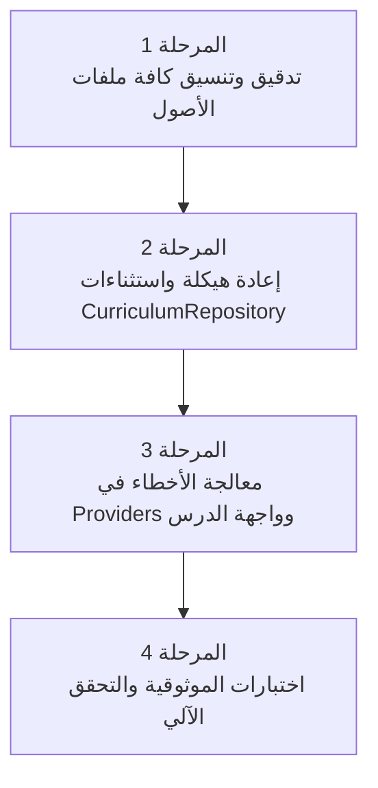

# خطة التنفيذ للإصلاحات العاجلة للمنهج والموثوقية (Critical Fixes Execution Plan)

---

## 🎯 الهدف والنطاق

تهدف هذه الخطة الإجرائية المفصلة إلى تنفيذ **الإصلاحات العاجلة (Critical Fixes)** التي تم تحديدها في وثيقة تقييم المنهج [`curriculum_evaluation.md`](./curriculum_evaluation.md).

تركز هذه المرحلة على معالجة المشكلات الهيكلية والتقنية في طبقة تحميل المنهج (`CurriculumRepository`)، وتأمين استقرار تطبيق **Learn GDScript** ضد الأخطاء غير المتوقعة (أصول مفقودة، JSON غير سليم، نصوص تالفة)، وضمان تقديم تجربة استخدام سلسة وموثوقة (Resilient UX) تمنع انهيار الشاشات.

---

## 📊 سجل التقدم والحالة الراهنة

- **تاريخ الإنشاء:** 22 أكتوبر 2026
- **الحالة العامة:** قيد التخطيط والمراجعة
- **المرجعية:**
  - [`docs/curriculum_evaluation.md`](./curriculum_evaluation.md)
  - [`lib/data/repositories/curriculum_repository.dart`](file:///home/osm/flutter_projects/learn_gdscript/lib/data/repositories/curriculum_repository.dart)
  - [`test/content_validation_test.dart`](file:///home/osm/flutter_projects/learn_gdscript/test/content_validation_test.dart)
  - [`test/curriculum_asset_bundle_test.dart`](file:///home/osm/flutter_projects/learn_gdscript/test/curriculum_asset_bundle_test.dart)

---

## 🛠️ النطاق والمخرجات المستهدفة

1. **سلامة بيانات الأصول (Asset Integrity Audit):**
   - الفحص التلقائي لجميع ملفات الـ JSON في المنهج (12 وحدة، 51 درساً) والتأكد من تطابق الهيكل والمعرفات وعدم وجود ملفات فارغة (0 بايت).

2. **تعزيز مرونة طبقة البيانات (`CurriculumRepository` Robustness):**
   - معالجة جميع الاستثناءات المحتملة أثناء قراءة الـ Asset Bundle وتحليل الـ JSON.
   - إنشاء صنف استثناءات مخصص `CurriculumException` للتمييز بين الأخطاء (درس غير موجود، خطأ تنسيق JSON، عدم مطابقة المعرفات).

3. **حماية واجهة المستخدم والـ Providers:**
   - تحديث `LessonProvider` و `LearningPathProvider` لاستقبال الأخطاء بمرونة.
   - عرض واجهة خطأ لطيفة (Fallback Error UI) داخل `LessonScreen` تُعلم المتعلم بحالة الدرس وإمكانية العودة لمسار التعلم بدلاً من الشاشة الحمراء (Red Screen of Death).

4. **التحقق الآلي وشبكة الأمان (Automated Verification):**
   - بناء وتحديث اختبارات الوحدة والـ Widget الخاصة بتمثيل الأخطاء والتحقق من سلامة تحميل كافة الدروس.

---

## 🗺️ المراحل الفرعية المتسلسلة للخطة التنفيذية



---

### 🔹 المرحلة الفرعية 1: تدقيق سلامة وهيكلية أصول المنهج (Asset & Schema Audit)

#### 🎯 الهدف:

التأكد من أن كافة الملفات المسجلة في `manifest.json` موجودة في المسارات الصحيحة وتطابق النماذج البرمجية بلا أخطاء صياغية.

#### 📝 المهام التفصيلية:

1. **فحص الـ Manifest والمجلدات:**
   - مراجعة [`assets/curriculum/manifest.json`](file:///home/osm/flutter_projects/learn_gdscript/assets/curriculum/manifest.json) والتحقق من مطابقة معرّفات الدروس والوحدات للقرص الصلب.
   - التأكد من وجود ملفات `unit.json` في المجلدات الـ 12.
2. **فحص وتدقيق الـ 51 ملف درس (`.json`):**
   - التحقق من عدم وجود أي ملف بحجم **0 بايت**.
   - التأكد من صحة فك ترميز الـ JSON وخلوه من الفواصل الزائدة (Trailing Commas) أو الأقواس غير المغلقة.
   - التحقق من وجود الحقول الأساسية لكل درس (`id`, `unitId`, `title`, `objective`, `contentMarkdown`, `documentation`, `exercises`).
3. **مطابقة معرّفات التمارين والاختبارات:**
   - التأكد من احتواء كل درس على 10 تمارين مضبوطة الأنواع والتلميحات.

#### 🚩 معيار الخروج للمرحلة 1:

- جميع ملفات الـ JSON الـ 51 صالحة للتحليل، ولا يوجد ملف فارغ أو مفقود غير مسجل.

---

### 🔹 المرحلة الفرعية 2: تعزيز مرونة طبقة البيانات (`CurriculumRepository` Robustness)

#### 🎯 الهدف:

إعادة كتابة وتأمين `CurriculumRepository` بحيث لا يتسبب أي خطأ في أصول المنهج في انهيار غير محكوم للتطبيق.

#### 📝 المهام التفصيلية:

1. **تعريف استثناءات المنهج المخصصة (`CurriculumException`):**
   - إضافة أصناف استثناءات واضحة في [`lib/data/repositories/curriculum_repository.dart`](file:///home/osm/flutter_projects/learn_gdscript/lib/data/repositories/curriculum_repository.dart):
     ```dart
     sealed class CurriculumException implements Exception {
       final String message;
       const CurriculumException(this.message);
     }
     class LessonNotFoundException extends CurriculumException { ... }
     class LessonParseException extends CurriculumException { ... }
     class ManifestParseException extends CurriculumException { ... }
     ```
2. **تأمين دالة `loadCurriculum()`:**
   - التقاط استثناءات تحميل ملف الـ Manifest أو تحليله وتغليفها بشرط دلالي واضح.
3. **تأمين دالة `loadLesson()`:**
   - فحص وجود الملف قبل التحليل.
   - إلقاء `LessonNotFoundException` مع معرف الدرس والوحدة إذا تعذر العثور على أصل الدرس في الـ AssetBundle.
   - إلقاء `LessonParseException` إذا كان الـ JSON غير صالح أو فارغاً.

#### 🚩 معيار الخروج للمرحلة 2:

- `CurriculumRepository` يطلق استثناءات مخصصة ومفهومة بدلاً من `TypeError` أو `FlutterError` الخام.

---

### 🔹 المرحلة الفرعية 3: معالجة الأخطاء في Providers وواجهة الدرس (Graceful Fallback UI)

#### 🎯 الهدف:

عرض واجهات خطأ واضحة ومصممة بعناية داخل التطبيق عند فشل تحميل أي درس، مع منح المستخدم خيار العودة أو إعادة المحاولة.

#### 📝 المهام التفصيلية:

1. **تحديث `LessonProvider` / `LearningPathProvider`:**
   - معالجة الأخطاء القادمة من `CurriculumRepository` وتغيير حالة المزود إلى `LessonState.error(message)`.
2. **تحديث شاشة الدرس (`LessonScreen`):**
   - دعم حالة الخطأ بإنشاء ودجت مخصص [`LessonErrorWidget`](file:///home/osm/flutter_projects/learn_gdscript/lib/ui/widgets/lesson_error_widget.dart).
   - عرض رسالة توضيحية بالعربية والإنجليزية (مثال: *"عذراً، هذا الدرس قيد الصيانة أو غير متوفر حالياً"*).
   - توفير زرين: *"إعادة المحاولة"* و *"العودة لمسار التعلم"*.
3. **تحديث شاشة مسار التعلم (`LearningPathScreen`):**
   - إظهار مؤشر بصري على البطاقات غير المتوفرة أو المقفلة لحماية المتعلم قبل الضغط عليها.

#### 🚩 معيار الخروج للمرحلة 3:

- عند محاولة فتح درس تالف أو مفقود، تظهر واجهة مخصصة تمنع انهيار الشاشة وتتيح العودة لمسار التعلم بنجاح.

---

### 🔹 المرحلة الفرعية 4: التثبيت والتحقق الآلي (Automated Testing & Verification)

#### 🎯 الهدف:

كتابة وتأكيد كافة اختبارات الوحدة والواجهة للتأكد من عدم تراجع النظام مستقبلاً (Regression Testing).

#### 📝 المهام التفصيلية:

1. **تحديث `test/curriculum_asset_bundle_test.dart`:**
   - التأكد من إمكانية تحميل كل الدروس الـ 51 من الـ AssetBundle الحقيقي بنجاح.
2. **تحديث `test/content_validation_test.dart`:**
   - التأكد من نجاح اختبار فحص المحتوى بالكامل وقراءة جميع الحقول والتمارين الـ 510.
3. **إضافة اختبارات وحدة جديدة لـ `CurriculumRepository`:**
   - محاكاة AssetBundle يعيد ملفاً تالفاً أو غير موجود والتحقق من إطلاق `LessonNotFoundException` و `LessonParseException`.
4. **إضافة اختبارات واجهة لـ `LessonScreen` في حالة الخطأ:**
   - التأكد من ظهور رسالة الخطأ وزر العودة عند إمداد الشاشة بحالة خطأ.

#### 🚩 معيار الخروج للمرحلة 4:

- اجتياز جميع اختبارات `flutter test` بدون أي إخفاق.

---

## 📋 قائمة المراجعة النهائية والتحقق (Checklist)

- [ ] إتمام المرحلة الفرعية 1: تدقيق الأصول والـ 51 ملف JSON.
- [ ] إتمام المرحلة الفرعية 2: إعادة هيكلة استثناءات `CurriculumRepository`.
- [ ] إتمام المرحلة الفرعية 3: إضافة واجهة الخطأ اللطيفة زر الاسترجاع في `LessonScreen`.
- [ ] إتمام المرحلة الفرعية 4: تشغيل واجتياز مجموعة الاختبارات الآلية `flutter test`.
