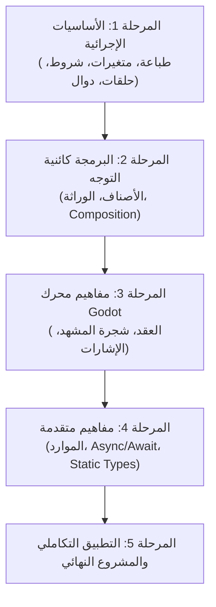

# تقييم وتحليل المنهج التعليمي لمشروع Learn GDScript

---

## 1. المقدمة ونطاق التقييم

يهدف مشروع **Learn GDScript** إلى تقديم تجربة تعليمية تفاعلية متكاملة باللغتين العربية والإنجليزية لتعلم لغة البرمجة **GDScript 4.x** الخاصة بمحرك الألعاب **Godot Engine 4**.

تتناول هذه الوثيقة تقييم وتفسير المنهج التعليمي الحالي للمشروع من نواحي متعددة:

1. **البنية التخطيطية والتقدم:** مقارنة المنهج المخطط المكتوب في الفهرس (`manifest.json`) بالملفات التنفيذية الفعلية المتوفرة في مجلدات الأصول (`assets/curriculum/units/`).
2. **المنهجية التربوية والبيداغوجية:** تقييم تسلسل المفاهيم، العبء المعرفي، وتدرج التمارين.
3. **التوافق التقني مع GDScript 4.x ومحرك Godot:** مدى شمولية المفاهيم الحديثة للغة ومطابقتها لأفضل ممارسات المحرك.
4. **جودة التفاعلية ونظام التمارين:** تحليل أنواع التمارين والتحقق الآلي ومستوى الأسئلة.
5. **جودة الثنائية اللغوية والتوثيق المرجعي:** التوازن بين الصياغة العربية والمصطلحات الإنجليزية وحقوق الملكية الفكرية.
6. **التكامل مع نظام التلعيب (Gamification):** ربط المنهج بنظام الخبرة (XP) والتتابع اليومي (Streaks) والشارات.

---

## 2. الوضع الحالي للمنهج: المخطط مقابل المنفذ فعلياً

### 2.1 المنهج المخطط (الرؤية الكاملة)
وفقاً لـ `assets/curriculum/manifest.json` وخطة التنفيذ `docs/curriculum_12_units_implementation_plan.md`، يتكون المسار الكامل من:

- **12 وحدة تعليمية** تتبع التدرج المنطقي للمتعلم من مرحلة المبتدئ وحتى بناء مشروع ألعاب متكامل.
- **51 درساً تعليمياً** يغطي كل منها مفهوماً محدداً.
- **510 تمرين تفاعلي** (بمعدل 10 تمارين لكل درس).

| رقم الوحدة | اسم الوحدة | عدد الدروس المخططة | الحالة الراهنة في الأصول |
| :---: | :--- | :---: | :---: |
| **01** | البداية وأساسيات السكربت | 3 دروس | 3 دروس منفذة |
| **02** | القيم والمتغيرات والأنواع | 5 دروس | 5 دروس منفذة |
| **03** | التعبيرات والقرارات | 4 دروس | 4 دروس منفذة |
| **04** | التكرار والحاويات | 5 دروس | 5 دروس منفذة |
| **05** | الدوال والتصميم | 5 دروس | 5 دروس منفذة |
| **06** | الأصناف والخصائص (OOP) | 5 دروس | 5 دروس منفذة؛ حُسّنت أسئلة المفاهيم والمهام العملية |
| **07** | Godot — العقد وشجرة المشهد | 5 دروس | 5 دروس منفذة؛ حُسّنت أسئلة المفاهيم والمهام العملية |
| **08** | التفاعل والأحداث (Signals & Input) | 4 دروس | 4 دروس منفذة؛ حُسّنت أسئلة المفاهيم والمهام العملية |
| **09** | خصائص المحرر والموارد | 4 دروس | 4 دروس منفذة؛ أصبحت تحديات الشيفرة مرتبطة بسياق الدرس |
| **10** | الزمن والعمليات غير المتزامنة (`await`) | 4 دروس | 4 دروس منفذة؛ أصبحت تحديات الشيفرة مرتبطة بسياق الدرس |
| **11** | الأنواع والتحليل وجودة الشيفرة | 4 دروس | 4 دروس منفذة؛ أصبحت تحديات الشيفرة مرتبطة بسياق الدرس |
| **12** | تطبيق تكاملي | 3 دروس | 3 دروس منفذة؛ أصبحت تحديات الشيفرة مرتبطة بسياق الدرس |

### 2.2 الثغرات والعيوب التقنية المكتشفة في الملفات الحالية

أُعيد فحص الأصول الحالية في 26 أكتوبر 2026: الوحدات الاثنتا عشرة موجودة، وجميع الدروس الـ51 المشار إليها في الفهرس لها ملفات JSON، ولكل درس 10 تمارين (510 إجمالاً). الدرس `lesson_05_operations` موجود ضمن مجلد الوحدة الثالثة `03_conditions`، وليس ضمن `02_variables` كما ورد في النسخة السابقة من هذا التقييم. لذلك فالملاحظات القديمة عن غياب الوحدات 06–12 وعن الملف الفارغ وعدم تطابق الفهرس لم تعد تصف الحالة الحالية.

تركز المراجعة الأخيرة على جودة أسئلة الوحدات 06–12: صيغت أسئلة الاختيار من متعدد والمهام الموجهة في الوحدات 06–08 حول مفاهيم الدروس، وأصبحت تحديات الشيفرة في الوحدات 09–12 تستخدم مدخلات اختبار متعددة وحسابات مرتبطة بسياق كل درس. يظل الاختيار من متعدد والمهام الموجهة دون `testCases` عمداً؛ فهذا هو عقد النموذج واختبار التحقق الحالي، وتُراجع هاتان الفئتان عبر الإجابات الصحيحة والخطوات على التوالي.

---

## 3. التقييم التربوي والبيداغوجي (Pedagogical Evaluation)

### 3.1 التسلسل التعليمي وتدفق المفاهيم
يمتلك المنهج هيكلية ممتازة منطقياً، حيث يعتمد مبدأ **التعلم المتدرج (Scaffolded Learning)**:

#### جوانب القوة في التسلسل:

- **الفصل الحكيم بين أساسيات GDScript ومفاهيم Godot:** يبدأ المنهج بتعليم البرمجة المحضة (Pure Programming) أولاً قبل خلطها بدورة حياة العقد والشجرة، مما يمنع تشتت المبتدئين.
- **التدرج اللطيف:** الانتقال من المتغيرات البسيطة إلى الحاويات (Arrays & Dictionaries) ثم الدوال يمهد الطريق لفهم الأصناف والخصائص لاحقاً.

### 3.2 العبء المعرفي والتعلم المصغر (Micro-learning)

- تُمثل كل وحدة مجموعة دروس مركزة بغرض عدم تجاوز زمن الدرس 8-15 دقيقة (`estimatedMinutes`).
- ينقسم الدرس الواحدة إلى:
  - **الشرح الأكاديمي المكتوب** (`contentMarkdown`).
  - **مثال حي قابل للتجربة** (`exampleCode`).
  - **التوثيق المرجعي الأعمق** (`documentation`).
  - **سلسلة التمارين** (`exercises`).

### 3.3 تقييم نظام التمارين والتفاعلية

يحتوي كل درس منفذ على 10 تمارين تتنوع أشكالها وفق التالي:

1. **`multipleChoice` (اختيار من متعدد):** للتحقق من المفاهيم والنظريات.
2. **`guidedTask` (مهمة تطبيقية موجّهة):** توجيه المستخدم لتطبيق فكرة في محرر Godot الحقيقي.
3. **`predictOutput` (تنبأ بالناتج):** تحليل الشيفرات وقراءة سياق التنفيذ قبل تشغيله.
4. **`fixBug` (تصحيح الأخطاء):** اكتشاف وتعديل الأخطاء الصياغية أو المنطقية.
5. **`writeCode` (كتابة الشيفرة):** بناء الحل من الصفر أو إكمال الجزء المفقود وتأكيده باختبارات ناتجة (`testCases`).

#### نقد وتقييم جودة الأسئلة الحالية:

- **نقطة ضعف في جودة خيارات الأسئلة النظرية:** في بعض الدروس الأولى، تجد خيارات الاختيار من متعدد عامة جداً (مثل: *"ما الفكرة الأساسية؟ فهم القاعدة وتطبيقها"* مقابل *"تجاهل ترتيب التنفيذ"*). هذه الأسئلة لا تقيس فهم GDScript بدقة، بل تقيس الفطرة السليمة.
- **ملاحظة حول `guidedTask`:** المهام الموجهة حالياً تُصنف كـ "تدريب ذاتي لا يتم فحصه آلياً". ينبغي تعزيزها بإرشادات واضحة أو استبدال بعضها بتحديات برمجة برمجية مقيدة إذا كانت الواجهة لا تدعم الاتصال المباشر بالمحرر الخارجي.

---

## 4. التوافق مع لغة GDScript 4.x ومحرك Godot

### 4.1 التوافق مع الإصدار الرابع (Godot 4.x Alignment)
يظهر المنهج توافقاً رائعاً مع التحديثات الرئيسية في GDScript 4:

- استخدام صياغة الإشارات الجديدة: `signal.connect(callable)` بدلاً من النصوص القديمة في Godot 3.
- دعم صياغة `match` المتطورة للنمذجة والتحقق من الأنماط (Pattern Matching).
- التركيز على `await` بدلاً من `yield` المتروكة.
- التعرّف على مزايا الأنواع الساكنة (`static typing`) والمصفوفات المحددة النوع (`Array[int]`).
- استخدام الـ Annotations الجديدة مثل `@export` و `@onready`.

### 4.2 الربط بعمارة محرك Godot (Engine Paradigm Alignment)
تم تصميم الوحدات المتأخرة (الوحدات 7–10) لتبني أفضل ممارسات Godot:

- قاعدة **Call Down, Signal Up** (الاستدعاء للأسفل، والإشارات للأعلى) موضحة ضمن دروس الإشارات والعقد.
- الفصل بين البيانات والمنطق عبر **الموارد المخصصة (Custom Resources)** في الوحدة 9.
- استخدام دورة حياة العقدة الصحيحة (`_ready`, `_process`, `_physics_process`).

---

## 5. جودة الدعم ثنائي اللغة والتوثيق المرجعي

### 5.1 ثنائية اللغة (Arabic & English Support)

- جميع النصوص البشرية (العناوين، الأهداف، الشرح، التلميحات، أسماء التمارين) مصممة بخصائص مزدوجة (`ar` / `en`).
- تعريب المصطلحات البرمجية ممتاز بدون تشويه الصياغة: تبقى أسماء الكلمات المفتاحية (`var`, `func`, `extends`, `signal`) باللغة الإنجليزية كما هي في المحرر، بينما يُشرح مفهومها باللغة العربية.

### 5.2 التوثيق المرجعي وحقوق الملكية الفكرية

- يتضمن كل درس قسماً مرجعياً (`documentationSources`) يربط الدرس بصفحات توثيق Godot الرسمية.
- المنهج ملزم بمتطلبات ترخيص **CC BY 3.0** الخاص بتوثيق Godot Engine، مع وجود إسناد قانوني صريح يوضح أن الشرح هو صياغة تعليمية مستقلة.

---

## 6. التكامل مع نظام التلعيب (Gamification Integration)

يرتبط المنهج التعليمي ارتباطاً وثيقاً بنظام التلعيب المبني في المرحلة 4 (`gamification_service.dart`, `badge_evaluator.dart`):

- **نقاط XP:** يحصل المتعلم على XP عند إكمال كل درس، مع مكافآت إضافية للإجابة من المحاولة الأولى، ومكافأة كبرى عند إكمال الوحدة بالكامل.
- **الشارات والوسامات (Badges):** هناك شارات مخصصة تقدم المنهج مثل:
  - `badge_first_lesson`: إكمال أول درس في المنهج.
  - `badge_unit_1_complete` إلى `badge_unit_5_complete`: شارات إكمال الوحدات.
  - `badge_graduate`: وسام "خريج المسار" الممنوح عند إكمال جميع الوحدات التعليمية.

---

## 7. مصفوفة SWOT للمنهج التعليمي

| نقاط القوة (Strengths) | نقاط الضعف (Weaknesses) |
| :--- | :--- |
| • هيكلية متدرجة ومنطقية تفصل البرمجة عن المحرك ثم تدمجهما. • دعم كامل ومتقن للثنائية اللغوية (عربي/إنجليزي). • تغطية ممتازة لميزات GDScript 4.x الحديثة. • اكتمال الأصول: 12 وحدة و51 درساً و510 تمارين. • تنوع التمارين، واختبارات تنفيذية بمدخلات متعددة للتمارين البرمجية، وتلميحات متدرجة. • تكامل سلس مع محرك التلعيب وشارات الإنجاز. | • لا تُفحص المهام الموجهة آلياً؛ فهي أنشطة تطبيقية يراجعها المتعلم داخل Godot. • تبقى مراجعة دقة أمثلة الشيفرة وسياقات الاختبارات مع تغيّر إصدارات Godot حاجة مستمرة. |
| **الفرص (Opportunities)** | **التهديدات والمخاطر (Threats)** |
| • إمكانية إضافة ممرر أو محاكي بصري لشجرة المشهد (Scene Tree Simulator) داخل التطبيق. • توسيع نطاق المنهج ليشمل مشاريع ألعاب دقيقة (مثل ألعاب 2D منصات أو ألعاب ألغاز). • دعم تمارين سحب وإسقاط (Drag & Drop) لبناء الشيفرات للمبتدئين. | • صعوبة التحقق الآلي من ميزات تتطلب مشهد Godot فعلياً، مثل دورة حياة العقد والإشارات والموارد. • احتمال تباعد أمثلة GDScript عن واجهات Godot عند تحديث المحرك. • احتماء صعوبة المفاهيم عند الانتقال المفاجئ من البرمجة البسيطة إلى الأصناف المعقدة. |

---

## 8. التوصيات وخطة العمل الإجرائية (Actionable Recommendations)

لرفع كفاءة المنهج التعليمي واكتشافه وتوفير أفضل تجربة للمتعلم، نوصي بتنفيذ الخطوات التالية بالترتيب:

### 🔴 أولاً: الإصلاحات العاجلة (Critical Fixes)

1. كانت الملاحظات المتعلقة بدرس فارغ وأصول مفقودة مبنية على لقطة قديمة؛ أظهر الجرد الحالي أن الأصول المشار إليها في الفهرس موجودة. أعد التحقق من سلامة الأصول عند إضافة دروس أو وحدات جديدة.
2. استمر في اختبار أخطاء تحميل JSON والأصول المفقودة في `CurriculumRepository` من خلال اختبارات المستودع، مع عرض الخطأ بوضوح بدلاً من إخفائه.

### 🟡 ثانياً: إكمال المحتوى التعليمي (Content Completion)

اكتملت هذه المرحلة وفق الفهرس الموجود: الوحدات 06–12 تضم 29 درساً و290 تمريناً، والمنهاج كله يضم 51 درساً و510 تمارين. رقم «37 درساً متبقياً» الوارد في النسخة القديمة لا يطابق توزيع الدروس الحالي، لذا ينبغي تحديثه إذا ظهرت خطة أحدث معتمدة.

### 🟢 ثالثاً: تحسين وتجويد المحتوى والأنشطة (Content Enhancement)

1. مراجعة الخيارات والتلميحات بشكل دوري للتأكد من أن كل سؤال يقيس مفهوم درسه وأن موضع الإجابة الصحيحة لا يمكن تخمينه من نمط ثابت.
2. إبقاء المهام الموجهة كتقييم ذاتي ما دامت تتطلب مشروع Godot حقيقياً؛ لا تضف لها اختبارات آلية شكلية لا تتحقق من المشهد أو الإشارة الفعلية.
3. تشغيل اختبارات المحتوى والتنفيذ عند تغيير أمثلة الشيفرة، وإعادة مراجعة روابط توثيق Godot الرسمية دورياً.

---

## 9. الخلاصة

يُعد المنهج التعليمي لمشروع **Learn GDScript** مشروعاً واعداً ومصمماً وفق أسس تربوية وتقنية متينة. تكمن القوة الحقيقية للمنهج في تدرجه الذكي، ودعمه الممتاز للغة العربية إلى جانب الإنجليزية، واعتماده على المعايير الحديثة لمحرك Godot 4.

اكتملت ملفات المنهاج المشار إليها في الفهرس، ويتركز التحسين اللاحق على الحفاظ على دقة المحتوى واختبار الأمثلة وتطوير تقييم عملي للميزات التي تتطلب تشغيل مشروع Godot حقيقياً.
