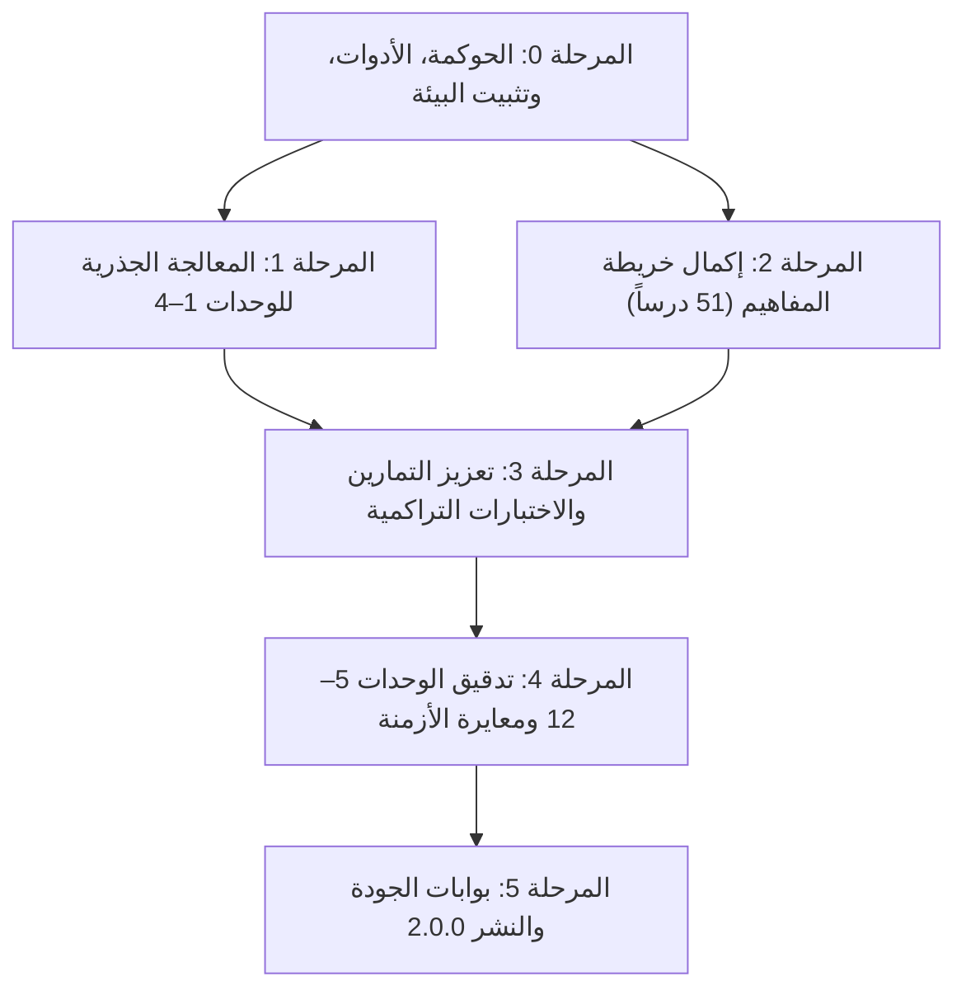

# الخطة التنفيذية لمعالجة وتطوير المنهج التعليمي — تطبيق تعلّم GDScript

> **تاريخ الاعتماد:** 2026-10-27  
> **المرجع الأساسي:** [تحليل وتقييم المنهج التعليمي](file:///home/osm/flutter_projects/learn_gdscript/docs/curriculum_analysis.md)  
> **الهدف:** سد جميع الفجوات التعليمية والتقنية ورفع تقييم المنهج من 3.2 إلى 4.8 / 5  
> **إصدار المنهج المستهدف:** 2.0.0 — Godot 4.3+

---

## فهرس الخطة

1. [الرؤية والأهداف التنفيذية](#1-الرؤية-والأهداف-التنفيذية)
2. [مصفوفة الفجوات وخرائط المعالجة](#2-مصفوفة-الفجوات-وخرائط-المعالجة)
3. [المعايير المنهجية الموحدة (دستور التأليف والتقييم)](#3-المعايير-المنهجية-الموحدة-دستور-التأليف-والتقييم)
   - [3.5 معيار التوجيهات الرسمية لـ GDScript (التحذيرات، المعلومات، والتوصيات)](#35-معيار-التوجيهات-الرسمية-لـ-gdscript-التحذيرات-المعلومات-والتوصيات)
4. [مراحل التنفيذ المتسلسلة](#4-مراحل-التنفيذ-المتسلسلة)
   - [المرحلة 0: الحوكمة، الأدوات، وتثبيت البيئة التقنية](#المرحلة-0-الحوكمة-الأدوات-وتثبيت-البيئة-التقنية)
   - [المرحلة 1: المعالجة الجذرية للوحدات التأسيسية (الوحدات 1–4)](#المرحلة-1-المعالجة-الجذرية-للوحدات-التأسيسية-الوحدات-14)
   - [المرحلة 2: إكمال خريطة المفاهيم والعلاقات التفاعلية (37 درساً)](#المرحلة-2-إكمال-خريطة-المفاهيم-والعلاقات-التفاعلية-37-درسا)
   - [المرحلة 3: تعزيز التمارين وحالات الاختبار والتحديات التراكمية](#المرحلة-3-تعزيز-التمارين-وحالات-الاختبار-والتحديات-التراكمية)
   - [المرحلة 4: تدقيق الوحدات المتقدمة (5–12) ومعايرة الأوزان الزمنية](#المرحلة-4-تدقيق-الوحدات-المتقدمة-512-ومعايرة-الأوزان-الزمنية)
   - [المرحلة 5: بوابات الجودة، الاختبار والتكامل، ونشر الإصدار 2.0.0](#المرحلة-5-بوابات-الجودة-الاختبار-والتكامل-ونشر-الإصدار-200)
5. [الجدول الزمني ومسار الاعتماديات (Roadmap & Dependencies)](#5-الجدول-الزمني-ومسار-الاعتماديات)
6. [مصفوفة الأدوار والمسؤوليات (RACI Matrix)](#6-مصفوفة-الأدوار-والمسؤوليات-raci)
7. [مؤشرات الأداء والقياس (KPIs & Verification Gates)](#7-مؤشرات-الأداء-والقياس)
8. [استراتيجية الحفاظ على بيانات المستخدمين والترحيل (Data Migration Strategy)](#8-استراتيجية-الحفاظ-على-بيانات-المستخدمين-والترحيل)

---

## 1. الرؤية والأهداف التنفيذية

أظهرت وثيقة [تحليل المنهج التعليمي](file:///home/osm/flutter_projects/learn_gdscript/docs/curriculum_analysis.md) أن التطبيق يتمتع ببنية هندسية صلبة بمعمارية Dart/JSON ونظام تقدم وتلعيب ممتاز (تقييم 5/5)، في حين يعاني المحتوى التعليمي في مراحله الأولى من **إيجاز مفرط ونمطية قالبية** تُهدد احتفاظ المتعلم المبتدئ بالرغبة في المتابعة (تقييم 2/5).

### الأهداف الاستراتيجية للخطة

1. **القضاء التام على القوالب المتكررة:** استبدال 100% من الأسئلة القالبية والتلميحات العامة والشروح المنسوخة بأسئلة وتلميحات وشروح مخصصة لكل درس بعينه.
2. **الارتقاء بالعمق التعليمي:** تحويل كل درس من فقرة مجردة ومثال وحيد إلى وحدة تعلّم متكاملة مبنية وفق نموذج الأركان الخمسة للتعليم البرمجي.
3. **التغطية البصرية الشاملة لخريطة المفاهيم:** رفع نسبة تمثيل الدروس في خريطة المفاهيم من 27.5% (14 درساً فقط) إلى 100% (51 درساً كاملاً).
4. **المتانة البرمجية لحالات الاختبار:** ضمان وجود ما لا يقل عن 2–3 حالات اختبار لكل تمرين كتابة شيفرة مع تغطية الحالات الحدية (Edge Cases).
5. **الربط التراكمي للمفاهيم:** إضافة تحدٍ تركيبي في نهاية كل وحدة يدمج مفاهيمها قبل الانتقال للوحدة اللاحقة.

---

## 2. مصفوفة الفجوات وخرائط المعالجة

تُلخّص المصفوفة التالية نقاط الضعف الست المحددة في التحليل، والحل الجذري المعتمد، ومرحلة التنفيذ المسؤولة:

| المعرف | نقطة الضعف المرصودة | درجة الخطورة | الحل الجذري المعتمد | المرحلة المسؤولة |
| --- | --- | :---: | --- | :---: |
| **GAP-01** | محتوى الوحدات 1–4 قالبي، سطحي، وأسئلة الاختيار من متعدد متطابقة في كل الدروس، والإجابة الصحيحة دائماً الأولى | 🔴 حرجة | إعادة تأليف كاملة لـ 17 درساً وفق معيار الأركان الخمسة + أسئلة اختيار من متعدد مخصصة مع تنويع فهرس الإجابة الصحيحة | المرحلة 1 |
| **GAP-02** | خريطة المفاهيم تغطي 14 درساً فقط من أصل 51 (37 درساً مفقوداً تماماً في شبكة المفاهيم) | 🟡 متوسطة | تحديث `concept_map/manifest.json` بإضافة 37 عقدة مفهومية وربط علاقات الاعتماديات المسبقة وإحداثيات الرسم | المرحلة 2 |
| **GAP-03** | حالات الاختبار (`testCases`) غير كافية (غالباً حالة وحيدة تفحص مطابقة نصية بسيطة) | 🟡 متوسطة | إضافة 2–3 حالات اختبار لكل تمرين برمجي تفحص المخرجات الطبيعية والحالات الحدية والقيم الصفرية والسالبة | المرحلة 3 |
| **GAP-04** | انعدام التقييم التراكمي والربط العملي في نهاية كل وحدة (دروس مفردة دون مشروع مصغر) | 🟡 متوسطة | إدراج تمرين تركيبي ختامي (Synthesis Capstone Task) في كل وحدة يربط مهاراتها بما قبلها | المرحلة 3 |
| **GAP-05** | المدد التقديرية للدروس (`estimatedMinutes`) غير واقعية مقارنة بالمحتوى و10 تمارين | 🟢 منخفضة | إعادة معايرة زمن الدروس واقعياً (10–20 دقيقة للدروس المتقدمة وتلك المحتوية على مهام موجهة) | المرحلة 4 |
| **GAP-06** | روابط التوثيق الرسمي تشير إلى المسار المتغير `/stable/` دون تثبيت إصدار Godot | 🟢 منخفضة | فحص الروابط الـ 75+ وتثبيت المسار على التوثيق الرسمي المستقر لإصدار Godot 4.3 | المرحلة 0 و 4 |

---

## 3. المعايير المنهجية الموحدة (دستور التأليف والتقييم)

لكي لا يتكرر الخطأ في أي مرحلة لاحقة، يُلزم فريق التطوير والمحتوى باعتماد هذا "الدستور التأليفي" كمعيار صارم غير قابل للتجاوز:

### 3.1 معيار بنية محتوى الدرس (نموذج الأركان الخمسة)

يجب أن يحتوي حقل `contentMarkdown.ar` في كل درس على الأقسام الخمسة التالية وجوباً:

```text
┌──────────────────────────────────────────────────────────────┐
│ 1. المفهوم والهدف: لماذا نحتاج هذه الميزة في سياق صناعة الألعاب؟  │
├──────────────────────────────────────────────────────────────┤
│ 2. الصياغة والقواعد: القواعد النحوية، البنية، والمعاملات     │
├──────────────────────────────────────────────────────────────┤
│ 3. مثال عملي مشروح سطر بسطر مع توضيح المدخلات والمخرجات      │
├──────────────────────────────────────────────────────────────┤
│ 4. أخطاء شائعة وتحذيرات: ما هي الأخطاء الشائعة وكيفية تجنبها؟  │
├──────────────────────────────────────────────────────────────┤
│ 5. قاعدة ذهبية وملخص من نقطتين للتطبيق العملي السريع         │
└──────────────────────────────────────────────────────────────┘
```

### 3.2 معيار أسئلة الاختيار من متعدد (`multipleChoice`)

1. **منع القوالب تماماً:** يُحظر استخدام أسئلة من قبيل: *"ما الفكرة الأساسية؟"* أو *"أي ممارسة تساعد؟"*.
2. **سياق السؤال:** يجب أن يطرح السؤال سيناريو برمجياً حقيقياً، كأن يعرض مقطع شيفرة ويسأل عن تصرف المحرك أو ناتج التنفيذ أو نوع الخطأ المتوقع.
3. **توزيع الإجابة الصحيحة:** يُحظر جعل الإجابة الصحيحة عند الفهرس `0` بشكل دائم؛ يجب توزيع الفهرس `correctOptionIndex` عشوائياً بين `0` و `1` و `2`.
4. **جودة الخيارات المشتتة (Distractors):** يجب أن تمثل المشتتات أخطاء مفاهيمية يقع فيها المبرمجون بالفعل (Plausible Misconceptions)، لا مجرد جمل غير منطقية.

### 3.3 معيار التلميحات المتدرجة (Three-Tier Hints)

لكل تمرين تلميحان على الأقل يصاغان وفق السلّم التالي:

- **التلميح 1 (توجيه مفاهيمي):** تذكير بالدالة أو الكلمة المحجوزة أو المفهوم المطلوب استخدامه دون إعطاء الشيفرة.
- **التلميح 2 (هيكل وبنية):** إعطاء شكل السطر أو القالب الناقص (Skeleton) مع إشارة إلى المعاملات المفقودة.

### 3.4 معيار تمارين كتابة الشيفرة وحالات التحقق

- منع تكرار تغيير النص في `print()` بين التمارين المتتالية لملء عدد الـ 10 تمارين.
- التدرج في التمارين العشرة للدرس:
  - التمارين 1–3: استدعاء وتطبيق مباشر للقاعدة.
  - التمارين 4–6: إكمال شيفرة وتصحيح أخطاء منطقية.
  - التمارين 7–9: كتابة منطق كامل يتعامل مع حالات متعددة.
  - التمرين 10: مسألة مصغرة تدمج فكرة الدرس مع فكرة سابقة.
- وجود حالتي تحقق (`testCases`) على الأقل لكل تمرين `writeCode` أو `fixBug` تغطي قيماً مختلفة للمدخلات وسلوك المخرجات.

### 3.5 معيار التوجيهات الرسمية لـ GDScript (التحذيرات، المعلومات، والتوصيات)

ربط المنهج التعليمي بالتوثيق الرسمي لمحرك Godot 4.3 لا يقتصر على سرد روابط في حقل `documentationSources`، بل يلزم دمج "الحكمة الهندسية" للمحرك داخل صلب الدرس عبر ثلاث كتل توجيهية قياسية (Callout Blocks) مقتبسة ومطابقة لتوثيق Godot الرسمي:

#### 1. تصنيف كتل التوجيهات الرسمية الثلاث

| النوع | الرمز | المعيار والهدف التعليمي | أمثلة تطبيقية من GDScript |
| --- | :---: | --- | --- |
| **تحذير رسمي (Official Warning)** | ⚠️ `[!WARNING]` | كشف السلوكيات الخطيرة أو الفخاخ غير البديهية (Gotchas) التي تسبب انهيار اللعبة (Crash)، تجميد المحرك، أو أخطاء حسابية صامتة. | - ناتج قسمة الأعداد الصحيحة `int / int`<br>- تجميد المحرك بحلقة `while` لانهائية<br>- كسر الذاكرة باستدعاء `free()` بدلاً من `queue_free()`<br>- تعليق `await` على عقدة محذوفة |
| **معلومة تقنية (Technical Note)** | ℹ️ `[!NOTE]` | شرح معماري لسلوك المحرك في الذاكرة وآليات التنفيذ تحت الغطاء لتعميق الفهم ومنع الخلط الذهني. | - تمرير المصفوفات والقواميس بالمرجع `Pass-by-reference`<br>- إدارة الذاكرة في `RefCounted` مقابل `Object`<br>- الفرق بين معالجة الإطارات `_process` و `_physics_process`<br>- استهلاك الأحداث في `_unhandled_input` |
| **توصية وممارسة فضلى (Best Practice)** | 💡 `[!TIP]` | إرشادات دليل أسلوب GDScript الرسمي (Style Guide) والقواعد المعمارية المعترف بها في مجتمع مطوري Godot. | - قاعدة تصميم المشاهد: "Signal Up, Call Down"<br>- تسريع الأداء بنسبة 30–40% بالأنواع الساكنة<br>- استخدام التعليقات التوثيقية `##` لتوليد التوثيق الداخلي<br>- تقييد المتغيرات المصدرة عبر `@export_range` |

#### 2. الصيغة البصرية المعتمدة في Markdown (`contentMarkdown`)

تُكتب هذه الكتل بصيغة التنبيهات القياسية المعتمدة ليتم تنسيقها بصرياً بألوان وأيقونات مميزة في واجهة التطبيق:

```markdown
> [!WARNING]
> **تحذير رسمي من Godot:** قسمة عددين صحيحين `5 / 2` تُنتج `2` دائماً وتتجاهل الكسر العشري. إذا أردت ناتجاً بالفاصلة العائمة، يجب تحويل أحد الطرفين صراحة: `float(5) / 2` أو كتابة `5.0 / 2`.

> [!NOTE]
> **معلومة هندسية:** المتغيرات من نوع `Array` و `Dictionary` تُمرر بالمرجع (Pass-by-reference)؛ أي أن تعديل محتواها داخل دالة فرعية سيُغير البيانات الأصلية مباشرة دون الحاجة لإرجاعها.

> [!TIP]
> **توصية رسمية (Best Practice):** التزم بقاعدة **"Signal Up, Call Down"**؛ نادِ دوال العقد التابعة (الأبناء) مباشرة، لكن تواصل مع العقد العلوية (الآباء) والمشاهد المحيطة عبر إطلاق الإشارات فقط لمنع الارتباط الوثيق (Tight Coupling).
```

#### 3. مصفوفة التوجيهات الرسمية الإلزامية عبر وحدات المنهج (Directives Canonical Map)

يُلزم كتّاب المحتوى بتضمين هذه التوجيهات الرسمية في الدروس المستهدفة وفق الجدول التالي:

| الوحدة | الدرس المستهدف | نوع التوجيه | نص التوجيه ومحتواه المستند لتوثيق Godot 4.3 |
| --- | --- | :---: | --- |
| **01. البداية** | `lesson_01_hello` | ℹ️ معلومة | دالة `_ready()` تُستدعى تلقائياً مرة واحدة فقط عندما تدخل العقدة وجميع أبنائها شجرة المشهد. |
| | `lesson_02_comments` | 💡 توصية | استخدام `##` للتوثيق الداخلي يجعل محرر Godot يعرض شرح المتغيرات والدوال في نافذة الفحص (Inspector Tooltip). |
| | `lesson_15_errors` | ⚠️ تحذير | تحذيرات المترجم (Yellow Warnings) قد لا توقف التشغيل الآن، لكنها غالباً تخفي ثغرات خطيرة تنهار عند تجميع اللعبة للتصدير. |
| **02. المتغيرات** | `lesson_04_types` | ⚠️ تحذير | الحذر من قسمة الأعداد الصحيحة `int / int` وفقدان الدقة العشرية في حساب سرعات وحركة اللعبة. |
| | `lesson_16_casting` | ℹ️ معلومة | تحويل `float` إلى `int` لا يقرب إلى أقرب رقم بل يقتطع الكسر كلياً (`int(4.9) == 4`). استخدم `round()` للتقريب. |
| | `lesson_17_strings` | 💡 توصية | استخدام `%s` أو `String.format()` بدلاً من الجمع المتكرر بـ `+`، لدعم الترجمة وفصل النصوص عن المنطق. |
| | `lesson_18_enums` | 💡 توصية | استخدم التعدادات المسماة (Named Enums) لحالات الشخصية بدلاً من الأرقام الصريحة لتفادي الأرقام السحرية (Magic Numbers). |
| **03. القرارات** | `lesson_06_if_else` | ⚠️ تحذير | الانتباه التام للفرق بين الإسناد `=` والمقارنة `==`. محرر Godot 4 يُطلق تحذيراً فورياً إذا أسندت قيمة داخل شرط. |
| | `lesson_08_match` | 💡 توصية | استخدام `match` بدلاً من سلاسل `elif` الطويلة يرفع سرعة الفحص ويجعل الشيفرة أكثر نظافة مع إلزامية وضع الحارس `_`. |
| **04. التكرار** | `lesson_10_while` | ⚠️ تحذير | الحلقات غير المنتهية في `while` تُجمد خيط معالجة اللعبة الرئيسي بالكامل وتتطلب قتل العملية قسرياً. |
| | `lesson_19_arrays` | ⚠️ تحذير | لا تقم بحذف أو إضافة عناصر لنفس المصفوفة أثناء الدوران عليها بحلقة `for`، لأن الفهارس تنزاح وينتج تخطٍ للعناصر. |
| | `lesson_20_dictionaries` | ℹ️ معلومة | قراءة مفتاح غير موجود في القاموس تسبب خطأ قاتلاً، استخدم دائماً دالة `dict.get(key, default)` أو افحص بـ `has(key)`. |
| **05. الدوال** | `lesson_21_scope` | ⚠️ تحذير | تظليل المتغيرات (Shadowing): تسمية معامل دالة بنفس اسم متغير صنف يؤدي إلى حجب المتغير الأصلي ووقوع أخطاء غير مقصودة. |
| **06. الأصناف** | `lesson_24_inheritance` | 💡 توصية | لا تضع `class_name` في كل سكربت؛ استخدمه فقط للأصناف التي تريد تسجيلها كعقدة مخصصة في نافذة إنشاء العقد بمحرر المحرك. |
| | `lesson_26_properties` | ⚠️ تحذير | في GDScript 4، كتابة `property = val` داخل نفس الصنف لا تستدعي دالة الـ setter؛ يجب استخدام `self.property = val`. |
| **07. المشهد** | `lesson_28_nodes` | ⚠️ تحذير | تجنب استخدام المسارات المطلقة مثل `get_node("/root/...")`؛ لأنها تتعطل فور إعادة ترتيب المشاهد في شجرة المشروع. |
| | `lesson_29_lifecycle` | ⚠️ تحذير | لا تستخدم `free()` على عقدة متصلة بالشجرة؛ استخدم `queue_free()` دائماً لجدولة الحذف الآمن في نهاية الإطار وتفادي المؤشرات المعلقة. |
| | `lesson_30_onready` | 💡 توصية | استخدام التعليق `@onready` يضمن عدم استدعاء `get_node()` إلا بعد جاهزية الشجرة، مما يمنع أخطاء `null instance`. |
| **08. التفاعل** | `lesson_33_signals` | 💡 توصية | قاعدة "Signal Up, Call Down": استدعِ دوال الأبناء مباشرة، لكن خاطب الآباء بالإشارات لمنع التشابك المعماري (Spaghetti Code). |
| | `lesson_35_input` | ℹ️ معلومة | استدعاء `get_viewport().set_input_as_handled()` عند معالجة حدث ما يمنع وصوله للعقد التالية في شجرة المشهد دون داعٍ. |
| **09. الموارد** | `lesson_37_exports` | 💡 توصية | قيد المدخلات دائماً باستخدام `@export_range(min, max, step)` لضمان عدم إدخال قيم خاطئة من نافذة الفحص بواسطة المصممين. |
| | `lesson_39_resources` | ℹ️ معلومة | كائنات الموارد `Resource` مشتركة في الذاكرة افتراضياً؛ تعديل مورد في عدو واحد سيُغيره لجميع الأعداء ما لم يُستنسخ بـ `duplicate()`. |
| **10. الزمن والـ async** | `lesson_41_await` | ⚠️ تحذير | إذا حُذفت العقدة المنتظر عليها قبل صدور الإشارة، ستبقى الدالة معلقة إلى الأبد في الذاكرة. افحص دائماً بـ `is_instance_valid()`. |
| **11. الجودة** | `lesson_45_static_types` | 💡 توصية | الأنواع الساكنة الصريحة (Static Typing) تُسرع أداء السكربت بنسبة تتجاوز 30% في Godot 4 بفضل تحسين التعليمات البرمجية. |
| | `lesson_48_style` | 💡 توصية | الالتزام الصارم بدليل الأسلوب الرسمي: `snake_case` للمتغيرات والدوال، و `PascalCase` للأصناف والعقد، و `CONSTANT_CASE` للتعدادات. |

---

## 4. مراحل التنفيذ المتسلسلة



---

### المرحلة 0: الحوكمة، الأدوات، وتثبيت البيئة التقنية

**الهدف:** بناء أدوات التحقق الآلي وصياغة أدوات مساعدة تمنع تسرب أي محتوى ضعيف وتضمن سلامة البنية قبل كتابة حرف واحد في المنهج.

#### المهام التنفيذية التفصيلية

1. **تطوير سكريبت التدقيق المنهجي الشامل (`tools/validate_curriculum.dart`):**
   - فحص ملفات JSON لكل الدروس والوحدات.
   - التحقق من عدم تكرار نصوص التلميحات عبر تمارين الدرس الواحد والوحدة.
   - التحقق من تباين مؤشر الإجابة الصحيحة في أسئلة `multipleChoice` عبر الدرس والتأكد من أنه ليس دائماً `0`.
   - فحص وجود حقلين لاختبارات التحقق (`testCases`) على الأقل لتمارين الشيفرة.
   - التحقق من أن جميع روابط `documentationSources` تعمل وتتبع موقع Godot الرسمي المعتمد.
   - التحقق من تطابق معرفات الدروس في `manifest.json` و`unit.json` وخريطة المفاهيم `concept_map`.
   - التحقق الآلي من تضمين كتل التوجيهات الرسمية الثلاث (`[!WARNING]`, `[!NOTE]`, `[!TIP]`) في الدروس الإلزامية المحددة في مصفوفة التوجيهات الرسمية.

2. **تثبيت إصدار التوثيق الرسمي ومطابقة النماذج:**
   - اعتماد التوثيق الرسمي للإصدار المستقر الحديث (Godot 4.3).
   - توحيد روابط المراجع إلى الصيغة: `https://docs.godotengine.org/en/4.3/...` أو الإبقاء على الروابط الرسمية المعتمدة والتأكد من استقرار مساراتها.

3. **إعداد قوالب المطورين (Authoring Starter Kits):**
   - توفير ملف نموذجي استرشادي (`lesson_template.json`) يحتوي على الأركان الخمسة والأنواع السبعة للتمارين كمرجع للكتّاب.

**المخرجات المعتمدة:**

- أداة تدقيق آلي جاهزة في المستودع وقابلة للتشغيل عبر الأوامر السريعة.
- تقرير التدقيق المبدئي بصفر أخطاء تركيبية.

---

### المرحلة 1: المعالجة الجذرية للوحدات التأسيسية (الوحدات 1–4)

**الهدف:** إعادة تأليف 17 درساً (170 تمريناً) تشكل الأساس الحاكم لتجربة المستخدم في المراحل المبكرة لسد الفجوة الحرجة 🔴 **GAP-01**.

```text
الوحدات المستهدفة:
├── الوحدة 01: البداية وأساسيات السكربت (3 دروس: 01, 02, 15) ─── 30 تمريناً
├── الوحدة 02: القيم والمتغيرات والأنواع (5 دروس: 03, 04, 16, 17, 18) ─── 50 تمريناً
├── الوحدة 03: التعبيرات والقرارات (4 دروس: 05, 06, 07, 08) ─── 40 تمريناً
└── الوحدة 04: التكرار والحاويات (5 دروس: 09, 10, 11, 19, 20) ─── 50 تمريناً
```

#### تفاصيل خطة التدخل لكل وحدة

#### 1.1 الوحدة 01: البداية وأساسيات السكربت (Lessons 01, 02, 15)

- **الدرس 01 (`lesson_01_hello`):**
  - **المحتوى:** لا نكتفي بـ `print("Hello")`. يشرح الدرس بيئة Godot: ما هو السكربت؟ أين يُرفق؟ الفرق بين محرر الشيفرة ولوحة الإخراج (Output Dock)، وكيف يتم تنفيذ السطور تسلسلياً داخل دالة `_ready()`.
  - **التمارين:** التدرج من طباعة رسائل متعددة، طباعة أرقام، جمع نصوص، وتصحيح نسيان الأقواس أو علامات التنصيص.
  - **أسئلة الاختيار:** فحص وظيفة لوحة الإخراج، ترتيب تنفيذ الأسطر، وسلوك `print()`.
- **الدرس 02 (`lesson_02_comments`):**
  - **المحتوى:** التعليقات بسطر واحد `#` والتعليقات التوثيقية `##`، متى ولماذا نعلّق على الشيفرة؟ كيف تساعد التعليقات عند العمل في فريق ألعاب؟
  - **التمارين:** تفعيل وتعطيل أسطر برمجية (Comment out)، إضافة توثيق لدالة، وتمييز السطور التي ستُنفذ عن المعطلة.
- **الدرس 15 (`lesson_15_errors`):**
  - **المحتوى:** تشريح رسائل الأخطاء في Godot: الفرق بين أخطاء الصياغة (Syntax Errors) وأخطاء وقت التشغيل (Runtime Errors) وتحذيرات المترجم (Warnings).
  - **التمارين:** قراءة تتبع المكدس (Stack Trace) البسيط، تصحيح أسماء دوال مكتوبة خطأ، ومعالجة أخطاء الفاصلة والأقواس.

#### 1.2 الوحدة 02: القيم والمتغيرات والأنواع (Lessons 03, 04, 16, 17, 18)

- **الدرس 03 (`lesson_03_variables`):** الإعلان باستخدام `var`، قواعد تسمية المتغيرات (snake_case)، إعادة التعيين وتتبع تغير القيمة عبر الزمن في سياق لعبة (مثل: نقاط اللاعب، سرعة الحركة).
- **الدرس 04 (`lesson_04_types`):** الأنواع البدائية (`int`, `float`, `String`, `bool`) وسلوك كل نوع في الذاكرة والحسابات (مثل مشكلة قسمة الأعداد الصحيحة).
- **الدرس 16 (`lesson_16_casting`):** تحويل الأنواع الصريح باستخدام الدوال البانية (`str()`, `int()`, `float()`) والتحويل التلقائي ومخاطر فقدان الدقة عند تحويل الفاصلة إلى صحيح.
- **الدرس 17 (`lesson_17_strings`):** عمليات السلاسل النصية، الربط (`+`)، التنسيق عبر `%` و `String.format()`، وحساب الطول واقتطاع النصوص لرسائل الحوار في اللعبة.
- **الدرس 18 (`lesson_18_enums`):** استخدام `enum` لتمثيل حالات اللعبة (PlayerState: IDLE, RUN, JUMP, DEAD)، ومقارنة المتغيرات بالتعداد لمنع الأرقام السحرية (Magic Numbers).

#### 1.3 الوحدة 03: التعبيرات والقرارات (Lessons 05, 06, 07, 08)

- **الدرس 05 (`lesson_05_operations`):** المعاملات الحسابية (`+`, `-`, `*`, `/`, `%`) ومعاملات المقارنة والمنطق (`and`, `or`, `not`) وجدول الصواب (Truth Table).
- **الدرس 06 (`lesson_06_if_else`):** اتخاذ القرار الثنائي: فحص صحة اللاعب، انتهاء الذخيرة، وفتح الأبواب.
- **الدرس 07 (`lesson_07_elif`):** الشروط المتعددة وتقييم الدرجات أو مستويات الصعوبة مع تجنب فخاخ ترتيب الشروط.
- **الدرس 08 (`lesson_08_match`):** التعرف على بديل `switch` القوي في GDScript ومطابقة القيم والتعدادات والأنماط مع استخدام الحراسة `_` للقيمة الافتراضية.

#### 1.4 الوحدة 04: التكرار والحاويات (Lessons 09, 10, 11, 19, 20)

- **الدرس 09 (`lesson_09_for`):** التكرار باستخدام `for i in range(...)` وصيغ `range` الثلاث (start, stop, step)، والمرور على عناصر قائمة.
- **الدرس 10 (`lesson_10_while`):** التكرار المشروط، متى نستخدم `while` بدلاً من `for`؟ وكيفية الحماية الصارمة من الحلقات اللانهائية التي تُجمد Godot.
- **الدرس 11 (`lesson_11_break_continue`):** التحكم بالتدفق: إيقاف البحث بمجرد العثور على عنصر، وتخطي العناصر غير المناسبة.
- **الدرس 19 (`lesson_19_arrays`):** المصفوفات في GDScript: الإضافة (`append`)، الحذف (`erase`, `remove_at`)، الترتيب، والبحث وفحص الحجم.
- **الدرس 20 (`lesson_20_dictionaries`):** القواميس: تنظيم بيانات الأعداء والمقتنيات بمفاتيح وقيم، التحقق من وجود المفتاح بـ `has()`، وقراءة القيم بأمان.

**المخرجات المعتمدة للمرحلة:**

- استبدال نصوص 17 ملف درس بالكامل في `assets/curriculum/units/`.
- تحديث 170 تمريناً بأسئلة أصيلة وتلميحات مخصصة واختبارات متعددة.
- تقرير الفحص الآلي يثبت خلو الوحدات 1–4 من أي تشابه قالبي أو نمطية في خيارات الإجابة.

---

### المرحلة 2: إكمال خريطة المفاهيم والعلاقات التفاعلية (37 درساً)

**الهدف:** توسيع `assets/concept_map/manifest.json` من 14 مفهوماً ليشمل جميع مفاهيم المنهج الـ 51 بالكامل لسد الفجوة 🟡 **GAP-02**.

#### المهام التنفيذية التفصيلية

1. **تصميم شبكة المفاهيم والمستويات (Hierarchy & Layers):**
   - توزيع المفاهيم الـ 51 على شبكة إحداثيات بصرية (Canvas Grid) منظمة في أعمدة وصفوف تسمح لـ `concept_map_screen.dart` برسم الخطوط بوضوح دون تشابك أو تداخل.
   - تحديد الإحداثيات `(x, y)` بحساب دقيق لمسافات التباعد العرضي والارتفاعي.

2. **بناء مصفوفة الاعتماديات المسبقة الصريحة (`prerequisiteIds`):**
   - ربط الدروس الجديدة بالاعتماديات المباشرة والاعتماديات العرضية الحاكمة:
     - مفاهيم الأصناف (`lesson_23`–`27`) تعتمد على الدوال (`lesson_14`) والقواميس (`lesson_20`).
     - مفاهيم شجرة المشهد (`lesson_28`–`32`) تعتمد على الأصناف ووراثة `Node`.
     - مفاهيم الإشارات (`lesson_33`–`36`) تعتمد على العقد ودورة الحياة.
     - مفاهيم العمليات غير المتزامنة (`lesson_41`–`44`) تعتمد على الإشارات والمؤقتات.
     - مفاهيم الأنواع الساكنة وجودة الشيفرة (`lesson_45`–`48`) تعتمد على الأساسيات والدوال.
     - مفاهيم المشروع التكاملي (`lesson_49`–`51`) تعتمد على الوحدات 1 إلى 11 بالكامل.

3. **الجدول المرجعي للمفاهيم المضافة في `concept_map/manifest.json`:**

| النطاق | معرفات الدروس | المفهوم المضاف | الاعتمادية المسبقة |
| --- | --- | --- | --- |
| **الوحدة 01 (متبقي)** | `lesson_15_errors` | `concept_errors` | `concept_comments` |
| **الوحدة 02 (متبقي)** | `lesson_16_casting` | `concept_casting` | `concept_types` |
| | `lesson_17_strings` | `concept_strings` | `concept_casting` |
| | `lesson_18_enums` | `concept_enums` | `concept_strings` |
| **الوحدة 04 (متبقي)** | `lesson_19_arrays` | `concept_arrays` | `concept_loop_control` |
| | `lesson_20_dictionaries` | `concept_dictionaries` | `concept_arrays` |
| **الوحدة 05 (متبقي)** | `lesson_21_scope` | `concept_scope` | `concept_returns` |
| | `lesson_22_problem_decomposition` | `concept_problem_decomposition` | `concept_scope` |
| **الوحدة 06 (أصناف)** | `lesson_23` إلى `lesson_27` | `concept_classes`, `concept_inheritance`, `concept_init`, `concept_properties`, `concept_composition` | `concept_problem_decomposition`, `concept_dictionaries` |
| **الوحدة 07 (مشاهد وعقد)** | `lesson_28` إلى `lesson_32` | `concept_nodes`, `concept_lifecycle`, `concept_onready`, `concept_groups`, `concept_packed_scenes` | `concept_classes`, `concept_inheritance` |
| **الوحدة 08 (أحداث وإشارات)** | `lesson_33` إلى `lesson_36` | `concept_signals_def`, `concept_connect_emit`, `concept_input_events`, `concept_node_coordination` | `concept_nodes`, `concept_onready` |
| **الوحدة 09 (المحرر والموارد)** | `lesson_37` إلى `lesson_40` | `concept_exports`, `concept_resource_loading`, `concept_custom_resources`, `concept_saving_data` | `concept_packed_scenes`, `concept_properties` |
| **الوحدة 10 (الزمن والـ async)** | `lesson_41` إلى `lesson_44` | `concept_await_signals`, `concept_timers`, `concept_async_flow`, `concept_await_pitfalls` | `concept_signals_def`, `concept_connect_emit` |
| **الوحدة 11 (الأنواع والجودة)** | `lesson_45` إلى `lesson_48` | `concept_static_typing`, `concept_typed_arrays`, `concept_debugging_assert`, `concept_style_doc` | `concept_types`, `concept_scope`, `concept_classes` |
| **الوحدة 12 (المشروع)** | `lesson_49` إلى `lesson_51` | `concept_project_planning`, `concept_project_building`, `concept_final_integration` | كافة مفاهيم الوحدات 1–11 |

1. **التحقق والتأكد البصري:**
   - فحص تحميل البيانات عبر نموذج Dart المخصص `ConceptMap.fromJson`.
   - التأكد من عدم وجود حلقات اعتماد دائرية (Circular Dependencies).

**المخرجات المعتمدة للمرحلة:**

- ملف `assets/concept_map/manifest.json` مكتمل بنسبة 100% يغطي الـ 51 درساً.
- شاشة خريطة المفاهيم في التطبيق تعرض الشجرة المتكاملة وتتفاعل بنجاح مع تقدم المستخدم.

---

### المرحلة 3: تعزيز التمارين وحالات الاختبار والتحديات التراكمية

**الهدف:** الارتقاء بتقييم جودة التمارين من ⭐⭐ إلى ⭐⭐⭐⭐ لسد الفجوتين 🟡 **GAP-03** و 🟡 **GAP-04**.

#### المهام التنفيذية التفصيلية

1. **إعادة هيكلة حالات الاختبار (`testCases`) لتمارين كتابة الشيفرة:**
   - إلزام وجود حالتي تحقق على الأقل لكل تمرين برمجي (حالة التحقق الأساسية + حالة حدية).
   - استخدام خيارات التحقق المتاحة بنموذج `ExerciseTestCase`:
     - تفعيل `ignoreWhitespace` لمنع إحباط المتعلم بسبب المسافات الفارغة.
     - تفعيل `ignoreCase` حينما لا تكون حالة الأحرف جوهرية، وإيقافها عند اختبار أسماء المتغيرات والكلمات المحجوزة.
   - تضمين الحالات الحدية التالية في التمارين ذات الصلة:
     - النصوص الفارغة `""` والمصفوفات الفارغة `[]`.
     - الأعداد الصفرية والسالبة.
     - الحدود الدنيا والقصوى في الحسابات والشروط.

2. **تصميم التحديات التراكمية الختامية لكل وحدة (Unit Synthesis Capstone):**
   - تخصيص التمرين العاشر (Exercise 10) في الدرس الأخير من كل وحدة ليكون "تحدياً تركيبياً" (Synthesis Challenge):
     - في الوحدة 01: كتابة سكربت متكامل يطبع بطاقة هوية شخصية لعبة مع تعليقات توثيقية وتجنب أخطاء الإسناد.
     - في الوحدة 02: برنامج إدارة متجر مقتنيات يحسب الأسعار ويحول العملات ويستخدم تعداداً لنوع العنصر.
     - في الوحدة 03: نظام قتال مبسط يفحص دفاع العدو وضربات الحظ الحرجة باستخدام `match` و `if/elif`.
     - في الوحدة 04: معالجة قائمة أعداء وحساب معدل نقاطهم وتصفية الموتى باستخدام مصفوفات وقواميس وحلقات تكرار.
     - وهكذا في كافة الوحدات حتى الوحدة 11.

3. **تنويع وتوزيع أنواع التمارين السبعة في كل درس:**
   - ضمان تمثيل التنوع داخل كل درس من دروس المنهج:
     - 4 تمارين `writeCode` (متدرجة الصعوبة).
     - 2 تمرين `multipleChoice` (سيناريوهات برمجية).
     - 1 تمرين `fixBug` (اكتشاف وتصحيح زلة برمجية).
     - 1 تمرين `predictOutput` (قراءة وتتبع مسار التنفيذ ذهنياً).
     - 1 تمرين `fillBlank` (إكمال كلمة محجوزة أو نوع).
     - 1 تمرين `reorderSteps` أو `guidedTask` (تطبيق عملي أو ترتيب خطوات منطقية).

**المخرجات المعتمدة للمرحلة:**

- تغطية 510 تمارين بحالات اختبار صلبة ومتنوعة.
- 11 تحدياً تركيبياً موزعاً على ختام الوحدات.
- زيادة معدل حالات الاختبار إلى أكثر من 1200 حالة اختبار عبر المنهج.

---

### المرحلة 4: تدقيق الوحدات المتقدمة (5–12) ومعايرة الأوزان الزمنية

**الهدف:** ضمان الاتساق الأكاديمي والعمق التقني للوحدات المتقدمة وسد الفجوتين 🟢 **GAP-05** و 🟢 **GAP-06**.

#### المهام التنفيذية التفصيلية

1. **إزالة الغموض وإيضاح المتطلبات المسبقة في أمثلة Godot:**
   - مراجعة أمثلة الوحدات 7 و 8 و 9:
     - عند شرح الاصطدامات، توضيح شجرة العقد المطلوبة (`Area2D` وبداخلها `CollisionShape2D`).
     - عند شرح الإشارات واستقبال الأحداث، إيضاح موضع ربط الإشارة (عبر الواجهة أو برمجياً عبر الشيفرة).
     - تضمين قسم إرشادي موجز يصف "إعداد المشهد المفترض" في حقل `documentation` أو بداية الدرس.

2. **إعادة معايرة المدد التقديرية (`estimatedMinutes`):**
   - تعديل أزمنة الدروس وفق معادلة واقعية:
     $$\text{Estimated Time} = \text{Reading Time (3-5 min)} + (10 \times \text{Avg Exercise Time (1-1.5 min)}) + \text{Review Buffer (2-5 min)}$$
   - رفع مدة الدروس التأسيسية من 7 إلى 10–12 دقيقة.
   - رفع مدة دروس الأصناف والمشاهد والإشارات المتقدمة من 8 إلى 15–18 دقيقة.
   - رفع مدة دروس المشروع التكاملي إلى 20–25 دقيقة للدرس.
   - إجمالي المدة التقديرية للمنهج سيتعدل من ~7.5 ساعات إلى ~12–14 ساعة تعلّم مكثفة وواقعية.

3. **تثبيت وفحص مراجع التوثيق الرسمي (75+ رابط):**
   - مراجعة كافة كائنات `documentationSources` في ملفات JSON.
   - التأكد من مطابقة الروابط ومطابقتها لإصدار Godot 4.3.
   - فحص خلو الروابط من الصفحات المحذوفة أو الموجهة خطأ (Dead / 404 Links).

**المخرجات المعتمدة للمرحلة:**

- تنقيح نصوص وتمارين الوحدات 5 إلى 12.
- تحديث قيم `estimatedMinutes` في كافة ملفات المنهج.
- توثيق مراجع الروابط وتحديثها رسمياً.

---

### المرحلة 5: بوابات الجودة، الاختبار والتكامل، ونشر الإصدار 2.0.0

**الهدف:** التحقق الشامل وإجراء التدقيق الرباعي النهائي قبل اعتماد المنهج رسمياً كإصدار إنتاجي متكامل.

#### بوابات الجودة الأربع (The 4 Quality Gates)

```text
┌──────────────────────────────────────────────────────────────────┐
│ بوابة 1: الفحص الآلي والتركيبي (Automated Schema & Code Gate)     │
│ - نجاح سكريبت validate_curriculum.dart بنسبة 100%                 │
│ - تطابق JSON مع نماذج Dart وعدم وجود FormatException             │
├──────────────────────────────────────────────────────────────────┤
│ بوابة 2: الفحص الأكاديمي والتربوي (Pedagogical Quality Gate)      │
│ - التحقق من تطبيق الأركان الخمسة في كل درس                        │
│ - التحقق من عدم وجود أسئلة أو تلميحات قالبية نهائياً              │
├──────────────────────────────────────────────────────────────────┤
│ بوابة 3: الفحص التقني لـ Godot 4 (Engine & GDScript 4 Accuracy)    │
│ - تشغيل أمثلة وحلول التمارين على محرك Godot 4.3 والتأكد من مخرجاتها │
│ - سلامة الروابط المرجعية الرسمية وصلاحيتها                        │
├──────────────────────────────────────────────────────────────────┤
│ بوابة 4: تجربة المستخدم والترحيل (UX & Backward Compatibility)   │
│ - تجربة التدفق في شاشات التطبيق، خريطة المفاهيم، ولوحة المتابعة    │
│ - التحقق من عدم كسر تقدم المستخدمين المحفوظ مسبقاً               │
└──────────────────────────────────────────────────────────────────┘
```

#### خطة الاعتماد والنشر

1. زيادة حقل `version` في `assets/curriculum/manifest.json` إلى `"2.0.0"`.
2. تحديث سجل التغييرات وملفات التوثيق في `docs/`.
3. التأكد من نجاح كافة اختبارات Flutter (`flutter test`) في المشروع.

---

## 5. الجدول الزمني ومسار الاعتماديات

يوضح المخطط أدناه التسلسل الزمني المقترح للتنفيذ على مدار 6 أسابيع عمل مركزة:

| الأسبوع | المرحلة | التركيز التنفيذي | المعلم البارز (Milestone) |
| :---: | --- | --- | --- |
| **الأسبوع 1** | المرحلة 0 + بدء المرحلة 1 | بناء أدوات الفحص + إعادة كتابة الوحدة 01 والوحدة 02 | إطلاق سكريبت التدقيق + اكتمال الوحدتين 1 و 2 بنموذج الأركان الخمسة |
| **الأسبوع 2** | استكمال المرحلة 1 | إعادة كتابة الوحدة 03 والوحدة 04 بالكامل | اكتمال كامل الوحدات التأسيسية الـ 4 بنسبة 100% |
| **الأسبوع 3** | المرحلة 2 | هندسة وإكمال خريطة المفاهيم (الدروس 15–51) | خريطة مفاهيم تفاعلية متكاملة لـ 51 درساً |
| **الأسبوع 4** | المرحلة 3 | تدعيم حالات الاختبار وإدراج التحديات التراكمية لكل وحدة | اكتمال بنك الاختبارات المتعددة والتحديات التركيبية |
| **الأسبوع 5** | المرحلة 4 | مراجعة الوحدات 5–12 ومعايرة الأزمنة وتدقيق الروابط | ضبط أزمنة المنهج بالكامل وصلاحية 100% للروابط |
| **الأسبوع 6** | المرحلة 5 | اجتياز بوابات الجودة الأربع، اختبارات Flutter، والإطلاق | اعتماد وطرح المنهج 2.0.0 في بيئة الإنتاج |

---

## 6. مصفوفة الأدوار والمسؤوليات (RACI)

لتنسيق العمل وضمان عدم تداخل الأدوار، تُوزع المسؤوليات وفق مصفوفة RACI:
*(R: مسؤول عن التنفيذ Responsible, A: معتمد ومسائل Accountable, C: مستشار ومراجع Consulted, I: مطلع ومبلّغ Informed)*

| المسار / المهمة | كاتب المحتوى التعليمي | مهندس Flutter والبيانات | مراجع Godot / GDScript | المراجع اللغوي والتربوي |
| --- | :---: | :---: | :---: | :---: |
| كتابة محتوى الأركان الخمسة | **R** | I | C | **A** |
| تصميم وتأليف التمارين والتلميحات | **R** | C | **A** | C |
| تطوير وتوسيع خريطة المفاهيم | C | **R** | **A** | I |
| برمجة حالات الاختبار والتحقق | C | **R** | **A** | I |
| سكريبتات الفحص والتحقق الآلي | I | **R / A** | C | I |
| تدقيق صحة شيفرات Godot 4.3 | C | I | **R / A** | I |
| التدقيق اللغوي والمصطلحات | C | I | C | **R / A** |
| بوابات الجودة والاعتماد النهائي | C | **A** | **A** | **A** |

---

## 7. مؤشرات الأداء والقياس (KPIs & Verification Gates)

تُقاس جودة تنفيذ الخطة وفق معايير رقمية صارمة ومحددة بدقة:

| المقياس | الوضع السابق (التحليل) | المستهدف في الخطة | أداة القياس |
| --- | :---: | :---: | --- |
| **التقييم العام للمنهج** | 3.2 / 5 | **≥ 4.8 / 5** | مصفوفة التقييم المنهجي الكمي |
| **تغطية خريطة المفاهيم** | 27.5% (14 درساً) | **100% (51 درساً)** | فحص عقد `concept_map/manifest.json` |
| **الأسئلة والتلميحات النمطية** | ~40% من التمارين | **0% (انعدام تام)** | أداة `validate_curriculum.dart` |
| **متوسط حالات الاختبار/تمرين** | 1.0 حالة | **≥ 2.3 حالة** | تعداد `testCases` في ملفات JSON |
| **التحديات التراكمية في الوحدات** | 1 (الوحدة 12 فقط) | **12 (كل الوحدات)** | فحص التمارين الختامية في كل وحدة |
| **تغطية التحذيرات والتوجيهات الرسمية** | نادرة وغائبة | **100% من الدروس المستهدفة** | فحص كتل `[!WARNING]`, `[!NOTE]`, `[!TIP]` ومطابقتها لمصادر Godot 4 |
| **تثبيت روابط التوثيق الرسمي** | روابط عامة غير مثبتة | **100% مثبتة وصالحة** | سكريبت فحص استجابة الروابط (HTTP 200) |
| **نسبة نجاح اختبارات التطبيق** | اختبارات أساسية | **100% Pass** | تشغيل `flutter test` |

---

## 8. استراتيجية الحفاظ على بيانات المستخدمين والترحيل (Data Migration Strategy)

أحد أهم جوانب الأمان الهندسي هو **عدم فقدان أي تقدم أحرزه المتعلمون القدامى** أثناء ترقية محتوى المنهج:

1. **ثبات المعرفات (Immutable IDs):**
   - يُحظر تماماً تغيير أي معرف للدروس الحالية (`lesson_01_hello`, `lesson_02_comments`, ...).
   - المعرفات القائمة في `manifest.json` و `unit.json` تظل ثابتة ومطابقة لما هو محفوظ في قاعدة بيانات تقدم المستخدم المحلية (Hive / SharedPreferences).

2. **توافق نماذج التخزين (Backward Compatibility):**
   - لن يتم حذف أي حقل يعتمد عليه نموذج `LessonProgress` أو `ExerciseProgress`.
   - عند إضافة حالات اختبار جديدة أو تنقيح نصوص التمارين، تُعامل التمارين المجتازة مسبقاً في حسابات المستخدمين كتمارين مكتملة (`completed`) دون إجبار المتعلم على إعادة حلها إلا إذا رغب في ذلك اختيارياً.

3. **آلية معالجة خريطة المفاهيم الجديدة:**
   - عند إطلاق خريطة المفاهيم الموسعة (51 مفهوماً)، يقوم نظام التقدم تلقائياً بربط حالة إكمال المفاهيم بحالة إكمال الدروس المرتبطة بها؛ بحيث تظهر المفاهيم المقابلة للدروس المنجزة مفتوحة ومكتملة فور التحديث.

---

## 9. الخطوات التنفيذية المباشرة للبدء (Immediate Next Steps)

للبدء الفوري في تطبيق هذه الخطة، يتم الشروع بالترتيب التالي:

1. **المهمة 1 (فوراً):** إنشاء سكريبت التحقق `tools/validate_curriculum.dart` وتشغيله لتوثيق خط الأساس (Baseline Metrics).
2. **المهمة 2:** استهداف الوحدة 01 (`01_first_program`) وإعادة كتابة دروسها الثلاثة (01, 02, 15) وتمارينها الثلاثين كنموذج ريادي معتمد (Golden Pilot).
3. **المهمة 3:** مراجعة النموذج الريادي، وإذا تطابق مع كافة معايير الجودة، يتم تعميمه على باقي وحدات المرحلة 1.
