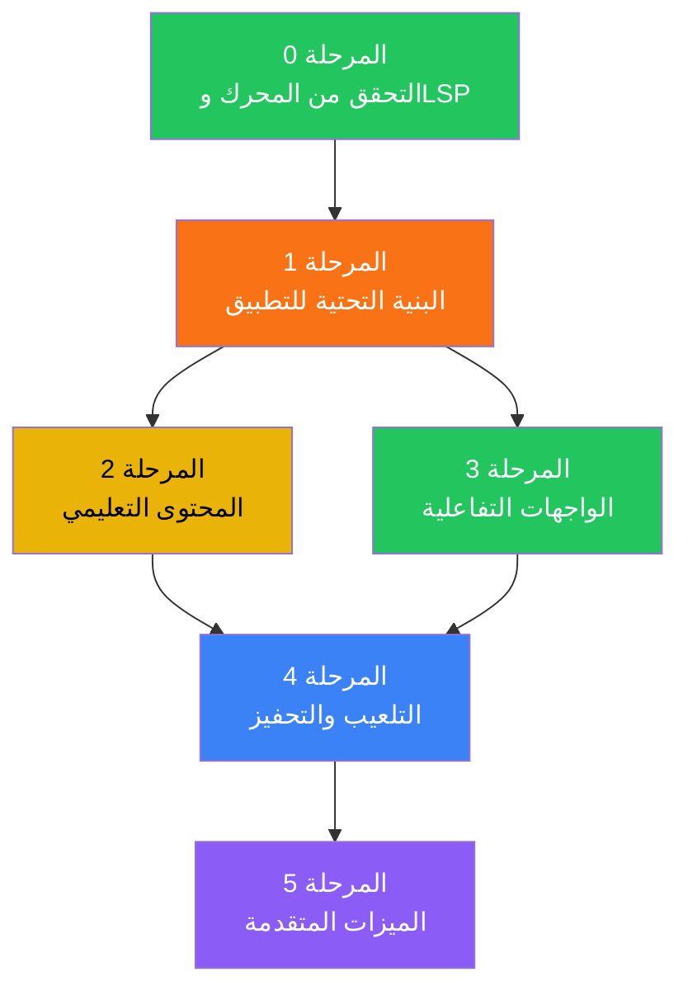
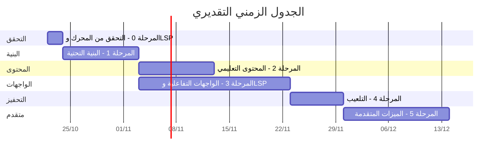

# الخطة التنفيذية الشاملة لمشروع تعلّم GDScript

## (Master Execution Plan — Learn GDScript App)

**تاريخ الإعداد:** 21 أكتوبر 2026
**تنفيذ الكود:** [`gdscript_engine`](file:///home/osm/flutter_projects/gdscript_engine/) — محرك خارجي مستقل
**خدمات المحرر:** [`gdscript_lsp`](file:///home/osm/flutter_projects/gdscript_lsp/) — خادم لغة عبر LSP
**المراجع المستند إليها:**

- [محرك GDScript الخارجي](file:///home/osm/flutter_projects/gdscript_engine/README.md)
- [خادم GDScript LSP](file:///home/osm/flutter_projects/gdscript_lsp/README.md)
- [دليل خادم GDScript LSP](file:///home/osm/flutter_projects/gdscript_lsp/docs/gdscript_lsp.md)
- [أفكار تطوير التجربة التعليمية](file:///home/osm/flutter_projects/learn_gdscript/docs/product_ideas_for_learning_gdscript.md)
- [التصور المرئي للواجهة](file:///home/osm/flutter_projects/learn_gdscript/docs/priority_one_app_and_home_screen.md)
- [تحليل أفكار DeepSeek](file:///home/osm/flutter_projects/learn_gdscript/docs/ideas_analysis.md)

---

## الرؤية العامة



### متطلبات اللغة والمظهر على مستوى التطبيق

- دعم العربية والإنجليزية في الواجهة وفي كامل المحتوى التعليمي ومرجع الصياغة، لا في القوائم فقط.
- العربية هي اللغة الافتراضية، مع إمكانية التبديل إلى الإنجليزية من الإعدادات؛ تُترجم كل النصوص الظاهرة للمستخدم، بما فيها رسائل الحالات والأخطاء والتلميحات.
- يتبع اتجاه الواجهة اللغة المختارة (RTL للعربية وLTR للإنجليزية)، بينما يبقى محرر الكود ومخرجاته LTR في اللغتين.
- دعم المظهر الفاتح والداكن وخيار اتباع إعداد النظام، مع تحديث فوري وحفظ اختيار المستخدم محلياً.

---

## افتراضات تكامل خادم اللغة ومساحة العمل

- يُعامل `gdscript_lsp` في هذه الخطة على أنه يوفّر خدمات المحرر عبر LSP: الإكمال، التشخيصات، hover، signature help، go to definition، document symbols، semantic tokens، طيّ الكود، مطابقة الأقواس، التنسيق، والبحث عبر ملفات المشروع.
- يفترض البحث عبر الملفات دعم الرموز والمراجع والتعريفات بين الملفات، إضافةً إلى بحث نصي في ملفات المشروع عند طلبه. يتطلب ذلك واجهة LSP واضحة لاستقبال جذر مساحة العمل ومحتوى الملفات المفهرسة وتحديثاتها؛ لا يكفي إرسال المستند المفتوح فقط.
- الخادم **لا يكتشف ملفات المشروع ولا يفهرسها تلقائياً**. التطبيق مسؤول عن اختيار مساحة العمل، اكتشاف ملفات GDScript المسموح بها، إنشاء فهرسها وتحديثه، وإتاحة الملفات والسياق للخادم عبر واجهة مساحة العمل المتفق عليها.
- يتضمن عقد التكامل دعم `textDocument/foldingRange` و`textDocument/formatting` و`workspace/symbol` و`textDocument/references`. تُعرض مطابقة الأقواس عبر `textDocument/documentHighlight` و`textDocument/selectionRange` القياسيين، ويُستخدم طلب مخصص للبحث النصي عبر مساحة العمل. تُوثق صيغة الطلبات والنتائج واختبار التوافق قبل بناء واجهة المحرر عليها.
- لا يُستخدم LSP لتنفيذ الشيفرة التعليمية؛ يبقى `gdscript_engine` مسؤولاً عن تشغيل الكود والتمارين.
- اتصال الخادم الحالي هو `stdio`؛ لذلك تُعزل عملية تشغيله والنقل خلف واجهة قابلة للاستبدال، ويُتحقق من دعم كل منصة مستهدفة قبل اعتماد التشغيل المحلي عليها.

---

## المرحلة 0: التحقق من المحرك وخادم اللغة

**المدة المقدرة:** 1-2 يوم
**الهدف:** التحقق من تشغيل الكود عبر المحرك، وخدمات المحرر عبر خادم LSP
**تعتمد على:** لا شيء (نقطة البداية)

> [!NOTE]
> المحرك والخادم موجودان في [`/home/osm/flutter_projects/gdscript_engine/`](file:///home/osm/flutter_projects/gdscript_engine/) و[`/home/osm/flutter_projects/gdscript_lsp/`](file:///home/osm/flutter_projects/gdscript_lsp/). المحرك اعتماد Dart محلي، أما الخادم فيعمل كعملية مستقلة عبر LSP على `stdio`.
> نطاق الخطة يفترض القدرات المذكورة في «افتراضات تكامل خادم اللغة ومساحة العمل» حتى لو احتاج الخادم إلى تطويرها قبل التكامل.

### مكونات اللغة

| المكون | المسؤولية | طريقة التكامل |
| :--- | :--- | :--- |
| `gdscript_engine` | تنفيذ الكود التعليمي والتمارين | اعتماد Dart محلي عبر `path: ../gdscript_engine` |
| `gdscript_lsp` | ميزات المحرر وتحليل ملفات مساحة العمل | تشغيل خادم محلي والتواصل معه عبر LSP على `stdio` |

### واجهات الاستخدام

```dart
// التنفيذ فقط
import 'package:gdscript_engine/gdscript_engine.dart';

final engine = GDScriptEngine();
final result = await engine.execute(code);
result.isSuccess;           // bool
result.output;              // List<String> — أسطر الطباعة
result.errorMessage;        // String? — رسالة الخطأ
result.executionTime;       // Duration
result.instructionsExecuted; // int
result.diagnostics;         // List<Diagnostic>
engine.dispose();

// خدمات المحرر: عميل LSP يرسل initialize ويفتح/يحدّث المستندات
// ثم يستخدم textDocument/completion وpublishDiagnostics وغيرها.
final lsp = await LanguageServerClient.start(
  executablePath: configuredServerPath,
);
await lsp.openDocument(uri, code);
final completions = await lsp.complete(uri, position);
final diagnostics = await lsp.diagnostics(uri);
final folds = await lsp.foldingRanges(uri);
final bracket = await lsp.matchingBracket(uri, position);
final edits = await lsp.formatDocument(uri);
final matches = await lsp.searchWorkspace(query);
await lsp.shutdown();
```

### المهام

#### 0.1 التحقق من المحرك وخادم LSP

- تشغيل `flutter pub get` والتحقق من اعتماد المحرك المحلي.
- بناء/تشغيل خادم LSP والتحقق من `initialize`, مزامنة مستند، طلب ميزة، و`shutdown` عبر `stdio`.
- تحديد طريقة توفير executable لكل منصة مستهدفة، وعدم افتراض أن تشغيل subprocess مدعوم على الهاتف أو الويب.

#### 0.2 اختبارات تكامل

- إنشاء `test/engine_integration_test.dart` يتحقق من:
  - تنفيذ `print("hello")` → المخرج `["hello"]`
- إنشاء `test/lsp_client_integration_test.dart` يتحقق من:
  - فتح وتحديث مستند واستلام التشخيصات والإكمال والرموز الدلالية.
  - طي الكود ومطابقة الأقواس وتنسيق المستند.
  - البحث عن تعريف/مراجع ورموز أو نص عبر ملفين مفهرسين.
  - إغلاق الخادم والتعامل الصريح مع فشل تشغيله أو انقطاع النقل.

#### 0.3 توثيق حدود ومسؤوليات التكامل

- المحرك ينفذ اللغة المدعومة ولا يتصل مباشرة بـ Godot أو بعُقد المشهد الحقيقية.
- خادم LSP يوفر خدمات المحرر، لكنه لا يكتشف ملفات المشروع ولا يفهرس مساحة العمل تلقائياً.
- التطبيق مسؤول عن إدارة مساحة العمل والفهرسة، وعن تحديد المنصات التي يمكنها تشغيل الخادم محلياً.

#### 0.4 استكمال عقد وقدرات خادم LSP

- تنفيذ أو استكمال ميزات طيّ الكود، مطابقة الأقواس، التنسيق، الرموز والمراجع عبر الملفات، والبحث النصي حسب العقد المتفق عليه.
- إضافة استقبال تحديثات ملفات مساحة العمل المفهرسة من التطبيق، دون مسح الملفات أو فهرستها تلقائياً داخل الخادم.
- نشر القدرات المدعومة فعلياً في `initialize`، وإضافة اختبارات بروتوكول متعددة الملفات وتحديث/حذف الملفات، وتوثيق العقد في دليل الخادم.

### معايير القبول

- [x] المحرك مرتبط وينفذ مثالاً بسيطاً
- [x] عميل LSP يتصل بالخادم ويكمل دورة حياته عبر `stdio`
- [x] اختبارات LSP تثبت ميزات المحرر المفترضة عبر ملفين على الأقل
- [x] قدرات الخادم المعلنة تطابق التنفيذ، وعقد البحث ومطابقة الأقواس موثق ومختبر
- [x] آلية اختيار مساحة العمل وفهرستها وتحديثها موثقة ومختبرة
- [x] حدود تشغيل الخادم على المنصات المستهدفة موثقة

---

## المرحلة 1: البنية التحتية للتطبيق

**المدة المقدرة:** 7-10 أيام
**الهدف:** بناء الهيكل المعماري للتطبيق (بدون محتوى تعليمي بعد)
**تعتمد على:** المرحلة 0 (المحرك وخادم LSP متحقق منهما)

### 1.1 بنية المجلدات

```text
lib/
├── main.dart                        ← نقطة البداية
├── app.dart                         ← MaterialApp + التوجيه
├── core/
│   ├── constants/
│   │   ├── app_constants.dart       ← ثوابت عامة
│   │   └── gdscript_constants.dart  ← ثوابت اللغة
│   ├── theme/
│   │   ├── color_schemes.dart       ← موجود
│   │   ├── text_theme.dart          ← موجود
│   │   ├── theme_data.dart          ← موجود
│   │   └── code_editor_theme.dart   ← 🆕 ألوان المحرر
│   ├── extensions/                  ← 🆕
│   │   └── context_extensions.dart
│   └── utils/                       ← 🆕
│       ├── responsive.dart          ← أدوات التجاوب
│       └── platform_utils.dart
├── data/                            ← 🆕 طبقة البيانات
│   ├── models/
│   │   ├── curriculum_models.dart   ← نماذج المنهج
│   │   ├── lesson_models.dart       ← نماذج الدروس
│   │   ├── exercise_models.dart     ← نماذج التمارين
│   │   ├── progress_models.dart     ← نماذج التقدم
│   │   ├── localized_text.dart      ← نص عربي وإنجليزي
│   │   └── app_settings.dart        ← اللغة والمظهر
│   ├── repositories/
│   │   ├── curriculum_repository.dart    ← تحميل المنهج من الأصول
│   │   ├── progress_repository.dart     ← حفظ/استرجاع التقدم
│   │   ├── settings_repository.dart      ← حفظ/استرجاع تفضيلات المستخدم
│   │   ├── workspace_repository.dart    ← ملفات المشروع وفهرس مساحة العمل
│   │   └── syntax_reference_repository.dart ← مرجع الصياغة
│   └── sqlite/
│       ├── database_helper.dart     ← إعداد SQLite
│       └── migrations.dart          ← ترحيل قاعدة البيانات
├── logic/                           ← 🆕 طبقة المنطق
│   ├── providers/
│   │   ├── curriculum_provider.dart
│   │   ├── lesson_provider.dart
│   │   ├── exercise_provider.dart
│   │   ├── progress_provider.dart
│   │   └── app_settings_provider.dart    ← اللغة والمظهر الحاليان
│   └── services/
│       ├── code_runner_service.dart  ← تشغيل الكود عبر المحرك
│       ├── language_server_client.dart ← عميل LSP وإدارة دورة حياته
│       ├── workspace_index_service.dart ← اكتشاف الملفات وفهرستها وتحديثها
│       ├── test_runner_service.dart  ← نظام اختبار التمارين
│       └── hint_service.dart        ← نظام التلميحات
├── ui/                              ← 🆕 طبقة الواجهة
│   ├── screens/
│   │   ├── home/
│   │   │   └── home_screen.dart
│   │   ├── learning_path/
│   │   │   └── learning_path_screen.dart
│   │   ├── workspace/
│   │   │   ├── workspace_screen.dart      ← اختيار/إدارة المشروع
│   │   │   └── workspace_search_screen.dart ← بحث عبر ملفات المشروع
│   │   ├── lesson/
│   │   │   ├── lesson_screen.dart
│   │   │   └── lesson_complete_screen.dart
│   │   ├── settings/
│   │   │   └── settings_screen.dart
│   │   └── onboarding/
│   │       └── onboarding_screen.dart
│   ├── widgets/
│   │   ├── code_editor/
│   │   │   ├── code_editor_widget.dart
│   │   │   ├── line_numbers.dart
│   │   │   ├── syntax_highlighter.dart
│   │   │   ├── folding_controls.dart      ← طيّ الكتل
│   │   │   ├── bracket_match_overlay.dart ← مطابقة الأقواس
│   │   │   └── code_actions_bar.dart
│   │   ├── output_panel/
│   │   │   ├── output_panel.dart
│   │   │   └── error_display.dart
│   │   ├── exercise/
│   │   │   ├── exercise_widget.dart
│   │   │   ├── test_results_widget.dart
│   │   │   └── hint_widget.dart
│   │   ├── progress/
│   │   │   ├── progress_bar.dart
│   │   │   └── unit_card.dart
│   │   └── common/
│   │       ├── continue_learning_card.dart
│   │       ├── quick_try_card.dart
│   │       └── navigation_bar.dart
│   └── layouts/
│       ├── adaptive_layout.dart     ← تخطيط متجاوب
│       ├── lesson_layout_mobile.dart
│       └── lesson_layout_desktop.dart
├── l10n/
│   ├── app_ar.arb                   ← نصوص الواجهة بالعربية
│   └── app_en.arb                   ← نصوص الواجهة بالإنجليزية
└── assets/                          ← محتوى تعليمي (في مجلد assets الرئيسي)
```

**في جذر المشروع:** `l10n.yaml` لإعداد توليد ترجمات الواجهة.

### 1.2 نماذج البيانات (Data Models)

**الملف:** `lib/data/models/curriculum_models.dart`

**الملف:** `lib/data/models/localized_text.dart`

```dart
class LocalizedText {
  final String ar;
  final String en;

  const LocalizedText({required this.ar, required this.en});

  factory LocalizedText.fromJson(Map<String, dynamic> json) => ...;

  String resolve(Locale locale) => locale.languageCode == 'en' ? en : ar;
}
```

**الملف:** `l10n.yaml`

```yaml
arb-dir: lib/l10n
template-arb-file: app_en.arb
output-localization-file: app_localizations.dart
output-class: AppLocalizations
```

**الملف:** `lib/data/models/app_settings.dart`

يحتوي `AppSettings` على لغة التطبيق (افتراضياً `Locale('ar')`) ووضع المظهر (افتراضياً `ThemeMode.system`).

```dart
///a وحدة تعليمية (مثل "الأساسيات"، "الشروط")
class Unit {
  final String id;
  final LocalizedText title;
  final LocalizedText description;
  final String iconName;
  final int order;
  final List<String> lessonIds;

  const Unit({...});

  factory Unit.fromJson(Map<String, dynamic> json) => ...;
}

/// المنهج الدراسي الكامل
class Curriculum {
  final String version;
  final String targetGDScriptVersion;
  final List<Unit> units;

  const Curriculum({...});

  factory Curriculum.fromJson(Map<String, dynamic> json) => ...;
}
```

**الملف:** `lib/data/models/lesson_models.dart`

```dart
///a درس واحد
class Lesson {
  final String id;
  final String unitId;
  final LocalizedText title;
  final LocalizedText objective;
  final int estimatedMinutes;
  final int order;
  final LocalizedText contentMarkdown; // شرح الدرس (Markdown)
  final String? exampleCode;     // مثال قابل للتشغيل
  final List<Exercise> exercises;

  const Lesson({...});

  factory Lesson.fromJson(Map<String, dynamic> json) => ...;
}

/// نوع التمرين
enum ExerciseType {
  writeCode,      // اكتب حلاً
  fillBlank,      // أكمل السطر
  predictOutput,  // توقّع الناتج
  fixBug,         // صحّح الخطأ
  reorderSteps,   // رتّب الخطوات
}
```

**الملف:** `lib/data/models/exercise_models.dart`

```dart
///a تمرين واحد
class Exercise {
  final String id;
  final String lessonId;
  final ExerciseType type;
  final LocalizedText prompt;    // وصف المطلوب
  final String starterCode;      // كود مبدئي
  final String solutionCode;     // الحل المرجعي
  final List<ExerciseTestCase> testCases;
  final List<LocalizedText> hints; // تلميحات متدرجة (3-4)
  final int order;

  const Exercise({...});

  factory Exercise.fromJson(Map<String, dynamic> json) => ...;
}

/// حالة اختبار واحدة
class ExerciseTestCase {
  final LocalizedText description;
  final String? setupCode;       // كود تحضيري (إن لزم)
  final String expectedOutput;   // المخرج المتوقع
  final bool ignoreWhitespace;   // تجاهل المسافات
  final bool ignoreCase;         // تجاهل حالة الأحرف

  const ExerciseTestCase({...});

  factory ExerciseTestCase.fromJson(Map<String, dynamic> json) => ...;
}
```

تُمثّل `LocalizedText` النصوص البشرية بنسختين (`ar` و`en`) وتختار النسخة بحسب لغة التطبيق. ينطبق ذلك أيضاً على الشروحات والتلميحات والتفسيرات ورسائل الاختبارات ومرجع الصياغة؛ أما الشيفرة ومعرّفات البيانات فلا تُترجم.

**الملف:** `lib/data/models/progress_models.dart`

```dart
///a تقدم المستخدم
class UserProgress {
  final String visitorId;         // معرف محلي
  final String currentUnitId;
  final String currentLessonId;
  final int totalXP;
  final int currentStreak;
  final int longestStreak;
  final DateTime lastActiveDate;
  final Map<String, LessonProgress> lessonsProgress;
  final List<String> earnedBadges;

  const UserProgress({...});
}

/// تقدم درس محدد
class LessonProgress {
  final String lessonId;
  final LessonStatus status;      // notStarted, inProgress, completed
  final int exercisesCompleted;
  final int exercisesTotal;
  final int attempts;
  final int hintsUsed;
  final DateTime? startedAt;
  final DateTime? completedAt;
  final String? savedCode;        // آخر كود كتبه المستخدم

  const LessonProgress({...});
}

enum LessonStatus { notStarted, inProgress, completed }
```

### 1.3 خدمة تشغيل الكود

**الملف:** `lib/logic/services/code_runner_service.dart`

```dart
import 'package:gdscript_engine/gdscript_engine.dart';

class CodeRunnerService {
  final GDScriptEngine _engine = GDScriptEngine();

  /// تشغيل كود وإرجاع النتيجة
  Future<CodeRunResult> runCode(String code) async {
    try {
      final result = await _engine.execute(code);
      return CodeRunResult(
        isSuccess: result.isSuccess,
        output: result.output,
        errorMessage: result.errorMessage,
        executionTimeMs: result.executionTime.inMilliseconds,
      );
    } catch (e) {
      return CodeRunResult(
        isSuccess: false,
        output: [],
        errorMessage: 'خطأ غير متوقع: $e',
      );
    }
  }
}

class CodeRunResult {
  final bool isSuccess;
  final List<String> output;
  final String? errorMessage;
  final int? executionTimeMs;

  const CodeRunResult({...});
}
```

### 1.4 عميل خادم اللغة وفهرس مساحة العمل

**الملفات:**

- `lib/logic/services/language_server_client.dart`
- `lib/logic/services/workspace_index_service.dart`
- `lib/data/repositories/workspace_repository.dart`

`LanguageServerClient` يشغّل الخادم ويدير نقل `stdio` ورسائل JSON-RPC/LSP، دورة الحياة، مزامنة المستندات، الطلبات، الإشعارات، والإلغاء. يوفّر واجهة موحدة للمحرر تشمل التشخيصات، الإكمال، semantic tokens، hover، signature help، التعريفات والمراجع متعددة الملفات، طيّ الكود، مطابقة الأقواس، التنسيق، والبحث في مساحة العمل.

`WorkspaceIndexService` مسؤول عن اختيار جذر مساحة العمل، اكتشاف ملفات GDScript المسموح بها، قراءة محتواها، بناء الفهرس وتحديثه عند إنشاء الملفات أو تعديلها أو حذفها، ثم تزويد الخادم بالمستندات والسياق اللازم. لا يُفترض أن الخادم يكتشف الملفات أو يفهرسها نيابةً عن التطبيق. تُحترم صلاحيات الوصول والاستثناءات، ولا تُفهرس مجلدات الاعتماد أو الملفات المستبعدة.

تُعرّف واجهة نقل قابلة للاستبدال لتشغيل executable محلياً على المنصات المدعومة، مع بديل منصّي عند الحاجة؛ لا يُربط منطق المحرر مباشرةً بعملية نظام تشغيل واحدة.

### 1.5 خدمة اختبار التمارين

**الملف:** `lib/logic/services/test_runner_service.dart`

```dart
class TestRunnerService {
  final CodeRunnerService _codeRunner;

  TestRunnerService(this._codeRunner);

  /// تشغيل جميع حالات الاختبار لتمرين
  Future<ExerciseResult> runTests({
    required String userCode,
    required List<ExerciseTestCase> testCases,
  }) async {
    final results = <TestCaseResult>[];

    for (final testCase in testCases) {
      final fullCode = testCase.setupCode != null
          ? '${testCase.setupCode}\n$userCode'
          : userCode;

      final runResult = await _codeRunner.runCode(fullCode);

      final actualOutput = runResult.output.join('\n').trim();
      final expectedOutput = testCase.expectedOutput.trim();

      bool passed;
      if (testCase.ignoreWhitespace) {
        passed = _normalizeWhitespace(actualOutput) ==
                 _normalizeWhitespace(expectedOutput);
      } else {
        passed = actualOutput == expectedOutput;
      }

      results.add(TestCaseResult(
        testCase: testCase,
        passed: passed,
        actualOutput: actualOutput,
        error: runResult.errorMessage,
      ));
    }

    return ExerciseResult(
      testResults: results,
      allPassed: results.every((r) => r.passed),
      passedCount: results.where((r) => r.passed).length,
      totalCount: results.length,
    );
  }

  String _normalizeWhitespace(String s) =>
      s.replaceAll(RegExp(r'\s+'), ' ').trim();
}

class TestCaseResult {
  final ExerciseTestCase testCase;
  final bool passed;
  final String actualOutput;
  final String? error;

  const TestCaseResult({...});
}

class ExerciseResult {
  final List<TestCaseResult> testResults;
  final bool allPassed;
  final int passedCount;
  final int totalCount;

  const ExerciseResult({...});
}
```

### 1.6 قاعدة بيانات التقدم المحلي

**الملف:** `lib/data/database/database_helper.dart`

```dart
import 'package:sqlite3/sqlite3.dart';
import 'package:path_provider/path_provider.dart';

class DatabaseHelper {
  static Database? _db;

  static Future<Database> get database async {
    _db ??= await _initDatabase();
    return _db!;
  }

  static Future<Database> _initDatabase() async {
    final dir = await getApplicationDocumentsDirectory();
    final path = '${dir.path}/learn_gdscript.db';
    final db = sqlite3.open(path);
    _createTables(db);
    return db;
  }

  static void _createTables(Database db) {
    db.execute('''
      CREATE TABLE IF NOT EXISTS user_progress (
        id INTEGER PRIMARY KEY AUTOINCREMENT,
        current_unit_id TEXT NOT NULL DEFAULT '',
        current_lesson_id TEXT NOT NULL DEFAULT '',
        total_xp INTEGER NOT NULL DEFAULT 0,
        current_streak INTEGER NOT NULL DEFAULT 0,
        longest_streak INTEGER NOT NULL DEFAULT 0,
        last_active_date TEXT NOT NULL,
        created_at TEXT NOT NULL DEFAULT (datetime('now'))
      )
    ''');

    db.execute('''
      CREATE TABLE IF NOT EXISTS lesson_progress (
        lesson_id TEXT PRIMARY KEY,
        status TEXT NOT NULL DEFAULT 'notStarted',
        exercises_completed INTEGER NOT NULL DEFAULT 0,
        exercises_total INTEGER NOT NULL DEFAULT 0,
        attempts INTEGER NOT NULL DEFAULT 0,
        hints_used INTEGER NOT NULL DEFAULT 0,
        saved_code TEXT,
        started_at TEXT,
        completed_at TEXT
      )
    ''');

    db.execute('''
      CREATE TABLE IF NOT EXISTS earned_badges (
        badge_id TEXT PRIMARY KEY,
        earned_at TEXT NOT NULL DEFAULT (datetime('now'))
      )
    ''');
  }
}
```

### 1.7 بنية أصول المحتوى

```text
assets/
  curriculum/
    curriculum.json                    ← فهرس المنهج
    units/
      01_first_program/
        unit.json
        lesson_01_hello_world.json
        lesson_02_comments.json
      02_variables/
        unit.json
        lesson_01_var_types.json
        lesson_02_operations.json
      03_conditions/
        unit.json
        lesson_01_if_else.json
        lesson_02_match.json
      04_loops/
        unit.json
        lesson_01_for.json
        lesson_02_while.json
      05_functions/
        unit.json
        lesson_01_basics.json
        lesson_02_return_values.json
    syntax_reference/
      keywords.json
      builtins.json
      types.json
```

### 1.8 نظام التوجيه (Routing)

**الملف:** `lib/app.dart`

```dart
class LearnGDScriptApp extends StatelessWidget {
  @override
  Widget build(BuildContext context) {
    return MaterialApp(
      onGenerateTitle: (context) => AppLocalizations.of(context)!.appTitle,
      locale: appSettings.locale,
      supportedLocales: const [Locale('ar'), Locale('en')],
      localizationsDelegates: AppLocalizations.localizationsDelegates,
      theme: AppTheme.light,
      darkTheme: AppTheme.dark,
      themeMode: appSettings.themeMode,
      initialRoute: '/',
      routes: {
        '/': (_) => const HomeScreen(),
        '/path': (_) => const LearningPathScreen(),
        '/settings': (_) => const SettingsScreen(),
        '/onboarding': (_) => const OnboardingScreen(),
      },
      onGenerateRoute: (settings) {
        // مسارات ديناميكية للدروس
        if (settings.name?.startsWith('/lesson/') ?? false) {
          final lessonId = settings.name!.split('/').last;
          return MaterialPageRoute(
            builder: (_) => LessonScreen(lessonId: lessonId),
          );
        }
        return null;
      },
    );
  }
}
```

تُحمّل `appSettings` من مزوّد الإعدادات؛ ويتولى `SettingsRepository` حفظ اللغة و`ThemeMode` محلياً واستعادتهما عند تشغيل التطبيق. تُولّد ترجمات الواجهة من ملفات ARB (`flutter: generate: true` في `pubspec.yaml`)، ويجب ألا تبقى نصوص واجهة ظاهرة مكتوبة مباشرة داخل الشاشات.

### معايير القبول

- [ ] بنية المجلدات مكتملة وكل ملف يحتوي على الهيكل الأساسي
- [ ] نماذج البيانات تتحول من/إلى JSON بنجاح
- [ ] اختيار العربية أو الإنجليزية يحدّث لغة التطبيق واتجاه الواجهة، ويُستعاد بعد إعادة التشغيل
- [ ] اختيار الفاتح أو الداكن أو اتباع النظام يحدّث المظهر ويُستعاد بعد إعادة التشغيل
- [ ] ملفات ترجمة الواجهة بالعربية والإنجليزية مكتملة ولا توجد مفاتيح ترجمة مفقودة
- [ ] `CodeRunnerService` يشغّل كوداً بسيطاً ويرجع النتيجة (عبر المحرك الخارجي)
- [ ] `LanguageServerClient` يدير الاتصال ومزامنة المستندات وطلبات LSP، منفصلاً عن تشغيل الكود
- [ ] `WorkspaceIndexService` يكتشف الملفات ويفهرسها ويحدّثها ويزوّد الخادم بسياق مساحة العمل
- [ ] أخطاء تشغيل الخادم أو النقل أو الفهرسة ظاهرة للمستخدم ومسجلة، ولا تتحول إلى نتائج نجاح
- [ ] `TestRunnerService` يقارن مخرجات الكود بالمتوقع
- [ ] قاعدة البيانات تُنشئ الجداول وتحفظ/تسترجع التقدم
- [ ] نظام التوجيه يعمل بين الشاشات
- [ ] `pubspec.yaml` يتضمن أصول المحتوى

---

## المرحلة 2: المحتوى التعليمي

**المدة المقدرة:** 7-10 أيام
**الهدف:** كتابة 5 وحدات تعليمية أولية مع 10+ دروس و 30+ تمرين
**تعتمد على:** المرحلة 1 (بنية الملفات وأنماط البيانات)

يُكتب كل نص تعليمي ومرجع صياغة باللغتين العربية والإنجليزية ضمن بنية المحتوى نفسها، بما يشمل عناوين الوحدات والدروس، الشروحات، الأمثلة النصية، التمارين، التلميحات، والتفسيرات. لا تُترجم الشيفرة أو معرّفاتها.

### 2.1 فهرس المنهج

**الملف:** `assets/curriculum/curriculum.json`

```json
{
  "version": "1.0.0",
  "target_gdscript_version": "4.x",
  "supported_features_note": {
    "ar": "المحرك يدعم المفاهيم الأساسية. الأصناف والإشارات محدودة.",
    "en": "The engine supports core concepts; classes and signals have limitations."
  },
  "units": [
    {
      "id": "unit_01_first_program",
      "title": {"ar": "أول برنامج", "en": "Your First Program"},
      "description": {
        "ar": "اكتب أول سطر كود وشاهد الناتج",
        "en": "Write your first line of code and see the output"
      },
      "icon": "play_circle",
      "order": 1,
      "lessons": ["lesson_01_hello", "lesson_02_comments"]
    },
    {
      "id": "unit_02_variables",
      "title": {"ar": "المتغيرات والأنواع", "en": "Variables and Types"},
      "description": {
        "ar": "تعلّم تخزين البيانات واستخدامها",
        "en": "Learn to store and use data"
      },
      "icon": "data_object",
      "order": 2,
      "lessons": ["lesson_03_variables", "lesson_04_types", "lesson_05_operations"]
    },
    {
      "id": "unit_03_conditions",
      "title": {"ar": "الشروط والقرارات", "en": "Conditions and Decisions"},
      "description": {
        "ar": "اجعل برنامجك يتخذ قرارات",
        "en": "Make your program make decisions"
      },
      "icon": "call_split",
      "order": 3,
      "lessons": ["lesson_06_if_else", "lesson_07_elif", "lesson_08_match"]
    },
    {
      "id": "unit_04_loops",
      "title": {"ar": "الحلقات والتكرار", "en": "Loops and Repetition"},
      "description": {
        "ar": "كرّر العمليات بكفاءة",
        "en": "Repeat operations efficiently"
      },
      "icon": "loop",
      "order": 4,
      "lessons": ["lesson_09_for", "lesson_10_while", "lesson_11_break_continue"]
    },
    {
      "id": "unit_05_functions",
      "title": {"ar": "الدوال وإعادة الاستخدام", "en": "Functions and Reuse"},
      "description": {
        "ar": "نظّم كودك في أجزاء قابلة لإعادة الاستخدام",
        "en": "Organize code into reusable parts"
      },
      "icon": "functions",
      "order": 5,
      "lessons": ["lesson_12_func_basics", "lesson_13_parameters", "lesson_14_return"]
    }
  ]
}
```

### 2.2 هيكل الدرس الواحد

**مثال:** `assets/curriculum/units/01_first_program/lesson_01_hello.json`

```json
{
  "id": "lesson_01_hello",
  "unit_id": "unit_01_first_program",
  "title": {"ar": "مرحباً بالعالم!", "en": "Hello, World!"},
  "objective": {
    "ar": "ستكتب أول أمر طباعة وتشاهد الناتج فوراً",
    "en": "Write your first print statement and see the output"
  },
  "estimated_minutes": 3,
  "order": 1,
  "content": [
    {
      "type": "text",
      "body": {
        "ar": "في GDScript، نستخدم الدالة `print()` لعرض نص على الشاشة.\n\nهذه أول وأبسط أداة ستتعلمها. كل ما تضعه بين القوسين سيظهر في لوحة الناتج.",
        "en": "In GDScript, use `print()` to display text. Anything inside its parentheses appears in the output panel."
      }
    },
    {
      "type": "example",
      "code": "print(\"Hello, World!\")",
      "expected_output": "Hello, World!",
      "explanation": {
        "ar": "الدالة `print()` تطبع النص الموجود بين علامتي التنصيص.",
        "en": "The `print()` function outputs the text inside the quotation marks."
      }
    },
    {
      "type": "tip",
      "body": {
        "ar": "💡 النص في GDScript يُحاط دائماً بعلامتي تنصيص مزدوجتين `\"\"` أو مفردتين `''`.",
        "en": "💡 In GDScript, text is enclosed in double quotes `\"\"` or single quotes `''`."
      }
    }
  ],
  "exercises": [
    {
      "id": "ex_01_hello_print",
      "type": "write_code",
      "prompt": {
        "ar": "اكتب أمراً يطبع اسمك على الشاشة",
        "en": "Write a statement that prints your name"
      },
      "starter_code": "",
      "hints": [
        {"ar": "استخدم الدالة print()", "en": "Use the print() function"},
        {
          "ar": "ضع اسمك بين علامتي تنصيص: print(\"اسمك\")",
          "en": "Put your name inside quotation marks: print(\"your name\")"
        },
        {"ar": "مثال: print(\"أحمد\")", "en": "Example: print(\"Alex\")"}
      ],
      "solution": "print(\"Alex\")",
      "test_cases": [
        {
          "description": {
            "ar": "يجب أن يطبع نصاً (أي شيء)",
            "en": "It should print some text"
          },
          "validation_type": "output_not_empty",
          "expected_output": null
        }
      ]
    },
    {
      "id": "ex_02_multi_print",
      "type": "write_code",
      "prompt": {
        "ar": "اكتب 3 أوامر print لتطبع:\nسطر 1\nسطر 2\nسطر 3",
        "en": "Write 3 print statements to output:\nLine 1\nLine 2\nLine 3"
      },
      "starter_code": "",
      "hints": [
        {
          "ar": "استخدم print() ثلاث مرات، كل واحدة في سطر",
          "en": "Use print() three times, once on each line"
        },
        {
          "ar": "print(\"سطر 1\")\nprint(\"سطر 2\")",
          "en": "print(\"Line 1\")\nprint(\"Line 2\")"
        }
      ],
      "solution": "print(\"Line 1\")\nprint(\"Line 2\")\nprint(\"Line 3\")",
      "test_cases": [
        {
          "description": {
            "ar": "يجب أن يطبع 3 أسطر بالترتيب",
            "en": "It should print 3 lines in order"
          },
          "expected_output": "Line 1\nLine 2\nLine 3"
        }
      ]
    },
    {
      "id": "ex_03_predict_output",
      "type": "predict_output",
      "prompt": {
        "ar": "ماذا سيطبع هذا الكود؟",
        "en": "What will this code print?"
      },
      "display_code": "print(\"Hello\")\nprint(\"World\")",
      "options": [
        {"ar": "HelloWorld", "en": "HelloWorld"},
        {"ar": "Hello\nWorld", "en": "Hello\nWorld"},
        {"ar": "Hello World", "en": "Hello World"},
        {"ar": "خطأ", "en": "Error"}
      ],
      "correct_option_index": 1,
      "explanation": {
        "ar": "كل print() تطبع في سطر جديد",
        "en": "Each print() outputs on a new line"
      }
    }
  ]
}
```

### 2.3 خطة الدروس التفصيلية

| الوحدة | الدرس | المفهوم | عدد التمارين | أنواع التمارين |
| :--- | :--- | :--- | :--- | :--- |
| **أول برنامج** | مرحباً بالعالم | `print()` | 3 | كتابة، توقع |
| | التعليقات | `#` و `"""` | 2 | إكمال، إصلاح |
| **المتغيرات** | المتغيرات | `var` | 3 | كتابة، توقع |
| | أنواع البيانات | `int, float, String, bool` | 3 | توقع، ترتيب |
| | العمليات الحسابية | `+, -, *, /, %` | 4 | كتابة، إكمال |
| **الشروط** | الشرط البسيط | `if / else` | 3 | كتابة، إصلاح |
| | الشروط المتعددة | `elif` | 3 | كتابة، ترتيب |
| | المطابقة | `match` | 2 | كتابة، توقع |
| **الحلقات** | حلقة for | `for i in range()` | 3 | كتابة، توقع |
| | حلقة while | `while` | 3 | كتابة، إصلاح |
| | التحكم | `break / continue` | 2 | كتابة، توقع |
| **الدوال** | تعريف الدوال | `func` | 3 | كتابة، إكمال |
| | المعاملات | المعاملات الافتراضية | 3 | كتابة، إصلاح |
| | القيم المعادة | `-> int`, `return` | 3 | كتابة، توقع |

**الإجمالي:** 5 وحدات، 14 درساً، 40+ تمرين

### 2.4 مرجع الصياغة (Syntax Reference)

**الملف:** `assets/curriculum/syntax_reference/keywords.json`

```json
[
  {
    "keyword": "var",
    "category": "declarations",
    "title": {"ar": "متغير", "en": "Variable"},
    "description": {
      "ar": "يُعرّف متغيراً يمكن تغيير قيمته لاحقاً",
      "en": "Declares a variable whose value can change later"
    },
    "syntax": "var name = value",
    "example": "var score = 100\nprint(score)  # 100",
    "related_lesson": "lesson_03_variables",
    "see_also": ["const", "static"]
  },
  {
    "keyword": "const",
    "category": "declarations",
    "title": {"ar": "ثابت", "en": "Constant"},
    "description": {
      "ar": "يُعرّف قيمة لا تتغير أبداً",
      "en": "Declares a value that never changes"
    },
    "syntax": "const NAME = value",
    "example": "const MAX_HEALTH = 100\nprint(MAX_HEALTH)",
    "related_lesson": "lesson_03_variables",
    "see_also": ["var"]
  }
]
```

### معايير القبول

- [ ] 14 ملف درس JSON صالح ومتسق الهيكل
- [ ] 40+ تمرين مع اختبارات ومخرجات متوقعة
- [ ] كل تمرين يحتوي على 2-4 تلميحات متدرجة
- [ ] ملف مرجع الصياغة يغطي 30+ كلمة مفتاحية
- [ ] جميع نصوص الوحدات والدروس والتمارين ومرجع الصياغة متوفرة بالعربية والإنجليزية
- [ ] التحقق الآلي من وجود الترجمتين لكل نص مطلوب في ملفات المحتوى
- [ ] كل مثال تم اختباره يدوياً مع المحرك
- [ ] لا يوجد درس يعتمد على ميزة غير مدعومة في المحرك

---

## المرحلة 3: الواجهات التفاعلية

**المدة المقدرة:** 14-20 يوم
**الهدف:** بناء جميع شاشات التطبيق بتصميم متجاوب Desktop/Mobile
**تعتمد على:** المرحلة 1 (البنية التحتية) + المرحلة 2 (بعض المحتوى للاختبار)

### 3.1 شاشة الإعداد الأولي (Onboarding)

**الملف:** `lib/ui/screens/onboarding/onboarding_screen.dart`

- سؤال واحد: "هل سبق لك البرمجة؟"
  - "أنا جديد تماماً" → يبدأ من الدرس 1
  - "أعرف أساسيات البرمجة" → يقترح تخطي الوحدة 1
- لا يُلزم بتسجيل أو إنشاء حساب
- ينتقل مباشرة إلى الشاشة الرئيسية

### 3.2 الشاشة الرئيسية (Home)

**الملف:** `lib/ui/screens/home/home_screen.dart`

**المكونات:**

1. **شريط علوي:** "تعلّم GDScript" + زر الإعدادات
2. **بطاقة الترحيب:** رسالة مخصصة (جديد/عائد)
3. **بطاقة "تابع التعلّم":** (الأبرز)
   - اسم الوحدة والدرس
   - تقدير زمني
   - شريط تقدم + "3 من 10 دروس"
   - زر **[تابع التعلّم ←]**
4. **بطاقة "جرّب الآن":** مثال بسيط قابل للتعديل والتشغيل
5. **قائمة الوحدات:** بطاقات مختصرة مع حالة كل وحدة
6. **شريط تنقل سفلي:** الرئيسية | المسار | الإعدادات

**التجاوب:**

- الهاتف: ترتيب عمودي، تنقل سفلي
- الحاسوب: شريط جانبي، محتوى بعرض مقروء (max-width: 800px)

### 3.3 شاشة المسار التعليمي (Learning Path)

**الملف:** `lib/ui/screens/learning_path/learning_path_screen.dart`

**المكونات:**

1. عنوان "مسار تعلّم GDScript" + شريط تقدم عام
2. قائمة الوحدات مع بطاقات:

   ```text
   ✓  أول برنامج                    مكتمل
   ●  المتغيرات والأنواع    [تابع]   2/3
   ○  الشروط والقرارات               مقفل
   ```

3. الضغط على وحدة يفتح قائمة دروسها

**السلوك:**

- الدروس المقفلة تعرض عنوانها لكن لا تفتح
- الوحدة الحالية مميزة بلون
- يمكن مراجعة الدروس المكتملة

### 3.4 شاشة الدرس (الأهم) ⭐

**الملف:** `lib/ui/screens/lesson/lesson_screen.dart`

**التخطيط على الهاتف (عمودي):**

```text
┌─────────────────────────────────┐
│ [← رجوع]     الشروط    [1/4]   │
├─────────────────────────────────┤
│                                 │
│ 📖 الشرح                        │
│ اجعل برنامجك يتخذ قراراً       │
│ باستخدام if.                    │
│                                 │
│ 💻 المثال                        │
│ ┌─────────────────────────────┐ │
│ │ var score = 10              │ │
│ │ if score > 0:               │ │
│ │     print("فزت!")           │ │
│ └─────────────────────────────┘ │
│ [▶ شغّل المثال]                 │
│                                 │
│ 📤 الناتج                        │
│ ┌─────────────────────────────┐ │
│ │ فزت!                        │ │
│ └─────────────────────────────┘ │
│                                 │
│ ✏️ التمرين                       │
│ غيّر الشرط ليظهر "فزت!"        │
│ فقط عندما score > 50           │
│                                 │
│ ┌─────────────────────────────┐ │
│ │ # اكتب كودك هنا             │ │
│ │                             │ │
│ └─────────────────────────────┘ │
│ [💡 تلميح]        [▶ شغّل]      │
│                                 │
│ 📊 نتيجة الاختبار               │
│ ✅ اختبار 1: ناجح               │
│ ❌ اختبار 2: المتوقع "فزت!"     │
│                                 │
│           [الدرس التالي ←]      │
└─────────────────────────────────┘
```

**التخطيط على الحاسوب (أفقي):**

```text
┌──────────────────────────────────────────────────────┐
│ [← المسار]           الشروط              [1/4]       │
├──────────────────┬───────────────────────────────────┤
│                  │                                   │
│ 📖 الشرح          │  💻 المحرر                         │
│ ...              │  ┌───────────────────────────────┐│
│                  │  │ var score = 10                ││
│ 💡 تلميحات        │  │ if score > 0:                 ││
│ [تلميح 1]        │  │     print("فزت!")             ││
│                  │  └───────────────────────────────┘│
│                  │                                   │
│                  │  [▶ شغّل]  [↺ إعادة]  [💡 تلميح]  │
│                  │                                   │
│                  │  📤 الناتج                         │
│                  │  ┌───────────────────────────────┐│
│                  │  │ فزت!                          ││
│                  │  └───────────────────────────────┘│
│                  │                                   │
│                  │  📊 نتائج الاختبار                 │
│                  │  ✅ 1/2  ❌ 1/2                     │
├──────────────────┴───────────────────────────────────┤
│                      [الدرس التالي ←]                │
└──────────────────────────────────────────────────────┘
```

### 3.5 محرر الأكواد المدمج

**الملف:** `lib/ui/widgets/code_editor/code_editor_widget.dart`

**الميزات:**

- أرقام الأسطر على اليسار
- تلوين الصياغة من semantic tokens التي يرسلها خادم LSP
- المسافة البادئة التلقائية (Indentation)
- إبراز سطر الخطأ باللون الأحمر
- زر إعادة للكود المبدئي
- طيّ الكتل ومطابقة الأقواس عبر طلبات LSP
- تنسيق المستند عبر طلب LSP مع تطبيق التعديلات على المحرر ثم مزامنتها للخادم
- مزامنة تغييرات المحرر تدريجياً، وعرض التشخيصات والإكمال وhover والتعريفات والمراجع
- اتجاه النص LTR دائماً (حتى في واجهة RTL)
- خط أحادي العرض (monospace) للشيفرة

في مشاريع المستخدم، يختار المستخدم مجلد العمل أولاً. يكتشف التطبيق ملفات GDScript ويبني الفهرس ويرسله للخادم؛ وبعدها تعمل عمليات البحث والتعريفات والمراجع عبر الملفات على بيانات مساحة العمل المفهرسة. تعرض الواجهة حالة الفهرسة والتقدم وأخطاء الملفات غير المقروءة، وتعيد تحديث الفهرس عند تغييرات الملفات.

**الشريط السفلي للمحرر:**

```text
[💡 تلميح]  [↺ إعادة]  [👁 الحل]  [▶ شغّل]
```

### 3.6 لوحة المخرجات

**الملف:** `lib/ui/widgets/output_panel/output_panel.dart`

**الحالات:**

- فارغة: "اضغط شغّل لرؤية الناتج"
- قيد التشغيل: مؤشر تحميل
- ناجح: النص الناتج باللون الأخضر
- خطأ: رسالة الخطأ باللون الأحمر + رقم السطر
- نتائج الاختبار: قائمة ✅/❌

### 3.7 نظام التلميحات

**الملف:** `lib/ui/widgets/exercise/hint_widget.dart`

**السلوك:**

1. أول ضغطة: تلميح عام ("تذكر استخدام if")
2. ثاني ضغطة: تلميح أوضح ("الشرط يجب أن يقارن score بـ 50")
3. ثالث ضغطة: مثال مشابه
4. رابع ضغطة: "عرض الحل" (يظهر الحل الكامل مع شرح)

كل ضغطة تُسجل في `lesson_progress.hints_used`

### 3.8 شاشة الإعدادات

**الملف:** `lib/ui/screens/settings/settings_screen.dart`

**الخيارات:**

- حجم خط المحرر (صغير/متوسط/كبير)
- المظهر (فاتح/داكن/اتباع إعداد النظام)
- لغة التطبيق والمحتوى (العربية/English)
- حالة خادم اللغة وإعداد مسار executable عند الحاجة
- اختيار مساحة العمل وإدارة الملفات المستبعدة من الفهرسة
- إعادة ضبط التقدم (مع تأكيد)
- حول التطبيق + الإصدار
- إرسال ملاحظات

تُطبّق تغييرات اللغة والمظهر فوراً على كامل التطبيق، وتُحفظ محلياً. عند اختيار الإنجليزية تتحول الواجهة إلى LTR، وعند اختيار العربية إلى RTL؛ يبقى محرر الكود LTR في الحالتين.

### معايير القبول

- [ ] جميع الشاشات تعمل على الهاتف (360px عرض)
- [ ] جميع الشاشات تعمل على الحاسوب (1280px عرض)
- [ ] المحرر يلوّن الصياغة بشكل صحيح
- [ ] الإكمال والتشخيصات والـ hover والتعريفات تعمل عبر LSP بعد مزامنة المستند
- [ ] طيّ الكود ومطابقة الأقواس والتنسيق تعمل وتحافظ على تزامن المحرر والخادم
- [ ] اختيار مساحة عمل يؤدي إلى اكتشاف ملفاتها وفهرستها وتحديث الفهرس عند التغييرات
- [ ] البحث عن الرموز والمراجع والتعريفات، والبحث النصي، يعمل عبر عدة ملفات مفهرسة
- [ ] لا يعتمد أي مسار على فهرسة تلقائية من الخادم؛ يوضح التطبيق حالة الفهرسة وأخطاءها
- [ ] زر التشغيل يعرض الناتج خلال < 2 ثانية
- [ ] التلميحات تظهر بالتدريج (لا تعرض الحل فوراً)
- [ ] التنقل بين الشاشات سلس
- [ ] كل شاشة ورسائلها تظهر بالعربية والإنجليزية، مع اتجاه RTL للعربية وLTR للإنجليزية
- [ ] محرر الكود ومخرجاته LTR في اللغتين
- [ ] تبديل الفاتح/الداكن/اتباع النظام يحدّث كل الشاشات فوراً
- [ ] ألوان المحرر والمخرجات مقروءة ومتوافقة مع المظهر الفاتح والداكن
- [ ] إعدادات اللغة والمظهر محفوظة بعد إغلاق التطبيق وإعادة فتحه
- [ ] حفظ التقدم يعمل عند الخروج والعودة

---

## المرحلة 4: التلعيب والتحفيز

**المدة المقدرة:** 5-7 أيام
**الهدف:** إضافة عناصر التحفيز لتشجيع المستخدم على الاستمرار
**تعتمد على:** المرحلة 3 (واجهات تعمل)

### 4.1 نظام نقاط الخبرة (XP)

**جدول النقاط:**

| الحدث | النقاط |
| :--- | :--- |
| إكمال درس | +20 XP |
| حل تمرين من أول محاولة | +15 XP |
| حل تمرين (بعد عدة محاولات) | +10 XP |
| تشغيل المثال | +2 XP |
| استخدام تلميح | -2 XP (حد أدنى 0) |
| عرض الحل | 0 XP |
| إكمال وحدة كاملة | +50 XP مكافأة |
| يوم متتالي (Streak) | +5 XP |

### 4.2 نظام الشارات

| الشارة | الشرط | الأيقونة |
| :--- | :--- | :--- |
| **أول سطر** | أول أمر print ناجح | 🌱 |
| **مبرمج مبتدئ** | إكمال وحدة "أول برنامج" | ⭐ |
| **سيد المتغيرات** | إكمال وحدة "المتغيرات" | 📦 |
| **صانع القرارات** | إكمال وحدة "الشروط" | 🔀 |
| **عدّاد لا يتعب** | إكمال وحدة "الحلقات" | 🔄 |
| **منظّم الكود** | إكمال وحدة "الدوال" | 🧩 |
| **حلّال سريع** | حل 5 تمارين من أول محاولة | ⚡ |
| **مثابر** | 7 أيام متتالية | 🔥 |
| **باحث** | استخدام مستكشف الصياغة 10 مرات | 🔍 |
| **خريج المسار** | إكمال كل الوحدات | 🎓 |

### 4.3 سلاسل الأيام (Streaks)

- تُحسب من أول تمرين يحله المستخدم في اليوم
- الانقطاع يوم واحد: يعود العداد لـ 0 (بدون عقوبة أخرى)
- اختيارية: يمكن إخفاؤها من الإعدادات
- تظهر في الشاشة الرئيسية فقط إذا كانت > 0

### 4.4 شاشة إكمال الدرس

**الملف:** `lib/ui/screens/lesson/lesson_complete_screen.dart`

```text
┌─────────────────────────────────┐
│                                 │
│           🎉 أحسنت!              │
│                                 │
│    أكملت درس "الشروط"            │
│                                 │
│    +20 XP                       │
│    ⭐ شارة جديدة: صانع القرارات   │
│                                 │
│    ملخص:                         │
│    ✅ 3 تمارين محلولة             │
│    💡 1 تلميح مستخدم              │
│    ⏱ 8 دقائق                    │
│                                 │
│    [← العودة للمسار]              │
│    [الدرس التالي →]              │
│                                 │
└─────────────────────────────────┘
```

### معايير القبول

- [ ] XP تُضاف وتُعرض بشكل صحيح
- [ ] الشارات تُمنح عند تحقق الشرط
- [ ] سلسلة الأيام تُحدّث يومياً
- [ ] شاشة الإكمال تعرض الملخص والمكافآت
- [ ] كل شيء محفوظ محلياً ويستمر بعد إغلاق التطبيق
- [ ] لا عقوبات قاسية (الانقطاع لا يحذف التقدم)

---

## المرحلة 5: الميزات المتقدمة

**المدة المقدرة:** 10-14 يوم
**الهدف:** إضافة ميزات تميّز التطبيق وتعمّق الفهم
**تعتمد على:** المرحلتان 3 و 4

### 5.1 مستكشف الصياغة (Syntax Explorer)

**الملف:** `lib/ui/screens/syntax_explorer/syntax_explorer_screen.dart`

**المكونات:**

1. شريط بحث نصي في الأعلى
2. فلاتر: [الكل] [كلمات مفتاحية] [دوال مدمجة] [أنواع]
3. قائمة النتائج: بطاقات قابلة للتوسيع
4. تفاصيل البطاقة: الصياغة + شرح عربي + مثال + زر "جرّب"

**مصدر البيانات:**

- `assets/curriculum/syntax_reference/keywords.json`
- `assets/curriculum/syntax_reference/builtins.json`

### 5.2 البحث في مساحة العمل

**الملف:** `lib/ui/screens/workspace/workspace_search_screen.dart`

- بحث نصي ورمزي في ملفات المشروع المفهرسة.
- عرض التعريفات والمراجع ونتائج البحث مع اسم الملف والسطر ومقتطف سياقي.
- فتح نتيجة البحث في المحرر والتنقل إلى الموضع المحدد.
- لا يبدأ البحث قبل اختيار مساحة عمل واكتمال فهرسة ملفاتها؛ يعرض التطبيق التقدم وأخطاء القراءة والاستثناءات.
- يعتمد البحث عبر الملفات على الفهرس الذي ينشئه التطبيق ثم يقدمه لخادم LSP، وليس على اكتشاف أو فهرسة تلقائية من الخادم.

### 5.3 المراجعة الذكية (Spaced Repetition)

**الملف:** `lib/logic/services/review_service.dart`

**الخوارزمية (مبسطة):**

```dart
class ReviewService {
  /// حساب موعد المراجعة التالية
  DateTime nextReviewDate(ReviewItem item) {
    if (item.lastResult == ReviewResult.correct) {
      // ضاعف الفاصل: 1 يوم → 3 أيام → 7 أيام → 14 يوم
      final newInterval = item.currentIntervalDays * 2.5;
      return item.lastReviewDate.add(
        Duration(days: newInterval.round()),
      );
    } else {
      // أعد في اليوم التالي
      return item.lastReviewDate.add(Duration(days: 1));
    }
  }

  /// الحصول على أسئلة المراجعة لليوم
  List<ReviewItem> getTodayReviews() {
    // استعلام عن العناصر التي حان موعد مراجعتها
    return _repository.getItemsDueBefore(DateTime.now());
  }
}
```

**أنواع أسئلة المراجعة:**

- "ماذا يطبع هذا الكود؟" (توقع الناتج)
- "أكمل السطر الناقص" (ملء الفراغ)
- "صحّح الخطأ في هذا الكود" (إصلاح)

### 5.4 خريطة المفاهيم البصرية

**الملف:** `lib/ui/screens/concept_map/concept_map_screen.dart`

- عرض شجرة تفاعلية قابلة للتكبير/التصغير
- كل عقدة = مفهوم (متغيرات، شروط، حلقات...)
- العقد المكتملة باللون الأخضر
- العقدة الحالية تنبض بالحركة
- الضغط على عقدة يعرض ملخصاً ورابطاً للدرس

### 5.5 مشروع تطبيقي على مراحل

**الفكرة:** بعد إكمال الوحدات الخمس، يبني المستخدم "لعبة تخمين الرقم"

**المراحل:**

1. طباعة رسالة الترحيب (print)
2. توليد رقم عشوائي (var + randi)
3. مقارنة تخمين اللاعب (if/elif/else)
4. تكرار حتى الإجابة الصحيحة (while)
5. تغليف المنطق في دالة (func)
6. إضافة عداد المحاولات ونتيجة نهائية

### 5.6 أنواع تمارين إضافية

**ترتيب الأسطر (Reorder):**

```json
{
  "type": "reorder_steps",
  "prompt": "رتب هذه الأسطر لتشكل برنامجاً يطبع الأعداد من 1 إلى 5",
  "shuffled_lines": [
    "    print(i)",
    "for i in range(1, 6):",
    ""
  ],
  "correct_order": [1, 0, 2]
}
```

**إصلاح الخطأ (Fix Bug):**

```json
{
  "type": "fix_bug",
  "prompt": "هذا الكود يحتوي على خطأ. أصلحه ليطبع 'مرحبا'",
  "buggy_code": "prnt(\"مرحبا\")",
  "solution": "print(\"مرحبا\")",
  "bug_description": "اسم الدالة مكتوب بشكل خاطئ"
}
```

### معايير القبول

- [ ] مستكشف الصياغة يبحث ويعرض النتائج فوراً
- [ ] بحث مساحة العمل يعرض النتائج النصية والرمزية من الفهرس المحدث، ويفتح الملف عند الموضع المطابق
- [ ] الإشارات والتعريفات عبر الملفات تعمل ضمن المشروع المحدد
- [ ] المراجعة الذكية تقترح أسئلة حسب الفواصل الزمنية
- [ ] خريطة المفاهيم تعرض شجرة تفاعلية
- [ ] المشروع التطبيقي مقسم إلى 6 مراحل مستقلة
- [ ] كل نوع تمرين جديد يعمل مع نظام الاختبارات

---

## ملخص المشروع الكامل



| المرحلة | المدة | المهام | الملفات الرئيسية | الشرط المسبق |
| :--- | :--- | :--- | :--- | :--- |
| **0** | 1-2 يوم | التحقق من المحرك وخادم LSP وعميل الاتصال | `pubspec.yaml`, `test/` | — |
| **1** | 7-10 أيام | البنية + نماذج الإعدادات ومساحة العمل + عميل LSP والفهرسة | `lib/data/`, `lib/logic/`, `lib/ui/` | المرحلة 0 |
| **2** | 7-10 أيام | 5 وحدات، 14 درس، 40+ تمرين | `assets/curriculum/` | المرحلة 1 |
| **3** | 14-20 يوم | الشاشات + المحرر المتكامل مع LSP + إدارة مساحة العمل + دعم اللغتين والمظهرين | `lib/ui/screens/`, `lib/ui/widgets/` | المرحلة 1 + 2 |
| **4** | 5-7 أيام | XP + شارات + Streaks | `lib/logic/`, `lib/ui/` | المرحلة 3 |
| **5** | 10-14 يوم | مستكشف + بحث مشروع عبر LSP + مراجعة + خريطة + مشروع | `lib/ui/screens/` | المرحلة 3 + 4 |
| **الإجمالي** | **~44-63 يوم** | | | |

---

## قواعد عامة ملزمة طوال جميع المراحل

1. **الاختبار أولاً:** لا تُدمج ميزة بدون اختبار يثبت عملها
2. **المحتوى منفصل عن الكود:** الدروس في JSON/Markdown، لا hardcoded
3. **دعم اللغتين:** الواجهة والمحتوى بالعربية والإنجليزية؛ اتجاه الواجهة حسب اللغة والكود LTR دائماً
4. **Mobile أولاً:** صمّم للهاتف ثم وسّع للحاسوب
5. **فصل المسؤوليات:** المحرك لتنفيذ الكود، وLSP لخدمات المحرر، والتطبيق لإدارة وفهرسة مساحة العمل
6. **حفظ محلي فقط:** لا خدمات سحابية في هذه المراحل
7. **dart analyze نظيف:** صفر أخطاء وتحذيرات في كل مرحلة
8. **المظهر:** كل الشاشات تدعم الفاتح والداكن واتباع إعداد النظام
