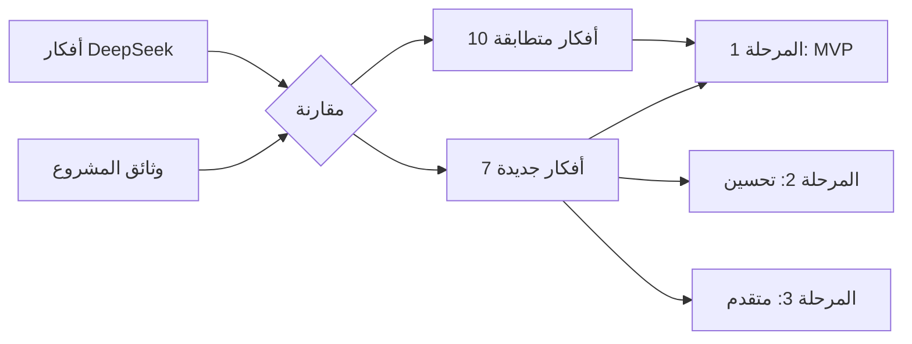

# تحليل محادثة DeepSeek وربطها بمشروع learn_gdscript

## ملخص المحادثة

المحادثة مع DeepSeek طرحت أفكاراً وميزات لبناء تطبيق تعليمي تفاعلي للغة GDScript باستخدام Flutter، مقسمة إلى 6 محاور:

1. 🎯 المحتوى التعليمي (مسار متدرج، دروس مصغرة، مشاريع صغيرة)
2. 🕹️ التفاعلية (محرر أكواد، تنفيذ مباشر، اختبارات، تلميحات، عرض الحل)
3. 📱 التصميم المتجاوب (واجهة تكيفية Desktop/Mobile)
4. 🏆 التلعيب (سلاسل أيام، XP، شارات، لوحة متصدرين)
5. 🧠 ميزات للفهم العميق (مستكشف صياغة، خريطة مفاهيم)
6. 🛠️ ملاحظات تقنية (val_highlight_flutter، محاكاة التنفيذ، JSON/Markdown)

---

## مقارنة: ما الموجود مسبقاً vs ما هو جديد

### ✅ أفكار مطابقة — موجودة ومفصّلة أكثر في وثائقنا

| فكرة DeepSeek | الموجود في المشروع | الملف المرجعي |
| :--- | :--- | :--- |
| مسار تعلم متدرج (Learning Path) | ✅ موجود ومفصّل بـ 10 وحدات تعليمية | [product_ideas](file:///home/osm/flutter_projects/learn_gdscript/docs/product_ideas_for_learning_gdscript.md#L28-L43) |
| دروس مصغرة (Micro-lessons) | ✅ موجود: "مفهوم واحد، شرح موجز، مثال، تمرين" | [product_ideas](file:///home/osm/flutter_projects/learn_gdscript/docs/product_ideas_for_learning_gdscript.md#L30-L31) |
| محرر أكواد مدمج | ✅ موجود ومفصّل: تلوين، أرقام أسطر، إكمال تلقائي | [priority_one](file:///home/osm/flutter_projects/learn_gdscript/docs/priority_one_app_and_home_screen.md#L45-L53) |
| تنفيذ مباشر (Live Runner) | ✅ موجود: زر "شغّل" ومنطقة ناتج | [priority_one](file:///home/osm/flutter_projects/learn_gdscript/docs/priority_one_app_and_home_screen.md#L48) |
| تلميحات ذكية متدرجة | ✅ موجود ومفصّل بـ 4 مستويات | [product_ideas](file:///home/osm/flutter_projects/learn_gdscript/docs/product_ideas_for_learning_gdscript.md#L67-L76) |
| عرض الحل (Peek Solution) | ✅ موجود: "الحل المشروح، بعد طلبه" | [product_ideas](file:///home/osm/flutter_projects/learn_gdscript/docs/product_ideas_for_learning_gdscript.md#L74) |
| واجهة تكيفية Desktop/Mobile | ✅ موجود ومفصّل لـ 3 أحجام شاشات | [priority_one](file:///home/osm/flutter_projects/learn_gdscript/docs/priority_one_app_and_home_screen.md#L213-L228) |
| شارات ونقاط XP | ✅ موجود: "شارات مرتبطة بمهارة أُتقنت" | [product_ideas](file:///home/osm/flutter_projects/learn_gdscript/docs/product_ideas_for_learning_gdscript.md#L92-L98) |
| سلاسل الأيام (Streaks) | ✅ موجود: "سلسلة أيام اختيارية" | [product_ideas](file:///home/osm/flutter_projects/learn_gdscript/docs/product_ideas_for_learning_gdscript.md#L96) |
| حفظ التقدم محلياً | ✅ موجود: SQLite مذكور في التبعيات | [product_ideas](file:///home/osm/flutter_projects/learn_gdscript/docs/product_ideas_for_learning_gdscript.md#L78-L80) |

### 🆕 أفكار جديدة — غير مذكورة في الوثائق الحالية

| فكرة DeepSeek | الحالة | قيمتها للمشروع |
| :--- | :--- | :--- |
| **نظام اختبارات (Test Cases)** — مدخلات/مخرجات متوقعة لكل تمرين | 🆕 مذكور جزئياً لكن ليس كنظام مستقل | ⭐⭐⭐⭐⭐ عالية جداً |
| **مستكشف الصياغة (Syntax Explorer)** — بحث سريع عن الكلمات المفتاحية | 🆕 غير مذكور بوضوح | ⭐⭐⭐⭐ عالية |
| **خريطة مفاهيم بصرية** — شجرة تظهر العلاقات بين المفاهيم | 🆕 غير موجودة | ⭐⭐⭐ متوسطة |
| **لوحة المتصدرين (Leaderboard)** | 🆕 الوثائق تحذر منها! | ⭐ منخفضة (تؤجل) |
| **مشغل صوتي** للمصطلحات | 🆕 غير مذكور | ⭐⭐ اختيارية |
| **استخدام `val_highlight_flutter`** | 🆕 اقتراح حزمة محددة | ⭐⭐⭐ مفيدة تقنياً |
| **تخزين المحتوى في JSON/Markdown** | 🆕 مذكور بشكل عام لكن غير مفصّل | ⭐⭐⭐⭐ مهمة معمارياً |

---

## التحليل العميق: كيف نطبق الأفكار الجديدة

### 1. نظام اختبارات التمارين (Exercise Test System) ⭐⭐⭐⭐⭐

> [!IMPORTANT]
> هذه أهم فكرة جديدة من المحادثة. الوثائق الحالية تذكر "اختبارات تحقق" لكن لا تصف نظاماً مستقلاً.

**الفكرة:** لكل تمرين، نحدد مدخلات ومخرجات متوقعة. عندما يشغّل المستخدم كوده، يقارن التطبيق مخرجاته بالمتوقع تلقائياً.

**التطبيق في مشروعنا:**

```dart
// نموذج بيانات اختبار التمرين
class ExerciseTestCase {
  final String description;      // "يجب أن تطبع 'مرحبا'"
  final String? stdin;           // مدخلات اختيارية
  final String expectedOutput;   // المخرج المتوقع
  final bool ignoreWhitespace;   // تجاهل المسافات الزائدة
}

class Exercise {
  final String id;
  final String prompt;           // "اكتب دالة تجمع عددين"
  final String starterCode;      // الكود المبدئي
  final String solutionCode;     // الحل المرجعي
  final List<ExerciseTestCase> testCases;
  final List<String> hints;      // تلميحات متدرجة
}
```

**الربط بالمحرك:** محرك `gdscript_engine` الموجود يدعم `executeSync()` الذي يُرجع نتيجة التنفيذ. نستخدمه مباشرة:

```dart
final result = engine.executeSync(userCode);
final passed = result.output == testCase.expectedOutput;
```

> [!NOTE]
> هذا يعتمد على إصلاح الأخطاء الحرجة في المرحلة 1 من [خطة الإصلاح](file:///home/osm/flutter_projects/learn_gdscript/packages/gdscript_engine/docs/gdscript_engine_fix_plan.md#L53-L89).

---

### 2. مستكشف الصياغة (Syntax Explorer) ⭐⭐⭐⭐

**الفكرة:** قائمة مرجعية سريعة قابلة للبحث عن كلمات GDScript المفتاحية.

**التطبيق في مشروعنا:**

لدينا بالفعل بيانات ضخمة في `editor_api.dart` (4000 سطر!) تتضمن توثيقات الكلمات المفتاحية والدوال المدمجة. بعد تفكيكها (المرحلة 5 من خطة الإصلاح)، ستصبح:

```
lib/src/api/editor/data/
├── keyword_docs.dart     ← توثيقات الكلمات المفتاحية
├── builtin_docs.dart     ← توثيقات الدوال المدمجة
└── member_data.dart      ← خصائص الفئات
```

كما يوجد محتوى مرجعي واسع في [`docs/gdscript/`](file:///home/osm/flutter_projects/learn_gdscript/docs/gdscript) يمكن تحويله إلى بيانات قابلة للبحث.

**واجهة المستكشف المقترحة:**

- شريط بحث في أعلى الشاشة
- فلترة حسب الفئة (كلمات مفتاحية، دوال، أنواع)
- عرض: الاسم + شرح موجز + مثال قابل للتشغيل
- ربط مع الدرس ذي الصلة

---

### 3. خريطة المفاهيم البصرية ⭐⭐⭐

**الفكرة:** بدلاً من قائمة نصية، عرض المفاهيم كشجرة مترابطة.

**التطبيق:** يمكن بناؤها كـ Widget تفاعلي يستخدم `CustomPainter` أو حزمة مثل `graphview`. الهيكل:

```
البداية
  ├── المتغيرات
  │     ├── الأنواع (int, float, String, bool)
  │     └── التحويل بين الأنواع
  ├── الشروط (if/elif/else)
  │     └── match
  ├── الحلقات (for/while)
  │     ├── break/continue
  │     └── range()
  ├── الدوال
  │     ├── المعاملات والقيم المعادة
  │     └── Lambda
  ├── المصفوفات والقواميس
  └── الأصناف (class)
        ├── الخصائص والدوال
        ├── الوراثة (extends)
        └── الإشارات (signal)
```

> [!TIP]
> هذه ميزة للأولوية الثانية — بعد إكمال الحلقة التعليمية الأساسية.

---

### 4. تخزين المحتوى التعليمي في JSON/Markdown ⭐⭐⭐⭐

**الفكرة من DeepSeek:** "خزّن الدروس والتمارين في ملفات JSON أو Markdown منفصلة عن كود التطبيق."

**التطبيق المقترح:**

```
assets/
  curriculum/
    ├── curriculum.json          ← فهرس المسار والوحدات
    ├── units/
    │   ├── 01_basics/
    │   │   ├── unit.json        ← بيانات الوحدة
    │   │   ├── lesson_01.md     ← شرح الدرس (Markdown)
    │   │   ├── lesson_01_exercises.json  ← التمارين واختباراتها
    │   │   └── lesson_02.md
    │   ├── 02_conditions/
    │   └── ...
    └── syntax_reference/
        ├── keywords.json
        └── builtins.json
```

**مثال لملف تمرين JSON:**

```json
{
  "id": "basics_01_print",
  "title": "أول أمر طباعة",
  "type": "write_code",
  "prompt": "اكتب أمراً يطبع 'مرحبا بالعالم'",
  "starter_code": "# اكتب كودك هنا\n",
  "hints": [
    "استخدم الدالة print()",
    "ضع النص بين علامتي تنصيص: print(\"...\")",
    "الحل: print(\"مرحبا بالعالم\")"
  ],
  "solution": "print(\"مرحبا بالعالم\")",
  "test_cases": [
    {
      "description": "يجب أن يطبع 'مرحبا بالعالم'",
      "expected_output": "مرحبا بالعالم"
    }
  ]
}
```

> [!IMPORTANT]
> هذا يجعل إضافة محتوى جديد لا تتطلب إعادة بناء التطبيق — فقط تحديث ملفات الأصول.

---

## خطة التنفيذ المتكاملة (ربط DeepSeek + الوثائق الحالية)

### المرحلة 0: إصلاح المحرك (شرط مسبق)
>
> موثّقة في [gdscript_engine_fix_plan.md](file:///home/osm/flutter_projects/learn_gdscript/packages/gdscript_engine/docs/gdscript_engine_fix_plan.md)

- إصلاح الأخطاء الحرجة الثلاثة (تجميع المتغيرات، التعليقات، تسريب match)
- نقل الاختبارات للحزمة
- **بدون محرك يعمل، لا يوجد تطبيق تعليمي**

### المرحلة 1: الحلقة التعليمية الأساسية (MVP)
>
> تجمع بين وثائقنا + أفكار DeepSeek الجديدة

| المهمة | المصدر | الحالة |
| :--- | :--- | :--- |
| بنية المحتوى JSON/Markdown | 🆕 DeepSeek | جديد |
| كتابة 5 دروس أولية | وثائقنا | مخطط |
| نظام اختبارات التمارين | 🆕 DeepSeek | جديد |
| 5 أنواع تمارين متنوعة | وثائقنا | مخطط |
| محرر أكواد + تلوين صياغة | كلاهما | مخطط |
| لوحة مخرجات | كلاهما | مخطط |
| تلميحات متدرجة (4 مستويات) | وثائقنا | مخطط |
| حفظ محلي (SQLite) | وثائقنا | مخطط |
| شاشة رئيسية + مسار + درس + إعدادات | وثائقنا | مخطط |

### المرحلة 2: التحسين والتوسع

| المهمة | المصدر |
| :--- | :--- |
| مستكشف الصياغة (Syntax Explorer) | 🆕 DeepSeek |
| مراجعة ذكية (Spaced Repetition) | وثائقنا |
| شارات ونقاط XP | كلاهما |
| سلاسل الأيام (اختيارية) | كلاهما |
| مشروع تطبيقي على مراحل | وثائقنا |

### المرحلة 3: ميزات متقدمة

| المهمة | المصدر |
| :--- | :--- |
| خريطة مفاهيم بصرية | 🆕 DeepSeek |
| بحث داخل الدروس | وثائقنا |
| تصدير المشاريع | وثائقنا |
| مشغل صوتي للمصطلحات | 🆕 DeepSeek |

---

## ما يجب تأجيله أو تجنبه

> [!CAUTION]
> كلتا المحادثتين (DeepSeek + وثائقنا) تتفقان على تأجيل:

- ❌ **لوحة المتصدرين** — DeepSeek ذكرها لكن وثائقنا تحذر منها صراحة
- ❌ **حسابات ومزامنة سحابية** — قبل إثبات فائدة المسار الأساسي
- ❌ **محاكاة Godot الكاملة** — المحرك ينفذ مجموعة جزئية فقط
- ❌ **إشعارات متكررة** — تشتت أكثر مما تحفز
- ❌ **مقارنة حرفية للأكواد** — استخدم اختبارات المخرجات بدلاً منها

---

## الخلاصة



**المحادثة مع DeepSeek أضافت 3 أشياء قيّمة فعلاً:**

1. **نظام اختبارات التمارين** — الأكثر أهمية وقابلية للتنفيذ الفوري
2. **بنية JSON/Markdown للمحتوى** — قرار معماري مهم يجب اتخاذه مبكراً
3. **مستكشف الصياغة** — ميزة مميزة تستفيد من بيانات editor_api الضخمة

أما باقي الأفكار (مسار متدرج، محرر، تلميحات، تلعيب، تصميم متجاوب) فهي **موجودة ومفصّلة أكثر** في وثائقنا الحالية.
