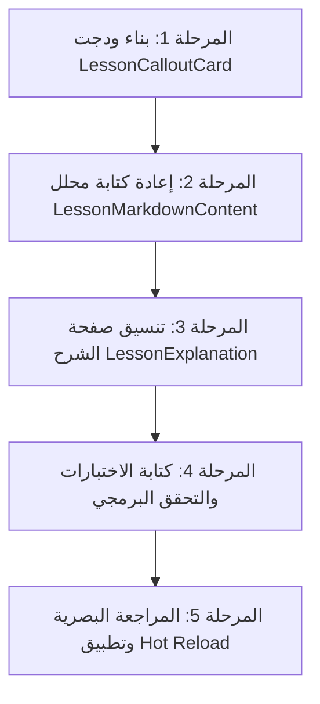

# الخطة التنفيذية لتطوير تجربة قراءة وتنسيق محتوى الدرس (Lesson Content UI Enhancement Plan)

> **تاريخ الاعتماد:** 2026-10-27  
> **حالة الوثيقة:** معتمدة للتنفيذ  
> **الملفات المستهدفة مباشرة:**  
>
> - [`lib/ui/screens/lesson/lesson_screen.dart`](file:///home/osm/flutter_projects/learn_gdscript/lib/ui/screens/lesson/lesson_screen.dart)  
> - [`lib/ui/screens/lesson/lesson_explanation.dart`](file:///home/osm/flutter_projects/learn_gdscript/lib/ui/screens/lesson/lesson_explanation.dart)  
> - [`lib/ui/screens/lesson/lesson_markdown_content.dart`](file:///home/osm/flutter_projects/learn_gdscript/lib/ui/screens/lesson/lesson_markdown_content.dart)  
> **الملفات والودجات الجديدة:**  
> - [`lib/ui/screens/lesson/widgets/lesson_callout_card.dart`](file:///home/osm/flutter_projects/learn_gdscript/lib/ui/screens/lesson/widgets/lesson_callout_card.dart)  
> - [`test/ui/widgets/lesson_markdown_content_test.dart`](file:///home/osm/flutter_projects/learn_gdscript/test/ui/widgets/lesson_markdown_content_test.dart)  
> **المراجع التصميمية:** [`lib/core/theme/godot_arabic_ide_theme.dart`](file:///home/osm/flutter_projects/learn_gdscript/lib/core/theme/godot_arabic_ide_theme.dart) | [`docs/curriculum_remediation_plan.md`](file:///home/osm/flutter_projects/learn_gdscript/docs/curriculum_remediation_plan.md)

---

## فهرس الخطة

1. [المقدمة والهدف الاستراتيجي](#1-المقدمة-والهدف-الاستراتيجي)
2. [تشخيص وتحليل الوضع الراهن (Root Cause Analysis)](#2-تشخيص-وتحليل-الوضع-الراهن-root-cause-analysis)
3. [المواصفات الفنية والبصرية لنظام الحاويات الذكية (Directives & Callouts System)](#3-المواصفات-الفنية-والبصرية-لنظام-الحاويات-الذكية-directives--callouts-system)
4. [معمارية معالج المحتوى والتدرج الهرمي (Content Parsing & Typography Engine)](#4-معمارية-معالج-المحتوى-والتدرج-الهرمي-content-parsing--typography-engine)
5. [المعمارية البرمجية وهيكلية الملفات](#5-المعمارية-البرمجية-وهيكلية-الملفات)
6. [مراحل التنفيذ المتسلسلة (Step-by-Step Execution Phases)](#6-مراحل-التنفيذ-المتسلسلة-step-by-step-execution-phases)
7. [معايير القبول وضمان الجودة (Definition of Done)](#7-معايير-القبول-وضمان-الجودة-definition-of-done)

---

## 1. المقدمة والهدف الاستراتيجي

يُعد قسم الشرح في شاشة الدرس ([`LessonScreen`](file:///home/osm/flutter_projects/learn_gdscript/lib/ui/screens/lesson/lesson_screen.dart)) البوابة التعليمية الأولى للمتعلم الجديد في تطبيق **"تعلّم GDScript"**. يعتمد المنهج التعليمي v2.0.0 في كل درس على بنية غنية خماسية الأركان تتضمن توجيهات رسمية مستندة إلى محرك Godot 4.3 (تحذيرات، توصيات، معلومات هندسية، وقواعد ذهبية).

### الهدف الأساسي من خطة التطوير

تحويل عرض نصوص الدروس من مظهر "ملف Markdown خام غير منسق" إلى **واجهة تعليمية تفاعلية حديثة وفاخرة**، تفصل بين أنواع المحتوى بوضوح، وتُبرز التحذيرات والتوصيات في حاويات ملونة بأيقونات معبرة، وتمنح المتعلم تجربة قراءة مريحة بصرياً تدعم ثنائية اللغة (العربية والإنجليزية) وعزل اتجاه الأكواد البرمجية (BiDi Protection).

---

## 2. تشخيص وتحليل الوضع الراهن (Root Cause Analysis)

عند فحص كود ودجت [`LessonMarkdownContent`](file:///home/osm/flutter_projects/learn_gdscript/lib/ui/screens/lesson/lesson_markdown_content.dart)، تبين أن طريقة المعالجة تعتمد على حلقة أسطر بدائية (`markdown.split('\n')`) تقتصر على:

1. التقاط كتل الأكواد ```` ``` ```` وتحويلها إلى `LessonCodeBlock`.
2. فحص سطر العنوان الرئيسي `##` فقط وتحويله إلى `titleLarge`.
3. طباعة باقي الأسطر كنص عادي عبر `SelectableText.rich` مع خط صغير `bodySmall`.

### الآثار السلبية الناتجة

- **ظهور وسوم Markdown الصريحة في العناوين والفقرات:** تظهر وسوم العناوين الفرعية `### 1. المفهوم` برموز الهاشتاج كنص عادي، كما تظهر وسوم النصوص العريضة `**نص**` بالنجوم.
- **ظهور علامات Backticks `` ` `` في العناوين دون تلوين:** عند ورود اسم دالة أو متغير داخل العنوان (مثل: `## استخدام دالة `print()` في المحرك`)، تظهر علامات `` ` `` حرفياً ويظهر الكود بلون أسود/رمادي باهت كبقية العنوان دون أي تلوين نحوي (Syntax Highlighting) أو عزل اتجاهي (BiDi Isolation)، مما يؤدي لتشوه شكل الأقواس وعلامات الدوال.
- **تجاهل كتل التنبيهات المعتمدة:** تظهر وسوم `> [!WARNING]` و `> [!TIP]` و `> [!NOTE]` كنص عادي مشوه أو مسبوق برمز `>`، مما يفقد المتعلم إدراك خطورة الفخاخ البرمجية في GDScript (مثل قسمة الأعداد الصحيحة أو الحلقات اللانهائية).
- **غياب التمييز البصري:** لا توجد حاويات أو بطاقات تفصل بين الشرح النظري، والتحذير الخطير، والممارسة الفضلى، والقاعدة الذهبية للمشروع.
- **إرهاق القراءة:** اعتماد خط `bodySmall` دون ضبط ارتفاع الأسطر (`line-height`) يُصعب القراءة المستمرة للدروس الشاملة.

---

## 3. المواصفات الفنية والبصرية لنظام الحاويات الذكية (Directives & Callouts System)

يتم بناء ودجت مخصص موحد باسم [`LessonCalloutCard`](file:///home/osm/flutter_projects/learn_gdscript/lib/ui/screens/lesson/widgets/lesson_callout_card.dart) يدعم 4 أنماط دلالية، متوافقة كلياً مع نظام الألوان والسمات في المشروع ([`GodotArabicIdeTheme`](file:///home/osm/flutter_projects/learn_gdscript/lib/core/theme/godot_arabic_ide_theme.dart)):

```
┌─────────────────────────────────────────────────────────────────────────┐
│ [أيقونة النمط]  عنوان التوجيه (مثل: تحذير رسمي من Godot)               │
│ ─────────────────────────────────────────────────────────────────────── │
│ نص الشرح التوضيحي مع دعم الكود المضمن `code` والكلمات **العريضة**...    │
└─────────────────────────────────────────────────────────────────────────┘
```

### مصفوفة الحاويات والأنماط التنبيهية

| نمط الحاوية | الصيغة المستهدفة في Markdown | الأيقونة | لون الخلفية والحدود (داكن / فاتح) | شارة العنوان التلقائية (عربي / إنجليزي) | الغرض التربوي |
| :--- | :--- | :---: | :--- | :--- | :--- |
| **تحذير رسمي (Warning)** | `> [!WARNING]` أو `- ⚠️ **تحذير...**` | `Icons.warning_amber_rounded` | أحمر/مرجاني (`debuggerCoral` شفافية 12% / `errorContainer` ناعم مع حد بارز) | ⚠️ تحذير رسمي<br>Official Warning | التنبيه من السلوكيات الخطيرة مثل انهيار اللعبة، تجميد المحرك، أو تدمير المراجع في الذاكرة. |
| **توصية فضلى (Tip / Best Practice)** | `> [!TIP]` أو `- 💡 **توصية...**` | `Icons.lightbulb_outline_rounded` | زمردي ناعم (`runtimeEmerald` شفافية 12% / `tertiaryContainer` مع حد زمردي) | 💡 توصية وممارسة فضلى<br>Best Practice | ترسيخ أسلوب كود Godot الرسمي وقواعد مثل "Signal Up, Call Down". |
| **معلومة هندسية (Technical Note)** | `> [!NOTE]` أو `- ℹ️ **معلومة...**` | `Icons.info_outline_rounded` | أزرق Godot (`godotBlue` شفافية 14% / `primaryContainer` مع حد أزرق هادئ) | ℹ️ معلومة هندسية<br>Technical Note | شرح آليات عمل المحرك خلف الكواليس وإدارة الذاكرة بالمرجع. |
| **قاعدة ذهبية (Golden Rule)** | `> **قاعدة ذهبية:**` أو الاقتباسات | `Icons.auto_awesome_rounded` | ذهبي ساطع (`questGold` شفافية 16% / `secondaryContainer` مع حد ذهبي مذهب) | ⭐ القاعدة الذهبية<br>Golden Rule | تلخيص خلاصة الدرس والمنهجية البرمجية الواجب حفظها وتطبيقها. |

---

## 4. معمارية معالج المحتوى والتدرج الهرمي (Content Parsing & Typography Engine)

تتم ترقية [`LessonMarkdownContent`](file:///home/osm/flutter_projects/learn_gdscript/lib/ui/screens/lesson/lesson_markdown_content.dart) ليعمل كمحلل كتل دلالي خفيف وسريع (Lightweight Block-based Parser):

### 1. تصنيف ومعالجة الكتل (Block Parsing)

- **كتل الأكواد:** التقاط علامات ```` ``` ```` ومسار اللغة وتوجيهها لـ `LessonCodeBlock` مع زر النسخ والتلوين اللوني للـ GDScript.
- **كتل التنبيهات متعددة الأسطر:** التقاط `> [!WARNING]`, `> [!TIP]`, `> [!NOTE]` وجمع أسطر الاقتباس التابعة لها حتى انتهاء الكتلة، وتحويلها إلى `LessonCalloutCard`.
- **كتل الاقتباس والقواعد الذهبية:** التقاط الأسطر البادئة بـ `>` وفحص احتوائها على "قاعدة ذهبية" لإنشاء حاوية مخصصة.
- **التنبيهات المضمنة في القوائم:** التعرف على الأسطر التي تبدأ بـ `- ⚠️` أو `- ℹ️` أو `- 💡` وتحويلها تلقائياً إلى حاويات مدمجة بدلاً من مجرد نقطة جامدة.
- **العناوين الرئيسية والفرعية مع دعم الأكواد المضمنة:**
  - `## العنوان`: عنوان رئيسي للقسم مع خط `titleLarge` ووزن عريض، **مع تطبيق تلوين الكود المضمن وإزالة علامات `` ` `` تلقائياً**.
  - `### الرقم. العنوان`: تحويلها إلى صف عنوان فرعي بارز (Subheading Row) مع شارة رقمية أنيقة، **مع دعم وتلوين أي كود برمجي وارد داخل العنوان**.
- **القوائم المنقطة العادية:** تحويل `- عنصر` إلى ودجت قائمة مخصص يعرض نقطة زخرفية متناسقة، مع هوامش اتجاهية (`EdgeInsetsDirectional`) لدعم المحاذاة التلقائية في العربية والإنجليزية.

### 2. التنسيق المضمن للنصوص والعناوين (Inline Spans & Code Highlighting Engine)

تطوير دالة موحدة لبناء الـ Spans تدعم تمرير النمط الأساسي (`baseStyle`) لتُستخدم في الفقرات والعناوين على حد سواء:

- **الكود المضمن في العناوين والفقرات (`` `code` ``):**
  - استئصال وحذف علامات الـ Backticks `` ` `` من العرض كلياً.
  - تطبيق التلوين النحوي التلقائي عبر `GDScriptSyntaxHighlighter` المستند لألوان ثيم المحرر `CodeEditorTheme`.
  - تطبيق العزل ثنائي الاتجاه (`\u2066` و `\u2069`) لضمان عدم انقلاب الأقواس `()` أو النقاط `.` عند ورود الكلمات البرمجية داخل العناوين والجمل العربية.
  - تغليف الكود داخل خلفية ناعمة خفيفة متناسقة مع مقاس خط العنوان أو الفقرة (Pill/Badge Background).
- **النصوص العريضة (`**text**`):** تحويلها إلى `FontWeight.w700` بلون الخط البارز.
- **النصوص المائلة (`*text*`):** تحويلها إلى `FontStyle.italic`.
- **الخط الأساسي للفقرات:** استخدام `bodyLarge` مع ضبط `height: 1.65` لمنح العين راحة فائقة أثناء قراءة الشروحات العربية المطولة.

---

## 5. المعمارية البرمجية وهيكلية الملفات

```
lib/ui/screens/lesson/
├── lesson_screen.dart                     <-- الشاشة الرئيسية للدرس
├── lesson_explanation.dart                <-- الحاوية العلوية لمعلومات وشرح الدرس
├── lesson_markdown_content.dart           <-- محرك تحليل الكتل والتنسيق الذكي
├── lesson_code_block.dart                 <-- كتلة عرض كود GDScript
├── lesson_documentation_section.dart      <-- بطاقة توثيق ومراجع المحرك
└── widgets/
    └── lesson_callout_card.dart           <-- ودجت الحاوية التنبيهية (جديد)
```

### تفاصيل الودجات

- **`LessonCalloutCard`:** ودجت Stateless يستقبل:
  - `type`: نوع التوجيه (`CalloutType.warning`, `tip`, `note`, `goldenRule`).
  - `title`: عنوان اختياري (إذا لم يُحدد، يولد العنوان التلقائي المترجم).
  - `content`: نص الشرح مع دعم التنسيقات المضمنة.
  - `icon`: أيقونة مخصصة اختيارية.

---

## 6. مراحل التنفيذ المتسلسلة (Step-by-Step Execution Phases)



### المرحلة 1: إنشاء ودجت `LessonCalloutCard`

- إنشاء الملف [`lib/ui/screens/lesson/widgets/lesson_callout_card.dart`](file:///home/osm/flutter_projects/learn_gdscript/lib/ui/screens/lesson/widgets/lesson_callout_card.dart).
- ضبط السمات اللونية والحدود وظلال السطح بناءً على `Theme.of(context).colorScheme`.
- دعم الترجمة التلقائية للشارات الافتراضية (عربي / إنجليزي).

### المرحلة 2: ترقية معالج المحتوى `LessonMarkdownContent`

- إعادة هيكلة [`lesson_markdown_content.dart`](file:///home/osm/flutter_projects/learn_gdscript/lib/ui/screens/lesson/lesson_markdown_content.dart) لدعم تحليل الكتل (`BlockToken`):
  - كتل كودية، كتل تنبيهية، كتل عناوين `##` و `###`، كتل اقتباسات، كتل قوائم، وفقرات عادية.
- دمج محلل التنسيقات المضمنة (Inline Spans: Bold, Italic, Code, RTL Isolation).

### المرحلة 3: تنسيق صفحة الشرح `LessonExplanation`

- تحسين بطاقة ترويسة الدرس (العنوان والهدف التعليمي) في [`lesson_explanation.dart`](file:///home/osm/flutter_projects/learn_gdscript/lib/ui/screens/lesson/lesson_explanation.dart) لتبدو كبطاقة تقديمية ذات هوية بصرية متميزة.
- ضمان التناسق البصري مع بطاقة التوثيق [`lesson_documentation_section.dart`](file:///home/osm/flutter_projects/learn_gdscript/lib/ui/screens/lesson/lesson_documentation_section.dart).

### المرحلة 4: اختبارات الوحدة والتحقق الشامل

- إنشاء ملف اختبارات متخصص [`test/ui/widgets/lesson_markdown_content_test.dart`](file:///home/osm/flutter_projects/learn_gdscript/test/ui/widgets/lesson_markdown_content_test.dart).
- فحص صحة تحليل الحاويات الأربع، والأكواد المضمنة، والنصوص العريضة، والقوائم.
- تشغيل التحليل الثابت `flutter analyze` والتأكد من خلو المشروع من أي أخطاء أو تحذيرات.

### المرحلة 5: المراجعة البصرية في التطبيق

- تفعيل ميزة التحديث الفوري (Hot Reload) والتحقق من المظهر في الوضعين الليلي والنهاري والشاشات المكتبية والمحمولة.

---

## 7. معايير القبول وضمان الجودة (Definition of Done)

1. ✅ **اختفاء رموز التنسيق الخام:** لا تظهر أي رموز `###` أو `**` أو `> [!...]` كنصوص مجردة في واجهة المستخدم.
2. ✅ **تلوين وتنسيق الأكواد في العناوين:** إزالة علامات `` ` `` بالكامل من العناوين الرئيسية (`##`) والفرعية (`###`)، وتلوين الكلمات البرمجية بداخلها بألوان ثيم GDScript مع العزل الاتجاهي وحجم خط متناسق مع العنوان.
3. ✅ **حاويات تنبيهية متمايزة:** ظهور كتل التحذيرات باللون المرجاني/الأحمر، والتوصيات باللون الزمردي/الأخضر، والملاحظات بالأزرق، والقواعد بالذهبي.
4. ✅ **عزل الكود ثنائي الاتجاه (BiDi):** عدم حدوث أي انكسار أو انقلاب للأقواس أو الرموز في الأكواد المضمنة داخل النصوص العربية.
5. ✅ **أداء عالي:** لا يوجد أي بطء أو إعادة رسم زائدة أثناء التمرير في شاشة الشرح.
6. ✅ **توافق تام مع الثيم:** التكيف السلس والتلقائي مع الوضع الليلي (Dark Mode) والوضع النهاري (Light Mode).
7. ✅ **اجتياز الاختبارات:** اجتياز كافة اختبارات الـ Widgets وفحص التحليل البرمجي بنسبة 100%.
