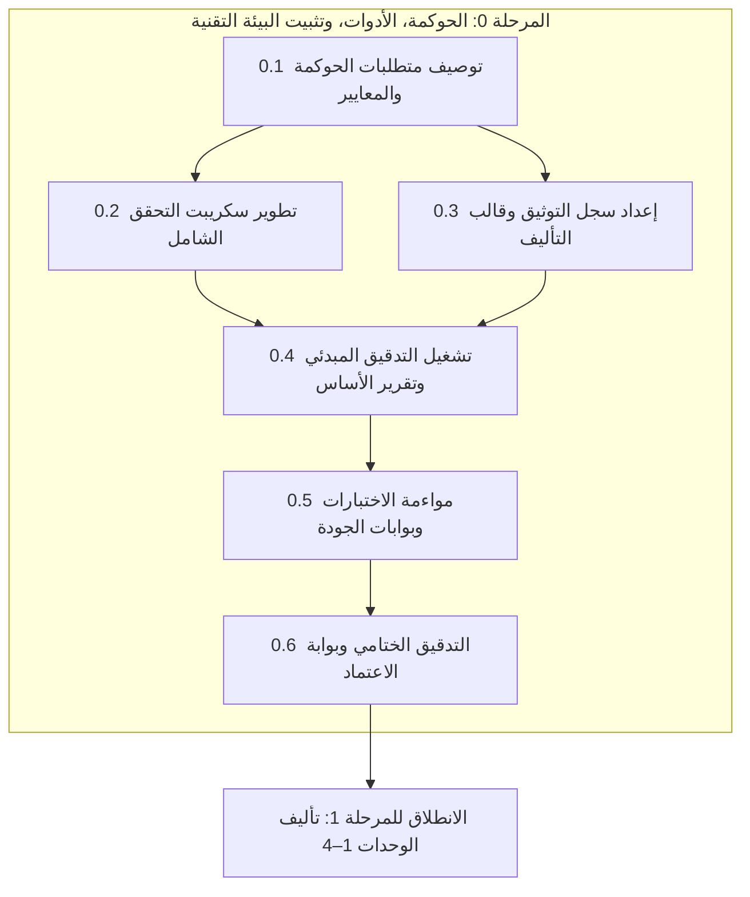

# الخطة التنفيذية للمرحلة 0: الحوكمة، الأدوات، وتثبيت البيئة التقنية

> **تاريخ الاعتماد:** 2026-10-27  
> **المرجع الأساسي:** [تحليل وتقييم المنهج التعليمي](file:///home/osm/flutter_projects/learn_gdscript/docs/curriculum_analysis.md)  
> **الخطة الأم:** [الخطة التنفيذية لمعالجة وتطوير المنهج التعليمي](file:///home/osm/flutter_projects/learn_gdscript/docs/curriculum_remediation_plan.md)  
> **نطاق المرحلة:** بناء المنظومة التقنية المؤتمتة لحوكمة المحتوى، تطوير سكريبت التحقق الآلي، تدقيق خط الأساس، وتجهيز قوالب ومراجع التأليف.  
> **المخرج النهائي المستهدف:** بيئة تطوير برمجية محصنة تمنع بنسبة 100% تسرب أي درس قالبي أو تمرين سطحي، مع تقرير خط أساس كمي كامل.

---

## فهرس خطة المرحلة 0

1. [مقدمة وأهداف المرحلة 0](#1-مقدمة-وأهداف-المرحلة-0)
2. [تحليل المدخلات والدروس المستفادة من التحليل](#2-تحليل-المدخلات-والدروس-المستفادة-من-التحليل)
3. [المراحل الفرعية المتسلسلة للتنفيذ](#3-المراحل-الفرعية-المتسلسلة-للتنفيذ)
   - [المرحلة الفرعية 0.1: توصيف متطلبات الحوكمة ومعايير التحقق](#المرحلة-الفرعية-01-توصيف-متطلبات-الحوكمة-ومعايير-التحقق)
   - [المرحلة الفرعية 0.2: هندسة وتطوير سكريبت التحقق الشامل (`tool/validate_curriculum.dart`)](#المرحلة-الفرعية-02-هندسة-وتطوير-سكريبت-التحقق-الشامل)
   - [المرحلة الفرعية 0.3: إعداد سجل توثيق Godot 4.3 وقالب التأليف المعياري](#المرحلة-الفرعية-03-إعداد-سجل-توثيق-godot-43-وقالب-التأليف-المعياري)
   - [المرحلة الفرعية 0.4: تشغيل التدقيق المبدئي وإصدار تقرير خط الأساس (Baseline Report)](#المرحلة-الفرعية-04-تشغيل-التدقيق-المبدئي-وإصدار-تقرير-خط-الأساس)
   - [المرحلة الفرعية 0.5: مواءمة الاختبارات القائمة وبناء بوابات الجودة (Quality Gates)](#المرحلة-الفرعية-05-مواءمة-الاختبارات-القائمة-وبناء-بوابات-الجودة)
   - [المرحلة الفرعية 0.6: التدقيق الختامي والاعتماد للانتقال إلى المرحلة 1](#المرحلة-الفرعية-06-التدقيق-الختامي-والاعتماد-للانتقال-إلى-المرحلة-1)
4. [الجدول الزمني ومسار الاعتماديات للمرحلة 0](#4-الجدول-الزمني-ومسار-الاعتماديات-للمرحلة-0)
5. [مصفوفة المسؤوليات (RACI) للمرحلة 0](#5-مصفوفة-المسؤوليات-raci-للمرحلة-0)
6. [معايير القبول وبوابة الإغلاق (Definition of Done)](#6-معايير-القبول-وبوابة-الإغلاق-definition-of-done)

---

## 1. مقدمة وأهداف المرحلة 0

بينت وثيقة [تحليل المنهج التعليمي](file:///home/osm/flutter_projects/learn_gdscript/docs/curriculum_analysis.md) أن أكبر خطر يهدد جودة تطبيق "تعلّم GDScript" هو **غياب الحوكمة الآلية على جودة المحتوى**؛ حيث سمح غياب أدوات الفحص الصارمة بمرور 17 درساً تأسيسياً بأسئلة قالبية مكررة وتلميحات عامة، وإجابات صحيحة عند الفهرس الأول دائماً، وتمرينات برمجة سطحية.

لذا، تمثل **المرحلة 0** خط الدفاع الأول والعمود الفقري الهندسي لكامل مسار التطوير. لن يتم كتابة درس واحد في المنهج قبل اكتمال هذه المرحلة والتأكد من وجود "حارس آلي" يرفض برمجياً أي محتوى لا يطابق المعايير.

### الأهداف التشغيلية للمرحلة 0

1. **أتمتة الرقابة:** تطوير أداة CLI قوية (`tool/validate_curriculum.dart`) تفحص آلياً جميع ملفات المنهج وخريطة المفاهيم وفق 12 معياراً صارماً.
2. **رصد خط الأساس:** استخراج إحصائيات دقيقة لعدد الانتهاكات الموجودة حالياً في المنهج (عدد الأسئلة القالبية، التلميحات المكررة، التمارين ذات حالة الاختبار الواحدة، المفاهيم الناقصة).
3. **تثبيت المرجع الرسمي:** إنشاء سجل موثق لروابط توثيق Godot 4.3 وتوحيد نمط المراجع.
4. **توحيد أدوات الكتّاب:** تجهيز حزمة تأليف متكاملة (Authoring Kit) تضم قالباً نموذجياً وقائمة تدقيق للمراجعين.
5. **سد ثغرات الاختبارات:** تعديل اختبارات المشروع في `test/` لفرض نفس المعايير العالية على جميع الوحدات (0 إلى 11) دون أي استثناء.

---

## 2. تحليل المدخلات والدروس المستفادة من التحليل

استناداً إلى الفحص العميق في [docs/curriculum_analysis.md](file:///home/osm/flutter_projects/learn_gdscript/docs/curriculum_analysis.md) وفحص ملف الاختبار القائم [test/content_validation_test.dart](file:///home/osm/flutter_projects/learn_gdscript/test/content_validation_test.dart)، تم رصد الحقائق الهندسية التالية:

1. **ثغرة الاستثناء في الاختبارات القائمة:**
   في `test/content_validation_test.dart` الأسطر 89–104، تبيّن وجود شرط استثنائي:

   ```dart
   if (unit.order >= 5) {
     expect(exercise.testCases.length, greaterThanOrEqualTo(3));
     expect(lessonExerciseTypes, hasLength(7));
   }
   ```

   هذا يعني أن الوحدات 0 إلى 4 كانت **معفاة برمجياً** من متطلب تنوع أنواع التمارين ومن متطلب تعدد حالات الاختبار، مما تسبب مباشرة في تدني جودتها! **يجب على المرحلة 0 إنهاء هذا الاستثناء تدريجياً عبر أدوات الفحص الجديدة.**

2. **أنماط القوالب المرصودة الواجب كشفها برمجياً:**
   - أسئلة نصية متطابقة: *"ما الفكرة الأساسية في هذا الدرس؟"*.
   - تلميحات متطابقة: *"اربط الإجابة بهدف الدرس والمثال"*، *"راجع قاعدة الدرس وتتبع تنفيذ الأسطر بالترتيب"*.
   - تمركز الإجابة الصحيحة: `correctOptionIndex == 0` في 100% من أسئلة الاختيار في الوحدات المبكرة.
   - تكرار تمارين الشيفرة: `print("Hello!")`, `print("Godot")`, `print(7)` دون أي تعقيد متصاعد.
   - غياب التوجيهات الرسمية: انعدام كتل التحذيرات (`[!WARNING]`) والمعلومات (`[!NOTE]`) والتوصيات (`[!TIP]`).

---

## 3. المراحل الفرعية المتسلسلة للتنفيذ



---

### المرحلة الفرعية 0.1: توصيف متطلبات الحوكمة ومعايير التحقق

**الهدف:** تحويل معايير "دستور التأليف" في الخطة العامة إلى خوارزميات وقواعد تحقق رقمية محددة بدقة.

#### المهام التنفيذية

1. **تحديد مصفوفة القواعد الـ 12 للتحقق الآلي:**
   - **القاعدة 1 (سلامة المخطط):** توافق ملفات JSON مع نماذج Dart (`Curriculum`, `Unit`, `Lesson`, `Exercise`, `ExerciseTestCase`, `DocumentationSource`) وصحة أنواع الحقول وخلوها من القيم الفارغة.
   - **القاعدة 2 (تطابق وتفرد المعرفات):** تطابق معرفات `manifest.json` مع أسماء المجلدات وملفات الدروس، وتفرد معرفات الدروس والتمارين عبر كامل التطبيق.
   - **القاعدة 3 (اكتمال البنية الخماسية):** فحص احتواء `contentMarkdown.ar` على الأقسام الخمسة الإلزامية: (1. المفهوم والهدف، 2. الصياغة والقواعد، 3. مثال عملي مشروح، 4. أخطاء شائعة وتحذيرات، 5. قاعدة ذهبية وملخص).
   - **القاعدة 4 (منع التكرار القالبي للتلميحات):** خوارزمية تطابق نصي تفحص تشابه نصوص التلميحات عبر تمارين الدرس الواحد وعبر دروس الوحدة.
   - **القاعدة 5 (منع أسئلة الاختيار القالبية):** حظر قائمة الكلمات/الجمل القالبية المحظورة ("ما الفكرة الأساسية"، "أي ممارسة تساعد"، إلخ).
   - **القاعدة 6 (توزيع خيارات الاختيار من متعدد):** التحقق من أن مؤشر الإجابة الصحيحة `correctOptionIndex` متغير ولا يتركز عند الفهرس `0` بنسبة تتجاوز 40% داخل الدرس الواحد.
   - **القاعدة 7 (كفاية حالات الاختبار):** وجود حالتي اختبار (`testCases`) على الأقل لتمارين `writeCode` و `fixBug`، وتنوع المدخلات والمخرجات المتوقعة.
   - **القاعدة 8 (فحص التوجيهات الرسمية):** التحقق من احتواء الدروس المحددة في مصفوفة التوجيهات على كتل `[!WARNING]` أو `[!NOTE]` أو `[!TIP]`.
   - **القاعدة 9 (صلاحية الروابط وتثبيت الإصدار):** فحص جميع روابط `documentationSources` والتأكد من أنها تبدأ بـ `https://docs.godotengine.org/` وتشير إلى التوثيق المعتمد وتستجيب برمز HTTP 200.
   - **القاعدة 10 (تكامل خريطة المفاهيم):** تطابق جميع دروس المنهج (51 درساً) مع عقد في `assets/concept_map/manifest.json` وخلو شبكة الاعتماديات من الحلقات الدائرية.
   - **القاعدة 11 (العدالة الزمنية):** التحقق من أن المدة التقديرية `estimatedMinutes` تتناسب مع عدد الكلمات والتمارين (بين 8 إلى 25 دقيقة).
   - **القاعدة 12 (التحدي التراكمي للوحدة):** فحص وجود تمرين تركيبي تراكمي في نهاية كل وحدة.

---

### المرحلة الفرعية 0.2: هندسة وتطوير سكريبت التحقق الشامل

**الهدف:** برمجة أداة Dart مستقلة عالية الأداء وقابلة للتشغيل من الطرفية: `tool/validate_curriculum.dart`.

#### معمارية الأداة البرمجية

تُبنى الأداة في المجلد `tool/` وتعتمد على محركات فحص معيارية مستقلة:

```text
tool/
├── validate_curriculum.dart             ← نقطة الدخول الرئيسية للطرفية (CLI Entrypoint)
└── src/
    ├── checkers/
    │   ├── schema_checker.dart          ← فحص بنية JSON وتوافق النماذج
    │   ├── duplicate_checker.dart       ← كشف التلميحات والأسئلة القالبية المتكررة
    │   ├── multiple_choice_checker.dart ← فحص توزيع الإجابات وجودة الخيارات
    │   ├── test_case_checker.dart       ← فحص حالات الاختبار وتغطية الحالات الحدية
    │   ├── directives_checker.dart      ← فحص كتل التحذيرات والتوصيات والمعلومات
    │   ├── links_checker.dart           ← فحص وتدقيق روابط توثيق Godot الرسمي
    │   └── concept_map_checker.dart     ← فحص تغطية والاعتماديات في خريطة المفاهيم
    ├── reporters/
    │   ├── console_reporter.dart        ← تقرير ملون وتفاعلي على شاشة الطرفية
    │   └── markdown_reporter.dart       ← توليد تقرير تدقيق بصيغة Markdown للحفظ في docs/
    └── config/
        └── validation_rules.dart        ← ثوابت القواعد والمعايير والكلمات المحظورة
```

#### المزايا التقنية للأداة

1. **خيارات تشغيل مرنة عبر الأوامر (CLI Flags):**
   - `dart run tool/validate_curriculum.dart` — فحص كامل مع تقرير ملخص.
   - `dart run tool/validate_curriculum.dart --unit=01` — فحص وحدة محددة أثناء التأليف.
   - `dart run tool/validate_curriculum.dart --check-links` — فحص الروابط الشبكية (HTTP HEAD/GET).
   - `dart run tool/validate_curriculum.dart --strict` — وضع الصرامة القصوى (فشل مع أي تحذير).
   - `dart run tool/validate_curriculum.dart --output=docs/audit_report.md` — تصدير التقرير كملف markdown.
2. **رموز الخروج (Exit Codes):**
   - يرجع السكريبت رمز `0` عند النجاح الكامل، و `1` عند وجود أخطاء تمنع الاعتماد، مما يسمح بدمجه في الـ CI والـ Git Hooks.

---

### المرحلة الفرعية 0.3: إعداد سجل توثيق Godot 4.3 وقالب التأليف المعياري

**الهدف:** توفير بنية تحتية مرجعية وقوالب عمل جاهزة تضمن التزام مؤلفي المنهج بأعلى معايير الجودة من اليوم الأول.

#### المهام التنفيذية

1. **إنشاء سجل روابط التوثيق الرسمي المعتمد (`docs/gdscript_official_registry.md`):**
   - حصر وتوثيق روابط Godot 4.3 الرسمية وتصنيفها حسب الموضوعات:
     - الأساسيات: Syntax, Variables, Operators, Control Flow.
     - الأصناف والكائنات: Classes, Inheritance, Properties, Signals.
     - شجرة المشهد: Nodes, SceneTree, Lifecycle, Groups, PackedScenes.
     - المدخلات والأحداث: InputEvent, Viewport, Actions.
     - الموارد والمحرر: Resources, Exports, Saving.
     - العمليات غير المتزامنة: Coroutines, await, Timers.
     - جودة الشيفرة: Static typing, Warnings, Style Guide.
   - توثيق عنوان كل مرجع ورابطه الثابت وقسمه المستهدف لتوحيد حقول `documentationSources`.

2. **بناء قالب الدرس المعياري الكامل (`docs/templates/lesson_template.json`):**
   - ملف JSON نموذجي يطابق نموذج `Lesson` بنسبة 100% ويحتوي على:
     - نصوص الأركان الخمسة كاملة بالعربية والإنجليزية في `contentMarkdown`.
     - كتل التنبيهات الثلاث (`[!WARNING]`, `[!NOTE]`, `[!TIP]`) مع أمثلة حقيقية من Godot.
     - 10 تمارين كاملة تغطي الأنواع السبعة المدعومة:
       - 4 تمارين `writeCode` بحالتي اختبار على الأقل لكل تمرين.
       - 2 تمرين `multipleChoice` بخيارات مشتتة حقيقية وموضع إجابة غير الصفر.
       - 1 تمرين `fixBug` ببيانات تصحيح واضحة.
       - 1 تمرين `predictOutput` بشيفرة تتبع واقعية.
       - 1 تمرين `fillBlank` بإكمال دقيق.
       - 1 تمرين `reorderSteps` أو `guidedTask`.
     - تلميحات ثلاثية متدرجة (مفهوم ثم هيكل) لكل تمرين.

3. **إعداد قائمة تدقيق المراجع (Reviewer Checklist):**
   - وثيقة سريعة (`docs/templates/lesson_review_checklist.md`) يستخدمها المراجع التربوي والتقني قبل إقرار أي درس.

---

### المرحلة الفرعية 0.4: تشغيل التدقيق المبدئي وإصدار تقرير خط الأساس (Baseline Report)

**الهدف:** تشغيل أداة التحقق الجديدة على محتوى المنهج الحالي لتسجيل قياسات البداية وتوثيق الفجوات كمياً.

#### المهام التنفيذية

1. تنفيذ الأمر الشامل لتوليد التقرير:

   ```bash
   dart run tool/validate_curriculum.dart --output=docs/baseline_curriculum_audit_report.md
   ```

2. تصنيف وتجميع المخالفات المرصودة:
   - حصر الدروس المحتوية على أسئلة اختيار من متعدد قالبية.
   - حصر الدروس التي يكون فيها خيار الإجابة الصحيحة دائماً `0`.
   - حصر التمارين التي تكرر نفس نصوص التلميحات.
   - حصر التمارين البرمجية التي تقتصر على حالة اختبار واحدة.
   - حصر الدروس الـ 37 غير المغطاة في خريطة المفاهيم.
   - حصر الدروس الخالية من كتل التحذيرات والتوصيات الرسمية.
3. اعتماد ملف `docs/baseline_curriculum_audit_report.md` كمرجع رسمي للمقارنة (Baseline Benchmark)، لمعرفة نسبة التقدم مع كل وحدة يتم تطويرها في المراحل اللاحقة.

---

### المرحلة الفرعية 0.5: مواءمة الاختبارات القائمة وبناء بوابات الجودة (Quality Gates)

**الهدف:** ربط أدوات الفحص بحزمة اختبارات المشروع الرسمية وتفعيل الحماية البرمجية.

#### المهام التنفيذية

1. **تحديث `test/content_validation_test.dart`:**
   - تجهيز ملف الاختبار لتبني المعايير الجديدة تدريجياً:
     - الإبقاء على سلامة الاختبارات الحالية مع إضافة فحوصات توافق لخط الأساس.
     - تجهيز أعلام فحص (Flags) تُمكّن من رفع المعايير على الوحدات التي تكتمل إعادة كتابتها (مثلاً: التحقق الصارم للوحدة 01 فور اكتمالها في المرحلة 1).
2. **إضافة أمر الفحص في `pubspec.yaml` (Scripts / Workflows):**
   - تمكين تشغيل الفحص عبر أمر سريع ومباشر في الطرفية.
3. **تجهيز خطاف التحقق قبل الإيداع (Pre-commit Git Hook Guideline):**
   - توفير سكريبت يمنع إيداع أي تعديل في `assets/curriculum/` إذا فشل التحقق في الوضع الصارم (`--strict`).

---

### المرحلة الفرعية 0.6: التدقيق الختامي والاعتماد للانتقال إلى المرحلة 1

**الهدف:** التحقق من اكتمال كافة متطلبات المرحلة 0 بنجاح وإعطاء الضوء الأخضر لبدء المرحلة 1 (النموذج الريادي للوحدة 01).

#### قائمة التحقق لإغلاق المرحلة 0 (Sign-off Checklist)

- [ ] مجلد `tool/` يحتوي على `validate_curriculum.dart` وكافة محركات الفحص الستة.
- [ ] سكريبت الفحص يعمل بكفاءة وسرعة عبر الطرفية وينتج تقارير نصية وبصيغة Markdown.
- [ ] تم توثيق تقرير خط الأساس المبدئي في `docs/baseline_curriculum_audit_report.md`.
- [ ] ملف `docs/gdscript_official_registry.md` موثق ويحتوي على كافة الروابط المرجعية لـ Godot 4.3.
- [ ] ملف `docs/templates/lesson_template.json` جاهز وصالح برمجياً ويحتوي على البنية الخماسية والتوجيهات الرسمية.
- [ ] ملف `docs/templates/lesson_review_checklist.md` جاهز للاستخدام.
- [ ] تشغيل `flutter test` يمر بنجاح كامل (100% Pass).

---

## 4. الجدول الزمني ومسار الاعتماديات للمرحلة 0

تُنفذ المرحلة 0 في فترة عمل مركزة مدتها **5 أيام عمل متتالية**:

| اليوم | المرحلة الفرعية | المهام المنجزة | المخرج اليومي (Daily Deliverable) |
| :---: | --- | --- | --- |
| **اليوم 1** | المرحلة 0.1 | توصيف معايير وقواعد الفحص الـ 12 بدقة | وثيقة مواصفات الفحص التقنية |
| **اليوم 2** | المرحلة 0.2 (جزء 1) | بناء هيكل `tool/` ومحركات البنية والتكرار والخيارات | نواة سكريبت الفحص تعمل على JSON |
| **اليوم 3** | المرحلة 0.2 (جزء 2) | برمجة محرك حالات الاختبار ومحرك التوجيهات ومحرك الروابط | سكريبت `validate_curriculum.dart` مكتمل الوظائف |
| **اليوم 4** | المرحلة 0.3 + 0.4 | إعداد سجل Godot 4.3 وقالب الدرس وتوليد تقرير خط الأساس | صدور `baseline_curriculum_audit_report.md` وقالب الدرس |
| **اليوم 5** | المرحلة 0.5 + 0.6 | مواءمة الاختبارات، بوابات الجودة، وإجراء التدقيق الختامي | جاهزية تامة والاعتماد الرسمي لإطلاق المرحلة 1 |

---

## 5. مصفوفة المسؤوليات (RACI) للمرحلة 0

| المهمة التنفيذية | مهندس Flutter والأدوات | مراجع Godot التقني | المراجع الأكاديمي واللغوي |
| --- | :---: | :---: | :---: |
| توصيف معايير وقواعد الفحص الـ 12 | **A / R** | C | C |
| برمجة سكريبت `validate_curriculum.dart` ومحركاته | **A / R** | I | I |
| إعداد سجل توثيق Godot 4.3 وتدقيق الروابط | C | **A / R** | I |
| بناء قالب الدرس المعياري `lesson_template.json` | C | **R** | **A** |
| تشغيل تدقيق خط الأساس واستخراج التقرير | **A / R** | I | I |
| مواءمة اختبارات `test/` وبوابات الجودة | **A / R** | C | I |
| الاعتماد النهائي لإغلاق المرحلة 0 | **A** | **A** | **A** |

---

## 6. معايير القبول وبوابة الإغلاق (Definition of Done)

تُعتبر المرحلة 0 مكتملة رسمياً فقط عند استيفاء المعايير التالية:

1. **سلامة الأداة البرمجية:** سكريبت `validate_curriculum.dart` يعمل بنجاح بدون أخطاء وقت التشغيل، ويعطي نتائج متطابقة تماماً عند تكرار الفحص.
2. **دقة كشف الانتهاكات:** قدرة السكريبت على كشف جميع العيوب المرصودة في وثيقة التحليل (مثل أسئلة الاختيار القالبية في الوحدات 1–4 ومؤشر الإجابة الثابت عند 0 والتلميحات المكررة).
3. **جاهزية المراجع والقوالب:** توفر قالب الدرس النموذجي وسجل روابط Godot 4.3 في مجلد `docs/`.
4. **توثيق الأساس:** صدور تقرير خط الأساس الكمي رسمياً في `docs/`.
5. **عدم انكسار الاختبارات القائمة:** استمرار نجاح كافة اختبارات المشروع السابقة عبر `flutter test`.

---

## 7. الخطوة المباشرة التالية بعد الاعتماد

بمجرد إغلاق هذه الخطة واعتماد مخرجاتها، يتم الشروع فوراً في **المرحلة 1: المعالجة الجذرية للوحدات التأسيسية**، بدءاً من:
- **تأليف النموذج الريادي (Golden Pilot):** إعادة كتابة دروس الوحدة 01 الثلاثة (`lesson_01_hello`, `lesson_02_comments`, `lesson_15_errors`) باستخدام القالب المعتمد وإخضاعها لفحص الأداة الجديدة بنجاح 100%.
