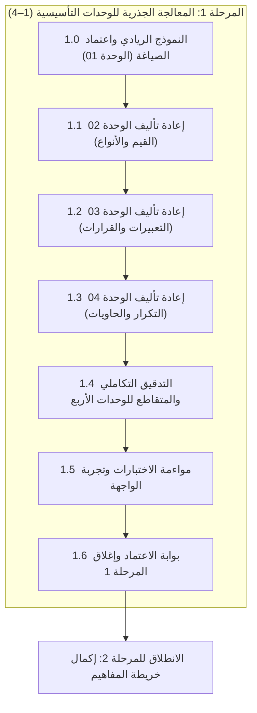

# الخطة التنفيذية للمرحلة 1: المعالجة الجذرية للوحدات التأسيسية (الوحدات 1–4)

> **تاريخ الاعتماد:** 2026-10-27  
> **المرجع الأساسي:** [تحليل وتقييم المنهج التعليمي](file:///home/osm/flutter_projects/learn_gdscript/docs/curriculum_analysis.md)  
> **الخطة الأم:** [الخطة التنفيذية لمعالجة وتطوير المنهج التعليمي](file:///home/osm/flutter_projects/learn_gdscript/docs/curriculum_remediation_plan.md)  
> **خطة المرحلة السابقة:** [الخطة التنفيذية للمرحلة 0](file:///home/osm/flutter_projects/learn_gdscript/docs/phase_0_execution_plan.md)  
> **النطاق التنفيذي:** إعادة تأليف وتعميق كامل لـ 17 درساً و 170 تمريناً في الوحدات الأربع الأولى، والقضاء التام على النمطية القالبية، وتطبيق دستور التأليف والتوجيهات الرسمية لـ GDScript 4.3.  
> **المخرج المستهدف:** تحويل الوحدات التأسيسية من نقطة ضعف حرجة (تقييم 2.0/5) إلى تجربة تعليمية نموذجية ريادية (تقييم 4.9/5).

---

## فهرس خطة المرحلة 1

1. [الرؤية والأهداف التشغيلية](#1-الرؤية-والأهداف-التشغيلية)
2. [استرجاع فجوات الوحدات 1–4 من وثيقة التحليل](#2-استرجاع-فجوات-الوحدات-14-من-وثيقة-التحليل)
3. [المراحل الفرعية المتسلسلة للتنفيذ](#3-المراحل-الفرعية-المتسلسلة-للتنفيذ)
   - [المرحلة الفرعية 1.0: النموذج الريادي واعتماد معايير الصياغة (الوحدة 01)](#المرحلة-الفرعية-10-النموذج-الريادي-واعتماد-معايير-الصياغة-الوحدة-01)
   - [المرحلة الفرعية 1.1: إعادة تأليف الوحدة 02 — القيم والمتغيرات والأنواع (5 دروس)](#المرحلة-الفرعية-11-إعادة-تأليف-الوحدة-02--القيم-والمتغيرات-والأنواع-5-دروس)
   - [المرحلة الفرعية 1.2: إعادة تأليف الوحدة 03 — التعبيرات والقرارات (4 دروس)](#المرحلة-الفرعية-12-إعادة-تأليف-الوحدة-03--التعبيرات-والقرارات-4-دروس)
   - [المرحلة الفرعية 1.3: إعادة تأليف الوحدة 04 — التكرار والحاويات (5 دروس)](#المرحلة-الفرعية-13-إعادة-تأليف-الوحدة-04--التكرار-والحاويات-5-دروس)
   - [المرحلة الفرعية 1.4: التدقيق التكاملي والمتقاطع للوحدات التأسيسية الأربع](#المرحلة-الفرعية-14-التدقيق-التكاملي-والمتقاطع-للوحدات-التأسيسية-الأربع)
   - [المرحلة الفرعية 1.5: مواءمة الاختبارات الآلية والتحقق في واجهة التطبيق](#المرحلة-الفرعية-15-مواءمة-الاختبارات-الآلية-والتحقق-في-واجهة-التطبيق)
   - [المرحلة الفرعية 1.6: بوابة الاعتماد وإغلاق المرحلة 1](#المرحلة-الفرعية-16-بوابة-الاعتماد-وإغلاق-المرحلة-1)
4. [مخطط التحديات التراكمية الختامية لكل وحدة](#4-مخطط-التحديات-التراكمية-الختامية-لكل-وحدة)
5. [مصفوفة التوجيهات الرسمية الإلزامية للوحدات 1–4](#5-مصفوفة-التوجيهات-الرسمية-الإلزامية-للوحدات-14)
6. [الجدول الزمني ومسار الاعتماديات للمرحلة 1](#6-الجدول-الزمني-ومسار-الاعتماديات-للمرحلة-1)
7. [مصفوفة المسؤوليات (RACI) للمرحلة 1](#7-مصفوفة-المسؤوليات-raci-للمرحلة-1)
8. [معايير القبول وبوابة الإغلاق (Definition of Done)](#8-معايير-القبول-وبوابة-الإغلاق-definition-of-done)

---

## 1. الرؤية والأهداف التشغيلية

أكدت وثيقة [تحليل المنهج التعليمي](file:///home/osm/flutter_projects/learn_gdscript/docs/curriculum_analysis.md) أن الانطباع الأول للمتعلم يُبنى بالكامل في الوحدات الأربع الأولى (الدروس 1 إلى 20). إذا وجد المتعلم محتوى فقيراً أو أسئلة شكلية مكررة، فإن الدافعية تتلاشى وينقطع عن المتابعة (Drop-off Rate مرتفع).

تمثل **المرحلة 1** القلب النابض لعملية الإصلاح، حيث تنتقل بالمنهج من مرحلة التوليد الآلي القالبي إلى **مرحلة التأليف التعليمي الأصيل والمحترف** الموجه خصيصاً لمطوري الألعاب المبتدئين.

### الأهداف التشغيلية للمرحلة 1

1. **إعادة تأليف شاملة لـ 17 درساً (170 تمريناً):** إحلال كامل لنصوص الشرح والتوثيق والتمارين دون المساس بمعرفات الدروس (`lessonId`) أو تقدم المتعلم.
2. **تطبيق الأركان الخمسة للتعليم البرمجي:** كل درس يحتوي إلزاماً على: (1. المفهوم في سياق الألعاب، 2. القواعد والصياغة، 3. مثال عملي مشروح سطر بسطر، 4. أخطاء شائعة وتحذيرات، 5. ملخص وقاعدة ذهبية).
3. **التخصيص التام للأسئلة والتلميحات:** القضاء على أسئلة *"ما الفكرة الأساسية؟"* بنسبة 100%، وتوزيع الإجابة الصحيحة عشوائياً، وتخصيص التلميحات المتدرجة (مفهوم ثم هيكل).
4. **تعددية حالات الاختبار:** إضافة حالتي اختبار على الأقل لكل تمرين كتابة شيفرة تفحص القيم العادية والحدية.
5. **إدراج 4 تحديات تراكمية (Synthesis Capstones):** تمرين تركيبي في ختام كل وحدة يدمج مهاراتها.

---

## 2. استرجاع فجوات الوحدات 1–4 من وثيقة التحليل

لضمان معالجة دقيقة وشاملة، نلخص أدناه الفجوات المرصودة في [docs/curriculum_analysis.md](file:///home/osm/flutter_projects/learn_gdscript/docs/curriculum_analysis.md) الخاصة بالوحدات التأسيسية:

| الوحدة | عدد الدروس | تقييم التحليل | أبرز الفجوات المرصودة في التحليل |
| --- | :---: | :---: | --- |
| **الوحدة 01: البداية والأساسيات** | 3 دروس (30 تمرين) | ⭐⭐ (2.0 / 5) | - شرح فقرة واحدة لدرس كامل ومثال سطر وحيد.<br>- إهمال بيئة Godot: كيفية إنشاء مشروع، ربط السكربت بعقدة، نافذة الشيفرة مقابل لوحة الإخراج.<br>- تمارين `print()` مكررة 4 مرات بنفس الصيغة مع تغيير الكلمة فقط.<br>- أسئلة اختيار من متعدد متطابقة نصياً عبر الدروس الثلاثة. |
| **الوحدة 02: القيم والمتغيرات** | 5 دروس (50 تمرين) | ⭐⭐⭐ (2.5 / 5) | - غياب التحذير الرسمي الحاسم من قسمة الأعداد الصحيحة `int / int`.<br>- شرح غير كافٍ للفرق بين التحويل الصريح والضمني ومخاطر اقتطاع `int(float)`.<br>- إهمال أفضل الممارسات في التنسيق بـ `%s` و `String.format()`.<br>- تلميحات نمطية مكررة بحذافيرها في كل التمارين. |
| **الوحدة 03: التعبيرات والقرارات** | 4 دروس (40 تمرين) | ⭐⭐⭐ (2.5 / 5) | - عدم تحذير المبتدئ من الخطأ الشائع للخلط بين `=` و `==`.<br>- تمارين `if/elif` تفتقر للسيناريوهات الحقيقية للألعاب (صحة اللاعب، الذخيرة، الحظ).<br>- إهمال إبراز قوة `match` كبديل أسرع وأكثر أماناً من سلاسل `elif`.<br>- الإجابة الصحيحة دائماً الخيار الأول `0`. |
| **الوحدة 04: التكرار والحاويات** | 5 دروس (50 تمرين) | ⭐⭐⭐ (2.5 / 5) | - غياب التحذير الخطر من تجميد المحرك بسبب حلقة `while` لانهائية.<br>- عدم توضيح أن المصفوفات والقواميس تُمرر بالمرجع (Pass-by-reference).<br>- غياب التحذير من تعديل المصفوفة أثناء التكرار عليها.<br>- غياب درس أو تمرين تركيبي يدمج الحلقات والمصفوفات والقواميس. |

---

## 3. المراحل الفرعية المتسلسلة للتنفيذ



---

### المرحلة الفرعية 1.0: النموذج الريادي واعتماد معايير الصياغة (الوحدة 01)

**الهدف:** إعادة كتابة دروس الوحدة 01 الثلاثة وتطوير تمارينها الثلاثين لتكون "النموذج الذهبي المعياري" (Golden Standard) الذي يُقاس عليه باقي المنهج.

#### 1. تفاصيل دروس الوحدة 01

- **الدرس 01 (`lesson_01_hello` — المحرر وأول برنامج):**
  - **المفهوم والهدف:** ما هو السكربت في محرك Godot؟ ولماذا نكتب السكربت ملحقاً بعقدة في شجرة المشهد؟ دور دالة `_ready()` وكيف تُنفذ التعليمات تسلسلياً سطر بسطر.
  - **الصياغة:** شرح استدعاء الدالة `print()`، الأقواس، السلاسل النصية، ولوحة الإخراج (Output Dock) مقابل شاشة اللعبة.
  - **المثال العملي المشروح:** سكربت يطبع رسائل متعددة مع توضيح ترتيب الظهور في لوحة الإخراج.
  - **التوجيهات الرسمية المدمجة:**
    - ℹ️ **معلومة هندسية:** دالة `_ready()` تُستدعى تلقائياً مرة واحدة فقط عندما تدخل العقدة شجرة المشهد.
    - 💡 **توصية:** السكربت المستقل لا يعمل في لعبة حقيقية ما لم يُرفق بعقدة في المشهد.
  - **التمارين العشرة:**
    1. `multipleChoice`: سيناريو قراءة ترتيب المخرجات لثلاثة أسطر `print()` (الخيار الصحيح ليس الأول).
    2. `predictOutput`: توقع المخرجات لطباعة نصوص وأرقام معاً.
    3. `fillBlank`: إكمال استدعاء دالة `print` الناقصة في سكربت بداية.
    4. `writeCode`: كتابة سكربت يطبع اسم اللعبة وإصدارها في سطرين منفصلين.
    5. `fixBug`: تصحيح خطأ نسيان إغلاق القوس في `print("Hello Godot"`.
    6. `writeCode`: طباعة ناتج عملية حسابية بسيطة مع نص.
    7. `reorderSteps`: ترتيب خطوات إنشاء سكربت وإرفاقه بعقدة وتشغيله في Godot.
    8. `multipleChoice`: سؤال عن مكان ظهور الرسائل المطبوعة في المحرر (لوحة الإخراج vs نافذة اللعبة).
    9. `fixBug`: تصحيح نسيان علامات التنصيص حول النص.
    10. `writeCode` (تحدي مصغر): كتابة بطاقة بدء اللعبة (شعار الترحيب، اسم المطور، والحالة "جاهز").

- **الدرس 02 (`lesson_02_comments` — التعليقات والتوثيق):**
  - **المفهوم:** أهمية التعليقات لتنظيم الشيفرة والتواصل داخل فرق تطوير الألعاب.
  - **الصياغة:** التعليق بسطر واحد `#`، التعليقات التوثيقية `##` لتوليد التوثيق الآلي في Godot.
  - **التوجيهات الرسمية:** 💡 **توصية:** كتابة `##` قبل المتغيرات والدوال يجعل محرر Godot يعرض شرحها في نافذة الفحص (Inspector).
  - **التمارين:** تفعيل وتعطيل أسطر (Comment Out)، توثيق دالة، تمييز السطور المفسرة عن المهملة.

- **الدرس 15 (`lesson_15_errors` — قراءة الأخطاء وتشخيصها):**
  - **المفهوم:** تشريح نافذة Debugger في Godot، تتبع المكدس (Stack Trace)، والفرق بين أخطاء الصياغة وأخطاء وقت التشغيل.
  - **التوجيهات الرسمية:** ⚠️ **تحذير رسمي:** تحذيرات المترجم الصفراء لا توقف اللعبة فوراً لكنها غالباً تخفي ثغرات خطيرة تنهار عند التصدير.
  - **التمارين:** قراءة رسائل الخطأ، تصحيح أسماء غير معرفة، ضبط المسافات البادئة (Indentation Errors).

#### 2. الفحص والاعتماد

- فحص ملفات الوحدة 01 الثلاثة بأداة `validate_curriculum.dart --unit=01 --strict`.
- مراجعة النموذج الريادي واعتماد نمط الصياغة قبل الانتقال للوحدة 02.

---

### المرحلة الفرعية 1.1: إعادة تأليف الوحدة 02 — القيم والمتغيرات والأنواع (5 دروس)

**الهدف:** تعميق المفاهيم الرياضية والبيانات في GDScript وتصحيح فجوات الأنواع والقسمة والتحويل.

#### دروس الوحدة 02 المستهدفة

1. **الدرس 03 (`lesson_03_variables` — المتغيرات والإسناد):**
   - الكلمة المحجوزة `var`، قواعد التسمية الرسمية (`snake_case`)، مفهوم المتغير كصندوق في الذاكرة تتغير قيمته عبر الزمن (صحة اللاعب، السرعة، النقاط).
2. **الدرس 04 (`lesson_04_types` — أنواع البيانات الأساسية):**
   - الأنواع الأربعة: `int`, `float`, `String`, `bool`.
   - **التوجيه الرسمي الحرج:** ⚠️ **تحذير رسمي:** قسمة الأعداد الصحيحة `int / int` (مثل `5 / 2 = 2`) تُسقط الكسر تماماً! وللحصول على كسر عشري يجب تحويل أحد الطرفين إلى `float`.
3. **الدرس 16 (`lesson_16_casting` — تحويل الأنواع والفحص):**
   - التحويل الصريح بـ `int()`, `float()`, `str()`.
   - **التوجيه الرسمي:** ℹ️ **معلومة تقنية:** تحويل `float` إلى `int` يقتطع الجزء العشري دون تقريب (`int(7.9) == 7`). استخدم `round()` عند الحاجة للتقريب.
4. **الدرس 17 (`lesson_17_strings` — السلاسل النصية وتنسيقها):**
   - عمليات النصوص، دمج النصوص، التنسيق المتقدم عبر `%s` و `String.format()`، وحساب الطول واقتطاع النصوص.
   - **التوجيه الرسمي:** 💡 **توصية:** تجنب ربط النصوص المتكرر بـ `+` داخل الحلقات، واستخدم التنسيق لدعم الترجمة وتعدد اللغات.
5. **الدرس 18 (`lesson_18_enums` — التعدادات والثوابت):**
   - استخدام `const` للقيم الثابتة، والتعدادات المسماة `enum PlayerState { IDLE, RUN, JUMP, DEAD }`.
   - **التوجيه الرسمي:** 💡 **توصية:** استخدام التعدادات المسماة يمنع الأرقام السحرية (Magic Numbers) ويمكّن الإكمال التلقائي في محرر Godot.

- **تحدي الوحدة 02 التراكمي (التمرين 10 في الدرس 18):**
  كتابة برنامج متكامل لإدارة بطاقة شخصية لعبة: متغيرات للصحة والسرعة، ثابت لأقصى طاقة، وتعداد لحالة اللاعب، مع طباعة ملخص منسق بالكامل عبر `String.format()`.

---

### المرحلة الفرعية 1.2: إعادة تأليف الوحدة 03 — التعبيرات والقرارات (4 دروس)

**الهدف:** تمكين المتعلم من بناء منطق حقيقي لألعاب الفيديو باستخدام المقارنات والقرارات المتفرعة وبدائل الأنماط.

#### دروس الوحدة 03 المستهدفة

1. **الدرس 05 (`lesson_05_operations` — العمليات الحسابية والمنطقية):**
   - المعاملات الحسابية، باقي القسمة `%` (واستخداماته في تبديل الأدوار وتكرار الدورات)، المعاملات المنطقية `and`, `or`, `not` وجداول الصواب.
2. **الدرس 06 (`lesson_06_if_else` — اتخاذ القرار البسيط):**
   - البنية الشرطية، المسافات البادئة، ومحاكاة شروط الألعاب (فتح الباب عند امتلاك المفتاح، موت العدو عند نفاد الصحة).
   - **التوجيه الرسمي الحرج:** ⚠️ **تحذير رسمي:** تجنب الخلط بين الإسناد `=` والمقارنة `==`. محرر Godot 4 يصدر تحذيراً فورياً إذا أسندت قيمة داخل شرط.
3. **الدرس 07 (`lesson_07_elif` — الشروط المتعددة والتسلسل المنطقي):**
   - التعامل مع مسارات متعددة، وتجنب فخاخ ترتيب الشروط (من الأخص إلى الأعم).
4. **الدرس 08 (`lesson_08_match` — مطابقة الأنماط المتطورة):**
   - هيكل `match` القوي في GDScript، مطابقة القيم والتعدادات، واستخدام الحارس الافتراضي `_`.
   - **التوجيه الرسمي:** 💡 **توصية:** استخدام `match` بدلاً من سلاسل `elif` الطويلة يرفع سرعة الفحص ويجعل الشيفرة أكثر نظافة وأسهل صيانة.

- **تحدي الوحدة 03 التراكمي (التمرين 10 في الدرس 08):**
  نظام احتساب أضرار المعركة: فحص حالة الدرع والضربة الحرجة والحالة الخاصة (مسموم / محروق) باستخدام `match` و `if/elif` وتحديد الناتج النهائي للصحة.

---

### المرحلة الفرعية 1.3: إعادة تأليف الوحدة 04 — التكرار والحاويات (5 دروس)

**الهدف:** إتقان معالجة مجموعات البيانات وتكرار العمليات دون تجميد اللعبة أو إحداث تسريبات في الذاكرة.

#### دروس الوحدة 04 المستهدفة

1. **الدرس 09 (`lesson_09_for` — حلقة for ونطاقات range):**
   - تكرار العمليات، أشكال دالة `range(count)`, `range(start, end)`, `range(start, end, step)`.
2. **الدرس 10 (`lesson_10_while` — حلقة while والشروط الديناميكية):**
   - متى نستخدم `while` بدلاً من `for`؟ كيفية تحديث شرط الاستمرار.
   - **التوجيه الرسمي الحرج:** ⚠️ **تحذير حرج جداً:** الحلقات اللانهائية في `while` تُجمد خيط معالجة اللعبة بالكامل وتتطلب قتل المحرك قسرياً. ضع دائماً شرط توقف آمن أو حداً أقصى للتكرار.
3. **الدرس 11 (`lesson_11_break_continue` — التحكم في سريان الحلقة):**
   - الخروج المبكر عبر `break` (إيقاف البحث عند إيجاد المقتنى)، وتخطي دورة محددة عبر `continue` (تخطي الأعداء الميتين).
4. **الدرس 19 (`lesson_19_arrays` — المصفوفات والعمليات عليها):**
   - إنشاء المصفوفات، الإضافة بـ `append()`، الحذف بـ `erase()`, `remove_at()`، الترتيب `sort()`، والبحث `find()`.
   - **التوجيهات الرسمية:**
     - ⚠️ **تحذير رسمي:** المصفوفات تُمرر بالمرجع (Pass-by-reference).
     - ⚠️ **تحذير أداء:** تجنب حذف عناصر من مصفوفة أثناء الدوران عليها في حلقة `for`.
5. **الدرس 20 (`lesson_20_dictionaries` — القواميس والبيانات المفتاحية):**
   - تنظيم خصائص الوحوش والعناصر بأزواج مفتاح-قيمة، القراءة الآمنة عبر `dict.get(key, default)`.
   - **التوجيه الرسمي:** ℹ️ **معلومة تقنية:** قراءة مفتاح غير موجود بدون فحص تسبب توقف اللعبة فوراً؛ افحص بـ `dict.has(key)` أو استخدم `get()`.

- **تحدي الوحدة 04 التراكمي (التمرين 10 في الدرس 20):**
  معالجة قائمة غنائم المعركة (Inventory): تصفية مصفوفة قواميس تمثل عناصر سقطت من الوحوش، تجميع الذهب، واستبعاد العناصر التالفة، وحساب إجمالي القيمة.

---

### المرحلة الفرعية 1.4: التدقيق التكاملي والمتقاطع للوحدات التأسيسية الأربع

**الهدف:** إجراء فحص شامل موحد على الـ 17 درساً والـ 170 تمريناً للتأكد من خلوها تماماً من أي مخالفات حوكمية.

#### المهام التنفيذية

1. تشغيل أداة التحقق الشامل على كافة وحدات المرحلة 1:

   ```bash
   dart run tool/validate_curriculum.dart --unit=01,02,03,04 --strict
   ```

2. فحص مصفوفة المقاييس المتقاطعة:
   - التأكد من أن نسبة أسئلة الاختيار ذات الفهرس `0` لا تتعدى 35% عبر كامل التمارين.
   - التأكد من عدم وجود أي تلميح مكرر في أكثر من تمرينين عبر الوحدات الأربع.
   - التأكد من أن كل تمرين برمجي يمتلك 2 إلى 3 حالات اختبار تغطي الحالات الحدية.
   - التأكد من اكتمال الأركان الخمسة في كل ملف درس من الـ 17 ملفاً.

---

### المرحلة الفرعية 1.5: مواءمة الاختبارات الآلية والتحقق في واجهة التطبيق

**الهدف:** إزالة الاستثناءات القديمة في كود الاختبار، والتأكد من جودة العرض في واجهة المستخدم.

#### المهام التنفيذية

1. **تحديث `test/content_validation_test.dart`:**
   - تعديل أسطر فحص تنوع التمارين وعدد حالات الاختبار بحيث تشمل الوحدات 0 إلى 4 دون استثناء:

     ```dart
     // إزالة شرط if (unit.order >= 5) وفرض المعيار الموحد على جميع الوحدات 0-4
     expect(exercise.testCases.length, greaterThanOrEqualTo(2));
     expect(lessonExerciseTypes.length, greaterThanOrEqualTo(5));
     ```

   - تشغيل اختبارات المشروع عبر Flutter والتأكد من نجاحها الكامل (100% Pass).
2. **التحقق من تجربة المستخدم في شاشة المحرر (Desktop IDE):**
   - فتح التطبيق وتصفح دروس الوحدات 1 إلى 4.
   - التأكد من ظهور كتل `[!WARNING]` و `[!NOTE]` و `[!TIP]` بتنسيق بصري جذاب ومريح للعين.
   - تجربة حل التمارين المتنوعة وتتبع ظهور التلميحات متعددة المستويات.

---

### المرحلة الفرعية 1.6: بوابة الاعتماد وإغلاق المرحلة 1

**الهدف:** الاعتماد الرسمي لاكتمال إصلاح الوحدات التأسيسية وإصدار تقرير الجودة قبل الانتقال إلى المرحلة 2 (خريطة المفاهيم).

#### قائمة التدقيق الإلزامية لإغلاق المرحلة 1 (DoD Checklist)

- [ ] 17 ملف درس تم إعادة كتابتها بالكامل باللغتين العربية والإنجليزية.
- [ ] 170 تمريناً مكتملة مع حلولها المرجعية وتلميحاتها المخصصة وحالات التحقق المتعددة.
- [ ] اجتياز فحص `validate_curriculum.dart --strict` بصفر أخطاء وصفر تحذيرات للوحدات 1–4.
- [ ] 4 تحديات تراكمية ختامية تعمل بنجاح في نهاية الوحدات 1، 2، 3، و 4.
- [ ] جميع اختبارات `flutter test` في المشروع تمر بنجاح 100%.
- [ ] الحفاظ الصارم على معرفات الدروس `lessonIds` دون أي تعديل يكسر حفظ بيانات المستخدم.

---

## 4. مخطط التحديات التراكمية الختامية لكل وحدة

| الوحدة | عنوان التحدي التراكمي | المفاهيم المدمجة في التحدي | المخرجات المتوقعة |
| --- | --- | --- | --- |
| **الوحدة 01** | **بطاقة هوية اللعبة (Game Splash Card)** | الطباعة المتعددة، التعليقات التوثيقية `##`، ترتيب التنفيذ، وتجنب أخطاء الصياغة. | مخرجات منسقة تشمل عنوان اللعبة، اسم المطور، وإصدار المحرك مع تعليقات شارحة. |
| **الوحدة 02** | **سجل مقتنيات اللاعب (Player Inventory Sheet)** | المتغيرات `var`، الأنواع الأربعة، الثوابت `const`، التعدادات `enum`، وتنسيق النصوص بـ `format()`. | احتساب الطاقة والذهب وعرض حالة اللاعب كـ `IDLE` أو `RUN` بنصوص منسقة. |
| **الوحدة 03** | **حاسبة أضرار المعركة (Combat Damage Engine)** | العمليات الحسابية والمنطقية، `if/else`، الشروط المتعددة `elif`، ومطابقة الأنماط `match`. | تقييم درع الخصم، مضاعفة الضربات الحرجة، وتحديد النتيجة (انتصار، هزيمة، صمود). |
| **الوحدة 04** | **مصفي الغنائم والموارد (Loot Drop Processor)** | حلقة `for` وحلقة `while`، المصفوفات `Array`، القواميس `Dictionary`، ودوال التحكم `break/continue`. | تصفية قائمة مقتنيات مجمعة، استبعاد التالف، واحتساب إجمالي الذهب المكتسب بأمان. |

---

## 5. مصفوفة التوجيهات الرسمية الإلزامية للوحدات 1–4

تُلخص المصفوفة التالية التوجيهات الرسمية المقررة لمؤلفي المحتوى في المرحلة 1:

```text
┌────────────────────────────────────────────────────────────────────────┐
│ الوحدة 01: البداية والأساسيات                                            │
│  - ℹ️ معلومة: تنفيذ _ready() التلقائي عند دخول شجرة المشهد              │
│  - 💡 توصية: توثيق الدوال والمتغيرات بـ ## لبناء المساعدة التلقائية      │
│  - ⚠️ تحذير: خطورة تحذيرات المترجم الصفراء ومخاطرها عند التصدير النهائي  │
├────────────────────────────────────────────────────────────────────────┤
│ الوحدة 02: القيم والأنواع                                               │
│  - ⚠️ تحذير: قسمة الأعداد الصحيحة int / int تسقط الكسر العشري تماماً     │
│  - ℹ️ معلومة: int(float) تقتطع الكسر كلياً ولا تقرب للرقم الأقرب        │
│  - 💡 توصية: استخدام String.format() وتنسيق %s بدلاً من جمع النصوص بـ + │
│  - 💡 توصية: التعدادات المسماة Named Enums تقضي تماماً على الأرقام السحرية│
├────────────────────────────────────────────────────────────────────────┤
│ الوحدة 03: التعبيرات والقرارات                                         │
│  - ⚠️ تحذير: الانتباه التام للفارق الجوهري بين الإسناد = والمقارنة ==    │
│  - 💡 توصية: match أسرع وأنظف من سلاسل elif الطويلة مع إلزامية وضع _     │
├────────────────────────────────────────────────────────────────────────┤
│ الوحدة 04: التكرار والحاويات                                           │
│  - ⚠️ تحذير حرج: تجميد خيط المحرك بالكامل عند وقوع حلقة while لانهائية  │
│  - ⚠️ تحذير: المصفوفات والقواميس تمرر بالمرجع Pass-by-reference         │
│  - ⚠️ تحذير أداء: حظر تعديل عناصر المصفوفة أثناء التكرار بحلقة for      │
│  - ℹ️ معلومة: قراءة مفتاح غير موجود في القاموس يوقف اللعبة؛ استخدم get() │
└────────────────────────────────────────────────────────────────────────┘
```

---

## 6. الجدول الزمني ومسار الاعتماديات للمرحلة 1

تستغرق المرحلة 1 فترة عمل مركزة مدتها **أسبوعان (10 أيام عمل متتالية)**:

| الأسبوع / اليوم | المرحلة الفرعية | نطاق التنفيذ اليومي | المخرج المعتمد |
| :---: | --- | --- | --- |
| **الأسبوع 1 — اليوم 1** | المرحلة 1.0 (جزء 1) | كتابة شروح وتمارين الدرس 01 والدرس 02 | مسودة الدرسين 01 و 02 |
| **الأسبوع 1 — اليوم 2** | المرحلة 1.0 (جزء 2) | كتابة شروح وتمارين الدرس 15 + فحص الوحدة 01 | اكتمال النموذج الريادي للوحدة 01 |
| **الأسبوع 1 — اليوم 3** | المرحلة 1.1 (جزء 1) | إعادة تأليف الدروس 03 و 04 و 16 في الوحدة 02 | مسودة المتغيرات والأنواع والقسمة |
| **الأسبوع 1 — اليوم 4** | المرحلة 1.1 (جزء 2) | إعادة تأليف الدروس 17 و 18 + تحدي الوحدة 02 | اكتمال الوحدة 02 وفحصها آلياً |
| **الأسبوع 1 — اليوم 5** | مراجعة منتصف المرحلة | تدقيق الوحدتين 01 و 02 وفحصهما في التطبيق | اعتماد 50% من محتوى المرحلة 1 |
| **الأسبوع 2 — اليوم 6** | المرحلة 1.2 (جزء 1) | إعادة تأليف الدروس 05 و 06 في الوحدة 03 | مسودة العمليات و if/else |
| **الأسبوع 2 — اليوم 7** | المرحلة 1.2 (جزء 2) | إعادة تأليف الدروس 07 و 08 + تحدي الوحدة 03 | اكتمال الوحدة 03 وفحصها آلياً |
| **الأسبوع 2 — اليوم 8** | المرحلة 1.3 (جزء 1) | إعادة تأليف الدروس 09 و 10 و 11 في الوحدة 04 | مسودة التكرار و while و break |
| **الأسبوع 2 — اليوم 9** | المرحلة 1.3 (جزء 2) | إعادة تأليف الدروس 19 و 20 + تحدي الوحدة 04 | اكتمال الوحدة 04 وفحصها آلياً |
| **الأسبوع 2 — اليوم 10** | المرحلة 1.4 + 1.5 + 1.6 | التدقيق التكاملي، مواءمة الاختبارات، والاعتماد | إغلاق المرحلة 1 بنجاح 100% |

---

## 7. مصفوفة المسؤوليات (RACI) للمرحلة 1

| المهمة التنفيذية | كاتب المحتوى التعليمي | مهندس Flutter والبيانات | مراجع Godot / GDScript | المراجع اللغوي والتربوي |
| --- | :---: | :---: | :---: | :---: |
| كتابة محتوى الأركان الخمسة للدروس | **R** | I | C | **A** |
| صياغة التمارين والتلميحات المتدرجة | **R** | C | **A** | C |
| برمجة حالات الاختبار المتعددة والحدية | C | **R** | **A** | I |
| تصميم التحديات التراكمية الأربعة | **R** | C | **A** | C |
| تشغيل أداة التحقق الآلي وفحص النتائج | I | **R / A** | C | I |
| تحديث اختبارات `test/` وإزالة الاستثناءات | I | **R / A** | I | I |
| المراجعة اللغوية والتربوية النهائية | C | I | C | **R / A** |
| الاعتماد النهائي لإغلاق المرحلة 1 | C | **A** | **A** | **A** |

---

## 8. معايير القبول وبوابة الإغلاق (Definition of Done)

تُعتبر المرحلة 1 منتهية رسمياً فقط عند التحقق من الشروط التالية:

1. **انعدام القوالب (0% Template Rate):** خلو كافة التمارين من الأسئلة القالبية المحظورة، وتنوع نصوص التلميحات عبر كامل الوحدات الأربع.
2. **عشوائية مؤشر الاختيار:** توزيع نسب الإجابة الصحيحة في الاختيار من متعدد بصورة عادلة بين الفهارس 0 و 1 و 2 دون أي تمركز عند الصفر.
3. **تغطية حالات الاختبار (Test Cases Coverage):** وجود حالتي تحقق على الأقل لكل تمرين كتابة شيفرة مع فحص القيم الحدية.
4. **نجاح الفحص الصارم (100% Strict Pass):** اجتياز الأمر `dart run tool/validate_curriculum.dart --unit=01,02,03,04 --strict` دون أي خطأ أو تحذير.
5. **استقرار اختبارات Flutter:** مرور جميع اختبارات المشروع في `test/` بنجاح كامل (100% Pass) مع إلغاء استثناء الوحدات 0–4.
6. **سلامة بيانات التقدم:** بقاء كافة معرفات الدروس مطابقة للحالة السابقة لضمان عدم فقدان تقدم المستخدمين المحفوظ.

---

## 9. الخطوة المباشرة التالية بعد الاعتماد

بمجرد إغلاق هذه الخطة بنجاح، يتم الانتقال مباشرة إلى:

- **المرحلة 2: إكمال خريطة المفاهيم والعلاقات التفاعلية (37 درساً)**، لربط المفاهيم التي تم إتقانها وتأصيلها في الوحدات التأسيسية بشبكة مفاهيم المنهج الكاملة.
