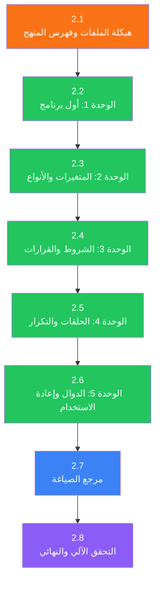
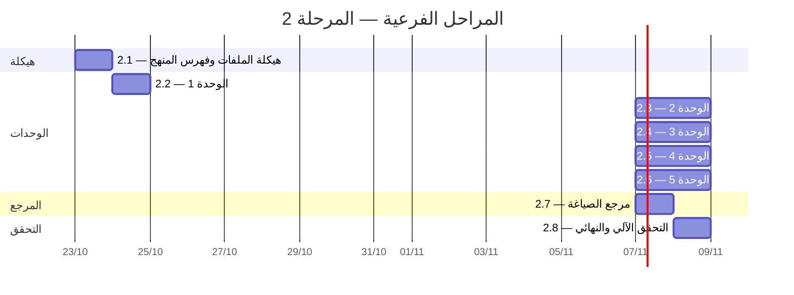

# خطة تنفيذ المرحلة 2: المحتوى التعليمي

هذه خطة مستقلة لتنفيذ المرحلة 2 من [`execution_plan.md`](./execution_plan.md).
تقسم العمل إلى مراحل فرعية متتابعة؛ لا تبدأ المرحلة الفرعية التالية قبل اجتياز
معيار الخروج للمرحلة الحالية، إلا إذا ذُكر اعتماد قابل للفصل صراحةً.

## سجل التقدم

**آخر تحديث:** 22 أكتوبر 2026
**الحالة العامة:** مكتملة
**الإنجاز:** 5 وحدات، 14 درساً، 40 تمريناً، و37 مدخلاً في مرجع الصياغة.
**التحقق:** اجتاز `flutter analyze` و`flutter test` جميع الاختبارات.

---

## الهدف والنطاق

كتابة 5 وحدات تعليمية أولية تحتوي على 14 درساً و40+ تمريناً بالعربية والإنجليزية،
مع مرجع صياغة يغطي 30+ كلمة مفتاحية ودالة مدمجة ونوع بيانات. تُخزن جميع المحتويات
في ملفات JSON ضمن `assets/curriculum/` و`assets/syntax_reference/`، وتُحمّل عبر
البنية التحتية المكتملة في المرحلة 1.

لا تُنتج هذه المرحلة واجهات أو شاشات جديدة؛ تقتصر على البيانات والملفات التي
تستهلكها الواجهات لاحقاً في المرحلة 3.

### شروط البدء

- المرحلة 1 مكتملة: نماذج البيانات ([`curriculum_models.dart`](file:///home/osm/flutter_projects/learn_gdscript/lib/data/models/curriculum_models.dart)، [`lesson_models.dart`](file:///home/osm/flutter_projects/learn_gdscript/lib/data/models/lesson_models.dart)، [`exercise_models.dart`](file:///home/osm/flutter_projects/learn_gdscript/lib/data/models/exercise_models.dart)، [`localized_text.dart`](file:///home/osm/flutter_projects/learn_gdscript/lib/data/models/localized_text.dart)) جاهزة ومختبرة.
- [`CurriculumRepository`](file:///home/osm/flutter_projects/learn_gdscript/lib/data/repositories/curriculum_repository.dart) يقرأ من `assets/curriculum/manifest.json`.
- [`SyntaxReferenceRepository`](file:///home/osm/flutter_projects/learn_gdscript/lib/data/repositories/syntax_reference_repository.dart) معرّف وجاهز للتوسيع.
- [`CodeRunnerService`](file:///home/osm/flutter_projects/learn_gdscript/lib/logic/services/code_runner_service.dart) و[`TestRunnerService`](file:///home/osm/flutter_projects/learn_gdscript/lib/logic/services/test_runner_service.dart) يعملان لتشغيل الأمثلة والتمارين.
- محرك `gdscript_engine` متاح ومختبر.

### مبادئ التنفيذ

1. **ثنائية اللغة إلزامية:** كل نص يظهر للمتعلم (عنوان، شرح، تلميح، وصف اختبار، تفسير) يجب أن يتوفر بالعربية والإنجليزية. الشيفرة ومعرّفات البيانات لا تُترجم.
2. **التوافق مع المحرك:** لا يُستخدم في الأمثلة أو التمارين أي ميزة غير مدعومة في `gdscript_engine`. يُختبر كل مثال وحل يدوياً مع المحرك قبل اعتماده.
3. **التدرج التعليمي:** يُبنى كل درس على ما سبقه؛ لا يُستخدم مفهوم لم يُقدّم بعد.
4. **تنوع التمارين:** يُوزّع بين أنواع التمارين الخمسة (`writeCode`، `fillBlank`، `predictOutput`، `fixBug`، `reorderSteps`) لتجنب الرتابة.
5. **صلاحية JSON:** كل ملف يُتحقق من تحليله عبر النماذج الموجودة (`Curriculum.fromJson`، `Lesson.fromJson`، `Exercise.fromJson`) قبل الاعتماد.
6. **الحقول حسب الشيفرة:** تطابق مفاتيح JSON تماماً أسماء الحقول في نماذج Dart (مثل `lessonId`، `unitId`، `starterCode`، `solutionCode`، `contentMarkdown`، `estimatedMinutes`، `testCases`، `ignoreWhitespace`، `ignoreCase`).

---

## هيكل المجلدات المستهدف

```text
assets/
├── curriculum/
│   ├── manifest.json                           ← فهرس المنهج (Curriculum)
│   └── units/
│       ├── 01_first_program/
│       │   ├── unit.json                       ← بيانات الوحدة
│       │   ├── lesson_01_hello.json            ← مرحباً بالعالم
│       │   └── lesson_02_comments.json         ← التعليقات
│       ├── 02_variables/
│       │   ├── unit.json
│       │   ├── lesson_03_variables.json        ← المتغيرات
│       │   ├── lesson_04_types.json            ← أنواع البيانات
│       │   └── lesson_05_operations.json       ← العمليات الحسابية
│       ├── 03_conditions/
│       │   ├── unit.json
│       │   ├── lesson_06_if_else.json          ← الشرط البسيط
│       │   ├── lesson_07_elif.json             ← الشروط المتعددة
│       │   └── lesson_08_match.json            ← المطابقة
│       ├── 04_loops/
│       │   ├── unit.json
│       │   ├── lesson_09_for.json              ← حلقة for
│       │   ├── lesson_10_while.json            ← حلقة while
│       │   └── lesson_11_break_continue.json   ← التحكم بالحلقات
│       └── 05_functions/
│           ├── unit.json
│           ├── lesson_12_func_basics.json      ← تعريف الدوال
│           ├── lesson_13_parameters.json       ← المعاملات
│           └── lesson_14_return.json           ← القيم المعادة
└── syntax_reference/
    ├── manifest.json                           ← فهرس مرجع الصياغة
    ├── keywords.json                           ← كلمات مفتاحية
    ├── builtins.json                           ← دوال مدمجة
    └── types.json                              ← أنواع البيانات
```

---

## نظرة عامة على المراحل الفرعية



| المرحلة الفرعية | المدة التقديرية | الناتج الرئيسي |
| :--- | :--- | :--- |
| 2.1 — هيكلة الملفات | 0.5 يوم | المجلدات + `manifest.json` + `unit.json` × 5 |
| 2.2 — الوحدة 1 | 1 يوم | 2 درس + 5 تمارين |
| 2.3 — الوحدة 2 | 1.5 يوم | 3 دروس + 10 تمارين |
| 2.4 — الوحدة 3 | 1.5 يوم | 3 دروس + 8 تمارين |
| 2.5 — الوحدة 4 | 1.5 يوم | 3 دروس + 8 تمارين |
| 2.6 — الوحدة 5 | 1.5 يوم | 3 دروس + 9 تمارين |
| 2.7 — مرجع الصياغة | 1 يوم | 3 ملفات مرجع (30+ مدخلاً) |
| 2.8 — التحقق النهائي | 1 يوم | سكريبت تحقق + إصلاح + تسجيل الأصول |
| **الإجمالي** | **~9-10 أيام** | **14 درساً + 40+ تمريناً + مرجع صياغة** |

---

## المرحلة الفرعية 2.1: هيكلة الملفات وفهرس المنهج

**المدة:** 0.5 يوم
**الهدف:** إنشاء شجرة المجلدات وملفات الفهرس الأساسية

### المهام

#### 2.1.1 إنشاء مجلدات الوحدات

إنشاء مجلدات الوحدات الخمسة داخل `assets/curriculum/units/`:

```text
01_first_program/
02_variables/
03_conditions/
04_loops/
05_functions/
```

#### 2.1.2 كتابة ملف `manifest.json` الرئيسي

**الملف:** `assets/curriculum/manifest.json`

يحتوي على بنية `Curriculum` الكاملة مع 5 وحدات. الحقول تطابق [`Curriculum.fromJson`](file:///home/osm/flutter_projects/learn_gdscript/lib/data/models/curriculum_models.dart#L63-L73):

```json
{
  "version": "1.0.0",
  "targetGDScriptVersion": "4.x",
  "units": [
    {
      "id": "unit_01_first_program",
      "title": {"ar": "أول برنامج", "en": "Your First Program"},
      "description": {
        "ar": "اكتب أول سطر كود وشاهد الناتج",
        "en": "Write your first line of code and see the output"
      },
      "iconName": "play_circle",
      "order": 0,
      "lessonIds": ["lesson_01_hello", "lesson_02_comments"]
    },
    {
      "id": "unit_02_variables",
      "title": {"ar": "المتغيرات والأنواع", "en": "Variables and Types"},
      "description": {
        "ar": "تعلّم تخزين البيانات واستخدامها",
        "en": "Learn to store and use data"
      },
      "iconName": "data_object",
      "order": 1,
      "lessonIds": ["lesson_03_variables", "lesson_04_types", "lesson_05_operations"]
    },
    {
      "id": "unit_03_conditions",
      "title": {"ar": "الشروط والقرارات", "en": "Conditions and Decisions"},
      "description": {
        "ar": "اجعل برنامجك يتخذ قرارات",
        "en": "Make your program make decisions"
      },
      "iconName": "call_split",
      "order": 2,
      "lessonIds": ["lesson_06_if_else", "lesson_07_elif", "lesson_08_match"]
    },
    {
      "id": "unit_04_loops",
      "title": {"ar": "الحلقات والتكرار", "en": "Loops and Repetition"},
      "description": {
        "ar": "كرّر العمليات بكفاءة",
        "en": "Repeat operations efficiently"
      },
      "iconName": "loop",
      "order": 3,
      "lessonIds": ["lesson_09_for", "lesson_10_while", "lesson_11_break_continue"]
    },
    {
      "id": "unit_05_functions",
      "title": {"ar": "الدوال وإعادة الاستخدام", "en": "Functions and Reuse"},
      "description": {
        "ar": "نظّم كودك في أجزاء قابلة لإعادة الاستخدام",
        "en": "Organize code into reusable parts"
      },
      "iconName": "functions",
      "order": 4,
      "lessonIds": ["lesson_12_func_basics", "lesson_13_parameters", "lesson_14_return"]
    }
  ]
}
```

#### 2.1.3 كتابة ملفات `unit.json` لكل وحدة

كل ملف `unit.json` يكرر بيانات الوحدة نفسها من الفهرس الرئيسي. يُستخدم عند الحاجة
لتحميل بيانات وحدة واحدة دون تحميل الفهرس كاملاً.

#### 2.1.4 تحقق أولي

```bash
# التحقق من صلاحية JSON
for f in assets/curriculum/manifest.json assets/curriculum/units/*/unit.json; do
  python3 -c "import json; json.load(open('$f'))" && echo "✓ $f" || echo "✗ $f"
done
```

- تحميل `manifest.json` عبر `Curriculum.fromJson` في اختبار Dart.
- التحقق من أن كل `unitId` في `lessonIds` يشير إلى معرف درس فريد.

### معيار الخروج

- [x] 5 مجلدات وحدات + 5 ملفات `unit.json` موجودة
- [x] `manifest.json` يُحلَّل بنجاح عبر `Curriculum.fromJson`
- [x] لا توجد معرفات مكررة

---

## المرحلة الفرعية 2.2: الوحدة 1 — أول برنامج

**المدة:** 1 يوم
**الهدف:** كتابة درسين تمهيديين (5 تمارين)
**المفاهيم:** `print()`، التعليقات السطرية (`#`) ومتعددة الأسطر باستخدام `#` في كل سطر؛ النصوص بين `"""` سلاسل متعددة الأسطر وليست تعليقات.

### هيكل JSON للدرس

كل ملف درس يتبع بنية [`Lesson.fromJson`](file:///home/osm/flutter_projects/learn_gdscript/lib/data/models/lesson_models.dart#L44-L62) بالحقول التالية:

```json
{
  "id": "lesson_01_hello",
  "unitId": "unit_01_first_program",
  "title": {"ar": "...", "en": "..."},
  "objective": {"ar": "...", "en": "..."},
  "estimatedMinutes": 3,
  "order": 0,
  "contentMarkdown": {"ar": "...", "en": "..."},
  "exampleCode": "print(\"Hello, World!\")",
  "exercises": [ /* Exercise objects */ ]
}
```

وكل تمرين يتبع [`Exercise.fromJson`](file:///home/osm/flutter_projects/learn_gdscript/lib/data/models/exercise_models.dart#L80-L111):

```json
{
  "id": "ex_01_hello_print",
  "lessonId": "lesson_01_hello",
  "type": "writeCode",
  "prompt": {"ar": "...", "en": "..."},
  "starterCode": "",
  "solutionCode": "print(\"Hello\")",
  "testCases": [ /* ExerciseTestCase objects */ ],
  "hints": [ /* LocalizedText objects */ ],
  "order": 0
}
```

### الدرس 1: مرحباً بالعالم (`lesson_01_hello.json`)

**المفهوم:** دالة `print()` والنصوص النصية

| العنصر | المحتوى |
| :--- | :--- |
| **العنوان** | مرحباً بالعالم! / Hello, World! |
| **الهدف** | كتابة أول أمر طباعة ومشاهدة الناتج فوراً |
| **الشرح** | شرح `print()`، علامات التنصيص، لوحة الناتج |
| **المثال** | `print("Hello, World!")` → `Hello, World!` |
| **الوقت** | 3 دقائق |

**التمارين (3 تمارين):**

| # | النوع | الوصف | الناتج المتوقع |
| :--- | :--- | :--- | :--- |
| 1 | `writeCode` | اكتب أمراً يطبع اسمك | أي مخرج غير فارغ |
| 2 | `writeCode` | اكتب 3 أوامر print لطباعة 3 أسطر | `Line 1\nLine 2\nLine 3` |
| 3 | `predictOutput` | ماذا سيطبع `print("Hello")\nprint("World")`؟ | `Hello\nWorld` |

**تلميحات التمرين 1 (مثال):**

1. `{"ar": "استخدم الدالة print()", "en": "Use the print() function"}`
2. `{"ar": "ضع اسمك بين علامتي تنصيص", "en": "Put your name inside quotation marks"}`
3. `{"ar": "مثال: print(\"أحمد\")", "en": "Example: print(\"Alex\")"}`

### الدرس 2: التعليقات (`lesson_02_comments.json`)

**المفهوم:** التعليقات السطرية `#` والتعليقات متعددة الأسطر `""" """`

| العنصر | المحتوى |
| :--- | :--- |
| **العنوان** | التعليقات / Comments |
| **الهدف** | تعلم كتابة ملاحظات في الكود لا تؤثر على التنفيذ |
| **الشرح** | `#` لتعليق سطر، `"""` لعدة أسطر، متى نستخدم التعليقات |
| **المثال** | `# This is a comment\nprint("Hello")  # inline comment` |
| **الوقت** | 3 دقائق |

**التمارين (2 تمرين):**

| # | النوع | الوصف |
| :--- | :--- | :--- |
| 1 | `fillBlank` | أكمل السطر بتعليق يشرح ماذا يفعل الكود |
| 2 | `fixBug` | صحّح كوداً فيه تعليق يمنع التنفيذ (`# print("Hello")` → `print("Hello")`) |

### معيار الخروج

- [x] ملفان JSON صالحان: `lesson_01_hello.json` و`lesson_02_comments.json`
- [x] كلاهما يُحلَّل بنجاح عبر `Lesson.fromJson`
- [x] 5 تمارين مع 2-3 تلميحات لكل تمرين
- [x] كل `exampleCode` و`solutionCode` مُختبر مع المحرك
- [x] جميع النصوص بالعربية والإنجليزية

---

## المرحلة الفرعية 2.3: الوحدة 2 — المتغيرات والأنواع

**المدة:** 1.5 يوم
**الهدف:** كتابة 3 دروس (10 تمارين)
**المفاهيم:** `var`، أنواع البيانات (`int`، `float`، `String`، `bool`)، العمليات الحسابية

### الدرس 3: المتغيرات (`lesson_03_variables.json`)

**المفهوم:** تعريف المتغيرات بـ `var` وإسناد القيم

| العنصر | المحتوى |
| :--- | :--- |
| **العنوان** | المتغيرات / Variables |
| **الهدف** | تعلّم تخزين البيانات في متغيرات واسترجاعها |
| **الشرح** | مفهوم المتغير كـ«صندوق يحمل اسماً»، `var`، التسمية، إعادة الإسناد |
| **المثال** | `var name = "Ali"\nprint(name)` → `Ali` |
| **الوقت** | 5 دقائق |

**التمارين (3 تمارين):**

| # | النوع | الوصف | ملاحظة |
| :--- | :--- | :--- | :--- |
| 1 | `writeCode` | عرّف متغيراً واطبع قيمته | بناء على المثال |
| 2 | `writeCode` | عرّف متغيرين واطبعهما في سطرين | تمرين على عدة متغيرات |
| 3 | `predictOutput` | ماذا يطبع بعد إعادة إسناد المتغير؟ | فهم أن القيمة تتغير |

### الدرس 4: أنواع البيانات (`lesson_04_types.json`)

**المفهوم:** `int`، `float`، `String`، `bool` والتحويل بينها

| العنصر | المحتوى |
| :--- | :--- |
| **العنوان** | أنواع البيانات / Data Types |
| **الهدف** | التمييز بين أنواع البيانات الأساسية واستخداماتها |
| **الشرح** | الأنواع الأربعة، أمثلة على كل نوع، `type()` أو `typeof()`، التحويل |
| **المثال** | `var age = 25\nvar pi = 3.14\nvar name = "Ali"\nvar alive = true` |
| **الوقت** | 5 دقائق |

**التمارين (3 تمارين):**

| # | النوع | الوصف |
| :--- | :--- | :--- |
| 1 | `predictOutput` | حدد نوع كل متغير من القيمة المسندة |
| 2 | `reorderSteps` | رتّب أسطر تعرّف متغيرات من أنواع مختلفة وتطبعها |
| 3 | `predictOutput` | ماذا يحدث عند جمع `int` مع `float`؟ |

### الدرس 5: العمليات الحسابية (`lesson_05_operations.json`)

**المفهوم:** `+`، `-`، `*`، `/`، `%`، `**`، جمع النصوص

| العنصر | المحتوى |
| :--- | :--- |
| **العنوان** | العمليات الحسابية / Arithmetic Operations |
| **الهدف** | إجراء حسابات ودمج نصوص باستخدام العمليات |
| **الشرح** | العمليات الخمس + باقي القسمة + الأس، أولوية العمليات، جمع النصوص بـ `+` |
| **المثال** | `var x = 10\nvar y = 3\nprint(x + y)\nprint(x % y)` → `13\n1` |
| **الوقت** | 7 دقائق |

**التمارين (4 تمارين):**

| # | النوع | الوصف |
| :--- | :--- | :--- |
| 1 | `writeCode` | احسب مساحة مستطيل (عرض × طول) واطبع النتيجة |
| 2 | `writeCode` | حوّل درجة حرارة من فهرنهايت إلى مئوية بصيغة `(F - 32) * 5 / 9` |
| 3 | `fillBlank` | أكمل العملية الحسابية للحصول على الناتج المطلوب |
| 4 | `predictOutput` | ما ناتج `print(10 / 3)` و`print(10 % 3)`؟ |

### معيار الخروج

- [x] 3 ملفات JSON صالحة (`lesson_03` — `lesson_05`)
- [x] 10 تمارين بتلميحات (2-4 لكل تمرين)
- [x] لا يُستخدم مفهوم لم يُقدم بعد (لا شروط، لا حلقات، لا دوال)
- [x] كل الأمثلة والحلول تعمل مع المحرك
- [x] ثنائية اللغة مكتملة

---

## المرحلة الفرعية 2.4: الوحدة 3 — الشروط والقرارات

**المدة:** 1.5 يوم
**الهدف:** كتابة 3 دروس (8 تمارين)
**المفاهيم:** `if`/`else`، `elif`، `match`، عوامل المقارنة والمنطق

### الدرس 6: الشرط البسيط (`lesson_06_if_else.json`)

**المفهوم:** `if`، `else`، عوامل المقارنة (`==`، `!=`، `>`، `<`، `>=`، `<=`)

| العنصر | المحتوى |
| :--- | :--- |
| **العنوان** | الشرط البسيط / If and Else |
| **الهدف** | اتخاذ قرارات بناءً على شرط |
| **الشرح** | بنية `if/else`، المسافة البادئة، عوامل المقارنة، `bool` كنتيجة مقارنة |
| **المثال** | `var score = 75\nif score >= 60:\n    print("ناجح")\nelse:\n    print("راسب")` |
| **الوقت** | 7 دقائق |

**التمارين (3 تمارين):**

| # | النوع | الوصف |
| :--- | :--- | :--- |
| 1 | `writeCode` | اكتب شرطاً يطبع "positive" إذا كان الرقم أكبر من 0، وإلا "not positive" |
| 2 | `fixBug` | أصلح كوداً فيه خطأ في المسافة البادئة أو عامل المقارنة |
| 3 | `writeCode` | اكتب شرطاً يتحقق إذا كان العمر ≥ 18 ويطبع رسالة مناسبة |

### الدرس 7: الشروط المتعددة (`lesson_07_elif.json`)

**المفهوم:** `elif`، الشروط المتسلسلة، العوامل المنطقية (`and`، `or`، `not`)

| العنصر | المحتوى |
| :--- | :--- |
| **العنوان** | الشروط المتعددة / Multiple Conditions |
| **الهدف** | التعامل مع أكثر من احتمالين باستخدام `elif` |
| **الشرح** | `elif` كبديل لسلاسل `if` المتداخلة، `and`/`or`/`not` |
| **المثال** | `var grade = 85\nif grade >= 90:\n    print("A")\nelif grade >= 80:\n    print("B")\nelse:\n    print("C")` |
| **الوقت** | 7 دقائق |

**التمارين (3 تمارين):**

| # | النوع | الوصف |
| :--- | :--- | :--- |
| 1 | `writeCode` | صنّف درجة حرارة إلى "بارد" / "معتدل" / "حار" |
| 2 | `reorderSteps` | رتّب أسطر `if/elif/else` لتشكل تصنيفاً صحيحاً |
| 3 | `writeCode` | اكتب شرطاً مركباً باستخدام `and` أو `or` |

### الدرس 8: المطابقة (`lesson_08_match.json`)

**المفهوم:** عبارة `match` كبديل أنظف لسلاسل `if/elif`

| العنصر | المحتوى |
| :--- | :--- |
| **العنوان** | المطابقة / Match Statement |
| **الهدف** | استخدام `match` لمقارنة قيمة واحدة بعدة احتمالات |
| **الشرح** | بنية `match`، الحالات، الحالة الافتراضية `_` |
| **المثال** | `var day = "Mon"\nmatch day:\n    "Mon":\n        print("Monday")\n    "Tue":\n        print("Tuesday")\n    _:\n        print("Other")` |
| **الوقت** | 5 دقائق |

**التمارين (2 تمرين):**

| # | النوع | الوصف |
| :--- | :--- | :--- |
| 1 | `writeCode` | استخدم `match` لطباعة اسم اليوم بالعربية حسب الرقم (1-7) |
| 2 | `predictOutput` | ماذا يطبع كود `match` معيّن؟ |

### معيار الخروج

- [x] 3 ملفات JSON صالحة (`lesson_06` — `lesson_08`)
- [x] 8 تمارين مع تلميحات
- [x] الأمثلة تستخدم مفاهيم الوحدات السابقة إلى جانب مفاهيم الشروط التي يقدمها الدرس
- [x] تمرين `fixBug` يختبر خطأ مسافة بادئة واقعي
- [x] ثنائية اللغة مكتملة

---

## المرحلة الفرعية 2.5: الوحدة 4 — الحلقات والتكرار

**المدة:** 1.5 يوم
**الهدف:** كتابة 3 دروس (8 تمارين)
**المفاهيم:** `for`/`range()`، `while`، `break`/`continue`

### الدرس 9: حلقة for (`lesson_09_for.json`)

**المفهوم:** `for i in range()`، التكرار على نطاق أرقام

| العنصر | المحتوى |
| :--- | :--- |
| **العنوان** | حلقة for / For Loop |
| **الهدف** | تكرار عملية عدداً محدداً من المرات |
| **الشرح** | `for`، `range(n)`، `range(start, end)`، `range(start, end, step)`، متغير الحلقة |
| **المثال** | `for i in range(5):\n    print(i)` → `0\n1\n2\n3\n4` |
| **الوقت** | 7 دقائق |

**التمارين (3 تمارين):**

| # | النوع | الوصف |
| :--- | :--- | :--- |
| 1 | `writeCode` | اطبع الأعداد من 1 إلى 10 |
| 2 | `writeCode` | اطبع الأعداد الزوجية من 2 إلى 20 |
| 3 | `predictOutput` | ماذا يطبع `for i in range(3, 8): print(i)`؟ |

### الدرس 10: حلقة while (`lesson_10_while.json`)

**المفهوم:** `while`، الشرط المتكرر، خطر الحلقة اللانهائية

| العنصر | المحتوى |
| :--- | :--- |
| **العنوان** | حلقة while / While Loop |
| **الهدف** | التكرار ما دام الشرط متحققاً |
| **الشرح** | `while`، الفرق عن `for`، تحديث متغير التحكم، تجنب الحلقة اللانهائية |
| **المثال** | `var count = 0\nwhile count < 5:\n    print(count)\n    count += 1` |
| **الوقت** | 7 دقائق |

> [!WARNING]
> يجب التحقق من أن المحرك يوقف الحلقات اللانهائية (بحدود `instructionsExecuted`
> أو timeout). إذا لم يفعل، يُضاف تحذير صريح في الشرح وتُتجنب تمارين قد تسبب
> حلقة لانهائية بدون حماية.

**التمارين (3 تمارين):**

| # | النوع | الوصف |
| :--- | :--- | :--- |
| 1 | `writeCode` | اطبع أرقاماً تنازلياً من 10 إلى 1 باستخدام `while` |
| 2 | `fixBug` | أصلح حلقة `while` لا تنتهي (نسي تحديث المتغير) |
| 3 | `writeCode` | اطبع مضاعفات 3 الأصغر من 30 باستخدام `while` |

### الدرس 11: التحكم بالحلقات (`lesson_11_break_continue.json`)

**المفهوم:** `break` للخروج المبكر، `continue` لتخطي تكرار

| العنصر | المحتوى |
| :--- | :--- |
| **العنوان** | التحكم بالحلقات / Loop Control |
| **الهدف** | التحكم بسير الحلقة باستخدام `break` و`continue` |
| **الشرح** | متى نستخدم `break`، متى نستخدم `continue`، أمثلة عملية |
| **المثال** | `for i in range(10):\n    if i == 5:\n        break\n    print(i)` → `0\n1\n2\n3\n4` |
| **الوقت** | 5 دقائق |

**التمارين (2 تمرين):**

| # | النوع | الوصف |
| :--- | :--- | :--- |
| 1 | `writeCode` | اطبع الأعداد من 1 إلى 20 لكن تخطَّ مضاعفات 4 باستخدام `continue` |
| 2 | `predictOutput` | ماذا يطبع كود يحتوي `break` داخل `for`؟ |

### معيار الخروج

- [x] 3 ملفات JSON صالحة (`lesson_09` — `lesson_11`)
- [x] 8 تمارين مع تلميحات
- [x] تمرين `fixBug` في الحلقات يختبر حلقة لا نهائية بسبب غياب تحديث العداد
- [x] التحقق من أن المحرك يدعم `range()` وأن `break`/`continue` يعملان
- [x] ثنائية اللغة مكتملة

---

## المرحلة الفرعية 2.6: الوحدة 5 — الدوال وإعادة الاستخدام

**المدة:** 1.5 يوم
**الهدف:** كتابة 3 دروس (9 تمارين)
**المفاهيم:** `func`، المعاملات، القيم المعادة، المعاملات الافتراضية

### الدرس 12: تعريف الدوال (`lesson_12_func_basics.json`)

**المفهوم:** `func`، استدعاء الدالة، نطاق المتغيرات

| العنصر | المحتوى |
| :--- | :--- |
| **العنوان** | تعريف الدوال / Defining Functions |
| **الهدف** | تنظيم الكود في دوال قابلة لإعادة الاستخدام |
| **الشرح** | `func name():`, جسم الدالة والمسافة البادئة، استدعاء الدالة، فائدة الدوال |
| **المثال** | `func greet():\n    print("Hello!")\n\ngreet()\ngreet()` → `Hello!\nHello!` |
| **الوقت** | 7 دقائق |

**التمارين (3 تمارين):**

| # | النوع | الوصف |
| :--- | :--- | :--- |
| 1 | `writeCode` | عرّف دالة `say_hi()` تطبع "Hi!" واستدعِها 3 مرات |
| 2 | `fillBlank` | أكمل تعريف الدالة واستدعاءها |
| 3 | `writeCode` | عرّف دالة تطبع خطاً فاصلاً (`"----------"`) واستخدمها بين عدة أسطر |

### الدرس 13: المعاملات (`lesson_13_parameters.json`)

**المفهوم:** المعاملات العادية، المعاملات الافتراضية

| العنصر | المحتوى |
| :--- | :--- |
| **العنوان** | المعاملات / Parameters |
| **الهدف** | تمرير بيانات إلى الدوال لجعلها أكثر مرونة |
| **الشرح** | المعامل كمتغير محلي، تمرير قيم عند الاستدعاء، القيم الافتراضية |
| **المثال** | `func greet(name):\n    print("Hello, " + name + "!")\n\ngreet("Ali")\ngreet("Sara")` |
| **الوقت** | 7 دقائق |

**التمارين (3 تمارين):**

| # | النوع | الوصف |
| :--- | :--- | :--- |
| 1 | `writeCode` | عرّف دالة `double(n)` تطبع ضعف الرقم |
| 2 | `fixBug` | أصلح دالة تستقبل معاملاً لكنها لا تستخدمه (أو تستدعى بدون تمرير) |
| 3 | `writeCode` | عرّف دالة `repeat_text(text, times)` مع قيمة افتراضية لـ `times` = 2 |

### الدرس 14: القيم المعادة (`lesson_14_return.json`)

**المفهوم:** `return`، النوع المعاد `-> Type`، الدوال النقية

| العنصر | المحتوى |
| :--- | :--- |
| **العنوان** | القيم المعادة / Return Values |
| **الهدف** | جعل الدوال تُعيد نتيجة بدل طباعتها مباشرة |
| **الشرح** | `return`، الفرق بين `print` و`return`، `-> int` (تحديد النوع)، استخدام النتيجة في تعبير |
| **المثال** | `func add(a, b):\n    return a + b\n\nvar result = add(3, 5)\nprint(result)` → `8` |
| **الوقت** | 7 دقائق |

**التمارين (3 تمارين):**

| # | النوع | الوصف |
| :--- | :--- | :--- |
| 1 | `writeCode` | عرّف دالة `square(n)` تعيد مربع الرقم، واطبع النتيجة |
| 2 | `predictOutput` | ماذا يطبع كود يستخدم ناتج دالة في تعبير حسابي؟ |
| 3 | `writeCode` | عرّف دالة `is_even(n)` تعيد `true` إذا كان الرقم زوجياً، واختبرها |

### معيار الخروج

- [x] 3 ملفات JSON صالحة (`lesson_12` — `lesson_14`)
- [x] 9 تمارين مع تلميحات
- [x] التحقق من أن المحرك يدعم `func`، `return`، المعاملات الافتراضية
- [x] الدوال المعرّفة تُستدعى بشكل صحيح ومخرجاتها تطابق المتوقع
- [x] ثنائية اللغة مكتملة

---

## المرحلة الفرعية 2.7: مرجع الصياغة (Syntax Reference)

**المدة:** 1 يوم
**الهدف:** كتابة مرجع شامل يغطي 30+ مدخلاً بالعربية والإنجليزية
**الملفات:** `assets/syntax_reference/`

### هيكل مدخل المرجع

```json
{
  "keyword": "var",
  "category": "declarations",
  "title": {"ar": "متغير", "en": "Variable"},
  "description": {
    "ar": "يُعرّف متغيراً يمكن تغيير قيمته لاحقاً",
    "en": "Declares a variable whose value can change later"
  },
  "syntax": "var name = value",
  "example": "var score = 100\nprint(score)",
  "relatedLesson": "lesson_03_variables",
  "seeAlso": ["const"]
}
```

### 2.7.1 كلمات مفتاحية (`keywords.json`)

| الكلمة | الفئة | الدرس المرتبط |
| :--- | :--- | :--- |
| `var` | declarations | lesson_03 |
| `const` | declarations | lesson_03 |
| `func` | declarations | lesson_12 |
| `return` | control_flow | lesson_14 |
| `if` | control_flow | lesson_06 |
| `else` | control_flow | lesson_06 |
| `elif` | control_flow | lesson_07 |
| `match` | control_flow | lesson_08 |
| `for` | loops | lesson_09 |
| `in` | loops | lesson_09 |
| `while` | loops | lesson_10 |
| `break` | loops | lesson_11 |
| `continue` | loops | lesson_11 |
| `and` | operators | lesson_07 |
| `or` | operators | lesson_07 |
| `not` | operators | lesson_07 |
| `true` | literals | lesson_04 |
| `false` | literals | lesson_04 |
| `null` | literals | — |
| `pass` | control_flow | — |

**الإجمالي:** ~20 كلمة مفتاحية

### 2.7.2 دوال مدمجة (`builtins.json`)

| الدالة | الوصف | الدرس |
| :--- | :--- | :--- |
| `print()` | طباعة قيمة | lesson_01 |
| `range()` | إنشاء نطاق أرقام | lesson_09 |
| `str()` | تحويل إلى نص | lesson_04 |
| `int()` | تحويل إلى عدد صحيح | lesson_04 |
| `float()` | تحويل إلى عدد عشري | lesson_04 |
| `len()` | طول النص أو المصفوفة | — |
| `abs()` | القيمة المطلقة | lesson_05 |
| `min()` | أصغر قيمة | — |
| `max()` | أكبر قيمة | — |
| `typeof()` | نوع القيمة | lesson_04 |

**الإجمالي:** ~10 دوال مدمجة

### 2.7.3 أنواع البيانات (`types.json`)

| النوع | الوصف | الدرس |
| :--- | :--- | :--- |
| `int` | عدد صحيح | lesson_04 |
| `float` | عدد عشري | lesson_04 |
| `String` | نص | lesson_01, lesson_04 |
| `bool` | قيمة منطقية | lesson_04, lesson_06 |
| `Array` | مصفوفة | — |
| `Dictionary` | قاموس | — |
| `null` | قيمة فارغة | — |

**الإجمالي:** ~7 أنواع

**المجموع الكلي:** ~37 مدخلاً (≥ 30)

### 2.7.4 تحديث `manifest.json` لمرجع الصياغة

**الملف:** `assets/syntax_reference/manifest.json`

```json
{
  "version": "1.0.0",
  "entries": [
    {"file": "keywords.json", "category": "keywords", "count": 20},
    {"file": "builtins.json", "category": "builtins", "count": 10},
    {"file": "types.json", "category": "types", "count": 7}
  ]
}
```

### 2.7.5 توسيع `SyntaxReferenceRepository`

تحديث [`SyntaxReferenceRepository`](file:///home/osm/flutter_projects/learn_gdscript/lib/data/repositories/syntax_reference_repository.dart)
ليقرأ ملفات المرجع من الأصول ويدعم البحث والتصفية:

- تحميل ملفات JSON عند أول استخدام
- بحث نصي في `keyword`/`title`/`description`
- تصفية حسب `category`
- دعم `LocalizedText` في `title` و`description`

### معيار الخروج

- [x] 3 ملفات JSON صالحة: `keywords.json`، `builtins.json`، `types.json`
- [x] 30+ مدخلاً مع ثنائية اللغة
- [x] كل `example` في المرجع يعمل مع المحرك
- [x] كل `relatedLesson` يشير إلى معرف درس موجود
- [x] `SyntaxReferenceRepository` يقرأ الملفات ويبحث فيها بنجاح

---

## المرحلة الفرعية 2.8: التحقق الآلي والنهائي

**المدة:** 1 يوم
**الهدف:** ضمان صحة وتكامل جميع ملفات المحتوى

### المهام

#### 2.8.1 سكريبت التحقق من بنية JSON

إنشاء سكريبت Dart في `test/content_validation_test.dart` يتحقق من:

1. **صلاحية JSON:** كل ملف يُحلَّل بدون أخطاء.
2. **توافق النماذج:** كل ملف يُحلَّل عبر `Lesson.fromJson` / `Exercise.fromJson`.
3. **ثنائية اللغة:** كل كائن `LocalizedText` يحتوي على `ar` و`en` غير فارغتين.
4. **المعرّفات الفريدة:** لا توجد معرّفات مكررة للوحدات أو الدروس أو التمارين.
5. **الروابط المتبادلة:**
   - كل `lessonId` في الوحدة يشير إلى ملف درس موجود.
   - كل `unitId` في الدرس يشير إلى وحدة موجودة في الفهرس.
   - كل `lessonId` في التمرين يشير إلى الدرس الحاوي.
6. **التلميحات:** كل تمرين يحتوي على 2-4 تلميحات.
7. **حالات الاختبار:** كل تمرين يحتوي على حالة اختبار واحدة على الأقل.
8. **ترتيب متسق:** `order` يبدأ من 0 ويتصاعد بدون فجوات داخل كل وحدة أو درس.

```dart
// test/content_validation_test.dart — مخطط
import 'dart:convert';
import 'package:flutter_test/flutter_test.dart';
import 'package:learn_gdscript/data/models/curriculum_models.dart';
import 'package:learn_gdscript/data/models/lesson_models.dart';

void main() {
  group('Content validation', () {
    test('manifest parses successfully', () { ... });
    test('all lesson files parse successfully', () { ... });
    test('no duplicate IDs', () { ... });
    test('all LocalizedText fields have ar and en', () { ... });
    test('every exercise has 2-4 hints', () { ... });
    test('every exercise has at least 1 test case', () { ... });
    test('cross-references are valid', () { ... });
    test('order values are sequential', () { ... });
  });
}
```

#### 2.8.2 اختبار الأمثلة مع المحرك

إنشاء اختبار `test/content_engine_test.dart` يجمع كل `exampleCode` و`solutionCode`
من الدروس والتمارين ويشغلها عبر `gdscript_engine`:

- كل مثال يجب أن ينتهي بنجاح (بدون خطأ تنفيذي).
- كل `solutionCode` يجب أن يجتاز `testCases` المرافقة.

> [!IMPORTANT]
> هذا الاختبار يعتمد على المحرك كاعتماد محلي. يُشغّل فقط عندما يتوفر المحرك.

#### 2.8.3 تسجيل الأصول في `pubspec.yaml`

التحقق من أن جميع ملفات المحتوى الجديدة مسجلة في قسم `flutter.assets` في
[`pubspec.yaml`](file:///home/osm/flutter_projects/learn_gdscript/pubspec.yaml):

```yaml
flutter:
  assets:
    - assets/curriculum/manifest.json
    - assets/curriculum/units/01_first_program/
    - assets/curriculum/units/02_variables/
    - assets/curriculum/units/03_conditions/
    - assets/curriculum/units/04_loops/
    - assets/curriculum/units/05_functions/
    - assets/syntax_reference/manifest.json
    - assets/syntax_reference/keywords.json
    - assets/syntax_reference/builtins.json
    - assets/syntax_reference/types.json
```

#### 2.8.4 تحليل ثابت

```bash
flutter analyze   # يجب أن يعود 0 أخطاء/تحذيرات
flutter test      # جميع الاختبارات تنجح
```

### معيار الخروج

- [x] سكريبت التحقق يعمل ويمر بنجاح
- [x] جميع الأمثلة والحلول تعمل مع المحرك
- [x] `pubspec.yaml` يحتوي على جميع الأصول
- [x] `flutter analyze` بدون أخطاء
- [x] `flutter test` جميع الاختبارات تنجح

---

## إحصائيات المحتوى المستهدفة

| المقياس | الهدف | الحد الأدنى |
| :--- | :--- | :--- |
| عدد الوحدات | 5 | 5 |
| عدد الدروس | 14 | 14 |
| عدد التمارين | 40+ | 40 |
| تمارين `writeCode` | ~18 | 15 |
| تمارين `predictOutput` | ~8 | 6 |
| تمارين `fillBlank` | ~5 | 3 |
| تمارين `fixBug` | ~5 | 3 |
| تمارين `reorderSteps` | ~4 | 2 |
| تلميحات لكل تمرين | 2-4 | 2 |
| مدخلات مرجع الصياغة | 37+ | 30 |
| لغات المحتوى | 2 (ar, en) | 2 |

---

## ملخص ترتيب التنفيذ



---

## قواعد خاصة بهذه المرحلة

1. **لا تُستخدم ميزة قبل تدريسها:** كل درس يستخدم فقط المفاهيم المقدمة في الدروس السابقة أو الحالي.
2. **أسماء المتغيرات بالإنجليزية:** حتى في الشرح العربي، أسماء المتغيرات والدوال في الكود دائماً بالإنجليزية.
3. **الأمثلة قصيرة:** لا يزيد مثال الشرح عن 8 أسطر كود.
4. **التمارين متدرجة:** أول تمرين في كل درس بسيط ومباشر، والأخير يتطلب تفكيراً أعمق.
5. **الحل المرجعي واحد:** يُقدّم حل واحد مقترح؛ لكن `testCases` يسمح بعدة حلول صحيحة عبر مقارنة المخرج لا الكود.
6. **لا hardcoding في الشيفرة:** كل المحتوى في ملفات JSON وليس في كود Dart.
7. **الترتيب:** حقل `order` يبدأ من `0` (لتوافقه مع `requiredInt(json, 'order', minimum: 0)` في النماذج).

---

## معايير القبول النهائية (من الخطة الرئيسية)

- [x] 14 ملف درس JSON صالح ومتسق الهيكل
- [x] 40+ تمرين مع اختبارات ومخرجات متوقعة
- [x] كل تمرين يحتوي على 2-4 تلميحات متدرجة
- [x] ملف مرجع الصياغة يغطي 30+ كلمة مفتاحية/دالة/نوع
- [x] جميع نصوص الوحدات والدروس والتمارين ومرجع الصياغة متوفرة بالعربية والإنجليزية
- [x] التحقق الآلي من وجود الترجمتين لكل نص مطلوب في ملفات المحتوى
- [x] كل مثال تم اختباره مع المحرك
- [x] لا يوجد درس يعتمد على ميزة غير مدعومة في المحرك
