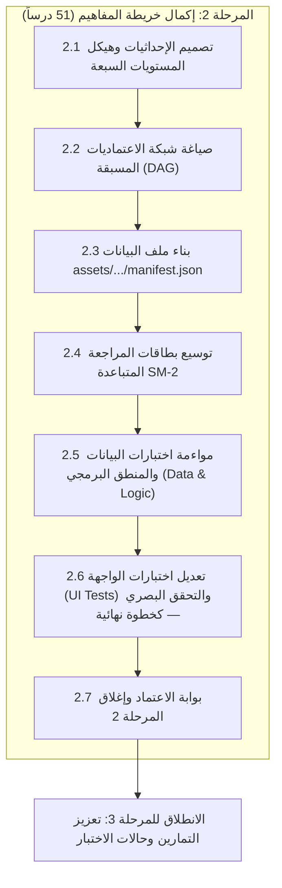

# الخطة التنفيذية للمرحلة 2: إكمال خريطة المفاهيم والعلاقات التفاعلية لكامل المنهج (51 درساً)

> **تاريخ الاعتماد:** 2026-10-27  
> **المرجع الأساسي:** [تحليل وتقييم المنهج التعليمي](docs/curriculum_analysis.md)  
> **الخطة الأم:** [الخطة التنفيذية لمعالجة وتطوير المنهج التعليمي](docs/curriculum_remediation_plan.md)  
> **خطط المراحل السابقة:** [المرحلة 0 (الحوكمة)](docs/phase_0_execution_plan.md) | [المرحلة 1 (الوحدات التأسيسية)](docs/phase_1_execution_plan.md)  
> **النطاق التنفيذي:** توسيع خريطة المفاهيم من 14 مفهوماً ليشمل 100% من دروس المنهج (51 درساً)، هندسة شبكة الاعتماديات الموجهة (DAG)، توزيع الإحداثيات البصرية للرسم التفاعلي، وتفعيل بطاقات التكرار المتباعد SM-2 لجميع المفاهيم.  
> **المخرج المستهدف:** خريطة مفاهيم شجرية وتفاعلية متكاملة لـ 51 درساً، مع 510 بطاقات مراجعة ذكية نشطة في التطبيق.

---

## فهرس خطة المرحلة 2

1. [الرؤية والأهداف التشغيلية](#1-الرؤية-والأهداف-التشغيلية)
2. [استرجاع فجوة خريطة المفاهيم من وثيقة التحليل (GAP-02)](#2-استرجاع-فجوة-خريطة-المفاهيم-من-وثيقة-التحليل-gap-02)
3. [المراحل الفرعية المتسلسلة للتنفيذ](#3-المراحل-الفرعية-المتسلسلة-للتنفيذ)
   - [المرحلة الفرعية 2.1: هندسة شبكة الإحداثيات وتصميم الهيكل الطوبولوجي (7 مستويات)](#المرحلة-الفرعية-21-هندسة-شبكة-الإحداثيات-وتصميم-الهيكل-الطوبولوجي-7-مستويات)
   - [المرحلة الفرعية 2.2: صياغة مصفوفة الاعتماديات المسبقة الصريحة والعرضية (DAG)](#المرحلة-الفرعية-22-صياغة-مصفوفة-الاعتماديات-المسبقة-الصريحة-والعرضية-dag)
   - [المرحلة الفرعية 2.3: بناء وتحديث ملف البيانات (`assets/concept_map/manifest.json`)](#المرحلة-الفرعية-23-بناء-وتحديث-ملف-البيانات-assetsconcept_mapmanifestjson)
   - [المرحلة الفرعية 2.4: ربط وتوسيع نظام المراجعة المتباعدة الذكية (SM-2 Flashcards)](#المرحلة-الفرعية-24-ربط-وتوسيع-نظام-المراجعة-المتباعدة-الذكية-sm-2-flashcards)
   - [المرحلة الفرعية 2.5: مواءمة اختبارات طبقة البيانات والمنطق البرمجي (Data & Logic Unit Tests)](#المرحلة-الفرعية-25-مواءمة-اختبارات-طبقة-البيانات-والمنطق-البرمجي-data--logic-unit-tests)
   - [المرحلة الفرعية 2.6: تعديل ومواءمة اختبارات الواجهة (UI Tests) والتحقق البصري — كخطوة نهائية](#المرحلة-الفرعية-26-تعديل-ومواءمة-اختبارات-الواجهة-ui-tests-والتحقق-البصري--كخطوة-نهائية)
   - [المرحلة الفرعية 2.7: بوابة الاعتماد وإغلاق المرحلة 2](#المرحلة-الفرعية-27-بوابة-الاعتماد-وإغلاق-المرحلة-2)
4. [الجدول المرجعي الكامل للمفاهيم الـ 51 (The 51 Concepts Canonical Registry)](#4-الجدول-المرجعي-الكامل-للمفاهيم-الـ-51)
5. [الجدول الزمني ومسار الاعتماديات للمرحلة 2](#5-الجدول-الزمني-ومسار-الاعتماديات-للمرحلة-2)
6. [مصفوفة المسؤوليات (RACI) للمرحلة 2](#6-مصفوفة-المسؤوليات-raci-للمرحلة-2)
7. [معايير القبول وبوابة الإغلاق (Definition of Done)](#7-معايير-القبول-وبوابة-الإغلاق-definition-of-done)

---

## 1. الرؤية والأهداف التشغيلية

أظهر تحليل المنهج في [docs/curriculum_analysis.md](docs/curriculum_analysis.md) أن التطبيق يمتلك شاشة خريطة مفاهيم بصرية استثنائية (`DesktopConceptMapSm2Screen`) مبنية بلوحة تفاعلية (Interactive Canvas) ونظام متطور للتكرار المتباعد (Spaced Repetition SM-2).

غير أن هذه الشاشة تعاني من نقص حاد في البيانات؛ إذ يغطي ملف `assets/concept_map/manifest.json` **14 مفهوماً فقط** (ما يعادل 27.5% من المنهج)، في حين أن **37 درساً متقدماً (من الدرس 15 إلى 51)** معزولة تماماً عن الخريطة!

### الأهداف التشغيلية للمرحلة 2

1. **التغطية الكاملة بنسبة 100%:** تمثيل جميع دروس المنهج الـ 51 في خريطة المفاهيم، بربط كل درس بعقدة مفهومية فريدة.
2. **هندسة شبكة الاعتماديات غير الدائرية (Acyclic DAG):** بناء شجرة مهارات موجهة منطقياً تمنع حدوث أي حلقات مغلقة وتتوافق مع فاحص `_validateAcyclic()` في نموذج Dart.
3. **توزيع الإحداثيات البصرية (Visual Canvas Layout):** ضبط إحداثيات `(x, y)` لجميع العقد الـ 51 على شبكة هندسية متعددة المستويات لتجنب تشابك أو تقاطع خطوط الاتصال المنحنية (Bézier curves).
4. **مضاعفة مخزون بطاقات التكرار المتباعد SM-2:** رفع إجمالي بطاقات المراجعة المتاحة (`allCards`) من 140 إلى 510؛ أما البطاقات المستحقة (`dueCards`) فتظل مرتبطة بتقدم المتعلم وجدول المراجعة.
5. **تحديث الحماية البرمجية لطبقة البيانات:** إلزام حزمة اختبارات المستودعات والبيانات برفض أي خريطة مفاهيم لا تحتوي على الـ 51 درساً كاملاً.
6. **مبدأ ترحيل وتعديل اختبارات الواجهة (UI Tests) كخطوة نهائية (UI Test Deferral Rule):** فصل دورة حياة اختبارات الواجهة الرسومية (UI Widget Tests مثل [test/ui/concept_map_screen_test.dart](test/ui/concept_map_screen_test.dart)) عن طبقة البيانات والمنطق؛ حيث يُمنع منعاً باتاً تعديل أو تشغيل اختبارات الواجهة في المراحل المبكرة، وتُرحل حصراً لتكون آخر خطوة تنفيذية بعد استقرار نموذج البيانات، وشبكة الـ DAG، ومخزون بطاقات SM-2، واجتياز اختبارات المستودعات بنسبة 100%، تجنباً لإفشال خطوط الـ CI بفشل التوافق العارض أثناء تحديث البيانات.

---

## 2. استرجاع فجوة خريطة المفاهيم من وثيقة التحليل (GAP-02)

وفقاً للقسم 7.3 والقسم 10 في [docs/curriculum_analysis.md](docs/curriculum_analysis.md):

- **الوضع الحالي:**
  - الخريطة تتوقف فجأة عند `concept_returns` المرتبط بـ `lesson_14_return` (نهاية دروس الدوال البسيطة).
  - الدروس من 15 إلى 51 غير موجودة إطلاقاً في `manifest.json`.
- **الآثار السلبية الناتجة:**
  1. حرمان المتعلم من رؤية المسار الكامل وتدرج مهارات Godot المتقدمة (العقد، الإشارات، الموارد، الـ async).
  2. تعطيل خوارزمية المراجعة المتباعدة SM-2 للدروس المتقدمة، حيث تعتمد الدالة `dueCardsAt()` في `concept_map_models.dart` على استخراج البطاقات حصراً من المفاهيم المعرفة في الخريطة.
  3. انفصال بصري ومعرفي بين الأساسيات المجردة وبين سياق محرك الألعاب Godot.

---

## 3. المراحل الفرعية المتسلسلة للتنفيذ



---

### المرحلة الفرعية 2.1: هندسة شبكة الإحداثيات وتصميم الهيكل الطوبولوجي (7 مستويات)

**الهدف:** تصميم شبكة إحداثيات هندسية متناسقة للوحة المفاهيم التفاعلية (Canvas) تستوعب 51 عقدة موزعة على 7 مستويات تعليمية أفقية ورأسية.

#### 1. المستويات التعليمية السبعة (The 7 Learning Tiers)

لتسهيل القراءة وتتبع مسار التعلم، تُوزع المفاهيم في مستويات رأسية متدرجة:

```text
المستوى 1: التأسيس والمدخل (Y = 80)      ── 4 مفاهيم (Hello, Comments, Errors, Variables)
المستوى 2: الأنواع والعمليات (Y = 260)    ── 6 مفاهيم (Types, Casting, Strings, Enums, Operations, If/Else)
المستوى 3: القرارات والتحكم (Y = 440)     ── 6 مفاهيم (Elif, Match, For, While, Break/Continue, Scope)
المستوى 4: الدوال والحاويات (Y = 620)     ── 7 مفاهيم (Arrays, Dicts, Funcs, Params, Return, Decomp, Style)
المستوى 5: الأصناف والمشهد (Y = 820)      ── 10 مفاهيم (Classes, Inherit, Init, Props, Comp, Nodes, Lifecycle, Onready, Groups, Packed)
المستوى 6: التفاعل والموارد (Y = 1040)    ── 8 مفاهيم (Signals, Connect, Input, Interaction, Exports, Load, Resources, Saving)
المستوى 7: المتقدم والتكامل (Y = 1260)    ── 10 مفاهيم (Await, Timers, Async, Pitfalls, StaticTypes, TypedArrays, Asserts, Capstone 1, 2, 3)
```

#### 2. قواعد ضبط الإحداثيات لمنع التداخل (Grid Rules)

- **التباعد الأفقي (X-Spacing):** مسافة لا تقل عن `200px` إلى `240px` بين مراكز العقد في نفس الصف لتفادي تداخل بطاقات العقد.
- **التباعد الرأسي (Y-Spacing):** مسافة تتراوح بين `180px` و `220px` بين المستويات للسماح بمنحنيات Bézier برسم خطوط الاتصال بانسيابية.
- **حدود اللوحة الافتراضية (Canvas Bounds):**
  - العرض الكلي للوحة: `2440px` لاستيعاب العقدة الأخيرة عند `x = 2240` وعرضها `170px` مع هامش.
  - الارتفاع الكلي للوحة: `1500px`.
  - تمكين الـ InteractiveViewer من التجول (Pan) والتكبير (Zoom من 0.4x إلى 2.0x).

---

### المرحلة الفرعية 2.2: صياغة مصفوفة الاعتماديات المسبقة الصريحة والعرضية (DAG)

**الهدف:** بناء شبكة علاقات موجهة غير دائرية (Directed Acyclic Graph) تعكس بدقة التدرج المنطقي لاكتساب مهارات GDScript.

#### 1. أنواع الاعتماديات في الشبكة

- **اعتماديات تتابعية مباشرة (Sequential Dependencies):** داخل نفس الوحدة (مثل: `concept_comments` تعتمد على `concept_hello`).
- **جسور عرضية بين الوحدات (Cross-Unit Bridges):** تربط المفاهيم المتقدمة بمفاهيم سابقة خارج وحدتها:
  - `concept_classes` تعتمد على `concept_problem_decomp` و `concept_dictionaries`.
  - `concept_nodes` تعتمد على `concept_classes`، ويُقدَّم مفهوم `extends Node` ضمن محتوى الدرس.
  - `concept_signals_def` تعتمد على `concept_nodes` و `concept_onready`.
  - `concept_await_signals` تعتمد على `concept_signals_def` و `concept_connect_emit`.
  - `concept_static_types` تعتمد على `concept_types` و `concept_functions`.
  - `concept_capstone_plan` تعتمد على `concept_node_interact` و `concept_resources`.

#### 2. التحقق الرياضي من غياب الحلقات الدائرية (Cycle-Free Proof)

- التأكد من أن كل اعتماد يشير إلى مستوى سابق، أو إلى مفهوم أسبق في الترتيب داخل المستوى نفسه.
- بهذا الترتيب لا يمكن لأي اعتماد أن يعود إلى مفهوم لاحق؛ ويُتحقق من ذلك أيضاً باجتياز `_validateAcyclic()` في Dart.

---

### المرحلة الفرعية 2.3: بناء وتحديث ملف البيانات (`assets/concept_map/manifest.json`)

**الهدف:** صياغة وتحديث ملف `manifest.json` بالكامل متضمناً الـ 51 مفهوماً بصيغة JSON دقيقة ومطابقة لنموذج `ConceptDefinition`.

#### المهام التنفيذية

1. إعداد الإدخالات الكاملة لـ 51 مفهوماً مع معرفاتها وإحداثياتها واعتمادياتها.
2. التحقق من تطابق كل `lessonId` مع الملف المقابل له في `assets/curriculum/units/`.
3. التحقق من سلامة البنية باستخدام أداة `json_decode` وتجنب أي فواصل زائدة أو أقواس مفقودة.

---

### المرحلة الفرعية 2.4: ربط وتوسيع نظام المراجعة المتبابعة الذكية (SM-2 Flashcards)

**الهدف:** تفعيل قوة خوارزمية التكرار المتباعد SuperMemo-2 (SM-2) لكافة مهارات المنهج المتقدمة.

#### المهام التنفيذية

1. **مضاعفة مخزون البطاقات:**
   بمجرد تسجيل المفاهيم الـ 37 الجديدة، يقوم نموذج `ConceptMapSnapshot.allCards` تلقائياً بتوليد بطاقات المراجعة من تمارين الدروس المرتبطة بها:
   $$\text{Total Review Cards} = 51 \text{ Lessons} \times 10 \text{ Exercises} = 510 \text{ Cards}$$
2. **فحص ترابط البطاقات:**
   التأكد من أن كل بطاقة مراجعة تستمد بياناتها بنجاح:
   - `prompt`: نص السؤال من التمرين.
   - `codeContext`: شيفرة البداية كما وردت في التمرين؛ وقد تكون فارغة للتمارين التي لا تتطلب شيفرة.
   - `answerCode`: الحل المرجعي كما ورد في التمرين؛ وقد يكون فارغاً للتمارين التي لا تتطلب إجابة برمجية.
   - `answerExplanation`: الهدف التعليمي للدرس.
3. **تكامل جدول المراجعة (`ReviewSchedule`):**
   التأكد من أن تقييم المتعلم للبطاقة (1 إلى 5 نجوم) يُحدث جدول التكرار المتباعد في قاعدة بيانات SQLite المحلية دون أخطاء.

---

### المرحلة الفرعية 2.5: مواءمة اختبارات طبقة البيانات والمنطق البرمجي (Data & Logic Unit Tests)

**الهدف:** تحديث حزمة اختبارات طبقة البيانات والمستودعات لفرض الرقابة الصارمة على اكتمال خريطة المفاهيم وخلوها من الحلقات الدائرية، مع حظر تعديل اختبارات الواجهة في هذه المرحلة.

> [!IMPORTANT]
> **قاعدة هندسية صارمة — حظر لمس أو تشغيل اختبارات الواجهة في هذه المرحلة:**  
> يُمنع منعاً باتاً تعديل أو تشغيل اختبارات الواجهة الرسومية (مثل [test/ui/concept_map_screen_test.dart](test/ui/concept_map_screen_test.dart)) خلال هذه الخطوة. اختبارات الواجهة تعتمد على استقرار شجرة الحالة بالكامل ومخزون البطاقات ككل مركب، وأي تعديل مبكر عليها قبل اكتمال البيانات يؤدي إلى أخطاء تزامن وكسر خطوط الـ CI. اختبارات الواجهة مُرحّلة حصراً إلى المرحلة الفرعية 2.6 لتكون الخطوة الختامية.

#### المهام التنفيذية لطبقة البيانات والمنطق

1. **تحديث [test/concept_map_repository_test.dart](test/concept_map_repository_test.dart):**
   رفع مستوى التوقعات من مجرد فحص `isNotEmpty` إلى الفحص الصارم لجميع الدروس الـ 51:

   ```dart
   test('concept map covers 100% of curriculum lessons with valid DAG', () async {
     final curriculumRepository = CurriculumRepository(assetBundle: rootBundle);
     final curriculum = await curriculumRepository.loadCurriculum();
     final repository = ConceptMapRepository(assetBundle: rootBundle);

     final content = await repository.load(curriculum);
     
     // 1. التحقق من أن الخريطة تغطي جميع الدروس الـ 51 بنسبة 100%
     expect(content.manifest.concepts, hasLength(51));
     expect(content.lessons.keys.toSet(), curriculum.units.expand((u) => u.lessonIds).toSet());
     
     // 2. التحقق من صحة جميع المعرفات وتفردها التام
     final conceptIds = content.manifest.concepts.map((c) => c.id).toSet();
     expect(conceptIds, hasLength(51));
     
     // 3. التحقق من خلو المخطط من الحلقات وصحة كافة الاعتماديات المسبقة
     for (final concept in content.manifest.concepts) {
       expect(concept.prerequisiteIds.every(conceptIds.contains), isTrue);
       expect(content.lessons[concept.lessonId]?.unitId, isNotNull);
     }
   });
   ```

2. **ربط الفحص بأداة التحقق CLI (`validate_curriculum.dart`):**
   إدراج فحص تكامل خريطة المفاهيم وعدم دائرية الـ DAG كبوابة إلزامية عند تشغيل السكريبت الآلي للحوكمة.

---

### المرحلة الفرعية 2.6: تعديل ومواءمة اختبارات الواجهة (UI Tests) والتحقق البصري — كخطوة نهائية

**الهدف:** تنفيذ التعديلات الدقيقة على اختبارات الواجهة الرسومية (UI Widget Tests) وتشغيلها بنجاح 100% كخطوة نهائية، مع إجراء التدقيق البصري للوحة الـ Canvas الموسعة.

#### 1. تعديل ومواءمة اختبار الواجهة ([test/ui/concept_map_screen_test.dart](test/ui/concept_map_screen_test.dart))

تُعدل وتُنفذ اختبارات الواجهة في هذه الخطوة الأخيرة وفق المعايير التالية:

- **مواءمة عداد المراجعة المستحقة (`dueCount`):**
  يصبح إجمالي مجموعة البطاقات `allCards` هو 510، لكن `dueCards` يعتمد على تقدم المتعلم وجداول المراجعة ولا يساوي 510 بالضرورة (فالمتعلم الجديد قد لا يملك بطاقات مستحقة بعد). لذلك يقرأ الاختبار العدد ديناميكياً من `harness.provider.state.value!.dueCards.length` ويطابق نص الزر التفاعلي:

  ```dart
  final dueCount = harness.provider.state.value!.dueCards.length;
  await tester.tap(find.text('Start review ($dueCount)'));
  ```

- **التحقق من تفاعل وحفظ بطاقة SM-2 عبر الواجهة:**
  محاكاة نقر المتعلم على زر إظهار الإجابة `find.text('Reveal answer')` ثم تقييم البطاقة بـ `find.text('Good')`، والتأكد البرمجي من ثبات الحالة وتخزين التقييم بنجاح في قاعدة بيانات SQLite المحلية عبر `harness.scheduleRepository.loadSchedules(...)`.
- **اختبار التجاوب والمرونة البصرية (Responsive Sizing & No Overflows):**
  - فحص ضخ الواجهة على شاشة سطح المكتب القياسية (`1200x900`).
  - فحص ضخ الواجهة على شاشة الهاتف المحمول (`390x844`).
  - التأكد التام من عدم رمي أي استثناءات تصميمية أو أخطاء تجاوز مساحة (`expect(tester.takeException(), isNull)`).
- **التحقق من التعريب والازدواج اللغوي (Dual Localization):**
  - التحقق من ظهور العنوان الإنجليزي: `'Concept Map & Spaced Repetition'`.
  - التحقق من التبديل السلس والعنوان العربي: `'خريطة المفاهيم والتكرار المتباعد'`.

#### 2. التدقيق البصري وتجربة المستخدم على الـ Canvas

1. **أداء الرسم والسيولة (60 FPS Performance):** التأكد من أن رسم 51 عقدة مع منحنيات Bézier لا يسبب أي بطء أثناء التحريك والتكبير والتصغير داخل `InteractiveViewer` من أبعاد اللوحة الموسعة (2440x1500).
2. **وضوح المسارات وتمايز الحالات:** تمايز ألوان الخطوط الرابطة (الأخضر للمكتمل، الأزرق للنشط، الرمادي الداكن للمقفل).
3. **التنقل المباشر للدرس (Deep Linking):** النقر على أي عقدة مفهومية يفتح فوراً شاشة الدرس المقابل لها في المحرر عبر `GoRouter`.
4. **تحديث شريط التقدم وإحصائيات المتقن:** فحص تحديث عدادات المفاهيم المقفلة والمكتملة بناءً على تقدم المستخدم الفعلي.

---

### المرحلة الفرعية 2.7: بوابة الاعتماد وإغلاق المرحلة 2

**الهدف:** المراجعة الختامية وإعلان إغلاق الفجوة GAP-02 بالكامل قبل الانتقال إلى المرحلة 3.

#### قائمة التحقق لإغلاق المرحلة 2 (DoD Checklist)

- [x] ملف `assets/concept_map/manifest.json` يحتوي على 51 مفهوماً كاملاً بدون أي درس مفقود.
- [x] خريطة المفاهيم تمثل شبكة موجهة غير دائرية (DAG) تماماً بدون أي حلقات دائرية (`_validateAcyclic()`).
- [ ] إحداثيات العقد الـ 51 موزعة على المستويات السبعة بانسيابية ودون أي تصادم في الإحداثيات.
- [x] نجاح اختبارات طبقة البيانات: اجتياز `test/concept_map_repository_test.dart` بنسبة 100%.
- [x] مخزون بطاقات التكرار المتباعد SM-2 يتضمن 510 بطاقة ضمن `allCards`.
- [x] **تعديل واجتياز اختبارات الواجهة كخطوة نهائية:** اجتياز `test/ui/concept_map_screen_test.dart` بنسبة 100% دون أي أخطاء Pump أو Overflow.
- [ ] التحقق البصري اليدوي في واجهة التطبيق من سلاسة الـ Canvas وسهولة التنقل واستجابة البطاقات التكرارية.

---

## 4. الجدول المرجعي الكامل للمفاهيم الـ 51

يوضح الجدول التالي المخطط الهندسي الكامل لـ 51 مفهوماً، يشمل المعرفات، الدروس المقابلة، الاعتماديات المسبقة، والإحداثيات المقترحة `(X, Y)`:

| # | معرف المفهوم (`id`) | معرف الدرس المقابل (`lessonId`) | الاعتماديات المسبقة (`prerequisiteIds`) | X | Y | المستوى |
| :---: | --- | --- | --- | :---: | :---: | :---: |
| 1 | `concept_hello` | `lesson_01_hello` | `[]` | 80 | 80 | المستوى 1 |
| 2 | `concept_comments` | `lesson_02_comments` | `["concept_hello"]` | 320 | 80 | المستوى 1 |
| 3 | `concept_errors` | `lesson_15_errors` | `["concept_comments"]` | 560 | 80 | المستوى 1 |
| 4 | `concept_variables` | `lesson_03_variables` | `["concept_errors"]` | 800 | 80 | المستوى 1 |
| 5 | `concept_types` | `lesson_04_types` | `["concept_variables"]` | 80 | 260 | المستوى 2 |
| 6 | `concept_casting` | `lesson_16_casting` | `["concept_types"]` | 320 | 260 | المستوى 2 |
| 7 | `concept_strings` | `lesson_17_strings` | `["concept_casting"]` | 560 | 260 | المستوى 2 |
| 8 | `concept_enums` | `lesson_18_enums` | `["concept_strings"]` | 800 | 260 | المستوى 2 |
| 9 | `concept_operations` | `lesson_05_operations` | `["concept_types"]` | 1040 | 260 | المستوى 2 |
| 10 | `concept_if_else` | `lesson_06_if_else` | `["concept_operations"]` | 1280 | 260 | المستوى 2 |
| 11 | `concept_elif` | `lesson_07_elif` | `["concept_if_else"]` | 80 | 440 | المستوى 3 |
| 12 | `concept_match` | `lesson_08_match` | `["concept_elif", "concept_enums"]` | 320 | 440 | المستوى 3 |
| 13 | `concept_for` | `lesson_09_for` | `["concept_match"]` | 560 | 440 | المستوى 3 |
| 14 | `concept_while` | `lesson_10_while` | `["concept_for"]` | 800 | 440 | المستوى 3 |
| 15 | `concept_loop_control` | `lesson_11_break_continue` | `["concept_while"]` | 1040 | 440 | المستوى 3 |
| 16 | `concept_scope` | `lesson_21_scope` | `["concept_variables", "concept_loop_control"]` | 1280 | 440 | المستوى 3 |
| 17 | `concept_arrays` | `lesson_19_arrays` | `["concept_loop_control"]` | 80 | 620 | المستوى 4 |
| 18 | `concept_dictionaries` | `lesson_20_dictionaries` | `["concept_arrays"]` | 320 | 620 | المستوى 4 |
| 19 | `concept_functions` | `lesson_12_func_basics` | `["concept_scope"]` | 560 | 620 | المستوى 4 |
| 20 | `concept_parameters` | `lesson_13_parameters` | `["concept_functions"]` | 800 | 620 | المستوى 4 |
| 21 | `concept_returns` | `lesson_14_return` | `["concept_parameters"]` | 1040 | 620 | المستوى 4 |
| 22 | `concept_problem_decomp` | `lesson_22_problem_decomposition` | `["concept_returns"]` | 1280 | 620 | المستوى 4 |
| 23 | `concept_style_doc` | `lesson_48_style_documentation` | `["concept_comments", "concept_functions"]` | 1520 | 620 | المستوى 4 |
| 24 | `concept_classes` | `lesson_23_scripts_as_classes` | `["concept_problem_decomp", "concept_dictionaries"]` | 80 | 820 | المستوى 5 |
| 25 | `concept_inheritance` | `lesson_24_inheritance_class_name` | `["concept_classes"]` | 320 | 820 | المستوى 5 |
| 26 | `concept_init` | `lesson_25_init` | `["concept_inheritance"]` | 560 | 820 | المستوى 5 |
| 27 | `concept_properties` | `lesson_26_properties_get_set` | `["concept_init"]` | 800 | 820 | المستوى 5 |
| 28 | `concept_composition` | `lesson_27_composition_inheritance` | `["concept_properties"]` | 1040 | 820 | المستوى 5 |
| 29 | `concept_nodes` | `lesson_28_nodes_paths` | `["concept_classes"]` | 1280 | 820 | المستوى 5 |
| 30 | `concept_lifecycle` | `lesson_29_node_lifecycle` | `["concept_nodes"]` | 1520 | 820 | المستوى 5 |
| 31 | `concept_onready` | `lesson_30_onready_nodes` | `["concept_lifecycle"]` | 1760 | 820 | المستوى 5 |
| 32 | `concept_groups` | `lesson_31_groups` | `["concept_onready"]` | 2000 | 820 | المستوى 5 |
| 33 | `concept_packed_scenes` | `lesson_32_packed_scenes` | `["concept_groups"]` | 2240 | 820 | المستوى 5 |
| 34 | `concept_signals_def` | `lesson_33_signals` | `["concept_nodes", "concept_onready"]` | 80 | 1040 | المستوى 6 |
| 35 | `concept_connect_emit` | `lesson_34_connect_emit` | `["concept_signals_def"]` | 320 | 1040 | المستوى 6 |
| 36 | `concept_input_events` | `lesson_35_input` | `["concept_nodes"]` | 560 | 1040 | المستوى 6 |
| 37 | `concept_node_interact` | `lesson_36_node_interaction` | `["concept_connect_emit", "concept_input_events"]` | 800 | 1040 | المستوى 6 |
| 38 | `concept_exports` | `lesson_37_exports` | `["concept_properties", "concept_packed_scenes"]` | 1040 | 1040 | المستوى 6 |
| 39 | `concept_resource_load` | `lesson_38_resource_loading` | `["concept_exports"]` | 1280 | 1040 | المستوى 6 |
| 40 | `concept_resources` | `lesson_39_resources` | `["concept_resource_load"]` | 1520 | 1040 | المستوى 6 |
| 41 | `concept_saving_data` | `lesson_40_saving` | `["concept_resources"]` | 1760 | 1040 | المستوى 6 |
| 42 | `concept_await_signals` | `lesson_41_await_signals` | `["concept_signals_def", "concept_connect_emit"]` | 80 | 1260 | المستوى 7 |
| 43 | `concept_timers_frames` | `lesson_42_timers_frames` | `["concept_await_signals"]` | 320 | 1260 | المستوى 7 |
| 44 | `concept_async_flow` | `lesson_43_async_flow` | `["concept_timers_frames"]` | 560 | 1260 | المستوى 7 |
| 45 | `concept_await_pitfalls` | `lesson_44_await_pitfalls` | `["concept_async_flow"]` | 800 | 1260 | المستوى 7 |
| 46 | `concept_static_types` | `lesson_45_static_types` | `["concept_types", "concept_functions"]` | 1040 | 1260 | المستوى 7 |
| 47 | `concept_typed_arrays` | `lesson_46_typed_arrays` | `["concept_static_types", "concept_arrays"]` | 1280 | 1260 | المستوى 7 |
| 48 | `concept_assert_debug` | `lesson_47_warnings_assert_debugging` | `["concept_static_types", "concept_errors"]` | 1520 | 1260 | المستوى 7 |
| 49 | `concept_capstone_plan` | `lesson_49_project_planning` | `["concept_node_interact", "concept_resources"]` | 1760 | 1260 | المستوى 7 |
| 50 | `concept_capstone_build` | `lesson_50_project_building` | `["concept_capstone_plan", "concept_await_pitfalls"]` | 2000 | 1260 | المستوى 7 |
| 51 | `concept_capstone_final` | `lesson_51_final_integration` | `["concept_capstone_build", "concept_assert_debug"]` | 2240 | 1260 | المستوى 7 |

---

## 5. الجدول الزمني ومسار الاعتماديات للمرحلة 2

تُنفذ المرحلة 2 في فترة عمل مركزة مدتها **أسبوع عمل (5 أيام متتالية)** مع الالتزام التام بترحيل اختبارات الواجهة لليوم الأخير:

| اليوم | المرحلة الفرعية | المهام اليومية المنجزة | المخرج اليومي (Milestone) |
| :---: | --- | --- | --- |
| **اليوم 1** | المرحلة 2.1 + 2.2 | ضبط معادلات شبكة الإحداثيات وتدقيق مصفوفة الاعتماديات الـ 51 رياضياً | وثيقة الهيكل الطوبولوجي وخلوه من الحلقات |
| **اليوم 2** | المرحلة 2.3 | صياغة ملف `assets/concept_map/manifest.json` بالكامل وفحصه برمجياً | ملف JSON مكتمل بنسبة 100% لـ 51 درساً |
| **اليوم 3** | المرحلة 2.4 | ربط وفحص بطاقات المراجعة المتباعدة SM-2 وتوسيعها لـ 510 بطاقات | جاهزية نظام SM-2 لكافة الدروس المتقدمة |
| **اليوم 4** | المرحلة 2.5 | تحديث اختبارات طبقة البيانات `test/concept_map_repository_test.dart` وتشغيلها (مع حظر لمس اختبارات الواجهة) | نجاح 100% لاختبارات طبقة البيانات والـ DAG |
| **اليوم 5** | المرحلة 2.6 + 2.7 | **كخطوة نهائية:** تعديل واجتياز اختبارات الواجهة `test/ui/concept_map_screen_test.dart`، التدقيق البصري على الـ Canvas، واعتماد الإغلاق | اجتياز اختبارات الواجهة واعتماد إغلاق المرحلة 2 رسمياً |

---

## 6. مصفوفة المسؤوليات (RACI) للمرحلة 2

| المهمة التنفيذية | مهندس Flutter والبيانات | مراجع Godot التقني | المراجع الأكاديمي والتربوي |
| --- | :---: | :---: | :---: |
| تصميم طوبولوجيا المستويات وشبكة الإحداثيات | **A / R** | C | C |
| تحديد الاعتماديات المسبقة والعلاقات العرضية | C | **A / R** | C |
| صياغة وترميز ملف `manifest.json` | **A / R** | I | I |
| توسيع واختبار بطاقات SM-2 التكرارية | **A / R** | C | I |
| تحديث اختبارات طبقة البيانات (`concept_map_repository_test.dart`) | **A / R** | I | I |
| **تعديل واجتياز اختبارات الواجهة كخطوة نهائية (`concept_map_screen_test.dart`)** | **A / R** | I | C |
| التدقيق البصري واختبار السيولة على الـ Canvas | **A** | C | **R** |
| الاعتماد النهائي لإغلاق المرحلة 2 | **A** | **A** | **A** |

---

## 7. معايير القبول وبوابة الإغلاق (Definition of Done)

تُعتبر المرحلة 2 منتهية رسمياً وناجحة فقط عند استيفاء المعايير التالية:

1. **التغطية الشاملة (100% Coverage):** احتواء `assets/concept_map/manifest.json` على 51 مفهوماً يطابق تماماً الـ 51 درساً المعرفة في `assets/curriculum/manifest.json`.
2. **اللا دورية التامة (Zero Cycles):** اجتياز دالة `_validateAcyclic()` في نموذج Dart دون أي استثناء.
3. **صلاحية الروابط والمعرفات:** كل مفهوم يشير إلى `lessonId` موجود وصحيح في المنهج.
4. **نشاط مخزون SM-2:** توليد 510 بطاقات مراجعة تفاعلية جاهزة للاستدعاء والمراجعة في واجهة المستخدم.
5. **نجاح اختبارات طبقة البيانات البرمجية:** اجتياز اختبار `flutter test test/concept_map_repository_test.dart` بنجاح كامل مع الفحص الصارم للـ 51 درساً وتفرد المعرفات والـ DAG.
6. **تعديل واجتياز اختبارات الواجهة كخطوة نهائية (UI Tests Passing):** اجتياز اختبار `test/ui/concept_map_screen_test.dart` بنجاح تام، والتحقق من إجمالي البطاقات (510) وعداد المراجعة المستحقة الديناميكي، والتفاعل، وضخ الواجهة بلا استثناءات (`tester.takeException() == null`)، وحفظ التقييم في SQLite، ودعم الازدواجية اللغوية (عربي/إنجليزي).
7. **الانسيابية وتجربة المستخدم البصرية:** خلو لوحة الـ Canvas في شاشة `DesktopConceptMapSm2Screen` من أي تداخل أو تصادم في بطاقات العقد أو تقاطع غير مبرر لمنحنيات التوصيل، مع ضمان سلاسة التكبير والتجول (60 FPS).

---

## 8. الخطوة المباشرة التالية بعد الاعتماد

بمجرد إغلاق هذه الخطة بنجاح، يتم الانتقال مباشرة إلى:

- **المرحلة 3: تعزيز التمارين وحالات الاختبار والتحديات التراكمية**، لرفع جودة التمارين الـ 510 وتزويدها بحالات اختبار حدية متعددة وإدراج التحديات التراكمية الختامية لكل وحدة.
