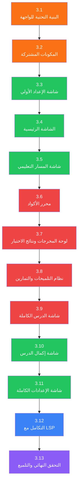
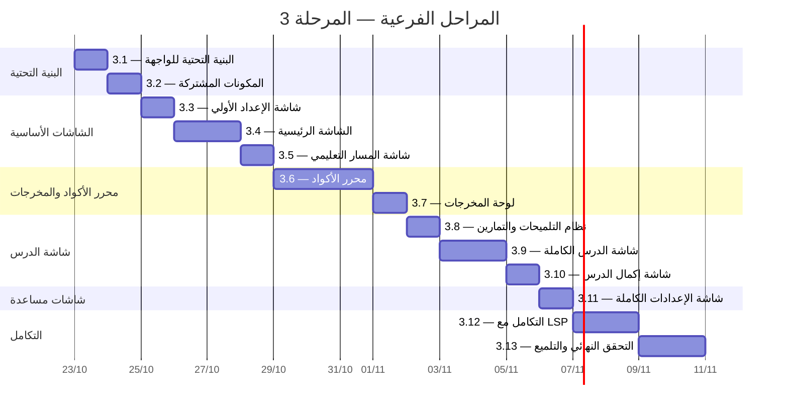

# خطة تنفيذ المرحلة 3: الواجهات التفاعلية

هذه خطة مستقلة لتنفيذ المرحلة 3 من [`execution_plan.md`](./execution_plan.md).
تقسم العمل إلى مراحل فرعية متتابعة؛ لا تبدأ المرحلة الفرعية التالية قبل اجتياز
معيار الخروج للمرحلة الحالية، إلا إذا ذُكر اعتماد قابل للفصل صراحةً.

## سجل التقدم

**آخر تحديث:** 22 أكتوبر 2026
**الحالة العامة:** لم تبدأ بعد

---

## الهدف والنطاق

بناء جميع شاشات التطبيق وعناصر الواجهة التفاعلية بتصميم متجاوب يعمل على الهاتف
(360px) والحاسوب (1280px+)، مع دعم كامل للغتين (العربية RTL والإنجليزية LTR)
والمظهرين (الفاتح والداكن). تشمل هذه المرحلة:

- شاشة الإعداد الأولي (Onboarding)
- الشاشة الرئيسية (Home)
- شاشة المسار التعليمي (Learning Path)
- شاشة الدرس الكاملة (Lesson) — الأهم
- محرر الأكواد المدمج مع تكامل LSP
- لوحة المخرجات (Output Panel)
- نظام التلميحات المتدرج
- شاشة الإعدادات الكاملة
- التخطيطات المتجاوبة (Adaptive Layouts)

لا تشمل هذه المرحلة نظام التلعيب (المرحلة 4) أو الميزات المتقدمة (المرحلة 5).

### شروط البدء

- المرحلة 1 مكتملة: البنية التحتية جاهزة، تشمل:
  - نماذج البيانات ([`curriculum_models.dart`](file:///home/osm/flutter_projects/learn_gdscript/lib/data/models/curriculum_models.dart)، [`lesson_models.dart`](file:///home/osm/flutter_projects/learn_gdscript/lib/data/models/lesson_models.dart)، [`exercise_models.dart`](file:///home/osm/flutter_projects/learn_gdscript/lib/data/models/exercise_models.dart))
  - المستودعات ([`CurriculumRepository`](file:///home/osm/flutter_projects/learn_gdscript/lib/data/repositories/curriculum_repository.dart)، [`ProgressRepository`](file:///home/osm/flutter_projects/learn_gdscript/lib/data/repositories/progress_repository.dart)، [`SettingsRepository`](file:///home/osm/flutter_projects/learn_gdscript/lib/data/repositories/settings_repository.dart))
  - المزوّدات ([`AppSettingsProvider`](file:///home/osm/flutter_projects/learn_gdscript/lib/logic/providers/app_settings_provider.dart)، [`CurriculumProvider`](file:///home/osm/flutter_projects/learn_gdscript/lib/logic/providers/curriculum_provider.dart)، [`LessonProvider`](file:///home/osm/flutter_projects/learn_gdscript/lib/logic/providers/lesson_provider.dart)، [`ExerciseProvider`](file:///home/osm/flutter_projects/learn_gdscript/lib/logic/providers/exercise_provider.dart)، [`ProgressProvider`](file:///home/osm/flutter_projects/learn_gdscript/lib/logic/providers/progress_provider.dart))
  - الخدمات ([`CodeRunnerService`](file:///home/osm/flutter_projects/learn_gdscript/lib/logic/services/code_runner_service.dart)، [`TestRunnerService`](file:///home/osm/flutter_projects/learn_gdscript/lib/logic/services/test_runner_service.dart)، [`LanguageServerClient`](file:///home/osm/flutter_projects/learn_gdscript/lib/logic/services/language_server_client.dart)، [`WorkspaceIndexService`](file:///home/osm/flutter_projects/learn_gdscript/lib/logic/services/workspace_index_service.dart))
  - المظهر ([`AppTheme`](file:///home/osm/flutter_projects/learn_gdscript/lib/core/theme/theme_data.dart)، [`CodeEditorTheme`](file:///home/osm/flutter_projects/learn_gdscript/lib/core/theme/code_editor_theme.dart))
  - التوجيه ([`app.dart`](file:///home/osm/flutter_projects/learn_gdscript/lib/app.dart)) — يعمل مع مسارات مبدئية
  - التعريب ([`app_ar.arb`](file:///home/osm/flutter_projects/learn_gdscript/lib/l10n/app_ar.arb)، [`app_en.arb`](file:///home/osm/flutter_projects/learn_gdscript/lib/l10n/app_en.arb))
  - أداة اتجاه الكود [`CodeDirectionality`](file:///home/osm/flutter_projects/learn_gdscript/lib/ui/widgets/code_directionality.dart)
- المرحلة 2 (محتوى كافٍ للاختبار): يكفي وجود وحدة تعليمية واحدة (2 درس + 5 تمارين) لاختبار الواجهات.
- الشاشات الحالية في [`initial_screens.dart`](file:///home/osm/flutter_projects/learn_gdscript/lib/ui/screens/initial_screens.dart) هي هياكل مبدئية (stubs) سيتم استبدالها بالواجهات الكاملة.

### مبادئ التنفيذ

1. **Mobile أولاً:** يُصمّم لعرض 360px ثم يُوسَّع لعرض 1280px+.
2. **فصل الملفات:** كل شاشة في ملفها المستقل ضمن مجلد خاص. لا يبقى أكثر من شاشة في ملف واحد.
3. **ثنائية اللغة والاتجاه:** كل نص ظاهر يأتي من `AppLocalizations`؛ اتجاه الواجهة يتبع اللغة (RTL/LTR)؛ المحرر والمخرجات LTR دائماً.
4. **المظهر المزدوج:** كل عنصر يدعم الفاتح والداكن ويستجيب لـ `ThemeMode`.
5. **الاختبار مع كل مرحلة:** لا تُدمج شاشة بدون اختبار widget يثبت عملها.
6. **الأداء:** زر التشغيل يعرض الناتج خلال < 2 ثانية؛ الانتقالات بين الشاشات سلسة.
7. **إعادة الاستخدام:** المكونات المشتركة (بطاقات، أزرار، مؤشرات) في `lib/ui/widgets/common/`.

---

## هيكل الملفات المستهدف

```text
lib/ui/
├── screens/
│   ├── onboarding/
│   │   └── onboarding_screen.dart
│   ├── home/
│   │   └── home_screen.dart
│   ├── learning_path/
│   │   └── learning_path_screen.dart
│   ├── lesson/
│   │   ├── lesson_screen.dart
│   │   └── lesson_complete_screen.dart
│   ├── settings/
│   │   └── settings_screen.dart
│   └── workspace/
│       ├── workspace_screen.dart
│       └── workspace_search_screen.dart
├── widgets/
│   ├── code_editor/
│   │   ├── code_editor_widget.dart
│   │   ├── line_numbers.dart
│   │   ├── syntax_highlighter.dart
│   │   ├── code_completion_overlay.dart
│   │   ├── folding_controls.dart
│   │   ├── bracket_match_overlay.dart
│   │   └── code_actions_bar.dart
│   ├── output_panel/
│   │   ├── output_panel.dart
│   │   └── error_display.dart
│   ├── exercise/
│   │   ├── exercise_widget.dart
│   │   ├── test_results_widget.dart
│   │   └── hint_widget.dart
│   ├── progress/
│   │   ├── progress_bar.dart
│   │   └── unit_card.dart
│   ├── common/
│   │   ├── continue_learning_card.dart
│   │   ├── quick_try_card.dart
│   │   ├── navigation_bar.dart
│   │   ├── loading_indicator.dart
│   │   └── empty_state.dart
│   └── code_directionality.dart           ← موجود
├── layouts/
│   ├── adaptive_layout.dart
│   ├── lesson_layout_mobile.dart
│   └── lesson_layout_desktop.dart
└── pages/                                  ← (يُحذف إن بقي فارغاً)
```

---

## نظرة عامة على المراحل الفرعية



| المرحلة الفرعية | المدة التقديرية | الناتج الرئيسي |
| :--- | :--- | :--- |
| 3.1 — البنية التحتية للواجهة | 1 يوم | التخطيطات المتجاوبة + هيكلة المجلدات + تحديث التوجيه + مفاتيح الترجمة |
| 3.2 — المكونات المشتركة | 1 يوم | بطاقات، أشرطة تقدم، مكونات مشتركة |
| 3.3 — شاشة الإعداد الأولي | 0.5 يوم | شاشة Onboarding كاملة |
| 3.4 — الشاشة الرئيسية | 1.5 يوم | Home Screen تفاعلية متجاوبة |
| 3.5 — شاشة المسار التعليمي | 1 يوم | Learning Path مع قائمة الوحدات والدروس |
| 3.6 — محرر الأكواد | 3 أيام | محرر كامل مع أرقام الأسطر وتلوين الصياغة والمسافة البادئة |
| 3.7 — لوحة المخرجات ونتائج الاختبار | 1 يوم | عرض النتائج والأخطاء |
| 3.8 — نظام التلميحات والتمارين | 1 يوم | ودجت التمارين والتلميحات المتدرجة |
| 3.9 — شاشة الدرس الكاملة | 2 يوم | تجميع المكونات في شاشة الدرس بتخطيط mobile/desktop |
| 3.10 — شاشة إكمال الدرس | 0.5 يوم | شاشة انتقالية بعد إكمال الدرس |
| 3.11 — شاشة الإعدادات الكاملة | 1 يوم | Settings كاملة بكل الخيارات |
| 3.12 — التكامل مع LSP | 2 يوم | ربط المحرر بخدمات LSP (إكمال، تشخيصات، hover، ...) |
| 3.13 — التحقق النهائي والتلميع | 1.5 يوم | اختبارات شاملة + تلميع بصري + إصلاح الثغرات |
| **الإجمالي** | **~17-18 يوم** | **جميع الشاشات والواجهات التفاعلية** |

---

## المرحلة الفرعية 3.1: البنية التحتية للواجهة

**المدة:** 1 يوم
**الهدف:** تجهيز الأساسيات التي تعتمد عليها جميع الشاشات

### المهام

#### 3.1.1 إعادة هيكلة مجلدات الشاشات

تقسيم [`initial_screens.dart`](file:///home/osm/flutter_projects/learn_gdscript/lib/ui/screens/initial_screens.dart) إلى ملفات مستقلة:

```text
lib/ui/screens/
├── onboarding/onboarding_screen.dart    ← من OnboardingScreen
├── home/home_screen.dart                ← من HomeScreen
├── learning_path/learning_path_screen.dart ← من LearningPathScreen
├── lesson/lesson_screen.dart            ← من LessonScreen
├── settings/settings_screen.dart        ← من SettingsScreen
├── workspace/workspace_screen.dart      ← من WorkspaceScreen
└── not_found_screen.dart                ← من NotFoundScreen
```

- نقل كل شاشة إلى ملفها الخاص مع الحفاظ على الوظيفة الحالية.
- تحديث الاستيرادات في [`app.dart`](file:///home/osm/flutter_projects/learn_gdscript/lib/app.dart).
- التحقق من أن التوجيه يعمل بعد إعادة الهيكلة.

#### 3.1.2 بناء نظام التخطيط المتجاوب (Adaptive Layout)

**الملف:** `lib/ui/layouts/adaptive_layout.dart`

```dart
class AdaptiveLayout extends StatelessWidget {
  const AdaptiveLayout({
    super.key,
    required this.mobileBuilder,
    required this.desktopBuilder,
    this.breakpoint = 768,
  });

  final WidgetBuilder mobileBuilder;
  final WidgetBuilder desktopBuilder;
  final double breakpoint;

  @override
  Widget build(BuildContext context) => LayoutBuilder(
    builder: (context, constraints) =>
        constraints.maxWidth >= breakpoint
            ? desktopBuilder(context)
            : mobileBuilder(context),
  );
}
```

#### 3.1.3 بناء تخطيط شاشة الدرس

**الملفات:**

- `lib/ui/layouts/lesson_layout_mobile.dart` — ترتيب عمودي: الشرح → المحرر → الناتج
- `lib/ui/layouts/lesson_layout_desktop.dart` — ترتيب أفقي: جزء أيسر (الشرح) + جزء أيمن (المحرر + الناتج)

```dart
// lesson_layout_mobile.dart
class LessonLayoutMobile extends StatelessWidget {
  const LessonLayoutMobile({
    super.key,
    required this.explanationSection,
    required this.editorSection,
    required this.outputSection,
    required this.actionsSection,
  });

  final Widget explanationSection;
  final Widget editorSection;
  final Widget outputSection;
  final Widget actionsSection;

  @override
  Widget build(BuildContext context) => SingleChildScrollView(
    child: Column(children: [
      explanationSection,
      editorSection,
      actionsSection,
      outputSection,
    ]),
  );
}

// lesson_layout_desktop.dart
class LessonLayoutDesktop extends StatelessWidget {
  // يقسم الشاشة إلى عمودين: الشرح (40%) والمحرر+الناتج (60%)
  // مع إمكانية سحب الحاجز لتغيير النسبة
}
```

#### 3.1.4 توسيع مفاتيح الترجمة

إضافة جميع مفاتيح الترجمة اللازمة للمرحلة 3 في ملفات ARB:

**ملف:** `lib/l10n/app_ar.arb` و `lib/l10n/app_en.arb`

المفاتيح الجديدة المطلوبة (غير الحصرية):

| المفتاح | العربية | الإنجليزية |
| :--- | :--- | :--- |
| `onboardingQuestion` | هل سبق لك البرمجة؟ | Have you programmed before? |
| `onboardingNewbie` | أنا جديد تماماً | I'm completely new |
| `onboardingExperienced` | أعرف أساسيات البرمجة | I know programming basics |
| `continueLearning` | تابع التعلّم | Continue Learning |
| `quickTry` | جرّب الآن | Quick Try |
| `runCode` | شغّل | Run |
| `resetCode` | إعادة | Reset |
| `showHint` | تلميح | Hint |
| `showSolution` | عرض الحل | Show Solution |
| `nextLesson` | الدرس التالي | Next Lesson |
| `previousLesson` | الدرس السابق | Previous Lesson |
| `exercisePrompt` | التمرين | Exercise |
| `outputLabel` | الناتج | Output |
| `outputEmpty` | اضغط شغّل لرؤية الناتج | Press Run to see output |
| `outputRunning` | جاري التشغيل... | Running... |
| `testResults` | نتائج الاختبار | Test Results |
| `testPassed` | ناجح | Passed |
| `testFailed` | فشل | Failed |
| `lessonComplete` | أحسنت! | Well done! |
| `completedLesson` | أكملت درس \"{name}\" | Completed lesson \"{name}\" |
| `exercisesSolved` | {count} تمارين محلولة | {count} exercises solved |
| `hintsUsed` | {count} تلميح مستخدم | {count} hints used |
| `timeSpent` | {minutes} دقائق | {minutes} minutes |
| `backToPath` | العودة للمسار | Back to Path |
| `unitLocked` | مقفل | Locked |
| `unitInProgress` | قيد التقدم | In Progress |
| `unitCompleted` | مكتمل | Completed |
| `editorFontSize` | حجم خط المحرر | Editor Font Size |
| `fontSmall` | صغير | Small |
| `fontMedium` | متوسط | Medium |
| `fontLarge` | كبير | Large |
| `resetProgress` | إعادة ضبط التقدم | Reset Progress |
| `resetConfirmation` | هل أنت متأكد؟ سيتم حذف كل تقدمك. | Are you sure? All progress will be deleted. |
| `aboutApp` | حول التطبيق | About |
| `sendFeedback` | إرسال ملاحظات | Send Feedback |
| `lspStatus` | حالة خادم اللغة | Language Server Status |
| `lspConnected` | متصل | Connected |
| `lspDisconnected` | غير متصل | Disconnected |

#### 3.1.5 توسيع `CodeEditorTheme`

إضافة ألوان الصياغة المتخصصة إلى [`CodeEditorTheme`](file:///home/osm/flutter_projects/learn_gdscript/lib/core/theme/code_editor_theme.dart):

```dart
class CodeEditorTheme {
  // الألوان الموجودة: background, foreground, lineNumber, selection, cursor

  // ألوان جديدة للصياغة:
  final Color keyword;       // كلمات مفتاحية (if, for, func, var)
  final Color string;        // نصوص "Hello"
  final Color number;        // أرقام 42, 3.14
  final Color comment;       // تعليقات # ...
  final Color function;      // أسماء الدوال print()
  final Color type;          // أنواع int, String
  final Color operator;      // عوامل +, -, ==
  final Color errorLine;     // خلفية سطر الخطأ
  final Color matchedBracket; // خلفية القوس المطابق
  final Color foldGutter;    // أيقونات الطيّ
}
```

### معيار الخروج

- [ ] كل شاشة في ملف مستقل داخل مجلد خاص
- [ ] التوجيه يعمل بعد إعادة الهيكلة (`flutter analyze` نظيف)
- [ ] `AdaptiveLayout` يبدّل بين Mobile و Desktop عند نقطة الانعطاف
- [ ] تخطيطات الدرس (mobile/desktop) قابلة للبناء مع widgets وهمية
- [ ] مفاتيح الترجمة الجديدة موجودة في `app_ar.arb` و `app_en.arb`
- [ ] `CodeEditorTheme` يحتوي على ألوان الصياغة للمظهرين
- [ ] `flutter test` جميع الاختبارات القائمة تنجح

---

## المرحلة الفرعية 3.2: المكونات المشتركة (Common Widgets)

**المدة:** 1 يوم
**الهدف:** بناء المكونات القابلة لإعادة الاستخدام في عدة شاشات

### المهام

#### 3.2.1 شريط التقدم (`progress_bar.dart`)

**الملف:** `lib/ui/widgets/progress/progress_bar.dart`

```dart
class LessonProgressBar extends StatelessWidget {
  const LessonProgressBar({
    super.key,
    required this.completed,
    required this.total,
    this.height = 8,
    this.showLabel = true,
  });

  final int completed;
  final int total;
  final double height;
  final bool showLabel;
}
```

**المتطلبات:**

- شريط متحرك (animated) يتغير لونه حسب النسبة (أحمر → أصفر → أخضر).
- يعرض تسمية اختيارية \"3 من 10\".
- يدعم المظهرين.

#### 3.2.2 بطاقة الوحدة (`unit_card.dart`)

**الملف:** `lib/ui/widgets/progress/unit_card.dart`

```dart
class UnitCard extends StatelessWidget {
  const UnitCard({
    super.key,
    required this.unit,
    required this.status,       // locked, inProgress, completed
    required this.progressText, // "2/3"
    this.onTap,
  });
}
```

**المتطلبات:**

- أيقونة الوحدة + عنوان + وصف مختصر.
- حالة بصرية: مقفل (رمادي + 🔒)، قيد التقدم (لون أساسي)، مكتمل (أخضر + ✓).
- الضغط ينتقل لقائمة دروس الوحدة (إذا غير مقفل).

#### 3.2.3 بطاقة \"تابع التعلّم\" (`continue_learning_card.dart`)

**الملف:** `lib/ui/widgets/common/continue_learning_card.dart`

**المتطلبات:**

- تعرض اسم الوحدة والدرس الحالي.
- شريط تقدم مصغّر.
- تقدير الوقت المتبقي.
- زر بارز \"تابع التعلّم ←\".
- تظهر فقط إذا كان هناك درس قيد التقدم.

#### 3.2.4 بطاقة \"جرّب الآن\" (`quick_try_card.dart`)

**الملف:** `lib/ui/widgets/common/quick_try_card.dart`

**المتطلبات:**

- محرر مصغّر مع كود مثال بسيط (مثل `print("Hello")`).
- زر \"شغّل\" يعرض الناتج أسفل المحرر.
- تعديل الكود ممكن قبل التشغيل.
- الهدف: أول تفاعل سريع للمستخدم الجديد.

#### 3.2.5 شريط التنقل (`navigation_bar.dart`)

**الملف:** `lib/ui/widgets/common/navigation_bar.dart`

**المتطلبات:**

- **على الهاتف:** شريط تنقل سفلي `BottomNavigationBar` بـ 3 عناصر: الرئيسية | المسار | الإعدادات.
- **على الحاسوب:** شريط جانبي `NavigationRail` مع أيقونات ونصوص.
- يتبع اللغة (RTL/LTR).
- يبرز العنصر النشط.

#### 3.2.6 مكونات مساعدة

- `loading_indicator.dart` — مؤشر تحميل موحد مع رسالة اختيارية.
- `empty_state.dart` — حالة فارغة مع أيقونة ورسالة وزر إجراء اختياري.

### معيار الخروج

- [ ] كل مكون يعمل بشكل مستقل مع بيانات وهمية
- [ ] كل مكون يدعم المظهرين (فاتح/داكن)
- [ ] كل مكون يدعم اللغتين (RTL/LTR)
- [ ] اختبار widget واحد على الأقل لكل مكون
- [ ] `flutter analyze` نظيف

---

## المرحلة الفرعية 3.3: شاشة الإعداد الأولي (Onboarding)

**المدة:** 0.5 يوم
**الهدف:** بناء شاشة ترحيب بسيطة تحدد مستوى المستخدم

### المهام

#### 3.3.1 تصميم وتنفيذ `OnboardingScreen`

**الملف:** `lib/ui/screens/onboarding/onboarding_screen.dart`

**المكونات:**

```text
┌─────────────────────────────────┐
│                                 │
│         🎮 تعلّم GDScript        │
│                                 │
│     ابدأ رحلتك في برمجة         │
│      الألعاب مع GDScript        │
│                                 │
│    ┌───────────────────────┐    │
│    │  هل سبق لك البرمجة؟  │    │
│    └───────────────────────┘    │
│                                 │
│  ┌─────────────────────────┐    │
│  │ 🌱 أنا جديد تماماً      │    │
│  │    ابدأ من الصفر         │    │
│  └─────────────────────────┘    │
│                                 │
│  ┌─────────────────────────┐    │
│  │ 💡 أعرف أساسيات البرمجة  │    │
│  │    تخطَّ المقدمة         │    │
│  └─────────────────────────┘    │
│                                 │
└─────────────────────────────────┘
```

**السلوك:**

- اختيار \"جديد تماماً\" → يحفظ في `ProgressProvider` أن المستخدم يبدأ من الوحدة 1، الدرس 1.
- اختيار \"أعرف أساسيات\" → يحفظ أن المستخدم يمكنه البدء من الوحدة 2 (يُقترح تخطي الوحدة 1 لكن لا يُجبر).
- بعد الاختيار: انتقال مباشر إلى الشاشة الرئيسية.
- لا يُلزم بتسجيل أو إنشاء حساب.
- يظهر مرة واحدة فقط (يُحفظ حالة \"تم عرض الـ Onboarding\" محلياً).

#### 3.3.2 تكامل مع التوجيه

- تحديث [`app.dart`](file:///home/osm/flutter_projects/learn_gdscript/lib/app.dart) لعرض `OnboardingScreen` عند أول تشغيل.
- بعد اكتمال الـ Onboarding: يتحول المسار الابتدائي إلى `/` (الشاشة الرئيسية).

### معيار الخروج

- [ ] شاشة Onboarding تظهر عند أول تشغيل
- [ ] لا تظهر مجدداً بعد الاختيار
- [ ] الاختيار يُحفظ ويؤثر على نقطة البداية
- [ ] تدعم اللغتين والمظهرين
- [ ] اختبار widget يتحقق من السلوك

---

## المرحلة الفرعية 3.4: الشاشة الرئيسية (Home Screen)

**المدة:** 1.5 يوم
**الهدف:** بناء شاشة رئيسية تفاعلية متجاوبة

### المهام

#### 3.4.1 تنفيذ `HomeScreen` الكاملة

**الملف:** `lib/ui/screens/home/home_screen.dart`

**التخطيط على الهاتف:**

```text
┌─────────────────────────────────┐
│ تعلّم GDScript          [⚙️]   │
├─────────────────────────────────┤
│                                 │
│ 👋 مرحباً بعودتك!               │
│                                 │
│ ┌─────────────────────────────┐ │
│ │ 📚 تابع التعلّم              │ │
│ │ الوحدة 2 → المتغيرات       │ │
│ │ ████████░░ 2/3 دروس        │ │
│ │ ~5 دقائق                   │ │
│ │         [تابع التعلّم ←]    │ │
│ └─────────────────────────────┘ │
│                                 │
│ ┌─────────────────────────────┐ │
│ │ 💻 جرّب الآن                 │ │
│ │ ┌─────────────────────────┐ │ │
│ │ │ print("Hello!")         │ │ │
│ │ └─────────────────────────┘ │ │
│ │ [▶ شغّل]     → Hello!      │ │
│ └─────────────────────────────┘ │
│                                 │
│ 📖 الوحدات التعليمية            │
│ ┌─────────────────────────────┐ │
│ │ ✓ أول برنامج     مكتمل     │ │
│ │ ● المتغيرات      2/3       │ │
│ │ ○ الشروط         مقفل      │ │
│ │ ○ الحلقات        مقفل      │ │
│ │ ○ الدوال         مقفل      │ │
│ └─────────────────────────────┘ │
│                                 │
├─────────────────────────────────┤
│ 🏠 الرئيسية | 📍 المسار | ⚙️    │
└─────────────────────────────────┘
```

**التخطيط على الحاسوب:**

```text
┌──────────┬──────────────────────────────────────┐
│          │                                      │
│  🏠 الرئيسية │  👋 مرحباً بعودتك!                │
│  📍 المسار   │                                  │
│  ⚙️ الإعدادات │  ┌──────────────┬──────────────┐ │
│          │  │ 📚 تابع التعلّم │ 💻 جرّب الآن  │ │
│          │  │ ...            │ ...          │ │
│          │  └──────────────┴──────────────┘ │
│          │                                      │
│          │  📖 الوحدات                           │
│          │  [بطاقات أفقية ...]                   │
│          │                                      │
└──────────┴──────────────────────────────────────┘
```

#### 3.4.2 ربط البيانات الحقيقية

- قراءة تقدم المستخدم من `ProgressProvider`.
- قراءة بيانات المنهج من `CurriculumProvider`.
- تحديد الدرس الحالي وعرضه في بطاقة \"تابع التعلّم\".
- تحديد حالة كل وحدة (مكتملة/قيد التقدم/مقفلة).

#### 3.4.3 رسالة ترحيب ذكية

- **مستخدم جديد (لم يكمل أي درس):** \"مرحباً! ابدأ رحلتك في تعلّم البرمجة 🚀\"
- **مستخدم عائد:** \"مرحباً بعودتك! 👋\" + ملخص تقدمه

### معيار الخروج

- [ ] الشاشة الرئيسية تعرض بيانات حقيقية من المزوّدات
- [ ] بطاقة \"تابع التعلّم\" تعمل وتوجه للدرس الحالي
- [ ] بطاقة \"جرّب الآن\" تشغّل كوداً عبر `CodeRunnerService`
- [ ] قائمة الوحدات تعرض الحالة الصحيحة
- [ ] التخطيط متجاوب (mobile ↔ desktop)
- [ ] شريط التنقل يعمل ويتبدل حسب الحجم
- [ ] تدعم اللغتين والمظهرين
- [ ] اختبار widget يتحقق من عرض المكونات الرئيسية

---

## المرحلة الفرعية 3.5: شاشة المسار التعليمي (Learning Path)

**المدة:** 1 يوم
**الهدف:** عرض المسار الكامل مع إمكانية التنقل بين الوحدات والدروس

### المهام

#### 3.5.1 تنفيذ `LearningPathScreen`

**الملف:** `lib/ui/screens/learning_path/learning_path_screen.dart`

**التخطيط:**

```text
┌─────────────────────────────────┐
│ [←]  مسار تعلّم GDScript       │
├─────────────────────────────────┤
│                                 │
│ التقدم الكلي                    │
│ ████████░░░░░░░░ 35%            │
│ 5 من 14 درساً                  │
│                                 │
│ ┌─────────────────────────────┐ │
│ │ ✅ أول برنامج                │ │
│ │    مكتمل — 2/2 دروس        │ │
│ │  ├─ ✓ مرحباً بالعالم        │ │
│ │  └─ ✓ التعليقات             │ │
│ └─────────────────────────────┘ │
│                                 │
│ ┌─────────────────────────────┐ │
│ │ 🔵 المتغيرات والأنواع       │ │
│ │    قيد التقدم — 2/3 دروس   │ │
│ │  ├─ ✓ المتغيرات            │ │
│ │  ├─ ✓ أنواع البيانات       │ │
│ │  └─ ○ العمليات الحسابية     │ │
│ │            [تابع ←]         │ │
│ └─────────────────────────────┘ │
│                                 │
│ ┌─────────────────────────────┐ │
│ │ 🔒 الشروط والقرارات         │ │
│ │    مقفل                     │ │
│ └─────────────────────────────┘ │
│ ...                             │
└─────────────────────────────────┘
```

#### 3.5.2 منطق فتح/قفل الوحدات

- الوحدة الأولى مفتوحة دائماً.
- الوحدات التالية تُفتح بعد إكمال جميع دروس الوحدة السابقة.
- الوحدة المقفلة تعرض عنوانها لكن لا يمكن فتح دروسها.
- يمكن مراجعة الدروس المكتملة (إعادة فتحها للمراجعة).

#### 3.5.3 توسيع/طي قائمة الدروس

- الضغط على وحدة مفتوحة (غير مقفلة) يوسّع/يطوي قائمة دروسها.
- الوحدة الحالية مفتوحة تلقائياً.
- الضغط على درس ينتقل إلى شاشة الدرس `/lesson/{lessonId}`.

#### 3.5.4 شريط التقدم الكلي

- يحسب إجمالي الدروس المكتملة من كل الوحدات.
- يعرض نسبة مئوية وعدداً (\"5 من 14 درساً\").

### معيار الخروج

- [ ] شاشة المسار تعرض جميع الوحدات بحالاتها الصحيحة
- [ ] الوحدات المقفلة تظهر لكن لا يمكن فتحها
- [ ] توسيع/طي الدروس يعمل
- [ ] الضغط على درس يفتح شاشة الدرس
- [ ] شريط التقدم الكلي يعكس الحالة الحقيقية
- [ ] تدعم اللغتين والمظهرين والتجاوب
- [ ] اختبار widget

---

## المرحلة الفرعية 3.6: محرر الأكواد المدمج

**المدة:** 3 أيام
**الهدف:** بناء محرر أكواد كامل الميزات

> [!IMPORTANT]
> هذه أطول وأعقد مرحلة فرعية. محرر الأكواد هو العمود الفقري لتجربة التعلّم.
> تُقسم إلى أجزاء متسلسلة.

### المهام

#### 3.6.1 المحرر الأساسي (`code_editor_widget.dart`)

**الملف:** `lib/ui/widgets/code_editor/code_editor_widget.dart`

```dart
class CodeEditorWidget extends StatefulWidget {
  const CodeEditorWidget({
    super.key,
    required this.initialCode,
    this.readOnly = false,
    this.onChanged,
    this.onRun,
    this.fontSize = 14,
    this.showLineNumbers = true,
    this.showActionBar = true,
  });

  final String initialCode;
  final bool readOnly;
  final ValueChanged<String>? onChanged;
  final VoidCallback? onRun;
  final double fontSize;
  final bool showLineNumbers;
  final bool showActionBar;
}
```

**المتطلبات الأساسية:**

1. **`TextField`/`EditableText` مخصص** بخط أحادي العرض (monospace).
2. **اتجاه النص LTR دائماً** — يُغلَّف بـ [`CodeDirectionality`](file:///home/osm/flutter_projects/learn_gdscript/lib/ui/widgets/code_directionality.dart).
3. **أحجام الخط:** صغير (12px)، متوسط (14px)، كبير (16px) — يأتي من إعدادات المستخدم.
4. **التحكم بالكود:** واجهة `TextEditingController` مخصصة لتتبع التغييرات وإدارة النص.

#### 3.6.2 أرقام الأسطر (`line_numbers.dart`)

**الملف:** `lib/ui/widgets/code_editor/line_numbers.dart`

**المتطلبات:**

- تعرض أرقام الأسطر على الجانب الأيسر.
- تتزامن مع التمرير العمودي للمحرر.
- لون مختلف عن النص العادي (من `CodeEditorTheme.lineNumber`).
- عرض ثابت يتسع لأكبر رقم سطر.

#### 3.6.3 تلوين الصياغة (`syntax_highlighter.dart`)

**الملف:** `lib/ui/widgets/code_editor/syntax_highlighter.dart`

**المتطلبات:**

- **المرحلة الأولى (regex محلي):** تلوين أساسي بـ regex للكلمات المفتاحية، النصوص، الأرقام، التعليقات.
- **المرحلة الثانية (3.12):** استبدال بـ semantic tokens من LSP.

```dart
class GDScriptSyntaxHighlighter {
  /// يحوّل نصاً إلى قائمة TextSpan ملونة
  List<TextSpan> highlight(String code, CodeEditorTheme theme);
}
```

**أنماط التلوين:**

| النمط | الأمثلة | اللون (مرجع) |
| :--- | :--- | :--- |
| keyword | `var`, `func`, `if`, `for`, `return` | `theme.keyword` |
| string | `"Hello"`, `'World'` | `theme.string` |
| number | `42`, `3.14` | `theme.number` |
| comment | `# comment` | `theme.comment` |
| function | `print`, `range` | `theme.function` |
| type | `int`, `String`, `bool` | `theme.type` |
| operator | `+`, `-`, `==`, `>=` | `theme.operator` |

#### 3.6.4 المسافة البادئة التلقائية (Auto-Indent)

**المتطلبات:**

- عند الضغط على Enter بعد `:` → إضافة مسافة بادئة (tab/4 مسافات).
- عند حذف سطر فارغ → إزالة مسافة بادئة.
- زر Tab يضيف مسافة بادئة (أو يُستبدل بزر في الـ toolbar على الهاتف).

#### 3.6.5 إبراز سطر الخطأ

**المتطلبات:**

- عند استلام خطأ من المحرك (مع رقم سطر): تلوين خلفية السطر بالأحمر الشفاف.
- عرض علامة ❌ بجانب رقم السطر.
- إزالة الإبراز عند التعديل.

#### 3.6.6 شريط أدوات المحرر (`code_actions_bar.dart`)

**الملف:** `lib/ui/widgets/code_editor/code_actions_bar.dart`

```text
[💡 تلميح]  [↺ إعادة]  [👁 الحل]  [▶ شغّل]
```

**المتطلبات:**

- **تلميح:** يعرض التلميح التالي (يتكامل مع `HintWidget`).
- **إعادة:** يعيد الكود إلى `starterCode` مع تأكيد إذا عُدِّل.
- **الحل:** يعرض `solutionCode` (فقط بعد استنفاد التلميحات أو 3+ محاولات).
- **شغّل:** يشغّل الكود عبر `CodeRunnerService` ويعرض الناتج.

### معيار الخروج

- [ ] المحرر يعرض كوداً بخط monospace مع أرقام أسطر
- [ ] تلوين الصياغة يعمل لجميع أنماط GDScript الأساسية
- [ ] المسافة البادئة التلقائية تعمل بعد `:`
- [ ] إبراز سطر الخطأ يظهر ويختفي عند التعديل
- [ ] شريط الأدوات يعمل (تلميح، إعادة، حل، شغّل)
- [ ] اتجاه النص LTR حتى في الواجهة العربية
- [ ] يدعم المظهرين (ألوان من `CodeEditorTheme`)
- [ ] اختبار widget للمحرر الأساسي

---

## المرحلة الفرعية 3.7: لوحة المخرجات ونتائج الاختبار

**المدة:** 1 يوم
**الهدف:** بناء مكونات عرض النتائج والأخطاء

### المهام

#### 3.7.1 لوحة المخرجات (`output_panel.dart`)

**الملف:** `lib/ui/widgets/output_panel/output_panel.dart`

```dart
class OutputPanel extends StatelessWidget {
  const OutputPanel({
    super.key,
    required this.state,     // empty, running, success, error
    this.output,
    this.errorMessage,
    this.errorLine,
  });
}
```

**الحالات البصرية:**

| الحالة | المظهر |
| :--- | :--- |
| `empty` | رسالة خافتة: \"اضغط شغّل لرؤية الناتج\" + أيقونة |
| `running` | مؤشر تحميل دائري + \"جاري التشغيل...\" |
| `success` | النص الناتج بخط monospace + خلفية خضراء خفيفة |
| `error` | رسالة الخطأ بالأحمر + رقم السطر (إن وُجد) + أيقونة ⚠️ |

**المتطلبات:**

- اتجاه النص LTR دائماً (مثل المحرر).
- يدعم التمرير إذا كان الناتج طويلاً.
- زر نسخ الناتج (اختياري).

#### 3.7.2 عرض الأخطاء (`error_display.dart`)

**الملف:** `lib/ui/widgets/output_panel/error_display.dart`

```dart
class ErrorDisplay extends StatelessWidget {
  const ErrorDisplay({
    super.key,
    required this.message,
    this.lineNumber,
    this.suggestion,      // اقتراح إصلاح (اختياري)
  });
}
```

**المتطلبات:**

- رسالة الخطأ مُنسّقة وواضحة.
- إذا توفر رقم السطر: \"خطأ في السطر 5: ...\" مع إمكانية الضغط للتنقل إلى السطر.
- ترجمة رسائل الأخطاء الشائعة (مثل \"Unexpected token\" → \"رمز غير متوقع\").

#### 3.7.3 نتائج الاختبار (`test_results_widget.dart`)

**الملف:** `lib/ui/widgets/exercise/test_results_widget.dart`

```dart
class TestResultsWidget extends StatelessWidget {
  const TestResultsWidget({
    super.key,
    required this.results,    // List<TestCaseResult>
    required this.allPassed,
  });
}
```

**التخطيط:**

```text
📊 نتائج الاختبار (2/3 ناجحة)
┌────────────────────────────────┐
│ ✅ اختبار 1: يجب أن يطبع Hello │
│ ✅ اختبار 2: يجب أن يطبع World │
│ ❌ اختبار 3: المتوقع: "Bye"    │
│             الفعلي:  "By"      │
└────────────────────────────────┘
```

**المتطلبات:**

- عرض كل حالة اختبار مع ✅/❌.
- في حالة الفشل: إظهار المتوقع والفعلي.
- ملخص في الأعلى: \"2 من 3 ناجحة\".
- رسالة تحفيزية عند النجاح الكامل: \"أحسنت! كل الاختبارات ناجحة 🎉\".

### معيار الخروج

- [ ] لوحة المخرجات تعرض الحالات الأربع بشكل صحيح
- [ ] عرض الأخطاء يتضمن رقم السطر (إن توفر)
- [ ] نتائج الاختبار تعرض التفاصيل في حالة النجاح والفشل
- [ ] جميع المكونات تدعم اللغتين والمظهرين
- [ ] اختبار widget لكل مكون

---

## المرحلة الفرعية 3.8: نظام التلميحات والتمارين

**المدة:** 1 يوم
**الهدف:** بناء نظام التلميحات المتدرج وودجت التمارين

### المهام

#### 3.8.1 ودجت التلميحات (`hint_widget.dart`)

**الملف:** `lib/ui/widgets/exercise/hint_widget.dart`

```dart
class HintWidget extends StatefulWidget {
  const HintWidget({
    super.key,
    required this.hints,            // List<LocalizedText>
    required this.solutionCode,     // String
    required this.onHintUsed,       // VoidCallback — لتسجيل الاستخدام
    required this.onShowSolution,   // VoidCallback
    this.attemptsCount = 0,
  });
}
```

**السلوك المتدرج:**

| الضغطة | الإجراء | المثال |
| :--- | :--- | :--- |
| 1 | تلميح عام | \"تذكر استخدام if\" |
| 2 | تلميح أوضح | \"الشرط يجب أن يقارن score بـ 50\" |
| 3 | مثال مشابه | \"مثال: `if x > 10: print(\"big\")`\" |
| 4 | عرض الحل | يظهر `solutionCode` كاملاً مع شرح |

**المتطلبات:**

- كل ضغطة تكشف التلميح التالي فقط (لا يمكن تخطي).
- التلميحات السابقة تبقى ظاهرة.
- التلميحات تظهر بتأثير حركي (fade-in + slide).
- كل ضغطة تُسجّل في `LessonProgress.hintsUsed` عبر `ProgressProvider`.
- زر \"عرض الحل\" لا يظهر إلا بعد استنفاد التلميحات أو بعد 3+ محاولات فاشلة.

#### 3.8.2 ودجت التمرين (`exercise_widget.dart`)

**الملف:** `lib/ui/widgets/exercise/exercise_widget.dart`

```dart
class ExerciseWidget extends StatefulWidget {
  const ExerciseWidget({
    super.key,
    required this.exercise,       // Exercise
    required this.onCompleted,    // VoidCallback
  });
}
```

**التخطيط:**

```text
┌─────────────────────────────────┐
│ ✏️ التمرين 1 من 3               │
│                                 │
│ 📝 اكتب أمراً يطبع اسمك        │
│    على الشاشة                   │
│                                 │
│ ┌───── محرر الأكواد ──────────┐ │
│ │ ...                         │ │
│ └─────────────────────────────┘ │
│                                 │
│ [💡 تلميح] [↺ إعادة] [▶ شغّل]  │
│                                 │
│ ┌───── لوحة المخرجات ─────────┐ │
│ │ ...                         │ │
│ └─────────────────────────────┘ │
│                                 │
│ ┌───── نتائج الاختبار ────────┐ │
│ │ ...                         │ │
│ └─────────────────────────────┘ │
│                                 │
│ ┌───── التلميحات ─────────────┐ │
│ │ ...                         │ │
│ └─────────────────────────────┘ │
└─────────────────────────────────┘
```

**دعم أنواع التمارين:**

| النوع | واجهة خاصة |
| :--- | :--- |
| `writeCode` | محرر فارغ/مع starter code + زر تشغيل |
| `fillBlank` | كود مع فراغات (`___`) قابلة للتعبئة |
| `predictOutput` | كود للقراءة فقط + اختيار من متعدد للناتج |
| `fixBug` | محرر مع كود خاطئ + تلميح بموقع الخطأ |
| `reorderSteps` | أسطر قابلة للسحب والترتيب (drag & drop) |

#### 3.8.3 دعم `predictOutput`

```dart
class PredictOutputExercise extends StatelessWidget {
  // يعرض الكود للقراءة فقط
  // يعرض خيارات (4 أزرار) للمخرج المتوقع
  // يتحقق من الإجابة ويعرض الشرح
}
```

#### 3.8.4 دعم `reorderSteps`

```dart
class ReorderExercise extends StatelessWidget {
  // يعرض أسطر كود مخلوطة
  // يتيح السحب والإفلات لإعادة الترتيب
  // يتحقق من الترتيب الصحيح ويشغّل الكود
}
```

### معيار الخروج

- [ ] التلميحات تظهر بالتدريج ولا تعرض الحل فوراً
- [ ] استخدام التلميحات يُسجّل في التقدم
- [ ] زر \"عرض الحل\" يظهر فقط بعد الشروط المحددة
- [ ] ودجت التمرين يدعم جميع أنواع التمارين الخمسة
- [ ] `predictOutput` يعرض خيارات ويتحقق من الإجابة
- [ ] `reorderSteps` يدعم السحب والإفلات
- [ ] اتجاه الكود LTR والنصوص حسب اللغة
- [ ] اختبار widget لكل نوع تمرين

---

## المرحلة الفرعية 3.9: شاشة الدرس الكاملة ⭐

**المدة:** 2 يوم
**الهدف:** تجميع كل المكونات في شاشة الدرس — أهم شاشة في التطبيق

> [!IMPORTANT]
> شاشة الدرس هي القلب النابض للتطبيق. يقضي المستخدم معظم وقته فيها.
> يجب أن تكون سلسة وبديهية ومتجاوبة.

### المهام

#### 3.9.1 تنفيذ `LessonScreen` الكاملة

**الملف:** `lib/ui/screens/lesson/lesson_screen.dart`

```dart
class LessonScreen extends StatefulWidget {
  const LessonScreen({super.key, required this.lessonId});
  final String lessonId;
}
```

**التخطيط على الهاتف (عمودي):**

```text
┌─────────────────────────────────┐
│ [← رجوع]     الشروط    [1/4]   │
├─────────────────────────────────┤
│                                 │
│ 📖 الشرح                        │
│ ──────────────────────────────  │
│ اجعل برنامجك يتخذ قراراً       │
│ باستخدام if.                    │
│                                 │
│ في GDScript، الشرط يُكتب هكذا: │
│ ```                             │
│ if condition:                   │
│     do_something()              │
│ ```                             │
│                                 │
│ 💻 المثال                        │
│ ┌─────────────────────────────┐ │
│ │ var score = 10              │ │
│ │ if score > 0:               │ │
│ │     print("فزت!")           │ │
│ └─────────────────────────────┘ │
│ [▶ شغّل المثال]                 │
│                                 │
│ 📤 الناتج                        │
│ ┌─────────────────────────────┐ │
│ │ فزت!                        │ │
│ └─────────────────────────────┘ │
│                                 │
│ ═══════════════════════════════ │
│                                 │
│ ✏️ التمرين 1 من 3               │
│ [ودجت التمرين الكامل]          │
│                                 │
│           [الدرس التالي ←]      │
└─────────────────────────────────┘
```

**التخطيط على الحاسوب (أفقي):**

```text
┌──────────────────┬───────────────────────────────────┐
│ [← المسار]       │                      [1/4]        │
├──────────────────┤───────────────────────────────────┤
│                  │                                   │
│ 📖 الشرح          │  💻 المحرر                         │
│ ─────────────    │  ┌───────────────────────────────┐│
│ اجعل برنامجك     │  │ var score = 10                ││
│ يتخذ قراراً      │  │ if score > 0:                 ││
│ ...              │  │     print("فزت!")             ││
│                  │  └───────────────────────────────┘│
│ 💡 التلميحات      │                                   │
│ ─────────────    │  [▶ شغّل]  [↺ إعادة]  [💡 تلميح]  │
│ [تلميح 1]        │                                   │
│                  │  📤 الناتج                         │
│                  │  ┌───────────────────────────────┐│
│                  │  │ فزت!                          ││
│ 📊 التمارين       │  └───────────────────────────────┘│
│ ─────────────    │                                   │
│ ● التمرين 1      │  📊 نتائج الاختبار                 │
│ ○ التمرين 2      │  ✅ 1/2  ❌ 1/2                     │
│ ○ التمرين 3      │                                   │
├──────────────────┴───────────────────────────────────┤
│                      [الدرس التالي ←]                │
└──────────────────────────────────────────────────────┘
```

#### 3.9.2 تحميل بيانات الدرس

```dart
// في initState أو عبر Provider
final lesson = await lessonProvider.loadLesson(lessonId);
final progress = progressProvider.getLessonProgress(lessonId);
```

**الحالات:**

- **تحميل:** مؤشر تحميل.
- **خطأ:** رسالة خطأ مع زر إعادة المحاولة.
- **نجاح:** عرض محتوى الدرس.

#### 3.9.3 عرض محتوى الشرح (Markdown)

- تحويل `contentMarkdown` إلى widgets عبر حزمة markdown.
- الشرح بلغة المستخدم (`LocalizedText.resolve(locale)`).
- تنسيقات: عناوين، فقرات، كود مضمّن (inline code)، كتل كود، تلميحات 💡.
- أمثلة الكود داخل الشرح قابلة للنسخ.

#### 3.9.4 تشغيل المثال

- مثال الدرس (`exampleCode`) يُعرض في محرر للقراءة فقط.
- زر \"شغّل المثال\" يشغل الكود ويعرض الناتج أسفله.
- يمكن للمستخدم تعديل المثال وتجربته (نسخة قابلة للتعديل).

#### 3.9.5 إدارة التمارين المتسلسلة

- التمارين تُعرض واحداً تلو الآخر.
- بعد حل التمرين الحالي: يظهر التمرين التالي.
- شريط تقدم مصغّر: \"التمرين 1 من 3\".
- عند حل آخر تمرين: يظهر زر \"الدرس التالي\" أو \"شاشة الإكمال\".

#### 3.9.6 حفظ التقدم التلقائي

- حفظ `savedCode` (آخر كود كتبه المستخدم) عند الخروج.
- حفظ `exercisesCompleted` بعد كل تمرين.
- حفظ `attempts` و `hintsUsed`.
- استعادة التقدم عند العودة للدرس.

#### 3.9.7 التنقل بين الدروس

- **الدرس التالي:** ينتقل إلى `/lesson/{nextLessonId}`.
- **الدرس السابق:** زر رجوع أو زر صريح.
- **العودة للمسار:** ينتقل إلى `/path`.
- **إذا كان آخر درس في الوحدة:** ينتقل لشاشة إكمال الدرس.

### معيار الخروج

- [ ] شاشة الدرس تعرض الشرح والمثال والتمارين
- [ ] تشغيل المثال يعرض الناتج خلال < 2 ثانية
- [ ] التمارين تُعرض بالتسلسل ويُحفظ التقدم
- [ ] شاشة الدرس متجاوبة (mobile ↔ desktop)
- [ ] حفظ واستعادة التقدم والكود المحفوظ يعمل
- [ ] التنقل بين الدروس سلس
- [ ] تدعم اللغتين والمظهرين
- [ ] الكود والمخرجات LTR والشرح حسب اللغة
- [ ] اختبار widget يتحقق من تحميل الدرس وعرض المكونات

---

## المرحلة الفرعية 3.10: شاشة إكمال الدرس

**المدة:** 0.5 يوم
**الهدف:** شاشة انتقالية تحتفي بإكمال الدرس

### المهام

#### 3.10.1 تنفيذ `LessonCompleteScreen`

**الملف:** `lib/ui/screens/lesson/lesson_complete_screen.dart`

```text
┌─────────────────────────────────┐
│                                 │
│           🎉 أحسنت!              │
│                                 │
│    أكملت درس "الشروط"            │
│                                 │
│    ملخص:                         │
│    ✅ 3 تمارين محلولة             │
│    💡 1 تلميح مستخدم              │
│    ⏱ 8 دقائق                    │
│                                 │
│    [← العودة للمسار]              │
│    [الدرس التالي →]              │
│                                 │
└─────────────────────────────────┘
```

**المتطلبات:**

- رسالة تهنئة متحركة (confetti أو animation بسيطة).
- ملخص الأداء: تمارين محلولة، تلميحات مستخدمة، الوقت المستغرق.
- زران: العودة للمسار أو الدرس التالي.
- إذا كان آخر درس في الوحدة: رسالة خاصة \"أكملت وحدة [اسم الوحدة]! 🏆\".

> [!NOTE]
> نظام XP والشارات يُضاف في المرحلة 4. هذه الشاشة تعرض الملخص فقط الآن،
> وتُوسَّع لاحقاً لعرض النقاط والشارات المكتسبة.

### معيار الخروج

- [ ] شاشة الإكمال تظهر بعد حل آخر تمرين
- [ ] تعرض ملخص الأداء الصحيح
- [ ] التنقل يعمل (مسار / درس تالي)
- [ ] رسالة خاصة لإكمال الوحدة
- [ ] تدعم اللغتين والمظهرين

---

## المرحلة الفرعية 3.11: شاشة الإعدادات الكاملة

**المدة:** 1 يوم
**الهدف:** توسيع شاشة الإعدادات لتشمل جميع الخيارات

### المهام

#### 3.11.1 توسيع `SettingsScreen`

**الملف:** `lib/ui/screens/settings/settings_screen.dart`

استبدال الشاشة الحالية في [`initial_screens.dart`](file:///home/osm/flutter_projects/learn_gdscript/lib/ui/screens/initial_screens.dart) بشاشة كاملة:

```text
┌─────────────────────────────────┐
│ [←]  الإعدادات                  │
├─────────────────────────────────┤
│                                 │
│ 🌐 اللغة                        │
│ ┌─────────────────────────────┐ │
│ │ ● العربية      ○ English   │ │
│ └─────────────────────────────┘ │
│                                 │
│ 🎨 المظهر                       │
│ ┌─────────────────────────────┐ │
│ │ ○ فاتح  ○ داكن  ● النظام  │ │
│ └─────────────────────────────┘ │
│                                 │
│ 📝 حجم خط المحرر                │
│ ┌─────────────────────────────┐ │
│ │ ○ صغير  ● متوسط  ○ كبير   │ │
│ └─────────────────────────────┘ │
│                                 │
│ ──────────────────────────────  │
│                                 │
│ 🖥 حالة خادم اللغة              │
│    متصل ● / غير متصل ○         │
│    [إعداد المسار]               │
│                                 │
│ 📁 مساحة العمل                   │
│    المجلد: /path/to/project     │
│    [تغيير] [إدارة الاستثناءات]   │
│                                 │
│ ──────────────────────────────  │
│                                 │
│ 🔄 إعادة ضبط التقدم             │
│    [إعادة ضبط] ← مع تأكيد      │
│                                 │
│ ──────────────────────────────  │
│                                 │
│ ℹ️ حول التطبيق                   │
│    الإصدار 1.0.0                │
│                                 │
│ 💬 إرسال ملاحظات                 │
│                                 │
└─────────────────────────────────┘
```

#### 3.11.2 خيارات جديدة

**حجم خط المحرر:**

- صغير (12px) / متوسط (14px) / كبير (16px).
- يُحفظ في `AppSettings` ويُطبّق فوراً على المحرر.
- يتطلب إضافة حقل `editorFontSize` إلى [`AppSettings`](file:///home/osm/flutter_projects/learn_gdscript/lib/data/models/app_settings.dart) و[`SettingsRepository`](file:///home/osm/flutter_projects/learn_gdscript/lib/data/repositories/settings_repository.dart).

**حالة خادم اللغة:**

- عرض حالة الاتصال (متصل/غير متصل) من `LanguageServerClient`.
- إعداد مسار executable عند الحاجة.
- زر إعادة اتصال.

**مساحة العمل:**

- عرض مجلد العمل الحالي (إن وُجد).
- زر تغيير المجلد.
- إدارة الملفات المستبعدة من الفهرسة.

**إعادة ضبط التقدم:**

- حوار تأكيد واضح: \"هل أنت متأكد؟ سيتم حذف كل تقدمك.\"
- زران: \"إلغاء\" و\"إعادة ضبط\" (بلون أحمر تحذيري).
- إعادة الضبط تحذف جميع بيانات التقدم من قاعدة البيانات.

### معيار الخروج

- [ ] جميع الخيارات تعمل وتُطبّق فوراً
- [ ] تغيير اللغة يحدّث الواجهة واتجاهها
- [ ] تغيير المظهر يحدّث كل الشاشات
- [ ] حجم الخط يُطبّق على المحرر
- [ ] إعادة الضبط تعمل مع تأكيد
- [ ] حالة LSP تظهر بشكل صحيح
- [ ] كل الإعدادات محفوظة بعد إغلاق التطبيق
- [ ] تدعم اللغتين والمظهرين
- [ ] اختبار widget

---

## المرحلة الفرعية 3.12: التكامل مع خادم LSP

**المدة:** 2 يوم
**الهدف:** ربط محرر الأكواد بخدمات خادم اللغة

> [!WARNING]
> هذه المرحلة تعتمد على أن [`LanguageServerClient`](file:///home/osm/flutter_projects/learn_gdscript/lib/logic/services/language_server_client.dart)
> يعمل بشكل صحيح وأن خادم LSP يدعم الميزات المطلوبة.
> إذا لم تتوفر ميزة، يُستخدم البديل المحلي (regex) ويُوثّق النقص.

### المهام

#### 3.12.1 مزامنة المستند مع الخادم

```dart
// عند فتح المحرر:
await lspClient.openDocument(uri, code);

// عند كل تغيير:
await lspClient.updateDocument(uri, changes);

// عند إغلاق المحرر:
await lspClient.closeDocument(uri);
```

**المتطلبات:**

- المزامنة تدريجية (incremental) لتقليل حجم البيانات المرسلة.
- لا يُعطّل المحرر أثناء المزامنة.
- عند فشل المزامنة: يستمر المحرر بالعمل مع تحذير صغير.

#### 3.12.2 التشخيصات (Diagnostics)

- استقبال `publishDiagnostics` من الخادم.
- عرض التشخيصات كعلامات على الأسطر (خط أحمر متعرج تحت الكود).
- عرض تفاصيل التشخيص عند hover على السطر.

#### 3.12.3 الإكمال التلقائي (Completion)

**الملف:** `lib/ui/widgets/code_editor/code_completion_overlay.dart`

- إرسال طلب `textDocument/completion` عند الكتابة.
- عرض قائمة منسدلة مع الاقتراحات.
- اختيار اقتراح يُدخله في المحرر.
- تصفية الاقتراحات أثناء الكتابة.

```text
var na|
┌──────────────┐
│ name         │
│ navigation   │
│ namespace    │
└──────────────┘
```

#### 3.12.4 Hover (تفاصيل عند التحويم)

- إرسال طلب `textDocument/hover` عند تحويم المؤشر.
- عرض tooltip مع معلومات الرمز (النوع، الوصف).

#### 3.12.5 Signature Help

- عرض بارامترات الدالة عند كتابة `(` بعد اسم دالة.

#### 3.12.6 طيّ الكتل (Folding)

**الملف:** `lib/ui/widgets/code_editor/folding_controls.dart`

- إرسال طلب `textDocument/foldingRange`.
- عرض أيقونات ▶/▼ بجانب الأسطر القابلة للطيّ.
- الضغط يطوي/يفتح الكتلة.

#### 3.12.7 مطابقة الأقواس (Bracket Matching)

**الملف:** `lib/ui/widgets/code_editor/bracket_match_overlay.dart`

- عند وضع المؤشر على قوس: إبراز القوس المقابل.
- يستخدم `textDocument/documentHighlight` أو `textDocument/selectionRange`.

#### 3.12.8 تنسيق المستند (Formatting)

- زر \"تنسيق\" في شريط الأدوات.
- إرسال طلب `textDocument/formatting`.
- تطبيق التعديلات على المحرر.
- مزامنة النص المنسّق للخادم.

#### 3.12.9 تلوين الصياغة عبر Semantic Tokens

- استبدال تلوين regex (من 3.6.3) بـ semantic tokens من LSP.
- fallback إلى regex إذا لم يدعم الخادم semantic tokens.

### معيار الخروج

- [ ] مزامنة المستند تعمل (فتح، تحديث، إغلاق)
- [ ] التشخيصات تظهر على الأسطر المعنية
- [ ] الإكمال التلقائي يعرض اقتراحات ويُدخلها
- [ ] Hover يعرض معلومات الرمز
- [ ] طيّ الكتل يعمل
- [ ] مطابقة الأقواس تعمل
- [ ] التنسيق يعمل ويحافظ على تزامن المحرر والخادم
- [ ] أخطاء LSP لا تعطّل المحرر (graceful degradation)
- [ ] اختبار تكامل للميزات الرئيسية

---

## المرحلة الفرعية 3.13: التحقق النهائي والتلميع

**المدة:** 1.5 يوم
**الهدف:** ضمان جودة كل الشاشات وإصلاح الثغرات

### المهام

#### 3.13.1 اختبارات الشاشات الشاملة

إنشاء/تحديث الاختبارات في `test/`:

```text
test/
├── ui/
│   ├── screens/
│   │   ├── onboarding_screen_test.dart
│   │   ├── home_screen_test.dart
│   │   ├── learning_path_screen_test.dart
│   │   ├── lesson_screen_test.dart
│   │   ├── lesson_complete_screen_test.dart
│   │   └── settings_screen_test.dart
│   └── widgets/
│       ├── code_editor_test.dart
│       ├── output_panel_test.dart
│       ├── exercise_widget_test.dart
│       ├── hint_widget_test.dart
│       ├── test_results_widget_test.dart
│       ├── progress_bar_test.dart
│       └── unit_card_test.dart
```

**كل اختبار يتحقق من:**

- العرض الأساسي (المكون يُبنى بدون أخطاء).
- التفاعل (الضغطات والإدخال).
- البيانات (عرض البيانات الصحيحة).
- اللغتين (ar و en).

#### 3.13.2 اختبار التجاوب

- اختبار كل شاشة بعرض 360px (mobile) و1280px (desktop).
- التحقق من تبدّل التخطيط عند نقطة الانعطاف.
- التحقق من أن شريط التنقل يتغير (bottom bar ↔ side rail).

#### 3.13.3 اختبار ثنائية اللغة والاتجاه

- كل شاشة تُختبر بالعربية (RTL) والإنجليزية (LTR).
- المحرر والمخرجات LTR في كلتا الحالتين.
- لا نصوص مكتوبة مباشرة في الكود (كلها من `AppLocalizations`).

#### 3.13.4 اختبار المظهر المزدوج

- كل شاشة تُختبر بالمظهر الفاتح والداكن.
- ألوان المحرر والمخرجات مقروءة ومتوافقة مع المظهرين.
- لا ألوان hardcoded (كلها من `Theme` أو `CodeEditorTheme`).

#### 3.13.5 التلميع البصري

- **انتقالات سلسة:** تأثيرات حركية بين الشاشات.
- **حالات التحميل:** مؤشرات تحميل واضحة.
- **حالات الخطأ:** رسائل واضحة مع زر إعادة المحاولة.
- **حالات فارغة:** رسائل ودية مع أيقونات.
- **التمرير:** سلس في جميع القوائم.
- **لوحة المفاتيح:** المحرر لا يتأثر بإخفاء/إظهار لوحة المفاتيح على الهاتف.

#### 3.13.6 تحليل ثابت وأداء

```bash
flutter analyze   # يجب أن يعود 0 أخطاء/تحذيرات
flutter test      # جميع الاختبارات تنجح
```

- التحقق من عدم وجود `widget rebuild` غير ضرورية.
- التحقق من أن زر التشغيل يعرض الناتج خلال < 2 ثانية.
- التحقق من سلاسة الانتقالات (لا إطارات مُسقطة).

### معيار الخروج

- [ ] جميع اختبارات الشاشات تنجح
- [ ] كل شاشة تعمل على mobile (360px) و desktop (1280px)
- [ ] كل شاشة تعمل بالعربية (RTL) والإنجليزية (LTR)
- [ ] كل شاشة تعمل بالمظهر الفاتح والداكن
- [ ] المحرر والمخرجات LTR في كلتا اللغتين
- [ ] لا نصوص hardcoded في الكود
- [ ] `flutter analyze` بدون أخطاء
- [ ] `flutter test` جميع الاختبارات تنجح
- [ ] زمن الاستجابة < 2 ثانية لتشغيل الكود
- [ ] الانتقالات سلسة بدون إطارات مُسقطة

---

## ملخص ترتيب التنفيذ



---

## قواعد خاصة بهذه المرحلة

1. **فصل الملفات:** كل شاشة في ملف مستقل داخل مجلد خاص. لا يُقبل ملف يحتوي أكثر من شاشة.
2. **لا ألوان hardcoded:** كل الألوان من `Theme.of(context)` أو `CodeEditorTheme.of(context)`.
3. **لا نصوص مباشرة:** كل نص ظاهر من `AppLocalizations` (مفاتيح الترجمة).
4. **الكود LTR دائماً:** محرر الكود ولوحة المخرجات يُغلَّفان بـ `CodeDirectionality`.
5. **Provider للحالة:** لا `setState` لبيانات مشتركة بين الشاشات؛ تُستخدم المزوّدات.
6. **اختبار كل مكون:** لا يُدمج مكون بدون اختبار widget واحد على الأقل.
7. **التجاوب إلزامي:** كل شاشة تُختبر على mobile و desktop.
8. **الأداء:** لا عمليات حسابية ثقيلة في `build()`؛ تُستخدم `const` و`Key` عند الحاجة.
9. **Graceful degradation:** إذا فشل LSP، يستمر المحرر بالعمل مع ميزات أقل (لا crash).

---

## معايير القبول النهائية (من الخطة الرئيسية)

- [ ] جميع الشاشات تعمل على الهاتف (360px عرض)
- [ ] جميع الشاشات تعمل على الحاسوب (1280px عرض)
- [ ] المحرر يلوّن الصياغة بشكل صحيح
- [ ] الإكمال والتشخيصات والـ hover والتعريفات تعمل عبر LSP بعد مزامنة المستند
- [ ] طيّ الكود ومطابقة الأقواس والتنسيق تعمل وتحافظ على تزامن المحرر والخادم
- [ ] اختيار مساحة عمل يؤدي إلى اكتشاف ملفاتها وفهرستها وتحديث الفهرس عند التغييرات
- [ ] البحث عن الرموز والمراجع والتعريفات، والبحث النصي، يعمل عبر عدة ملفات مفهرسة
- [ ] لا يعتمد أي مسار على فهرسة تلقائية من الخادم؛ يوضح التطبيق حالة الفهرسة وأخطاءها
- [ ] زر التشغيل يعرض الناتج خلال < 2 ثانية
- [ ] التلميحات تظهر بالتدريج (لا تعرض الحل فوراً)
- [ ] التنقل بين الشاشات سلس
- [ ] كل شاشة ورسائلها تظهر بالعربية والإنجليزية، مع اتجاه RTL للعربية وLTR للإنجليزية
- [ ] محرر الكود ومخرجاته LTR في اللغتين
- [ ] تبديل الفاتح/الداكن/اتباع النظام يحدّث كل الشاشات فوراً
- [ ] ألوان المحرر والمخرجات مقروءة ومتوافقة مع المظهر الفاتح والداكن
- [ ] إعدادات اللغة والمظهر محفوظة بعد إغلاق التطبيق وإعادة فتحه
- [ ] حفظ التقدم يعمل عند الخروج والعودة
