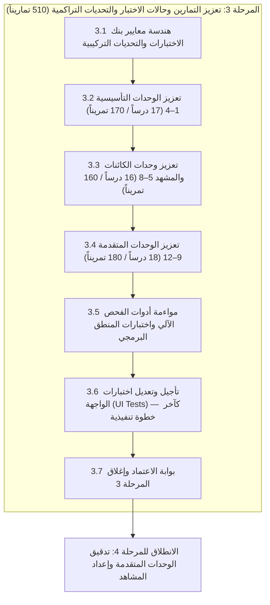

# الخطة التنفيذية للمرحلة 3: تعزيز التمارين وحالات الاختبار والتحديات التراكمية (510 تماريناً عبر 12 وحدة)

> **تاريخ الاعتماد:** 2026-10-27  
> **المرجع الأساسي:** [تحليل وتقييم المنهج التعليمي](docs/curriculum_analysis.md)  
> **الخطة الأم:** [الخطة التنفيذية لمعالجة وتطوير المنهج التعليمي](docs/curriculum_remediation_plan.md)  
> **خطط المراحل السابقة:** [المرحلة 0 (الحوكمة)](docs/phase_0_execution_plan.md) | [المرحلة 1 (الوحدات التأسيسية)](docs/phase_1_execution_plan.md) | [المرحلة 2 (خريطة المفاهيم)](docs/phase_2_execution_plan.md)  
> **قواعد الحوكمة والمراجع الرسمية:** [قواعد التحقق البرمجي للمنهج](docs/curriculum_validation_rules.md) | [سجل توثيق GDScript 4.3 الرسمي](docs/gdscript_official_registry.md)  
> **النطاق التنفيذي:** ترقية وتدعيم بنك التمارين بالكامل (510 تماريناً في 51 درساً موزعة على 12 وحدة)، مضاعفة حالات الاختبار (`testCases`) لتتجاوز 1200+ حالة اختبار مع فحص الحالات الحدية، تصميم 11 تحدياً تركيبياً تراكمياً (Synthesis Capstones)، وتحقيق التنوع البيداغوجي للأنواع السبعة.  
> **قاعدة تأجيل اختبارات الواجهة الحتمية:** إذا كان هناك أي اختبارات على الواجهة (UI Widget Tests)، فيجب تأجيلها وترحيلها بالكامل إلى **آخر خطوة تنفيذية** في الخطة (المرحلة الفرعية 3.6)، ويُحظر تماماً تعديلها أو تشغيلها أثناء مراحل صياغة وتحديث التمارين وبيانات JSON والمنطق البرمجي، لضمان استقرار البنية التحتية أولاً ومنع أي فشل عارض في خطوط الـ CI.  
> **المخرج المستهدف:** ارتقاء جودة التمارين من ⭐⭐ (ضعيفة ونمطية) إلى ⭐⭐⭐⭐+ (صلبة، تطبيقية، ومتنوعة برمجياً)، مع خلو كامل من اختبارات التحقق الشكلي.

---

## فهرس خطة المرحلة 3

1. [الرؤية والأهداف التشغيلية](#1-الرؤية-والأهداف-التشغيلية)
2. [استرجاع فجوات التمارين وحالات الاختبار من وثيقة التحليل (GAP-03 & GAP-04)](#2-استرجاع-فجوات-التمارين-وحالات-الاختبار-من-وثيقة-التحليل-gap-03--gap-04)
3. [المراحل الفرعية المتسلسلة للتنفيذ](#3-المراحل-الفرعية-المتسلسلة-للتنفيذ)
   - [المرحلة الفرعية 3.1: هندسة معايير بنك الاختبارات والتحديات التركيبية (Blueprint Standards)](#المرحلة-الفرعية-31-هندسة-معايير-بنك-الاختبارات-والتحديات-التركيبية-blueprint-standards)
   - [المرحلة الفرعية 3.2: تعزيز تمارين واختبارات الوحدات التأسيسية (الوحدات 1–4: 17 درساً، 170 تمريناً)](#المرحلة-الفرعية-32-تعزيز-تمارين-واختبارات-الوحدات-التأسيسية-الوحدات-14-17-درساً-170-تمريناً)
   - [المرحلة الفرعية 3.3: تعزيز تمارين واختبارات وحدات الكائنات وشجرة المشهد (الوحدات 5–8: 16 درساً، 160 تمريناً)](#المرحلة-الفرعية-33-تعزيز-تمارين-واختبارات-وحدات-الكائنات-وشجرة-المشهد-الوحدات-58-16-درساً-160-تمريناً)
   - [المرحلة الفرعية 3.4: تعزيز تمارين واختبارات الوحدات المتقدمة والأنظمة (الوحدات 9–12: 18 درساً، 180 تمريناً)](#المرحلة-الفرعية-34-تعزيز-تمارين-واختبارات-الوحدات-المتقدمة-والأنظمة-الوحدات-912-18-درساً-180-تمريناً)
   - [المرحلة الفرعية 3.5: مواءمة أدوات الفحص الآلي واختبارات منطق التشغيل (Logic & Unit Tests)](#المرحلة-الفرعية-35-مواءمة-أدوات-الفحص-الآلي-واختبارات-منطق-التشغيل-logic--unit-tests)
   - [المرحلة الفرعية 3.6: تأجيل وتعديل اختبارات الواجهة (UI Tests) والتحقق البصري — كآخر خطوة تنفيذية](#المرحلة-الفرعية-36-تأجيل-وتعديل-اختبارات-الواجهة-ui-tests-والتحقق-البصري--كآخر-خطوة-تنفيذية)
   - [المرحلة الفرعية 3.7: بوابة الاعتماد وإغلاق المرحلة 3](#المرحلة-الفرعية-37-بوابة-الاعتماد-وإغلاق-المرحلة-3)
4. [مخطط التحديات التراكمية الختامية الـ 11 للوحدات (The 11 Unit Synthesis Capstones Matrix)](#4-مخطط-التحديات-التراكمية-الختامية-الـ-11-للوحدات)
5. [المعايير الهندسية لحالات الاختبار ومصفوفة الحالات الحدية (Edge Cases)](#5-المعايير-الهندسية-لحالات-الاختبار-ومصفوفة-الحالات-الحدية-edge-cases)
6. [دمج التوجيهات الرسمية لـ GDScript 4.3 في صلب التمارين](#6-دمج-التوجيهات-الرسمية-لـ-gdscript-43-في-صلب-التمارين)
7. [الجدول الزمني ومسار الاعتماديات للمرحلة 3 (10 أيام عمل)](#7-الجدول-الزمني-ومسار-الاعتماديات-للمرحلة-3-10-أيام-عمل)
8. [مصفوفة المسؤوليات (RACI) للمرحلة 3](#8-مصفوفة-المسؤوليات-raci-للمرحلة-3)
9. [معايير القبول وبوابة الإغلاق (Definition of Done)](#9-معايير-القبول-وبوابة-الإغلاق-definition-of-done)
10. [الخطوة المباشرة التالية بعد الاعتماد](#10-الخطوة-المباشرة-التالية-بعد-الاعتماد)

---

## 1. الرؤية والأهداف التشغيلية

أكدت وثيقة [تحليل وتقييم المنهج التعليمي](docs/curriculum_analysis.md) أن التطبيق يمتلك معمارية تنفيذية واعدة للغاية تدعم 7 أنواع مختلفة من التمارين (`writeCode`, `multipleChoice`, `fixBug`, `predictOutput`, `fillBlank`, `reorderSteps`, `guidedTask`) مع محرك اختبارات متطور (`TestRunnerService`).

ومع ذلك، يعاني المنهج الحالي من **فجوتين بيداغوجيتين حرجتين**:

1. **سطحية واختزال حالات الاختبار (GAP-03):** أكثر من 90% من تمارين كتابة الشيفرة تحتوي على حالة اختبار وحيدة تفحص مخرجاً نصياً ثابتاً، دون فحص القيم الحدية أو استخدام `setupCode` لاختبار سلوك الدوال مع مدخلات متعددة، ودون ضبط متوازن لخيارات `ignoreWhitespace` و `ignoreCase`.
2. **غياب التقييم التراكمي في ختام الوحدات (GAP-04):** تنتهي الوحدات التعليمية بتمارين معزولة دون وجود مهمة تركيبية تجمع مهارات الوحدة في سياق لعبة حقيقي، مما يجعل المعرفة مجزأة لدى المتعلم.

### الأهداف التشغيلية للمرحلة 3

1. **الارتقاء بجودة التمارين الـ 510:** مراجعة وتحديث جميع التمارين في المنهج (10 تمارين لكل درس × 51 درساً) لتحقق عمقاً برمجياً وتدرجاً بيداغوجياً حقيقياً يخدم مطوري الألعاب.
2. **مضاعفة بنك حالات الاختبار (1200+ Test Cases):** إلزام وجود حالتي تحقق على الأقل (حالة عادية + حالة حدية أو مدخلات متعددة عبر `setupCode`) لكل تمرين من تمارين كتابة الشيفرة (`writeCode`) وتصحيح الأخطاء (`fixBug`).
3. **تأسيس 11 تحدياً تركيبياً ختامياً (Synthesis Capstones):** تخصيص التمرين العاشر (`Exercise 10`) في الدرس الأخير من كل وحدة ليكون مشروعاً مصغراً أو تحدياً مركباً يربط جميع مهارات الوحدة بما قبلها.
4. **تحقيق التوازن البيداغوجي للأنواع السبعة داخل الدروس:** توزيع التمارين في كل درس بنسبة مدروسة تمنع الرتابة (4 كتابة شيفرة، 2 سيناريو خيارات، 1 تصحيح أخطاء، 1 تنبؤ بالمخرجات، 1 إكمال فراغ، 1 مهمة إرشادية أو إعادة ترتيب خطوات).
5. **تعزيز نظام التلميحات ثنائي الطور:** ضمان أن كل تمرين يقدم تلميحين متدرجين (تلميح 1: توجيه مفاهيمي للسياق، تلميح 2: هيكل أو صيغة برمجية)، مع حظر تقديم الحل الجاهز بنسبة 100%.
6. **دمج التحذيرات الرسمية لـ GDScript 4.3:** صياغة تمارين عملية وتصحيح أخطاء تتمحور حول الفخاخ البرمجية الرسمية (مثل: قسمة الأعداد الصحيحة، كسر الذاكرة، تمرير الحاويات بالمرجع، وتحذيرات المترجم).
7. **مبدأ تأجيل وتعديل اختبارات الواجهة (UI Tests) إلى آخر خطوة تنفيذية (UI Test Deferral Rule):** فصل دورة حياة اختبارات الواجهة الرسومية (مثل [test/ui/widgets/exercise_widget_test.dart](test/ui/widgets/exercise_widget_test.dart) و [test/ui/desktop_lesson_ide_screen_test.dart](test/ui/desktop_lesson_ide_screen_test.dart)) عن طبقة البيانات والمنطق؛ حيث يُمنع منعاً باتاً تعديل أو تشغيل اختبارات الواجهة أثناء مراحل التعديل وتوليد ملفات JSON والبيانات، وتُرحل حصراً لتكون آخر خطوة تنفيذية في المرحلة (المرحلة الفرعية 3.6) بعد استقرار كافة التمارين وحالات الاختبار بنسبة 100%، تجنباً لتعطيل خطوط الـ CI بفشل التوافق العارض أثناء تحديث البيانات.

> [!IMPORTANT]
> **دستور تأجيل اختبارات الواجهة إلى آخر خطوة تنفيذية (UI Testing Deferral Principle):**  
> إذا كان هناك أي اختبارات برمجية على واجهة المستخدم (UI Tests مثل `test/ui/widgets/exercise_widget_test.dart` و `test/ui/desktop_lesson_ide_screen_test.dart`)، فإن الخطة تُلزم صراحة بتأجيل أي تعديل أو تشغيل لها إلى **آخر خطوة تنفيذية** (المرحلة الفرعية 3.6).  
> **التعليل الهندسي:** اختبارات الواجهة تفحص تكامل المكونات الرسومية وتعتمد على ثبات نموذج التمرين، عدد حالات الاختبار، التلميحات، ونصوص الأسئلة؛ وأي تشغيل أو تعديل مبكر عليها أثناء مرحلة تأليف وتحديث بيانات التمارين سيؤدي إلى فشل كاذب للـ CI وإعاقة وتشتيت عملية كتابة وتدقيق المحتوى.

---

## 2. استرجاع فجوات التمارين وحالات الاختبار من وثيقة التحليل (GAP-03 & GAP-04)

وفقاً للقسم 5.2، والقسم 5.3، والقسم 10 في [docs/curriculum_analysis.md](docs/curriculum_analysis.md):

| رمز الفجوة | الوصف المرصود في وثيقة التحليل | الأثر التعليمي والبرمجي | المعالجة المستهدفة في المرحلة 3 |
| :---: | --- | --- | --- |
| **GAP-03** | **حالات اختبار وحيدة ومختزلة (`testCases`):**<br>- 92% من تمارين `writeCode` تكتفي بفحص مخرج نصي وحيد.<br>- انعدام الفحص الحدي (الأعداد السالبة، الصفر، السلاسل الفارغة).<br>- عدم استغلال `setupCode` لتمرير متغيرات ديناميكية. | - نجاح حلول المتعلمين المعطوبة برمجياً بمجرد مطابقة نصية شكلية (False Positives).<br>- عدم تدريب المتعلم على التفكير الدفاعي وحالات الحدود (Edge Cases). | - رفع عدد الاختبارات إلى 2–3 حالات لكل تمرين.<br>- استخدام `setupCode` لتشغيل نفس الدالة بمدخلات متعددة.<br>- ضبط `ignoreWhitespace` لمنع الرسوب بسبب المسافات. |
| **GAP-04** | **انعدام التقييم التراكمي في ختام الوحدات:**<br>- كل درس معزول بتمارينه الخاصة.<br>- لا توجد تمارين تجمع الحلقات مع المصفوفات، أو الدوال مع الشروط، أو الإشارات مع العقد. | - تجزؤ المعرفة وصعوبة انتقال المتعلم من فهم القواعد المجردة إلى بناء لعبة فعلية.<br>- غياب الشعور بالإنجاز التركيبي بعد إتمام الوحدة. | - تصميم 11 تحدياً تركيبياً (Synthesis Capstones) كـ Exercise 10 في نهاية كل وحدة.<br>- محاكاة أنظمة ألعاب متكاملة (متجر، قتال، صحة، حقيبة). |
| **VAR-01** | **اختلال توزيع أنواع التمارين السبعة:**<br>- غلبة تمارين الخيارات المتعددة وكتابة الشيفرة البسيطة.<br>- ندرة تمارين `fixBug` و `predictOutput` في الدروس المتقدمة. | - ملل المتعلم وفقدان الدافعية الذهنية لتحليل الشيفرات المعطوبة وتتبع التنفيذ ذهنياً. | - موازنة إلزامية في كل درس تضمن تمثيل تمارين تتبع المخرجات واكتشاف الثغرات وتصحيحها. |

---

## 3. المراحل الفرعية المتسلسلة للتنفيذ



---

### المرحلة الفرعية 3.1: هندسة معايير بنك الاختبارات والتحديات التركيبية (Blueprint Standards)

**الهدف:** وضع الدليل الإرشادي والمعايير الهندسية الصارمة لكتابة التمارين، وتصميم حالات الاختبار المتعددة، وتحديد بنية التحديات التراكمية قبل البدء بالتنفيذ.

#### 1. القواعد الهندسية لصياغة حالات الاختبار (`ExerciseTestCase`)

وفقاً لنموذج Dart في [lib/data/models/exercise_models.dart](lib/data/models/exercise_models.dart) وخدمة التشغيل [lib/logic/services/test_runner_service.dart](lib/logic/services/test_runner_service.dart):

```dart
ExerciseTestCase(
  description: LocalizedText(ar: 'الوصف بالعربية', en: 'English description'),
  setupCode: 'var dynamic_input = ...', // اختياري لتهيئة متغيرات أو نداء دوال
  expectedOutput: 'Expected Result',
  ignoreWhitespace: true,  // تفعيل دائم للتمارين النصية والحسابية لتجنب الإحباط
  ignoreCase: false,       // إيقاف عند فحص الكلمات المفتاحية وأسماء المتغيرات
)
```

- **قاعدة تعدد الحالات (Multi-Case Rule):**
  - **الحالة 1 (المسار الطبيعي - Happy Path):** فحص المدخل المعتاد الذي شرحه الدرس.
  - **الحالة 2 (الحالة الحدية أو المعاكسة - Boundary / Alternate Path):** فحص قيم الصفر، النصوص الفارغة، الأعداد السالبة، أو الشروط غير المتحققة.
  - **الحالة 3 (التحقق الديناميكي عبر `setupCode` - Dynamic Injection):** حقن متغيرات مختلفة للتأكد من أن الحل يعتمد على المنطق البرمجي وليس مجرد طباعة ناتجة ثابتة (`Hardcoded Output`).

#### 2. بنية التحدي التراكمي الختامي (Synthesis Capstone Standard)

يُخصص التمرين العاشر (`order: 9`) في الدرس الأخير من كل وحدة ليكون "تحدياً تركيبياً" بالمواصفات التالية:

- **النوع:** `writeCode` أو `guidedTask` مدمج بكتابة شيفرة.
- **الهدف البيداغوجي:** دمج ما لا يقل عن 3 مفاهيم أساسية تمت دراستها في الوحدة والوحدات السابقة.
- **السياق:** سيناريو مستمد مباشرة من آليات الألعاب الحقيقية (Game Mechanics) في Godot.
- **حالات الاختبار:** لا تقل عن 3 حالات اختبار تغطي مختلف احتمالات مدخلات اللاعب.

---

### المرحلة الفرعية 3.2: تعزيز تمارين واختبارات الوحدات التأسيسية (الوحدات 1–4: 17 درساً، 170 تمريناً)

**الهدف:** ترقية بنك التمارين في الوحدات التأسيسية (الدروس 1 إلى 20)، وتحويلها من تمارين طباعة مكررة إلى تطبيقات تفاعلية صلبة تدعم حالات الاختبار المتعددة.

#### خطة الوحدات الأربع الأولى

1. **الوحدة 01: البداية والبرنامج الأول (3 دروس / 30 تمريناً):**
   - ترقية تمارين `print()` لاختبار طباعة نصوص مركبة، وإصدارات، واستدعاء دالة `_ready()`.
   - إضافة اختبارات تفحص النصوص متعددة الأسطر وتجاهل المسافات الزائدة (`ignoreWhitespace: true`).
   - **التحدي التراكمي (الوحدة 01 - الدرس 15):** بناء سكربت بطاقة تعريف شخصية اللعبة (اسم، رتبة، رسالة جاهزية) مع توثيق `##` وتجنب الأخطاء الإملائية.

2. **الوحدة 02: القيم والمتغيرات والأنواع (5 دروس / 50 تمريناً):**
   - تصميم اختبارات تفحص مخاطر قسمة الأعداد الصحيحة `int / int` ومقارنتها بالقسمة العشرية `float`.
   - اختبارات تحويل الأنواع الصريحة (`int(x)`, `str(y)`, `float(z)`) مع فحص الحالات الحدية (نصوص رقمية، كسور تقرب للأسفل).
   - اختبارات تنسيق السلاسل النصية بـ `%s` و `String.format()`.
   - **التحدي التراكمي (الوحدة 02 - الدرس 06):** برمجة حاسبة معاملات متجر مقتنيات تحسب سعر الشراء، ونسبة الخصم، وتحول العملات مع فحص رصيد الذهب الصفري والسالب.

3. **الوحدة 03: التعبيرات والقرارات والتحكم (4 دروس / 40 تمريناً):**
   - اختبارات الشروط المركبة (`and`, `or`, `not`) وتجنب الخلط بين `=` و `==`.
   - اختبارات `match` الشاملة للأرقام والنصوص وحالات الحارس (`guard conditions`).
   - حالات اختبار تفحص قيم صحة اللاعب عند الصفر تماماً، والقيم القصوى (Overkill).
   - **التحدي التراكمي (الوحدة 03 - الدرس 21):** محاكاة نظام القتال وتلقي الضربات الحرجة (Critical Hits) وحساب الدرع باستخدام `match` وسلاسل `if/elif`.

4. **الوحدة 04: التكرار والحاويات والدوال (5 دروس / 50 تمريناً):**
   - اختبارات معالجة الحاويات: المصفوفات الفارغة `[]`، القواميس الفارغة `{}`، ومحاولة جلب مفتاح مفقود (`dict.get("key", default)`).
   - اختبارات حلقات `for` و `while` مع حالات اختبار تضمن عدم الدخول في حلقات لانهائية.
   - اختبارات التحقق من تمرير المصفوفات بالمرجع (Pass-by-reference) ودوال الإرجاع الرياضية.
   - **التحدي التراكمي (الوحدة 04 - الدرس 48):** نظام إدارة موجات الأعداء (Enemy Wave Spawner)؛ فلترة الأعداء المهزومين، حساب متوسط الضرر، وترتيب قائمة الغنائم.

---

### المرحلة الفرعية 3.3: تعزيز تمارين واختبارات وحدات الكائنات وشجرة المشهد (الوحدات 5–8: 16 درساً، 160 تمريناً)

**الهدف:** بناء تمارين متقدمة تحاكي المعمارية الكينونية لـ Godot 4.3 وتدعم التحقق من الأصناف، العقد، الإشارات، وتوليد المشاهد.

#### خطة الوحدات 5 إلى 8

1. **الوحدة 05: البرمجة كائنية التوجه في GDScript (5 دروس / 50 تمريناً):**
   - اختبارات تعريف الأصناف `class_name` والوراثة `extends` ودوال البناء `_init()`.
   - اختبارات دوال الوصول والتعديل المخصصة (`set(value)` و `get`).
   - **التحدي التراكمي (الوحدة 05 - الدرس 27):** هندسة شجرة كائنات اللعبة (صنف أساسي `Entity` يتفرع منه `Player` و `Enemy` مع وراثة دوال الهجوم والحركة).

2. **الوحدة 06: شجرة المشهد والعقد ودورة الحياة (4 دروس / 40 تمريناً):**
   - اختبارات الوصول للعقد عبر المسارات النسبية والمطلقة `$` و `get_node()`.
   - اختبارات تتبع دورة الحياة (`_enter_tree()`, `_ready()`, `_exit_tree()`).
   - اختبارات إدارة المجموعات `add_to_group()` واستدعاء الأوامر الجماعية `get_tree().call_group()`.
   - **التحدي التراكمي (الوحدة 06 - الدرس 32):** نظام غرفة الزنزانة (Dungeon Room Manager)؛ جلب جميع صناديق الكنز عبر المجموعة، وتفعيل إضاءتها عند جاهزية الغرفة.

3. **الوحدة 07: الإشارات والتفاعل في الألعاب (4 دروس / 40 تمريناً):**
   - اختبارات تعريف الإشارات المخصصة `signal health_depleted(final_amount)`.
   - اختبارات ربط الإشارات بالكود `node.signal.connect(_on_handler)`، وفحص تكرار الربط بـ `is_connected()`.
   - اختبارات بث الأحداث وتمرير المعاملات المعقدة.
   - **التحدي التراكمي (الوحدة 07 - الدرس 36):** نظام تفاعل اللاعب مع الباب السحري عبر زر ضغط (Pressure Plate) يبث إشارة تفتح الباب وتطلق جسيمات بصرية.

4. **الوحدة 08: المشاهد والموارد والمدخلات وحفظ البيانات (3 دروس / 30 تمريناً):**
   - اختبارات توليد المشاهد برمجياً `PackedScene.instantiate()` وإضافتها بـ `add_child()`.
   - اختبارات إنشاء وتعديل وحفظ الموارد المخصصة `Resource`.
   - اختبارات معالجة مدخلات اللاعب `Input.is_action_just_pressed()` وتخزين البيانات بملفات JSON.
   - **التحدي التراكمي (الوحدة 08 - الدرس 40):** نظام حقيبة اللاعب وحفظ اللعبة (Inventory Save System)؛ توليد العناصر وحفظ بياناتها واسترجاعها بأمان.

---

### المرحلة الفرعية 3.4: تعزيز تمارين واختبارات الوحدات المتقدمة والأنظمة (الوحدات 9–12: 18 درساً، 180 تمريناً)

**الهدف:** الارتقاء بتمارين البرمجة اللاتزامنية، الأنواع الساكنة الصارمة، واستقرار المشاريع التكاملية.

#### خطة الوحدات 9 إلى 12

1. **الوحدة 09: البرمجة اللاتزامنية والتوقيت (4 دروس / 40 تمريناً):**
   - اختبارات الـ Coroutines و `await` مع الإشارات والمؤقتات `get_tree().create_timer()`.
   - اختبارات فحص الفخاخ الشائعة؛ التحقق من صلاحية العقدة بـ `is_instance_valid()` قبل استئناف التنفيذ.
   - **التحدي التراكمي (الوحدة 09 - الدرس 44):** نظام عداد تنازلي للهجوم الخاص مع فترات انتظار وتبريد (Cooldown Timer) يمنع الهجوم المزدوج.

2. **الوحدة 10: نظام الأنواع الساكنة وجودة الشيفرة (3 دروس / 30 تمريناً):**
   - اختبارات تعيين الأنواع الصريحة للمتغيرات والمعاملات وقيم الإرجاع (`func move(dir: Vector2) -> bool:`).
   - اختبارات المصفوفات محددة النوع `Array[int]` ومخاطر إدخال أنواع غير مطابقة.
   - اختبارات استخدام `assert()` للتحقق من شروط التشغيل وإعدادات المحرك.
   - **التحدي التراكمي (الوحدة 10 - الدرس 47):** محرك حركة فيزيائي مصغر مكتوب بالكامل بأنواع ساكنة صارمة ويتحقق من سلامة المدخلات بـ `assert`.

3. **الوحدة 11: أسلوب وتصميم مشاريع GDScript (3 دروس / 30 تمريناً):**
   - اختبارات تفكيك المشاكل البرمجية الكبيرة إلى دوال أحادية المسؤولية.
   - اختبارات تطبيق دليل أسلوب التوثيق الداخلي الرسمي بـ `##`.
   - **التحدي التراكمي (الوحدة 11 - الدرس 49):** التصميم الهيكلي لنواة لعبة مغامرات؛ فصل بيانات اللاعب عن منطق الحركة عن معالجة الواجهة.

4. **الوحدة 12: المشروع التكاملي النهائي (4 دروس / 40 تمريناً):**
   - مراجعة وتحديث تمارين بناء لعبة الأركيد المتكاملة خطوة بخطوة.
   - تدعيم كافة التمارين بحالات اختبار متعددة تضمن الترابط الوظيفي بين المشاهد، الأصناف، الإشارات، وتخزين الحالة.

---

### المرحلة الفرعية 3.5: مواءمة أدوات الفحص الآلي واختبارات منطق التشغيل (Logic & Unit Tests)

**الهدف:** تحديث حزمة الاختبارات الآلية وأدوات الحوكمة في سطر الأوامر للتحقق التلقائي من استيفاء معايير التمارين الـ 510 وحالات الاختبار الـ 1200+، مع فرض الحظر التام على تشغيل اختبارات الواجهة في هذه المرحلة.

> [!CAUTION]
> **قاعدة الحظر الصارم — حظر لمس أو تشغيل اختبارات الواجهة الرسومية:**  
> يُمنع منعاً باتاً فتح أو تعديل أو تشغيل أي اختبارات تخص طبقة الواجهة الرسومية (مثل `test/ui/widgets/exercise_widget_test.dart` أو `test/ui/desktop_lesson_ide_screen_test.dart`) خلال هذه المرحلة.  
> **السبب:** اختبارات الواجهة تفحص تكامل الحالة المرئية ومحرك المحرر، وأي تشغيل مبكر لها أثناء تعديل ملفات التمارين يسبب فشلاً كاذباً في الـ CI. هذه الاختبارات مؤجلة حتماً إلى المرحلة الفرعية 3.6 لتكون آخر خطوة تنفيذية.

#### المهام التنفيذية لطبقة المنطق والحوكمة

1. **تحديث أداة الحوكمة الفاحصة (`tool/validate_curriculum.dart`):**
   إضافة القواعد البرمجية الصارمة التالية لأداة التحقق:
   - فحص أن كل تمرين `writeCode` يحتوي على ما لا يقل عن حالتي اختبار (`testCases.length >= 2`).
   - فحص أن كل درس ختامي في الوحدات من 01 إلى 11 يحتوي على تمرين تركيبي ختامي (`order: 9`) يطابق مواصفات التحديات التراكمية.
   - فحص أن كل تمرين يحتوي على تلميحين فريدين على الأقل (`hints.length >= 2`) خاليين من النسخ القالبي.
   - فحص صحة `correctOptionIndex` لجميع تمارين الاختيار من متعدد وعدم تركزها في الخيار 0.

2. **بناء اختبار التحقق الآلي للحلول المرجعية (`test/curriculum_exercises_quality_test.dart`):**
   تشغيل محاكي `TestRunnerService` تلقائياً عبر حزمة الاختبارات لتأكيد أن:
   $$\forall \text{ Exercise } e \implies \text{runTests}(e.\text{solutionCode}, e.\text{testCases}).\text{allPassed} == \text{true}$$
   أي أن كل حل مرجعي موضوع في المنهج يجتاز بنجاح 100% من حالات الاختبار الخاصة به دون أي استثناء.

---

### المرحلة الفرعية 3.6: تأجيل وتعديل اختبارات الواجهة (UI Tests) والتحقق البصري — كآخر خطوة تنفيذية

**الهدف:** تنفيذ التعديلات الدقيقة على اختبارات الواجهة الرسومية (UI Widget Tests) وتشغيلها بنجاح 100% **كآخر خطوة تنفيذية**، والتأكد من انسيابية عرض التمارين المتنوعة والتحديات التراكمية في محرر التطبيق.

> **المبدأ التنفيذي الحاكم:** تنفيذاً للقاعدة الإلزامية بتأجيل اختبارات الواجهة، تمثل هذه المرحلة الفرعية **آخر خطوة تنفيذية** في المرحلة 3 قبل بوابة الاعتماد النهائي. هنا فقط، وبعد استقرار كافة ملفات التمارين الـ 510 وحالات الاختبار الـ 1200+ بنسبة 100% واجتياز اختبارات منطق التشغيل والحلول المرجعية بنجاح، يتم فتح وتعديل وتشغيل اختبارات الواجهة الرسومية.

#### 1. تعديل ومواءمة اختبارات الواجهة المؤجلة

- **تعديل واجتياز [test/ui/widgets/exercise_widget_test.dart](test/ui/widgets/exercise_widget_test.dart):**
  - **التحقق من تعدد حالات الاختبار في الواجهة:** التأكد من أن عنصر الواجهة `ExerciseWidget` يعرض نتائج الفحص المتعددة بسلاسة (حالة 1 مرت، حالة 2 فشلت مع رسالة خطأ، أو جميع الحالات مرت) دون أي تداخل في النصوص.
  - **التحقق من التجاوب مع الشيفرات الطويلة في التحديات التركيبية:** اختبار عرض الشيفرات المتعددة الأسطر الخاصة بالتحديات التراكمية في التمارين رقم 10 والتأكد من عدم حدوث تجاوزات مساحة (`RenderFlex overflowed`).
  - **التحقق من ظهور التلميحات المتدرجة:** اختبار تفاعل زر إظهار التلميح وتدرجه من التلميح الأول إلى الثاني.
  - **التحقق من عدم وجود استثناءات:** التأكد التام من `expect(tester.takeException(), isNull)`.

- **تعديل واجتياز [test/ui/desktop_lesson_ide_screen_test.dart](test/ui/desktop_lesson_ide_screen_test.dart):**
  - مواءمة الاختبار ليعمل مع الأنماط المحدثة للتمارين، وفحص استجابة محرر الأكواد ولوحة الإخراج `OutputPanel` عند تشغيل التمارين التي تحتوي على `setupCode`.
  - التحقق من تفعيل التبديل اللغوي (عربي/إنجليزي) لعناوين ومحتوى التمارين الجديدة.

#### 2. الفحص البصري وتجربة المستخدم في الواجهة

1. **وضوح مخرجات الاختبار:** التأكد من أن لوحة الإخراج تعرض بوضوح اسم حالة الاختبار وما إذا كانت قد نجحت أم أخفقت مع تلوين المخرجات المتوقعة مقابل الفعلية.
2. **سلاسة المحرر والتفاعل (60 FPS):** فحص انسيابية الكتابة والتمرير في محرر الأكواد عند استعراض التمارين الختامية الطويلة.
3. **تدرج ألوان شريط تقدم الدرس:** فحص تقدم المؤشر عند اجتياز التمارين من 1 إلى 10 بنجاح.

---

### المرحلة الفرعية 3.7: بوابة الاعتماد وإغلاق المرحلة 3

**الهدف:** المراجعة الختامية الصارمة وإعلان إغلاق الفجوتين GAP-03 و GAP-04 بنسبة 100%، وتأهيل المنهج للانتقال للمرحلة 4.

#### قائمة التحقق لإغلاق المرحلة 3 (DoD Checklist)

- [ ] تغطية 510 تمارين كاملة في 51 درساً دون أي تمرين مفقود أو غير مكتمل.
- [ ] بنك حالات الاختبار يتجاوز 1200+ حالة اختبار نشطة ومحققة لشرط التعدد (حالتان على الأقل لتمارين الشيفرة).
- [ ] تضمين الحالات الحدية (قيم سالبة، صفر، سلاسل وحاويات فارغة) في جميع التمارين ذات الصلة.
- [ ] إدراج 11 تحدياً تركيبياً ختامياً (Synthesis Capstone) في الدرس الأخير من كل وحدة من الوحدات 1 إلى 11.
- [ ] اجتياز جميع الحلول المرجعية (`solutionCode`) لكافة حالات الاختبار بنسبة 100% عبر الفحص الآلي.
- [ ] خلو التلميحات من أي نصوص قالبية مكررة أو كشف مباشر للحل.
- [ ] نجاح فحص أداة الحوكمة `dart run tool/validate_curriculum.dart` بالكامل.
- [ ] **كخطوة نهائية:** اجتياز اختبارات الواجهة `test/ui/widgets/exercise_widget_test.dart` و `test/ui/desktop_lesson_ide_screen_test.dart` بنجاح 100% دون أي أخطاء Pump أو استثناءات بصرية.

---

## 4. مخطط التحديات التراكمية الختامية الـ 11 للوحدات

يوضح الجدول التالي المخطط الهندسي لـ 11 تحدياً تركيبياً موزعاً على الدرس الختامي من كل وحدة، بحيث يمثل التمرين العاشر (`order: 9`) مشروعاً تطبيقياً مصغراً يدمج مهارات الوحدة كاملة في سياق لعبة حقيقي:

| الوحدة | الدرس الختامي | معرف التمرين (`id`) | عنوان التحدي التراكمي (عربي / إنجليزي) | المفاهيم المدمجة في التحدي | سيناريو التحدي في بيئة ألعاب Godot |
| :---: | :---: | :---: | --- | --- | --- |
| **01** | `lesson_15_errors` | `ex_15_errors_10` | **تحدي بطاقة شخصية اللعبة**<br>Player Identity Card Challenge | الطباعة، التعليقات التوثيقية، وتجنب أخطاء البناء | كتابة سكربت متكامل يعرف بطل اللعبة عبر رسائل منسقة في لوحة الإخراج مع توثيق `##` وتفادي تحذيرات المترجم. |
| **02** | `lesson_06_if_else` | `ex_06_if_else_10` | **تحدي حاسبة متجر المقتنيات**<br>Item Shop Transaction Calculator | المتغيرات، تحويل الأنواع، قسمة الأعداد، والشروط | حساب التكلفة الكلية للشراء وتطبيق خصم النسبة المئوية والتأكد من كفاية ذهب اللاعب مع معالجة الكسور والقيم الصفرية. |
| **03** | `lesson_21_scope` | `ex_21_scope_10` | **تحدي نظام القتال والضربات الحرجة**<br>Combat & Critical Strike Simulator | التفرعات الشرطية، `match`، نطاق المتغيرات، والحظ | محاكاة تلقي ضربة قتالية: فحص دفاع العدو، احتساب فرصة الضربة الحرجة عبر `match`، وتحديث نقاط الحياة ضمن نطاق آمن. |
| **04** | `lesson_48_style_documentation` | `ex_48_style_10` | **تحدي مدير موجات الأعداء والغنائم**<br>Enemy Wave & Loot Pipeline | المصفوفات، القواميس، حلقات `for`، والدوال | تصفية قائمة الأعداء المهزومين، استخراج الغنائم النادرة من قاموس الوحوش، وحساب إجمالي نقاط الخبرة المكتسبة. |
| **05** | `lesson_27_composition_inheritance` | `ex_27_comp_10` | **تحدي صنف الكائن الحي والمكونات**<br>Entity Class & Component Architecture | الأصناف `class_name`، الوراثة، دوال البناء `_init`، والتغليف | بناء صنف أساسي `Entity` مع مكون حركة وصحة، وتوريث صنف `Player` يمتلك معدلات درع وحياة خاصة مع حماية المتغيرات بـ setters. |
| **06** | `lesson_32_packed_scenes` | `ex_32_packed_10` | **تحدي مدير غرفة المشهد والمجموعات**<br>Room Scene Manager & Group Dispatcher | مسارات العقد `$`، دورة الحياة `_ready`، المجموعات، والمشاهد | البحث عن جميع عناصر التحكم في المشهد عبر مجموعة `"switches"`، والتأكد من جاهزيتها وتوليد مشهد البوابة عند سحب المقبض. |
| **07** | `lesson_36_node_interaction` | `ex_36_node_10` | **تحدي شبكة الأحداث والأبواب التفاعلية**<br>Interactive Trigger & Event Bus Network | الإشارات المخصصة، التوصيل بالكود، وتمرير المعاملات | ربط لوحة ضغط في الأرضية بباب إلكتروني عبر إشارة مخصصة `plate_activated(weight)` تفحص وزن الكائن وتفتح الباب تدريجياً. |
| **08** | `lesson_40_saving` | `ex_40_saving_10` | **تحدي تخزين واسترجاع حقيبة اللاعب**<br>Inventory Resource & Save Pipeline | الموارد `Resource`، ملفات الحفظ، ومدخلات اللاعب | إنشاء مورد لحقيبة اللاعب يحوي مصفوفة أدوات، وتحديثه عند ضغط زر الالتقاط، وحفظ البيانات واسترجاعها من ملف محلي بأمان. |
| **09** | `lesson_44_await_pitfalls` | `ex_44_pitfalls_10` | **تحدي نظام تبريد الهجوم الآمن**<br>Safe Asynchronous Cooldown Manager | الكوروتين `await`، المؤقتات، وفحص `is_instance_valid` | برمجة هجوم خاص ينتظر 2.5 ثانية لإعادة الشحن، مع حماية برمجية تمنع الأخطاء في حال تدمير الشخصية أثناء فترة الانتظار. |
| **10** | `lesson_47_warnings_assert_debugging` | `ex_47_assert_10` | **تحدي محرك الحركة الصارم الخالي من التحذيرات**<br>Strict Typed Movement Controller | الأنواع الساكنة الصارمة، `Array[Vector2]`، والتحقق بـ `assert` | كتابة وحدة حركة ثلاثية الأبعاد بمتغيرات ودوال محددة النوع 100%، مع استخدام `assert` للتحقق من عدم تجاوز السرعة للحد الأقصى. |
| **11** | `lesson_49_project_planning` | `ex_49_plan_10` | **تحدي النواة المعمارية للعبة متكاملة**<br>Architecture Core of a Modular Mini-Game | فصل الاهتمامات، التوثيق الداخلي `##`، والتركيبية | تخطيط وتكوين الهيكل البرمجي لنواة لعبة: صنف للبيانات، صنف للمنطق الحسابي، وواجهة بث إشارات تتواصل مع واجهة المستخدم. |

---

## 5. المعايير الهندسية لحالات الاختبار ومصفوفة الحالات الحدية (Edge Cases)

لضمان فحص متين لمنطق المتعلم البرمجي وتجنب اجتياز الحلول المعطوبة، يُلزم مؤلفو التمارين باتباع النماذج الهندسية التالية:

### 1. نموذج اختبار الحسابات والشروط (Numeric & Boundary Cases)

```json
{
  "testCases": [
    {
      "description": {"ar": "التحقق من حساب الضرر الطبيعي", "en": "Check regular damage calculation"},
      "setupCode": "var attack = 25\nvar defense = 10",
      "expectedOutput": "15",
      "ignoreWhitespace": true
    },
    {
      "description": {"ar": "فحص الحالة الحدية عندما يتفوق الدفاع على الهجوم", "en": "Check boundary case where defense exceeds attack"},
      "setupCode": "var attack = 10\nvar defense = 25",
      "expectedOutput": "0",
      "ignoreWhitespace": true
    },
    {
      "description": {"ar": "فحص القيم الصفرية للضرر والدفاع", "en": "Check zero values for attack and defense"},
      "setupCode": "var attack = 0\nvar defense = 0",
      "expectedOutput": "0",
      "ignoreWhitespace": true
    }
  ]
}
```

### 2. نموذج اختبار السلاسل النصية والتنسيق (String & Text Formatting)

```json
{
  "testCases": [
    {
      "description": {"ar": "التحقق من طباعة اسم اللاعب والمستوى", "en": "Check formatted player name and level"},
      "setupCode": "var player_name = \"Knight\"\nvar level = 5",
      "expectedOutput": "Hero: Knight | Level: 5",
      "ignoreWhitespace": true,
      "ignoreCase": false
    },
    {
      "description": {"ar": "فحص معالجة الاسم الفارغ والمستوى الافتراضي", "en": "Check empty name and default level handling"},
      "setupCode": "var player_name = \"\"\nvar level = 1",
      "expectedOutput": "Hero: Unknown | Level: 1",
      "ignoreWhitespace": true,
      "ignoreCase": false
    }
  ]
}
```

### 3. نموذج اختبار الحاويات والمصفوفات (Collections & Arrays)

```json
{
  "testCases": [
    {
      "description": {"ar": "التحقق من تصفية قائمة الأعداء النشطين", "en": "Check filtering active enemies"},
      "setupCode": "var enemies = [\"Slime\", \"Defeated\", \"Goblin\", \"Defeated\"]",
      "expectedOutput": "[\"Slime\", \"Goblin\"]",
      "ignoreWhitespace": true
    },
    {
      "description": {"ar": "فحص معالجة القائمة الفارغة دون أخطاء", "en": "Check empty list handling without errors"},
      "setupCode": "var enemies = []",
      "expectedOutput": "[]",
      "ignoreWhitespace": true
    }
  ]
}
```

---

## 6. دمج التوجيهات الرسمية لـ GDScript 4.3 في صلب التمارين

تطبيقاً للقسم 3.5 في [خطة المعالجة الشاملة](docs/curriculum_remediation_plan.md) ووثيقة [سجل توثيق GDScript الرسمي](docs/gdscript_official_registry.md)، يتم دمج التوجيهات الرسمية كعنصر جوهري في تمارين كل وحدة:

| التصنيف الرسمي | الآلية التطبيقية في التمارين | مثال تطبيقي في تمارين المرحلة 3 |
| --- | --- | --- |
| **⚠️ تحذير رسمي (Official Warning)** | تخصيص تمرين `fixBug` في الدرس لاكتشاف الثغرة التي يحذر منها التوثيق الرسمي وتصحيحها. | تمرين يطلب تصحيح كود يقسم أعداداً صحيحة `int / int` وينتج صفراً بدلاً من كسر عشري، أو تصحيح كود يستدعي `free()` على عقدة مرتبطة في الشجرة. |
| **ℹ️ معلومة تقنية (Technical Note)** | صياغة تمرين `predictOutput` يعتمد حله على إدراك السلوك الباطني للمحرك. | تمرين يعرض نسختين من مصفوفة ممررة لدالة، ويطلب توقع المخرجات لإثبات أن المصفوفات تُمرر بالمرجع (Pass-by-reference). |
| **💡 توصية وممارسة فضلى (Best Practice)** | صياغة تمرين `writeCode` يفرض تطبيق الأسلوب الموصى به في التوثيق. | تمرين يفرض استخدام التوثيق الداخلي `##` لتعريف المتغيرات المصدرة، أو استخدام النمط المعماري `"Signal Up, Call Down"` في التواصل بين العقد. |

---

## 7. الجدول الزمني ومسار الاعتماديات للمرحلة 3 (10 أيام عمل)

تُنفذ المرحلة 3 في فترة عمل مركزة مدتها **أسبوعا عمل (10 أيام متتالية)** مع الالتزام التام بتأجيل اختبارات الواجهة لليوم الأخير:

| اليوم | المرحلة الفرعية | المهام المنجزة خلال اليوم | المخرج اليومي المعتمد (Milestone) |
| :---: | --- | --- | --- |
| **اليوم 1** | المرحلة 3.1 | اعتماد وثيقة معايير بنك الاختبارات وهندسة الـ 11 تحدياً تركيبياً | اكتمال الدليل الإرشادي وصيغ الحالات الحدية |
| **اليوم 2** | المرحلة 3.2 (أ) | تعزيز تمارين واختبارات الوحدتين 01 و 02 (8 دروس / 80 تمريناً) | اكتمال بنك اختبارات الوحدتين 01 و 02 مع التحديات |
| **اليوم 3** | المرحلة 3.2 (ب) | تعزيز تمارين واختبارات الوحدتين 03 و 04 (9 دروس / 90 تمريناً) | اكتمال بنك اختبارات الوحدتين 03 و 04 مع التحديات |
| **اليوم 4** | المرحلة 3.3 (أ) | تعزيز تمارين واختبارات الوحدتين 05 و 06 (9 دروس / 90 تمريناً) | اكتمال بنك اختبارات الأصناف ودورة حياة العقد |
| **اليوم 5** | المرحلة 3.3 (ب) | تعزيز تمارين واختبارات الوحدتين 07 و 08 (7 دروس / 70 تمريناً) | اكتمال بنك اختبارات الإشارات والمشاهد والتخزين |
| **اليوم 6** | المرحلة 3.4 (أ) | تعزيز تمارين واختبارات الوحدتين 09 و 10 (7 دروس / 70 تمريناً) | اكتمال بنك اختبارات الـ Await والأنواع الساكنة |
| **اليوم 7** | المرحلة 3.4 (ب) | تعزيز تمارين واختبارات الوحدتين 11 و 12 (11 درساً / 110 تماريناً) | اكتمال بنك تمارين التصميم والمشروع التكاملي |
| **اليوم 8** | المرحلة 3.5 (أ) | مراجعة الحلول المرجعية والتحقق البرمجي التلقائي بـ `TestRunnerService` | اجتياز 100% من الحلول المرجعية للاختبارات |
| **اليوم 9** | المرحلة 3.5 (ب) | تحديث أداة الحوكمة `validate_curriculum.dart` وتشغيل اختبارات المنطق | خلو المنهج بالكامل من أي مخالفة لمعايير التمارين |
| **اليوم 10** | المرحلة 3.6 + 3.7 | **آخر خطوة تنفيذية:** تعديل واجتياز اختبارات الواجهة المؤجلة (UI Tests)، التدقيق البصري، والاعتماد | اجتياز اختبارات الواجهة بالكامل واعتماد إغلاق المرحلة 3 رسمياً |

---

## 8. مصفوفة المسؤوليات (RACI) للمرحلة 3

| المهمة التنفيذية | مؤلف المحتوى التعليمي | مراجع Godot التقني | مهندس Flutter والجودة |
| --- | :---: | :---: | :---: |
| تصميم معايير الاختبارات والحالات الحدية والتحديات | **A / R** | C | C |
| تأليف وتحديث التمارين وحالات الاختبار (الوحدات 1–4) | **A / R** | C | I |
| تأليف وتحديث التمارين وحالات الاختبار (الوحدات 5–8) | **R** | **A** | I |
| تأليف وتحديث التمارين وحالات الاختبار (الوحدات 9–12) | **R** | **A** | I |
| التحقق البرمجي الآلي للحلول المرجعية (`TestRunnerService`) | C | C | **A / R** |
| تحديث أداة الحوكمة وتشغيل اختبارات المنطق (`validate_curriculum.dart`) | I | I | **A / R** |
| **تأجيل وتعديل واجتياز اختبارات الواجهة كآخر خطوة تنفيذية (`exercise_widget_test.dart`)** | I | I | **A / R** |
| التدقيق البصري لتجربة حل التمارين في واجهة التطبيق | **R** | C | **A** |
| الاعتماد النهائي لإغلاق المرحلة 3 | **A** | **A** | **A** |

---

## 9. معايير القبول وبوابة الإغلاق (Definition of Done)

تُعتبر المرحلة 3 منتهية رسمياً وناجحة فقط عند استيفاء جميع المعايير التالية:

1. **الشمولية العددية (100% Quantity):** وجود 510 تمارين كاملة وموزعة بمعدل 10 تمارين لكل درس عبر الدروس الـ 51 دون استثناء.
2. **كفاية حالات الاختبار (Test Case Sufficiency):** احتواء كل تمرين برمجي (`writeCode`, `fixBug`) على حالتي اختبار على الأقل، مع تجاوز إجمالي حالات الاختبار في المنهج حاجز 1200 حالة اختبار نشطة.
3. **تغطية الحالات الحدية (Edge Case Coverage):** تغطية القيم الصفرية والسالبة والحاويات الفارغة والسلاسل القصوى في التمارين الحسابية والمنطقية.
4. **اكتمال التحديات التراكمية الـ 11:** وجود تمرين تركيبي ختامي في التمرين العاشر (`order: 9`) لكل وحدة من الوحدات 1 إلى 11 يربط مهارات الوحدة كاملة في سيناريو لعبة.
5. **نجاح الفحص البرمجي التلقائي:** اجتياز جميع الحلول المرجعية (`solutionCode`) لكافة حالات الاختبار (`testCases`) بنسبة 100% دون أي خطأ في محرك الاختبارات.
6. **سلامة الحوكمة:** اجتياز الفحص الصارم لأداة `dart run tool/validate_curriculum.dart` دون أي أخطاء أو تحذيرات.
7. **تأجيل وتعديل واجتياز اختبارات الواجهة كآخر خطوة تنفيذية (Deferred UI Tests Passing):** تشغيل واجتياز اختبارات الواجهة الرسومية:
   - [test/ui/widgets/exercise_widget_test.dart](test/ui/widgets/exercise_widget_test.dart)
   - [test/ui/desktop_lesson_ide_screen_test.dart](test/ui/desktop_lesson_ide_screen_test.dart)  
   بنسبة 100% بعد مواءمتها للتأكد من انسيابية عرض حالات الاختبار المتعددة، وعدم حدوث أي انهيار أو تجاوزات مساحة (`RenderFlex overflowed`) في الـ Canvas والمحرر.
8. **سلاسة الواجهة الرسومية:** التحقق البصري من وضوح عرض التلميحات ثنائية الطور ونتائج الفحص وسرعة استجابة المحرر (60 FPS).

---

## 10. الخطوة المباشرة التالية بعد الاعتماد

بمجرد إغلاق هذه الخطة بنجاح واعتمادها من الفريق، يتم الانتقال مباشرة إلى:

- **[المرحلة 4: تدقيق الوحدات المتقدمة (5–12) ومعايرة الأوزان الزمنية وإعداد المشاهد](docs/curriculum_remediation_plan.md#المرحلة-4-تدقيق-الوحدات-المتقدمة-512-ومعايرة-الأوزان-الزمنية)**، لمعالجة غموض المتطلبات المسبقة لشجرة العقد في أمثلة Godot المتقدمة، وإعادة حساب المدد التقديرية للدروس بناءً على كثافة التمارين المحدثة.
