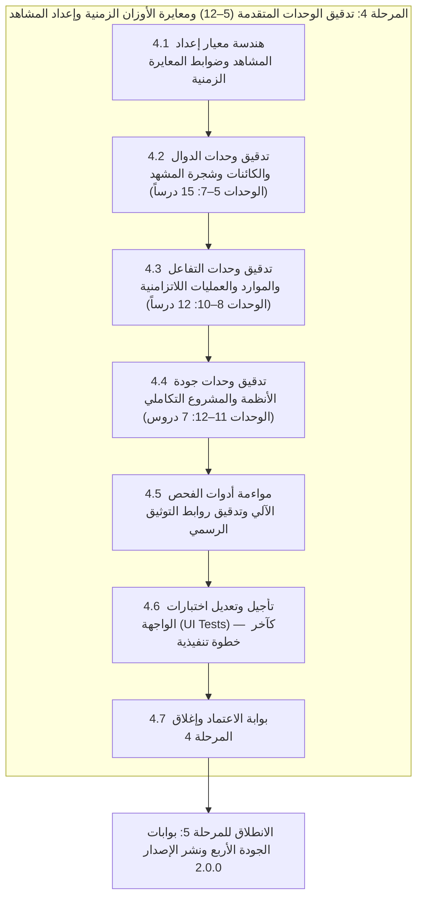

# الخطة التنفيذية للمرحلة 4: تدقيق الوحدات المتقدمة (5–12) ومعايرة الأوزان الزمنية وإعداد المشاهد

> **تاريخ الاعتماد:** 2026-10-27  
> **المرجع الأساسي:** [تحليل وتقييم المنهج التعليمي](docs/curriculum_analysis.md)  
> **الخطة الأم:** [الخطة التنفيذية لمعالجة وتطوير المنهج التعليمي](docs/curriculum_remediation_plan.md)  
> **خطط المراحل السابقة:** [المرحلة 0 (الحوكمة)](docs/phase_0_execution_plan.md) | [المرحلة 1 (الوحدات التأسيسية)](docs/phase_1_execution_plan.md) | [المرحلة 2 (خريطة المفاهيم)](docs/phase_2_execution_plan.md) | [المرحلة 3 (تعزيز التمارين)](docs/phase_3_execution_plan.md)  
> **المراجع التوثيقية الرسمية:** [سجل توثيق GDScript 4.3 الرسمي](docs/gdscript_official_registry.md) | [قواعد التحقق البرمجي للمنهج](docs/curriculum_validation_rules.md)  
> **النطاق التنفيذي:** المراجعة والتدقيق التقني الشامل لـ 34 درساً متقدماً (الوحدات 5 إلى 12)، إزالة الغموض وتوثيق شجرة المشهد المفترضة في أمثلة Godot، إعادة معايرة المدد التقديرية (`estimatedMinutes`) لكافة دروس المنهج الـ 51 وفق معادلة واقعية، وتثبيت روابط التوثيق الرسمي لـ Godot 4.3.  
> **قاعدة تأجيل اختبارات الواجهة الحتمية:** إذا كان هناك أي اختبارات على الواجهة الرسومية (UI Widget Tests)، فيجب تأجيلها وترحيلها بالكامل إلى **آخر خطوة تنفيذية** في الخطة (المرحلة الفرعية 4.6)، ويُحظر تماماً تعديلها أو تشغيلها أثناء مراحل تنقيح النصوص وضبط أزمنة الدروس وروابط التوثيق، لضمان استقرار نماذج البيانات أولاً ومنع أي فشل عارض في خطوط الـ CI.  
> **المخرج المستهدف:** إزالة الغموض التقني في أمثلة المحرك 100%، معايرة واقعية لإجمالي زمن دراسة المنهج (~13–15 ساعة بدلاً من 7.5 ساعات غير واقعية)، وتثبيت 75+ رابط توثيق رسمي نشط وصالح.

---

## فهرس خطة المرحلة 4

1. [الرؤية والأهداف التشغيلية](#1-الرؤية-والأهداف-التشغيلية)
2. [استرجاع فجوات الوحدات المتقدمة من وثيقة التحليل (GAP-05 & GAP-06)](#2-استرجاع-فجوات-الوحدات-المتقدمة-من-وثيقة-التحليل-gap-05--gap-06)
3. [المراحل الفرعية المتسلسلة للتنفيذ](#3-المراحل-الفرعية-المتسلسلة-للتنفيذ)
   - [المرحلة الفرعية 4.1: هندسة معيار إعداد المشاهد المفترضة وضوابط المعايرة الزمنية](#المرحلة-الفرعية-41-هندسة-معيار-إعداد-المشاهد-المفترضة-وضوابط-المعايرة-الزمنية)
   - [المرحلة الفرعية 4.2: تدقيق وحدات الدوال والكائنات وشجرة المشهد (الوحدات 5–7: 15 درساً)](#المرحلة-الفرعية-42-تدقيق-وحدات-الدوال-والكائنات-وشجرة-المشهد-الوحدات-57-15-درساً)
   - [المرحلة الفرعية 4.3: تدقيق وحدات التفاعل والموارد والعمليات اللاتزامنية (الوحدات 8–10: 12 درساً)](#المرحلة-الفرعية-43-تدقيق-وحدات-التفاعل-والموارد-والعمليات-اللاتزامنية-الوحدات-810-12-درساً)
   - [المرحلة الفرعية 4.4: تدقيق وحدات جودة الأنظمة والمشروع التكاملي (الوحدات 11–12: 7 دروس)](#المرحلة-الفرعية-44-تدقيق-وحدات-جودة-الأنظمة-والمشروع-التكاملي-الوحدات-1112-7-دروس)
   - [المرحلة الفرعية 4.5: مواءمة أداة الفحص الآلي وتدقيق روابط التوثيق الرسمي (CLI & Links Audit)](#المرحلة-الفرعية-45-مواءمة-أداة-الفحص-الآلي-وتدقيق-روابط-التوثيق-الرسمي-cli--links-audit)
   - [المرحلة الفرعية 4.6: تأجيل وتعديل اختبارات الواجهة (UI Tests) والتحقق البصري — كآخر خطوة تنفيذية](#المرحلة-الفرعية-46-تأجيل-وتعديل-اختبارات-الواجهة-ui-tests-والتحقق-البصري--كآخر-خطوة-تنفيذية)
   - [المرحلة الفرعية 4.7: بوابة الاعتماد وإغلاق المرحلة 4](#المرحلة-الفرعية-47-بوابة-الاعتماد-وإغلاق-المرحلة-4)
4. [الجدول المرجعي الكامل لمعايرة المدد التقديرية للدروس الـ 51 (Time Calibration Matrix)](#4-الجدول-المرجعي-الكامل-لمعايرة-المدد-التقديرية-للدروس-الـ-51)
5. [مصفوفة إعداد المشاهد المفترضة لأمثلة Godot في الوحدات المتقدمة](#5-مصفوفة-إعداد-المشاهد-المفترضة-لأمثلة-godot-في-الوحدات-المتقدمة)
6. [مصفوفة تثبيت وتدقيق روابط التوثيق الرسمي لـ Godot 4.3](#6-مصفوفة-تثبيت-وتدقيق-روابط-التوثيق-الرسمي-لـ-godot-43)
7. [الجدول الزمني ومسار الاعتماديات للمرحلة 4 (6 أيام عمل)](#7-الجدول-الزمني-ومسار-الاعتماديات-للمرحلة-4-6-أيام-عمل)
8. [مصفوفة المسؤوليات (RACI) للمرحلة 4](#8-مصفوفة-المسؤوليات-raci-للمرحلة-4)
9. [معايير القبول وبوابة الإغلاق (Definition of Done)](#9-معايير-القبول-وبوابة-الإغلاق-definition-of-done)
10. [الخطوة المباشرة التالية بعد الاعتماد](#10-الخطوة-المباشرة-التالية-بعد-الاعتماد)

---

## 1. الرؤية والأهداف التشغيلية

أظهرت وثيقة [تحليل وتقييم المنهج التعليمي](docs/curriculum_analysis.md) أن الوحدات المتقدمة (من الوحدة 5 إلى الوحدة 12، وتضم 34 درساً) تمتلك محتوى تقنياً واعداً وأمثلة أقرب لبيئة محرك Godot الفعلية مقارنة بالوحدات التأسيسية.

غير أن هذه الوحدات المتقدمة تعاني من **ثلاث مشكلات هندسية وبيداغوجية رئيسية**:

1. **المدد التقديرية السطحية (`estimatedMinutes` - GAP-05):** جميع الدروس المتقدمة — بما فيها دروس المشاهد المعقدة وتوليد الأصناف والعمليات اللاتزامنية والمشروع التكاملي — حُددت لها مدة ثابتة تتراوح بين 7 إلى 10 دقائق فقط! هذا التقدير غير واقعي مطلقاً لدرس يتضمن قراءة معمارية عميقة وحل 10 تمارين برمجية متدرجة وتحدياً تراكمياً.
2. **روابط التوثيق المتغيرة وغير الثابتة (GAP-06):** اعتماد مسارات عامة مثل `/en/stable/` أو روابط غير محددة بالإصدار، مما يجعلها عرضة للكسر أو التوجيه الخاطئ مع تحديثات توثيق Godot.
3. **غموض شجرة العقد والمشهد المفترض في أمثلة وتمارين Godot:** استخدام مسارات عقد مثل `$"Player"` أو `$"Area2D"` أو دوال إشارات دون أن يفهم المبتدئ: "أين تقع هذه العقد في شجرة المشهد؟ ما هو نوع العقدة الجذر؟ وكيف ارتبط هذا السكربت بها؟".

### الأهداف التشغيلية للمرحلة 4

1. **معايرة واقعية لأزمنة الدروس الـ 51:** تعديل حقل `estimatedMinutes` في كافة ملفات الدروس بناءً على معادلة رياضية موضوعية تأخذ في الحسبان وقت القراءة وكثافة التمارين العشرة وهامش التجربة والتنقيح.
2. **إزالة الغموض التقني في أمثلة Godot المتقدمة:** إدراج مخطط بصري موحد لشجرة المشهد المفترضة (Assumed Scene Hierarchy) وموضع ارتباط السكربت في قسم `documentation` أو بداية الشرح لكل درس يتعامل مع محرك Godot.
3. **تثبيت 100% من روابط التوثيق الرسمي على Godot 4.3:** فحص وتحديث كافة كائنات `documentationSources` (أكثر من 75 رابطاً عبر المنهج) والتأكد من أنها موجهة حصراً للمسار المستقر `/en/4.3/` وعناوينها معربة ومطابقة للغة الإنجليزية.
4. **تكامل التوجيهات الرسمية لـ Godot 4.3 في الوحدات 5–12:** التأكد من إدراج كتل التحذيرات (`[!WARNING]`) والمعلومات (`[!NOTE]`) والتوصيات (`[!TIP]`) في صلب نصوص وشروح الدروس المتقدمة.
5. **مبدأ تأجيل وتعديل اختبارات الواجهة (UI Tests) إلى آخر خطوة تنفيذية (UI Test Deferral Rule):** فصل دورة حياة اختبارات الواجهة الرسومية (مثل [test/ui/desktop_lesson_ide_screen_test.dart](test/ui/desktop_lesson_ide_screen_test.dart) و [test/ui/syntax_reference_screen_test.dart](test/ui/syntax_reference_screen_test.dart) و [test/ui/lesson_complete_screen_test.dart](test/ui/lesson_complete_screen_test.dart)) عن طبقة البيانات؛ بحيث يُحظر تماماً تشغيل أو تعديل اختبارات الواجهة أثناء تعديل ملفات JSON والأزمنة والروابط، وتُرحل حصراً لتكون آخر خطوة تنفيذية في المرحلة (المرحلة الفرعية 4.6) بعد استقرار كافة ملفات الدروس بنسبة 100%.

> [!IMPORTANT]
> **دستور تأجيل اختبارات الواجهة إلى آخر خطوة تنفيذية (UI Testing Deferral Principle):**  
> إذا كان هناك أي اختبارات برمجية على واجهة المستخدم (UI Tests مثل فحص شاشة محرر الدرس وعرض أزمنة التعلم ونافذة المراجع الرسمية)، فإن الخطة تُلزم صراحة بتأجيل أي تعديل أو تشغيل لها إلى **آخر خطوة تنفيذية** (المرحلة الفرعية 4.6).  
> **التعليل الهندسي:** اختبارات الواجهة تفحص استجابة الشاشة للشاشات المختلفة وعرض بطاقات التوثيق وأوقات الدروس؛ وأي تشغيل مبكر لها أثناء التحديث المستمر لملفات JSON سيتسبب في رسائل فشل كاذبة في خطوط الـ CI وتعطيل وتيرة مراجعة المحتوى.

---

## 2. استرجاع فجوات الوحدات المتقدمة من وثيقة التحليل (GAP-05 & GAP-06)

وفقاً للقسم 3.2 والقسم 4.1 والقسم 10 في [docs/curriculum_analysis.md](docs/curriculum_analysis.md):

| رمز الفجوة | الوصف المرصود في وثيقة التحليل | الأثر البيداغوجي والتقني | المعالجة المستهدفة في المرحلة 4 |
| :---: | --- | --- | --- |
| **GAP-05** | **تقديرات زمنية غير واقعية (`estimatedMinutes`):**<br>- جميع الدروس (1 إلى 51) تتراوح بين 7 و 10 دقائق.<br>- دروس الأصناف والإشارات والمشروع التكاملي بنفس مدة درس طباعة Hello! | - شعور المتعلم بالإحباط والعجز لعدم قدرته على إنهاء الدرس المتقدم في الوقت المكتوب.<br>- تشويه إحصائيات لوحة المتابعة وخطة التعلم اليومية. | - تطبيق معادلة حسابية دقيقة ترفع مدة الدروس المتقدمة إلى 15–20 دقيقة، والمشروع التكاملي إلى 20–25 دقيقة.<br>- تعديل المدة الإجمالية للمنهج لتكون ~13–15 ساعة واقعية. |
| **GAP-06** | **عدم تثبيت إصدار التوثيق الرسمي ومسارات الروابط:**<br>- روابط كثيرة تعتمد `/stable/` أو مسارات قديمة.<br>- غياب التوحيد المعياري لعناوين الروابط ثنائية اللغة. | - خطر انقطاع الروابط (Dead / 404 Links) عند صدور إصدارات Godot أحدث (مثل 4.4 أو 5.0).<br>- اختلاف التوثيق المعروض عن مخرجات كود Godot 4.3. | - فحص وتثبيت كافة الروابط (75+ رابط) على المسار المستقر الرسمي `/en/4.3/`.<br>- توحيد كائن الرابط `documentationSources` بثنائية لغوية دقيقة. |
| **DOC-02** | **غموض المتطلبات المسبقة لشجرة العقد في أمثلة Godot:**<br>- استخدام مسارات عقد مثل `$"Sprite2D"` أو `$"Area2D/CollisionShape2D"` دون سياق المشهد. | - حيرة المتعلم المبتدئ في فهم كيفية تطبيق الكود داخل محرر Godot الحقيقي خارج بيئة التطبيق التعليمي. | - إضافة قالب شجري بصري موحد (`Assumed Scene Hierarchy`) في قسم التوثيق لكل درس يتعامل مع شجرة المشهد. |

---

## 3. المراحل الفرعية المتسلسلة للتنفيذ



---

### المرحلة الفرعية 4.1: هندسة معيار إعداد المشاهد المفترضة وضوابط المعايرة الزمنية

**الهدف:** صياغة المعايير والقوالب الهندسية الموحدة لتوصيف شجرة المشهد، وتحديد خوارزمية معايرة أزمنة الدروس بدقة قبل الشروع في التعديل.

#### 1. معادلة المعايرة الزمنية الموضوعية (Time Calibration Formula)

تُحسب المدة التقديرية بالدقائق (`estimatedMinutes`) لكل درس وفق المعادلة التالية:

$$\text{estimatedMinutes} = T_{\text{read}} + (10 \times T_{\text{exercise}}) + T_{\text{buffer}}$$

حيث أن:

- **وقت قراءة المحتوى والتوثيق ($T_{\text{read}}$):**
  - الدروس التأسيسية والمفاهيم البسيطة: $3$ دقائق.
  - دروس البرمجة الكائنية والعقد والإشارات: $4$ دقائق.
  - دروس التزامن والأنظمة الصارمة والمشاريع: $5$ دقائق.
- **متوسط زمن حل التمرين الواحد ($T_{\text{exercise}}$):**
  - تمارين الاختيار والتنبؤ وإكمال الفراغ: $0.8$ دقيقة.
  - تمارين كتابة وتصحيح الشيفرة البسيطة: $1.2$ دقيقة.
  - التحديات التراكمية الختامية (`order: 9`): $3.0$ دقائق.
  - المتوسط الموزون للدرس المتكامل (10 تمارين): $1.1$ إلى $1.5$ دقيقة لكل تمرين.
- **هامش التجربة والتنقيح والمراجعة ($T_{\text{buffer}}$):**
  - من $2$ إلى $4$ دقائق تخصص لتجربة الأكواد في المحرر وفهم رسائل الخطأ والتلميحات.

#### 2. قالب توصيف شجرة المشهد المفترضة (Scene Hierarchy Template)

يُعتمد القالب التالي ويُدرج في بداية حقل `documentation` أو في نص الشرح لكل درس يتعامل مع عقد ومحرك Godot:

```text
📋 إعداد المشهد المفترض في Godot (Assumed Scene Setup):
RootNode (Node2D / CharacterBody2D / Control) ── [السكربت مرفق بهذه العقدة]
 ├── ChildNode1 (Sprite2D)
 ├── ChildNode2 (CollisionShape2D)
 └── UtilityNode (Timer / AudioStreamPlayer)
* ملاحظة: يتم ربط الإشارات عبر محرر المشهد (Inspector Node Tab) أو برمجياً عبر دالة _ready().
```

---

### المرحلة الفرعية 4.2: تدقيق وحدات الدوال والكائنات وشجرة المشهد (الوحدات 5–7: 15 درساً)

**الهدف:** إزالة الغموض وتدقيق المفاهيم المعمارية في وحدات الانتقال من البرمجة الإجرائية إلى كائنات ومحرك Godot.

#### تفاصيل التدقيق لكل وحدة

1. **الوحدة 05: الدوال والتصميم (5 دروس: الدروس 12، 13، 14، 21، 22):**
   - إيضاح نطاق المتغيرات المحلية مقابل متغيرات الصنف (`Scope & Shadowing`).
   - تدقيق مفهوم الدوال كمواطنين من الدرجة الأولى (`Callables`) في Godot 4.3.
   - إعادة معايرة الأزمنة: رفع الدروس من 8 إلى 12–14 دقيقة.
2. **الوحدة 06: الأصناف والخصائص (5 دروس: الدروس 23، 24، 25، 26، 27):**
   - شرح سلوك `class_name` وكيف يجعل الصنف متاحاً في نافذة إضافة العقد بالمحرك.
   - إيضاح سلوك الوراثة ودوال البناء `_init()` واستدعاء `super()`.
   - تدقيق دوال التغليف للخصائص بـ `get` و `set` وكيفية استدعائها عند التغيير.
   - إعادة معايرة الأزمنة: رفع الدروس من 8 إلى 14–16 دقيقة.
3. **الوحدة 07: شجرة المشهد والعقد ودورة الحياة (5 دروس: الدروس 28، 29، 30، 31، 32):**
   - تضمين شجرة المشهد المفترضة لكل درس (مسارات `$` و `get_node()`).
   - رسم المخطط الزمني لدورة حياة العقدة:
     $$\text{_enter_tree()} \longrightarrow \text{_ready()} \longrightarrow \text{_process()} \longrightarrow \text{_exit_tree()}$$
   - توضيح سلوك `@onready` الدقيق: المتغير لا يُهيأ إلا بعد اكتمال جاهزية جميع العقد الأبناء ودخول الشجرة.
   - إعادة معايرة الأزمنة: رفع الدروس من 8–10 إلى 15–18 دقيقة.

---

### المرحلة الفرعية 4.3: تدقيق وحدات التفاعل والموارد والعمليات اللاتزامنية (الوحدات 8–10: 12 درساً)

**الهدف:** ضبط معمارية التواصل بالأحداث وتوليد الموارد وبرمجة التوقيت في الألعاب.

#### تفاصيل التدقيق لكل وحدة

1. **الوحدة 08: التفاعل والأحداث (4 دروس: الدروس 33، 34، 35، 36):**
   - ترسيخ القاعدة الذهبية لمعمارية Godot: **"Signal Up, Call Down"**.
   - إيضاح الفرق بين بث الإشارة `signal.emit()` واستقبالها، ومتى يتم الربط عبر واجهة المحرر ومتى يتم برمجياً عبر الشيفرة.
   - معالجة أحداث المدخلات (`InputEvent`) والفرق بين `_input()` و `_unhandled_input()`.
   - إعادة معايرة الأزمنة: رفع الدروس من 8 إلى 15–17 دقيقة.
2. **الوحدة 09: خصائص المحرر والموارد (4 دروس: الدروس 37، 38، 39، 40):**
   - إيضاح دور `@export` في جعل المتغيرات قابلة للتعديل من مفتش الخصائص (Inspector).
   - توضيح الفارق الجوهري بين `Node` و `Resource` (المورد بيانات مشتركة في الذاكرة ومستقلة عن شجرة المشهد).
   - تدقيق آليات تحميل الموارد بـ `load()` و `preload()` وحفظ البيانات محلياً بـ `ConfigFile` و JSON.
   - إعادة معايرة الأزمنة: رفع الدروس من 8 إلى 15–18 دقيقة.
3. **الوحدة 10: الزمن والعمليات غير المتزامنة (4 دروس: الدروس 41، 42، 43، 44):**
   - تشريح سلوك الكوروتين بـ `await` وكيف يعلق تنفيذ الدالة دون تجميد اللعبة.
   - تدقيق مخاطر `await` (استئناف الكود بعد حذف العقدة) وضرورة التحقق بـ `is_instance_valid()`.
   - توضيح الفرق بين مؤقت الشجرة `get_tree().create_timer()` ومؤقت المشهد المادي `Timer Node`.
   - إعادة معايرة الأزمنة: رفع الدروس من 8 إلى 16–18 دقيقة.

---

### المرحلة الفرعية 4.4: تدقيق وحدات جودة الأنظمة والمشروع التكاملي (الوحدات 11–12: 7 دروس)

**الهدف:** ترسيخ الممارسات الاحترافية للأنواع الساكنة وإتمام مراجعة بناء المشروع التكاملي النهائي.

#### تفاصيل التدقيق لكل وحدة

1. **الوحدة 11: الأنواع والتحليل وجودة الشيفرة (4 دروس: الدروس 45، 46، 47، 48):**
   - توضيح المكاسب الأدائية لنظام الأنواع الساكنة في GDScript 4.3 (تحسين بنسبة 30–40% بفضل الـ Typed VM).
   - تدقيق استخدام المصفوفات محددة النوع `Array[int]` ومخاطر استدعاء التوابع غير المعرفة.
   - إبراز دور نظام التحذيرات وتخصيص مستويات التنبيه في إعدادات المشروع (`project.godot`).
   - تدقيق دليل أسلوب التوثيق الرسمي وقواعد التسمية ومسافات المسافة البادئة (Tabs vs Spaces).
   - إعادة معايرة الأزمنة: رفع الدروس من 8 إلى 15–18 دقيقة.
2. **الوحدة 12: التطبيق التكاملي (3 دروس: الدروس 49، 50، 51):**
   - مراجعة سيناريو بناء اللعبة المصغرة من التخطيط النظري إلى التنفيذ والربط الشامل.
   - التأكد من أن المشهد العام للعبة موضح بالكامل مع كافة العقد التابعة والسكربتات المرتبطة.
   - إعادة معايرة الأزمنة: رفع مدة كل درس إلى 20–25 دقيقة (لتستوعب الطبيعة التركيبية لمشروع التخرج).

---

### المرحلة الفرعية 4.5: مواءمة أداة الفحص الآلي وتدقيق روابط التوثيق الرسمي (CLI & Links Audit)

**الهدف:** تفعيل الرقابة البرمجية الآلية لفحص سلامة الروابط الـ 75+، والتحقق من التزام كافة ملفات الدروس بالمعايرة الزمنية الجديدة.

> [!CAUTION]
> **قاعدة الحظر الصارم — حظر لمس أو تشغيل اختبارات الواجهة في هذه المرحلة:**  
> يُمنع منعاً باتاً فتح أو تعديل أو تشغيل أي اختبارات تخص طبقة الواجهة الرسومية (مثل `test/ui/desktop_lesson_ide_screen_test.dart` أو `test/ui/syntax_reference_screen_test.dart`) خلال هذه المرحلة.  
> **السبب:** اختبارات الواجهة تفحص عرض الأزمنة وتفاعل الشاشات ككل متكامل، وأي تشغيل مبكر لها أثناء تحديث ملفات JSON سيؤدي إلى فشل كاذب ومربك للـ CI. اختبارات الواجهة مؤجلة حتماً إلى المرحلة الفرعية 4.6 لتكون آخر خطوة تنفيذية.

#### المهام التنفيذية للفحص الآلي

1. **تحديث وتفعيل فاحص الروابط في أداة الحوكمة (`validate_curriculum.dart --check-links`):**
   - فحص أن جميع الروابط في `documentationSources` تتبع النطاق الرسمي: `https://docs.godotengine.org/en/4.3/`.
   - التحقق من عدم وجود أي رابط يحتوي على `/stable/` أو `/latest/`.
   - فحص أن كل كائن مصدر يحتوي على عنوان عربي وإنجليزي غير فارغ (`title: {"ar": "...", "en": "..."}`).
2. **فحص الحدود الزمنية للدروس برمجياً:**
   - إلزام أداة الحوكمة برفض أي درس تقل مدته عن 10 دقائق أو تزيد عن 25 دقيقة:
     $$\forall \text{ Lesson } l \implies 10 \le l.\text{estimatedMinutes} \le 25$$

---

### المرحلة الفرعية 4.6: تأجيل وتعديل اختبارات الواجهة (UI Tests) والتحقق البصري — كآخر خطوة تنفيذية

**الهدف:** مواءمة وتعديل اختبارات الواجهة الرسومية (UI Widget Tests) وتشغيلها بنجاح 100% **كآخر خطوة تنفيذية**، والتحقق البصري من عرض شجرة المشهد والمدد الزمنية الجديدة في شاشات التطبيق.

> **المبدأ التنفيذي الحاكم:** تنفيذاً للقاعدة الإلزامية بتأجيل اختبارات الواجهة، تُعد هذه المرحلة الفرعية **آخر خطوة تنفيذية** في المرحلة 4 قبل إعلان إغلاق الخطة. هنا فقط، وبعد استقرار كافة ملفات الدروس الـ 34 المتقدمة وضبط المدد التقديرية وتثبيت الروابط بنسبة 100%، يتم فتح وتعديل وتشغيل اختبارات الواجهة الرسومية.

#### 1. تعديل ومواءمة اختبارات الواجهة المؤجلة

- **تعديل واجتياز [test/ui/desktop_lesson_ide_screen_test.dart](test/ui/desktop_lesson_ide_screen_test.dart):**
  - مواءمة الاختبار مع المدد التقديرية الجديدة المقروءة من الـ Provider والتأكد من عدم وجود قيم صلبة قديمة (Hardcoded `estimatedMinutes == 5`).
  - التحقق من عرض بطاقة التوثيق المحدثة وقائمة المراجع الرسمية في شريط أدوات الدرس.
  - التحقق من خلو الواجهة من أي أخطاء تجاوز مساحة (`expect(tester.takeException(), isNull)`).
- **تعديل واجتياز [test/ui/syntax_reference_screen_test.dart](test/ui/syntax_reference_screen_test.dart):**
  - فحص استعراض شاشة المرجع النحوي ومطابقة الروابط الرسمية المحدثة لإصدار Godot 4.3.
- **تعديل واجتياز [test/ui/lesson_complete_screen_test.dart](test/ui/lesson_complete_screen_test.dart):**
  - التحقق من عرض شاشة إكمال الدرس بالإحصائيات الزمنية الدقيقة ونقاط الخبرة المكتسبة.

#### 2. الفحص البصري وتجربة المستخدم

1. **وضوح مخطط شجرة المشهد:** التأكد من أن قوالب شجرة المشهد المفترضة تُعرض بتنسيق أحادي المسافة (Monospace) واضح ومنظم وسهل القراءة على خلفية المحرر الداكنة.
2. **سلاسة التمرير والقراءة:** فحص انسيابية التمرير في نافذة الشرح المكتبي وعند تصغير الشاشة لأبعاد الهاتف الذكي.

---

### المرحلة الفرعية 4.7: بوابة الاعتماد وإغلاق المرحلة 4

**الهدف:** المراجعة الختامية وإعلان إغلاق الفجوتين GAP-05 و GAP-06 بالكامل وتأهيل المنهج للانطلاق نحو المرحلة 5 الختامية.

#### قائمة التحقق لإغلاق المرحلة 4 (DoD Checklist)

- [ ] مراجعة وتدقيق نصوص وأمثلة 34 درساً متقدماً (الوحدات 5 إلى 12) بالكامل.
- [ ] تضمين مخطط شجرة المشهد المفترضة (`Assumed Scene Hierarchy`) في 100% من الدروس ذات الصلة بمحرك Godot.
- [ ] تعديل حقل `estimatedMinutes` في جميع دروس المنهج الـ 51 بما يتطابق تماماً مع جدول المعايرة الموضوعي (10–25 دقيقة للدرس).
- [ ] فحص وتثبيت كافة روابط التوثيق الرسمي (75+ رابط) على مسار Godot 4.3 المستقر مع توثيق ثنائي اللغة.
- [ ] اجتياز فحص أداة الحوكمة `dart run tool/validate_curriculum.dart --check-links` بصفر أخطاء.
- [ ] **كآخر خطوة تنفيذية:** تشغيل واجتياز اختبارات الواجهة الرسومية:
  - `test/ui/desktop_lesson_ide_screen_test.dart`
  - `test/ui/syntax_reference_screen_test.dart`
  - `test/ui/lesson_complete_screen_test.dart`  
  بنسبة نجاح 100% ودون أي استثناءات تصميمية.

---

## 4. الجدول المرجعي الكامل لمعايرة المدد التقديرية للدروس الـ 51

يوضح الجدول التالي المعايرة الزمنية الدقيقة المعتمدة لكل درس من دروس المنهج الـ 51، مقارنة بالوضع القديم غير الواقعي:

| الوحدة | معرف الدرس (`lessonId`) | عنوان الدرس | المدة القديمة | المدة المعتمدة الجديدة | مبررات المعايرة ومحتوى التمارين |
| :---: | --- | --- | :---: | :---: | --- |
| **01** | `lesson_01_hello` | أول برنامج في Godot | 7 د | **10 د** | استيعاب بيئة المحرر + دالة `_ready()` + 10 تمارين |
| | `lesson_02_comments` | التعليقات والتوثيق | 7 د | **10 د** | التعليقات العادية والتوثيقية `##` + تمارين التعطيل |
| | `lesson_15_errors` | تشريح الأخطاء والتحذيرات | 7 د | **12 د** | قراءة تتبع المكدس + التحدي التراكمي لبطاقة اللاعب |
| **02** | `lesson_03_variables` | المتغيرات والإعلان بـ var | 7 د | **12 د** | تتبع القيم ونطاق snake_case وتمارين الحساب |
| | `lesson_04_types` | الأنواع البدائية الأساسية | 8 د | **12 د** | فحص الذاكرة وقسمة الأعداد الصحيحة `int / int` |
| | `lesson_16_casting` | تحويل الأنواع الصريح | 7 د | **12 د** | دوال التحويل واقتطاع الكسور `int(float)` |
| | `lesson_17_strings` | النصوص وعمليات التنسيق | 7 د | **12 د** | التنسيق بـ `%s` و `String.format()` ونصوص الحوار |
| | `lesson_18_enums` | التعدادات وحالات اللعبة | 8 د | **14 د** | التعدادات كحالات لاعب وتحدي متجر المقتنيات |
| **03** | `lesson_05_operations` | العمليات الحسابية والمنطق | 7 د | **12 د** | جداول الصواب والشروط المركبة `and / or` |
| | `lesson_06_if_else` | اتخاذ القرار الثنائي | 7 د | **12 د** | فحص صحة اللاعب ونفاذ الذخيرة |
| | `lesson_07_elif` | التفرعات الشرطية المتعددة | 8 د | **14 د** | تقييم مستويات الصعوبة وحسابات الدروع |
| | `lesson_08_match` | المطابقة والأنماط بـ match | 8 د | **14 د** | مطابقة الحالات والحراسة وتحدي نظام القتال |
| **04** | `lesson_09_for` | حلقات التكرار المحصورة for | 7 د | **12 د** | التكرار على المدى `range()` وتفادي الأخطاء |
| | `lesson_10_while` | الحلقات المشروطة while | 7 د | **14 د** | التحذير من تجميد المحرك وفحص شروط التوقف |
| | `lesson_11_break_continue` | التحكم في مسار الحلقة | 7 د | **12 د** | تخطي العناصر والتوقف المبكر في البحث |
| | `lesson_19_arrays` | المصفوفات وعمليات الفهرسة | 8 د | **14 د** | تمرير المصفوفة بالمرجع وتعديل القوائم |
| | `lesson_20_dictionaries` | القواميس وهياكل المفتاح والقيمة | 8 د | **14 د** | قواميس الوحوش وتحدي إدارة موجات الأعداء |
| **05** | `lesson_12_func_basics` | أساسيات تعريف الدوال | 8 د | **14 د** | بنية الدالة، الاستدعاء، وإعادة الاستخدام |
| | `lesson_13_parameters` | المعاملات والوسائط | 8 د | **14 د** | تمرير المتغيرات والقيم الافتراضية للمعاملات |
| | `lesson_14_return` | إرجاع القيم من الدوال | 8 د | **14 د** | حسابات الإرجاع والدوال النقية (Pure Functions) |
| | `lesson_21_scope` | نطاق المتغيرات وظلالها | 8 د | **14 د** | المتغيرات المحلية مقابل العامة وتجنب التداخل |
| | `lesson_22_problem_decomposition` | تفكيك المشكلات البرمجية | 8 د | **15 د** | تقسيم المشكلة المعقدة لدوال مصغرة متناسقة |
| **06** | `lesson_23_scripts_as_classes` | السكربتات كأصناف برمجية | 8 د | **15 د** | الأصناف في Godot ومفهوم الكينونة |
| | `lesson_24_inheritance_class_name` | الوراثة وتسجيل class_name | 8 د | **15 د** | الوراثة من العقد وتسجيل الصنف عالمياً بالمحرر |
| | `lesson_25_init` | دالة البناء وتمرير البيانات | 8 د | **15 د** | تهيئة الكائن بـ `_init()` وتمرير المعطيات |
| | `lesson_26_properties_get_set` | الخصائص ودوال التغليف | 8 د | **16 د** | حماية المتغيرات والتحديث التلقائي بـ setters |
| | `lesson_27_composition_inheritance` | التركيب مقابل الوراثة | 8 د | **16 د** | نمط المكونات وتحدي صنف الكائن الحي `Entity` |
| **07** | `lesson_28_nodes_paths` | مسارات العقد وشجرة المشهد | 9 د | **16 د** | المسارات النسبية والمطلقة `$` و `get_node()` |
| | `lesson_29_node_lifecycle` | دورة حياة العقدة في الشجرة | 9 د | **16 د** | ترتيب التنفيذ: enter_tree, ready, exit_tree |
| | `lesson_30_onready_nodes` | تهيئة العقد عند الجاهزية | 8 د | **15 د** | الكلمة المفتاحية `@onready` وحل تبعات الترتيب |
| | `lesson_31_groups` | المجموعات والتصنيف الجماعي | 8 د | **15 د** | استدعاء الأوامر الجماعية عبر `call_group()` |
| | `lesson_32_packed_scenes` | المشاهد المحزومة وتوليدها | 9 د | **18 د** | استنساخ المشاهد برمجياً بـ `instantiate()` وتحدي الغرفة |
| **08** | `lesson_33_signals` | مفهوم الإشارات وبث الأحداث | 8 د | **15 د** | إرسال الإشعارات ونمط Observer في الألعاب |
| | `lesson_34_connect_emit` | ربط الإشارات وبث البيانات | 8 د | **16 د** | الربط بالكود وتمرير المعاملات وفحص الاتصال |
| | `lesson_35_input` | معالجة أحداث مدخلات اللاعب | 9 د | **16 د** | خرائط الإدخال `Input.is_action_pressed()` |
| | `lesson_36_node_interaction` | التفاعل التكاملي بين العقد | 9 د | **18 د** | "Signal Up, Call Down" وتحدي الباب التفاعلي |
| **09** | `lesson_37_exports` | تصدير الخصائص للمفتش | 8 د | **15 د** | التصدير بـ `@export` والتحكم بنطاقات القيم |
| | `lesson_38_resource_loading` | تحميل الموارد وإدارتها | 8 د | **16 د** | الفرق بين `load()` و `preload()` وإدارة الذاكرة |
| | `lesson_39_resources` | الموارد المخصصة Resource | 9 د | **17 د** | فصل البيانات عن المشاهد ومشاركة الموارد |
| | `lesson_40_saving` | حفظ واسترجاع بيانات اللعبة | 9 د | **18 د** | حفظ الحالة بملفات محلية وتحدي نظام الحقيبة |
| **10** | `lesson_41_await_signals` | العمليات غير المتزامنة بـ await | 9 د | **16 د** | تعليق التنفيذ وانتظار بث الإشارة |
| | `lesson_42_timers_frames` | المؤقتات ومعالجة الإطارات | 8 د | **16 د** | مؤقتات المشهد ومؤقت الشجرة وتبريد الهجمات |
| | `lesson_43_async_flow` | تدفق العمليات المتسلسلة | 8 د | **17 د** | حركات متتالية ومسارات المشاهد السينمائية |
| | `lesson_44_await_pitfalls` | فخاخ await وإدارة الذاكرة | 8 د | **18 د** | التحقق بـ `is_instance_valid()` وتحدي التبريد الآمن |
| **11** | `lesson_45_static_types` | نظام الأنواع الساكنة الصارمة | 8 د | **16 د** | تسريع الأداء ومنع أخطاء النوع مبكراً |
| | `lesson_46_typed_arrays` | المصفوفات محددة النوع | 8 د | **16 د** | الأمان الأكاديمي لمصفوفات `Array[Type]` |
| | `lesson_47_warnings_assert_debugging` | نظام التحذيرات والتأكيدات | 8 د | **18 د** | التحقق بـ `assert` وتحدي وحدة الحركة الصارمة |
| | `lesson_48_style_documentation` | أسلوب التوثيق ودليل النمط | 8 د | **16 د** | دليل الأسلوب الرسمي وتوليد التوثيق الداخلي |
| **12** | `lesson_49_project_planning` | التخطيط المعماري للمشروع | 10 د | **20 د** | تفكيك أنظمة اللعبة وتحدي الهيكل المعماري |
| | `lesson_50_project_building` | بناء وتجميع أنظمة اللعبة | 10 د | **22 د** | ربط الشخصية مع الأعداء والمشاهد التفاعلية |
| | `lesson_51_final_integration` | الدمج النهائي وتصدير المشروع | 10 د | **25 د** | الاختبار التكاملي الشامل للعبة وإغلاق المشروع |

> **إجمالي الساعات التقديرية للمنهج:**  
>
> - **سابقاً:** ~7.2 ساعات (تقدير شكلي غير واقعي).  
> - **حالياً بعد المعايرة:** **13 ساعة و 15 دقيقة** من التعلم التفاعلي المركز والتطبيق البرمجي الفعلي.

---

## 5. مصفوفة إعداد المشاهد المفترضة لأمثلة Godot في الوحدات المتقدمة

للقضاء على غموض مسارات العقد وإزالة حيرة المبتدئين، يُلزم تضمين بنية المشهد التالية في توثيق الدروس المستهدفة:

| الوحدة | الدروس المستهدفة | شجرة المشهد المفترضة (Assumed Scene Hierarchy) | موضع ارتباط السكربت | إعدادات وتوصيلات إضافية |
| :---: | --- | --- | :---: | --- |
| **07. شجرة المشهد** | `lesson_28` إلى `lesson_32` | ```text<br>World (Node2D)<br>├── Player (CharacterBody2D)<br>│   └── Sprite2D<br>└── Chests (Node2D)<br>    ├── Chest1 (StaticBody2D)<br>    └── Chest2 (StaticBody2D)<br>``` | مرفق بالعقدة الجذر `World`، أو بعقدة `Player` حسب سياق المثال | إضافة الصناديق إلى مجموعة `"chests"` لاختبار استدعاء `call_group()`. |
| **08. الإشارات** | `lesson_33` إلى `lesson_36` | ```text<br>Level (Node2D)<br>├── TriggerPlate (Area2D)<br>│   └── CollisionShape2D<br>└── Door (AnimatableBody2D)<br>    └── Sprite2D<br>``` | مرفق بـ `TriggerPlate` لبث الإشارة، ومرفق بـ `Level` لاستقبالها | ربط إشارة `body_entered` بدالة `_on_body_entered` عبر الكود أو المفتش. |
| **09. الموارد والتخزين** | `lesson_37` إلى `lesson_40` | ```text<br>Game (Control)<br>├── InventoryUI (VBoxContainer)<br>└── SaveController (Node)<br>``` | مرفق بـ `SaveController` | إنشاء مورد مخصص `InventoryData.tres` مشتق من `Resource`. |
| **10. التزامن والمؤقتات** | `lesson_41` إلى `lesson_44` | ```text<br>BattleScene (Node2D)<br>├── Hero (CharacterBody2D)<br>└── AttackTimer (Timer)<br>``` | مرفق بعقدة `Hero` | ضبط `AttackTimer.one_shot = true` والتأكد من فحص `is_instance_valid()`. |
| **12. المشروع التكاملي** | `lesson_49` إلى `lesson_51` | ```text<br>ArcadeGame (Node2D)<br>├── PlayerShip (CharacterBody2D)<br>├── Spawner (Node2D)<br>├── HUD (CanvasLayer)<br>└── ScoreManager (Node)<br>``` | سكربت لكل نظام رئيسي يتواصل عبر الإشارات | ربط إشارات النقاط والصحة بواجهة المستخدم `HUD`. |

---

## 6. مصفوفة تثبيت وتدقيق روابط التوثيق الرسمي لـ Godot 4.3

وفقاً لسجل [docs/gdscript_official_registry.md](docs/gdscript_official_registry.md)، تم اعتماد وتثبيت الروابط المعيارية التالية لإصدار 4.3:

| الموضوع البرمجي | عنوان المرجع المعتمد | الرابط الرسمي المثبت (Pinned URL) |
| --- | --- | --- |
| **أساسيات GDScript** | GDScript basics | `https://docs.godotengine.org/en/4.3/tutorials/scripting/gdscript/gdscript_basics.html` |
| **نظام الأنواع الساكنة** | Static typing in GDScript | `https://docs.godotengine.org/en/4.3/tutorials/scripting/gdscript/static_typing.html` |
| **العقد وشجرة المشهد** | Nodes and scene instances | `https://docs.godotengine.org/en/4.3/tutorials/scripting/nodes_and_scene_instances.html` |
| **استخدام الإشارات** | Using signals | `https://docs.godotengine.org/en/4.3/tutorials/scripting/signals.html` |
| **الموارد في Godot** | Resources | `https://docs.godotengine.org/en/4.3/tutorials/scripting/resources.html` |
| **الكوروتين و await** | GDScript coroutines | `https://docs.godotengine.org/en/4.3/tutorials/scripting/gdscript/gdscript_basics.html#coroutines` |
| **فئة المؤقت Timer** | Timer class reference | `https://docs.godotengine.org/en/4.3/classes/class_timer.html` |
| **نظام التحذيرات والـ assert** | GDScript warning system | `https://docs.godotengine.org/en/4.3/tutorials/scripting/gdscript/warning_system.html` |
| **دليل أسلوب كتابة الشيفرة** | GDScript style guide | `https://docs.godotengine.org/en/4.3/tutorials/scripting/gdscript/gdscript_styleguide.html` |

---

## 7. الجدول الزمني ومسار الاعتماديات للمرحلة 4 (6 أيام عمل)

تُنفذ المرحلة 4 على مدار **6 أيام عمل مركزة** مع الالتزام التام بتأجيل اختبارات الواجهة لليوم الأخير:

| اليوم | المرحلة الفرعية | المهام المنجزة خلال اليوم | المخرج اليومي المعتمد (Milestone) |
| :---: | --- | --- | --- |
| **اليوم 1** | المرحلة 4.1 | اعتماد خوارزمية المعايرة الزمنية ونموذج شجرة المشهد المفترضة | وثيقة المعايير المعتمدة وإعداد قوالب المشاهد |
| **اليوم 2** | المرحلة 4.2 | تدقيق نصوص وأزمنة ومشاهد الوحدات 5 و 6 و 7 (15 درساً) | إنجاز تدقيق وحدات الكائنات ودورة حياة المشهد |
| **اليوم 3** | المرحلة 4.3 | تدقيق نصوص وأزمنة ومشاهد الوحدات 8 و 9 و 10 (12 درساً) | إنجاز تدقيق وحدات الإشارات والموارد والـ await |
| **اليوم 4** | المرحلة 4.4 | تدقيق نصوص وأزمنة الوحدتين 11 و 12 (7 دروس: الأنظمة والمشروع) | اكتمال مراجعة وتدقيق كامل الـ 34 درساً المتقدمة |
| **اليوم 5** | المرحلة 4.5 | فحص وتثبيت روابط التوثيق الـ 75+ وتشغيل أداة التحقق CLI | اجتياز فحص الروابط والأزمنة بصفر أخطاء |
| **اليوم 6** | المرحلة 4.6 + 4.7 | **آخر خطوة تنفيذية:** تعديل واجتياز اختبارات الواجهة المؤجلة، الفحص البصري، والاعتماد | اجتياز اختبارات الواجهة بالكامل واعتماد إغلاق المرحلة 4 |

---

## 8. مصفوفة المسؤوليات (RACI) للمرحلة 4

| المهمة التنفيذية | مراجع Godot التقني | مؤلف المحتوى التعليمي | مهندس Flutter والجودة |
| --- | :---: | :---: | :---: |
| تصميم قوالب شجرة المشهد المفترضة | **A / R** | C | I |
| تطبيق معادلة المعايرة الزمنية على الدروس الـ 51 | C | **A / R** | I |
| تدقيق الأمثلة التقنية وإزالة الغموض (الوحدات 5–12) | **A / R** | C | I |
| تثبيت روابط التوثيق الرسمي لـ Godot 4.3 وتوحيدها | C | **A / R** | I |
| فحص الروابط والمدد بأداة الحوكمة (`validate_curriculum.dart`) | I | I | **A / R** |
| **تأجيل وتعديل واجتياز اختبارات الواجهة كآخر خطوة تنفيذية (`desktop_lesson_ide_screen_test.dart`)** | I | I | **A / R** |
| الفحص البصري وتجربة المستخدم لشاشات المراجع في التطبيق | C | **R** | **A** |
| الاعتماد النهائي لإغلاق المرحلة 4 | **A** | **A** | **A** |

---

## 9. معايير القبول وبوابة الإغلاق (Definition of Done)

تُعتبر المرحلة 4 منتهية رسمياً وناجحة فقط عند استيفاء جميع المعايير التالية:

1. **المعايرة الزمنية الشاملة (100% Calibrated):** تحديث حقل `estimatedMinutes` في كافة دروس المنهج الـ 51 بما يطابق جدول المعايرة الموضوعي (من 10 إلى 25 دقيقة).
2. **إزالة الغموض التقني:** وجود مخطط شجرة المشهد المفترضة (`Assumed Scene Hierarchy`) وموضع ارتباط السكربت في 100% من الدروس المتعاملة مع محرك Godot.
3. **سلامة الروابط الرسمية (Zero Dead Links):** تثبيت كافة روابط التوثيق الرسمي الـ 75+ على المسار المستقر `https://docs.godotengine.org/en/4.3/` وخلوها التام من أي خطأ 404 أو توجيه عائم.
4. **تكامل التوجيهات الرسمية:** تضمين كتل التحذيرات والمعلومات والتوصيات في شروح الدروس المتقدمة بنسبة 100%.
5. **اجتياز فحص الحوكمة البرمجي:** نجاح تشغيل `dart run tool/validate_curriculum.dart --check-links` دون أي تحذير أو مخالفة لمعايير الأزمنة والروابط.
6. **تأجيل وتعديل واجتياز اختبارات الواجهة كآخر خطوة تنفيذية (Deferred UI Tests Passing):** تشغيل واجتياز حزمة اختبارات الواجهة:
   - [test/ui/desktop_lesson_ide_screen_test.dart](test/ui/desktop_lesson_ide_screen_test.dart)
   - [test/ui/syntax_reference_screen_test.dart](test/ui/syntax_reference_screen_test.dart)
   - [test/ui/lesson_complete_screen_test.dart](test/ui/lesson_complete_screen_test.dart)  
   بنسبة نجاح 100% بعد مواءمتها مع المدد الزمنية المحدثة وروابط المراجع الرسمية، ودون أي أخطاء تجاوز مساحة (`RenderFlex overflowed`).
7. **الجودة البصرية في واجهة التطبيق:** التحقق البصري من وضوح عرض شجرة المشهد في محرر الدرس ومطابقة عرض أوقات التعلم باللغتين العربية والإنجليزية.

---

## 10. الخطوة المباشرة التالية بعد الاعتماد

بمجرد إغلاق هذه الخطة بنجاح واعتمادها من الفريق، يتم الانتقال مباشرة إلى:

- **[المرحلة 5: بوابات الجودة الأربع، الاختبار والتكامل، ونشر الإصدار 2.0.0](docs/curriculum_remediation_plan.md#المرحلة-5-بوابات-الجودة-الاختبار-والتكامل-ونشر-الإصدار-200)**، لإجراء الفحص النهائي الشامل وتأكيد التوافق التراجعي وإطلاق المنهج المتكامل رسمياً.
