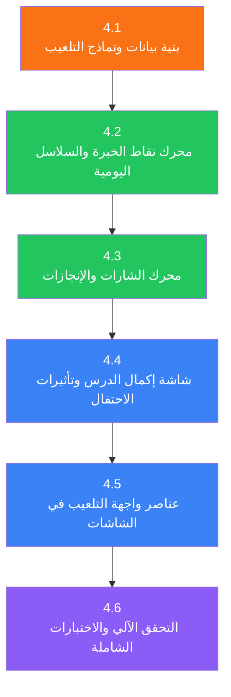

# خطة تنفيذ المرحلة 4: التلعيب والتحفيز (Gamification & Motivation)

هذه خطة مستقلة لتنفيذ المرحلة 4 من [`execution_plan.md`](./execution_plan.md).
تقسم العمل إلى مراحل فرعية متتابعة؛ لا تبدأ المرحلة الفرعية التالية قبل اجتياز
معيار الخروج للمرحلة الحالية، إلا إذا ذُكر اعتماد قابل للفصل صراحةً.

## سجل التقدم

**آخر تحديث:** 22 أكتوبر 2026  
**الحالة العامة:** لم تبدأ بعد  

---

## الهدف والنطاق

إضافة نظام التلعيب والتحفيز الشامل لتعزيز التفاعل واستمرارية التعلّم لدى مستخدمي تطبيق تعلّم GDScript. تشمل هذه المرحلة:

1. **نظام نقاط الخبرة (XP System):** قواعد واضحة لاكتساب وخصم النقاط بناءً على الأنشطة (إكمال الدروس، حل التمارين من المحاولة الأولى أو المحاولات التالية، تشغيل الأمثلة، استخدام التلميحات، إكمال الوحدات، ومكافآت التتابع اليومي).
2. **نظام الشارات والإنجازات (Badges & Achievements System):** إتاحة 10 شارات متدرجة مع محرك تقييم تلقائي محلي يراقب إنجازات المتعلم ويفتح الشارات فور تحقق شروطها.
3. **نظام التتابع اليومي (Streaks System):** تتبع النشاط اليومي المتتالي وحساب السلسلة الحالية والأطول، مع إمكانية إخفاء السلسلة من الإعدادات للتعلم الخالي من الضغوط.
4. **شاشة إكمال الدرس وتأثيرات الاحتفال (Lesson Complete Screen & Celebration Effects):** تصميم واجهة احتفالية تفاعلية تعرض XP المكتسبة، ملخص التمارين والتلميحات، والشارات المكتسبة حديثاً، مع أزرار تنقل سلسة.
5. **مكونات الواجهة للتلعيب (Gamification UI Components):** شريط المستوى والـ XP، شعلة التتابع اليومي، شبكة الشارات المفتوحة والمقفلة، ونافذة حوار احتفالية عند فتح شارة جديدة.
6. **التخزين والاختبارات الآلية (Persistence & Testing):** حفظ واسترجع بيانات التلعيب عبر SQLite و `ProgressRepository` واختبارات وحدة وواجهة شاملة.

### شروط البدء

- **المرحلة 1 مكتملة:** البنية التحتية الأساسية، نماذج البيانات ([`progress_models.dart`](file:///home/osm/flutter_projects/learn_gdscript/lib/data/models/progress_models.dart))، وقاعدة البيانات SQLite تعمل بنجاح.
- **المرحلة 3 مكتملة أو متوفرة للاختبار:** الواجهات التفاعلية وشاشات الدرس ([`lesson_screen.dart`](file:///home/osm/flutter_projects/learn_gdscript/lib/ui/screens/lesson/lesson_screen.dart)، [`home_screen.dart`](file:///home/osm/flutter_projects/learn_gdscript/lib/ui/screens/home/home_screen.dart)) متكاملة وقابلة لاستقبال بيانات التلعيب.

### مبادئ التنفيذ

1. **التحفيز الإيجابي وتجنب العقوبات القاسية:** النقاط والشارات تُمنح تشجيعاً، ولا توجد عقوبات تسلب نقاط المستخدم الإجمالية دون الصفر، ولا يُحذف التقدم عند انقطاع السلسلة.
2. **الحفظ والتزامن المحلي:** جميع بيانات XP، الشارات، والتتابع اليومي تُحفظ محلياً في قاعدة البيانات وتتزامن فوراً مع واجهة المستخدم عبر `ProgressProvider`.
3. **دعم ثنائية اللغة والاتجاه (RTL / LTR):** أسماء الشارات وأوصافها ونصوص المكافآت تظهر باللغة المختارة (العربية/إنجليزية) وتتبع اتجاه الواجهة.
4. **دعم المظهرين (الفاتح والداكن):** جميع مكونات التلعيب (أشرطة التقدم، الشارات، المؤثرات visual effects) مصممة للتوافق البصري التام مع `ThemeMode`.
5. **الأداء والمؤثرات خفيفة الوزن:** استخدام مؤثرات بصرية سريعة وسلسة لا تتسبب في هبوط الأطر (jank).

---

## هيكل الملفات المستهدف

```text
lib/
├── data/
│   ├── models/
│   │   ├── gamification_models.dart        ← 🆕 نماذج الشارات ومعاملات XP وقواعد التقييم
│   │   └── progress_models.dart            ← (تحديث) ربط الشارات المكتسبة ومستويات XP
│   ├── repositories/
│   │   └── progress_repository.dart        ← (تحديث) حفظ واسترجاع الشارات وتاريخ XP
│   └── sqlite/
│       ├── database_helper.dart            ← (تحديث) إضافة جداول الشارات المكتسبة ومعاملات XP
│       └── migrations.dart                 ← (تحديث) الترحيل لإضافة جداول التلعيب
├── logic/
│   ├── services/
│   │   ├── gamification_service.dart       ← 🆕 محرك حساب الـ XP والتتابع اليومي (Streak)
│   │   └── badge_evaluator.dart            ← 🆕 محرك تقييم شروط الشارات والإنجازات
│   └── providers/
│       └── progress_provider.dart          ← (تحديث) دمج أحداث التلعيب ومنح XP والشارات
├── ui/
│   ├── screens/
│   │   └── lesson/
│   │       └── lesson_complete_screen.dart ← 🆕 شاشة الاحتفال وإكمال الدرس
│   └── widgets/
│       ├── gamification/                   ← 🆕 مكونات الواجهة التفاعلية للتلعيب
│       │   ├── xp_level_header.dart        ← شريط المستوى والـ XP العلوية
│       │   ├── streak_badge_widget.dart    ← ودجت شعلة التتابع اليومي
│       │   ├── badges_grid_widget.dart     ← شبكة الشارات في الملف/المسار
│       │   ├── badge_card.dart             ← بطاقة الشارة الواحدة (مفتوحة/مقفلة)
│       │   ├── badge_unlocked_dialog.dart  ← نافذة الحوار الاحتفالية بالشارة المكتسبة
│       │   └── confetti_celebration.dart   ← ودجت الاحتفال البصري خفيف الوزن
│       └── progress/                       ← (تحديث المكونات لتضمين التلعيب)
└── l10n/
    ├── app_ar.arb                          ← (تحديث) إضافة نصوص الشارات ومكافآت XP
    └── app_en.arb                          ← (تحديث) إضافة نصوص الشارات ومكافآت XP
```

---

## نظرة عامة على المراحل الفرعية



| المرحلة الفرعية | المدة التقديرية | الناتج الرئيسي |
| :--- | :--- | :--- |
| 4.1 — بنية البيانات والنماذج | 1 يوم | نماذج الشارات ومعاملات XP + تحديث SQLite وقواعد البيانات |
| 4.2 — محرك XP والتتابع اليومي | 1 يوم | `GamificationService` وحساب Streaks ودمجه مع `ProgressProvider` |
| 4.3 — محرك تقييم الشارات | 1 يوم | `BadgeEvaluator` وتقييم الشارات العشر وفحص الشروط تلقائياً |
| 4.4 — شاشة إكمال الدرس والاحتفال | 1.5 يوم | `LessonCompleteScreen` ومؤثرات الاحتفال وملخص الدرس |
| 4.5 — عناصر الواجهة للتلعيب | 1.5 يوم | `XpLevelHeader` + `StreakBadgeWidget` + `BadgesGridWidget` + Dialogs |
| 4.6 — التحقق الآلي والاختبارات | 1 يوم | اختبارات وحدة وواجهة شاملة + `flutter test` أخضر |
| **الإجمالي** | **~7 أيام** | **نظام تلعيب وتحفيز متكامل ومختبر** |

---

## المرحلة الفرعية 4.1: بنية بيانات ونماذج التلعيب (Gamification Data Models)

**المدة:** 1 يوم  
**الهدف:** تعريف نماذج البيانات الخاصة بالشارات ونقاط الخبرة وتحديث قاعدة البيانات SQLite.

### المهام

#### 4.1.1 إنشاء نموذج البيانات `gamification_models.dart`

**الملف:** `lib/data/models/gamification_models.dart`

```dart
import 'package:flutter/foundation.dart';
import 'localized_text.dart';
import 'model_json.dart';

/// تصنيف الشارة
enum BadgeCategory {
  milestone,  // إنجاز في المنهج (إكمال وحدات)
  skill,      // مهارة برمجية (حل سرعة، بدون أخطاء)
  streak,     // التزام يومي متتالي
  explorer,   // استكشاف الصياغة والمراجعة
}

/// تعريف شارة واحدة في النظام
@immutable
class BadgeDefinition {
  final String id;
  final LocalizedText title;
  final LocalizedText description;
  final String iconName;
  final BadgeCategory category;
  final int order;
  final String conditionType;
  final int targetValue;

  const BadgeDefinition({
    required this.id,
    required this.title,
    required this.description,
    required this.iconName,
    required this.category,
    required this.order,
    required this.conditionType,
    required this.targetValue,
  });

  factory BadgeDefinition.fromJson(JsonObject json) => BadgeDefinition(
    id: requiredString(json, 'id'),
    title: LocalizedText.fromJson(requiredObject(json, 'title')),
    description: LocalizedText.fromJson(requiredObject(json, 'description')),
    iconName: requiredString(json, 'iconName'),
    category: BadgeCategory.values.byName(requiredString(json, 'category')),
    order: requiredInt(json, 'order'),
    conditionType: requiredString(json, 'conditionType'),
    targetValue: requiredInt(json, 'targetValue'),
  );

  JsonObject toJson() => {
    'id': id,
    'title': title.toJson(),
    'description': description.toJson(),
    'iconName': iconName,
    'category': category.name,
    'order': order,
    'conditionType': conditionType,
    'targetValue': targetValue,
  };
}

/// شارة مكتسبة للمستخدم
@immutable
class EarnedBadge {
  final String badgeId;
  final DateTime earnedAt;

  const EarnedBadge({
    required this.badgeId,
    required this.earnedAt,
  });

  factory EarnedBadge.fromJson(JsonObject json) => EarnedBadge(
    badgeId: requiredString(json, 'badgeId'),
    earnedAt: DateTime.parse(requiredString(json, 'earnedAt')),
  );

  JsonObject toJson() => {
    'badgeId': badgeId,
    'earnedAt': earnedAt.toIso8601String(),
  };
}

/// سبب مكتسب أو مخصوم لـ XP
enum XpReason {
  lessonCompleted,   // +20
  exerciseFirstTry,  // +15
  exerciseRetry,     // +10
  exampleExecuted,   // +2
  hintUsed,          // -2
  unitCompleted,     // +50
  dailyStreakBonus,  // +5
}

/// معاملة XP واحدة
@immutable
class XpTransaction {
  final String id;
  final int amount;
  final XpReason reason;
  final DateTime timestamp;
  final String? relatedEntityId;

  const XpTransaction({
    required this.id,
    required this.amount,
    required this.reason,
    required this.timestamp,
    this.relatedEntityId,
  });
}
```

#### 4.1.2 حساب المستوى برمجياً (Level Formula)

إضافة امتداد أو حقول محسوبة في `UserProgress` أو نموذج مساعد:

```dart
extension UserLevelExtension on UserProgress {
  /// المستوى الحالي (كل 100 XP تساوي مستوى)
  int get level => (totalXP ~/ 100) + 1;

  /// النقاط المحققة داخل المستوى الحالي (0..99)
  int get xpInCurrentLevel => totalXP % 100;

  /// النقاط المطلوبة للوصول للمستوى التالي
  int get xpToNextLevel => 100;

  /// نسبة التقدم للمستوى التالي (0.0..1.0)
  double get levelProgressRatio => xpInCurrentLevel / 100.0;
}
```

#### 4.1.3 تحديث جداول قاعدة البيانات SQLite

**الملف:** `lib/data/sqlite/database_helper.dart` و `lib/data/sqlite/migrations.dart`

إضافة جدول معامل التاريخ لـ XP وجدول تفاصيل الشارات المكتسبة:

```sql
CREATE TABLE IF NOT EXISTS earned_badges (
  badge_id TEXT PRIMARY KEY,
  earned_at TEXT NOT NULL DEFAULT (datetime('now'))
);

CREATE TABLE IF NOT EXISTS xp_transactions (
  id TEXT PRIMARY KEY,
  amount INTEGER NOT NULL,
  reason TEXT NOT NULL,
  timestamp TEXT NOT NULL,
  entity_id TEXT
);
```

### معيار الخروج

- [ ] نموذج `gamification_models.dart` مكتمل مع التحويل لـ/من JSON.
- [ ] امتداد `UserLevelExtension` يحسب المستوى ونسبة التقدم بدقة.
- [ ] جداول SQLite مفعلة وتم اختبار الترحيل في `migrations.dart`.
- [ ] اختبارات وحدة في `test/data/models/gamification_models_test.dart` تنجح بنسبة 100%.

---

## المرحلة الفرعية 4.2: محرك نقاط الخبرة والسلاسل اليومية (XP Engine & Daily Streaks)

**المدة:** 1 يوم  
**الهدف:** بناء المنطق البرمجي لحساب نقاط الخبرة المكتسبة بناءً على قواعد التلعيب وتتبع السلسلة اليومية المتتالية.

### جدول قواعد نقاط الخبرة (XP Rules)

| الحدث | المعامل | النقاط | الوصف |
| :--- | :--- | :--- | :--- |
| **إكمال درس** | `lessonCompleted` | **+20 XP** | عند إنهاء جميع تمارين الدرس |
| **حل تمرين من أول محاولة** | `exerciseFirstTry` | **+15 XP** | إجابة صحيحة من أول تشغيل |
| **حل تمرين (بعد عدة محاولات)** | `exerciseRetry` | **+10 XP** | إجابة صحيحة بعد تعديل الكود |
| **تشغيل مثال تعليمي** | `exampleExecuted` | **+2 XP** | تجربة كود المثال في الشرح |
| **استخدام تلميح** | `hintUsed` | **-2 XP** | خصم من جائزة التمرين (حد أدنى 0 XP للتمرين) |
| **عرض الحل الكامل** | `solutionViewed` | **0 XP** | لا تُمنح نقاط للتمرين في حالة طلب الحل |
| **إكمال وحدة كاملة** | `unitCompleted` | **+50 XP** | مكافأة إضافية عند إكمال جميع دروس الوحدة |
| **سلسلة أيام متتالية** | `dailyStreakBonus` | **+5 XP** | مكافأة النشاط اليومي المتتالي |

### المهام

#### 4.2.1 خدمة التلعيب `GamificationService`

**الملف:** `lib/logic/services/gamification_service.dart`

```dart
class GamificationService {
  /// حساب XP المكتسبة لتمرين واحد
  int calculateExerciseXP({
    required bool isFirstTry,
    required bool usedSolution,
    required int hintsCount,
  }) {
    if (usedSolution) return 0;
    final baseXP = isFirstTry ? 15 : 10;
    final penalty = hintsCount * 2;
    final finalXP = baseXP - penalty;
    return finalXP < 0 ? 0 : finalXP;
  }

  /// حساب تحديث السلسلة اليومية (Streak)
  StreakUpdateResult calculateStreakUpdate({
    required DateTime lastActiveDate,
    required int currentStreak,
    required int longestStreak,
    DateTime? now,
  }) {
    final today = now ?? DateTime.now();
    final lastActiveDay = DateTime(lastActiveDate.year, lastActiveDate.month, lastActiveDate.day);
    final currentDay = DateTime(today.year, today.month, today.day);
    final difference = currentDay.difference(lastActiveDay).inDays;

    if (difference == 0) {
      // نشط بالفعل اليوم -> لا تغيير في السلسلة
      return StreakUpdateResult(
        currentStreak: currentStreak,
        longestStreak: longestStreak,
        isNewDay: false,
        earnedBonusXP: 0,
      );
    } else if (difference == 1) {
      // يوم متتالي -> زيادة السلسلة بـ 1
      final newStreak = currentStreak + 1;
      final newLongest = newStreak > longestStreak ? newStreak : longestStreak;
      return StreakUpdateResult(
        currentStreak: newStreak,
        longestStreak: newLongest,
        isNewDay: true,
        earnedBonusXP: 5, // مكافأة Streak
      );
    } else {
      // انقطاع أكثر من يوم -> إعادة السلسلة لـ 1
      return StreakUpdateResult(
        currentStreak: 1,
        longestStreak: longestStreak,
        isNewDay: true,
        earnedBonusXP: 0,
      );
    }
  }
}

class StreakUpdateResult {
  final int currentStreak;
  final int longestStreak;
  final bool isNewDay;
  final int earnedBonusXP;

  const StreakUpdateResult({
    required this.currentStreak,
    required this.longestStreak,
    required this.isNewDay,
    required this.earnedBonusXP,
  });
}
```

#### 4.2.2 تحديث `ProgressProvider` لدمج أحداث التلعيب

توسيع `ProgressProvider` لإتاحة طرق تفاعلية مخصصة:

- `recordExerciseResult(...)`: تسجيل نقاط التمرين المكتسبة بمرونة.
- `recordLessonCompletion(...)`: تسجيل إكمال الدرس (+20 XP) وفحص إكمال الوحدة (+50 XP).
- `checkAndUpdateDailyStreak()`: فحص التتابع اليومي وتطبيقه عند أول نشاط باليوم.

### معيار الخروج

- [ ] `GamificationService` يحسب نقاط التمارين والدروس والسلاسل بدقة.
- [ ] حماية عدم نزول نقاط التمرين تحت الصفر عند استخدام التلميحات.
- [ ] السلسلة اليومية تعتمد على مقارنة الأيام التقويمية (Calendar days) وتتحدث بشكل صحيح.
- [ ] اختبارات وحدة شاملة تفي بجميع حالات الاستخدام والعد التنازلي للأيام.

---

## المرحلة الفرعية 4.3: محرك الشارات والإنجازات (Badge Evaluator & Catalog)

**المدة:** 1 يوم  
**الهدف:** إنشاء المجموعات الكاملة للشارات العشر وإدارة فحص الشروط تلقائياً بعد كل إنجاز.

### قائمة الشارات المعتمدة في المرحلة 4

| # | المعرّف (ID) | الاسم بالعربية | Name in English | الشرط (Condition) | الأيقونة |
| :--- | :--- | :--- | :--- | :--- | :--- |
| 1 | `badge_first_line` | **أول سطر** | First Line | أول أمر `print` ناجح | 🌱 |
| 2 | `badge_unit_01` | **مبرمج مبتدئ** | Novice Coder | إكمال وحدة "أول برنامج" | ⭐ |
| 3 | `badge_unit_02` | **سيد المتغيرات** | Variable Master | إكمال وحدة "المتغيرات والأنواع" | 📦 |
| 4 | `badge_unit_03` | **صانع القرارات** | Decision Maker | إكمال وحدة "الشروط والقرارات" | 🔀 |
| 5 | `badge_unit_04` | **عدّاد لا يتعب** | Relentless Counter | إكمال وحدة "الحلقات والتكرار" | 🔄 |
| 6 | `badge_unit_05` | **منظّم الكود** | Code Organizer | إكمال وحدة "الدوال وإعادة الاستخدام" | 🧩 |
| 7 | `badge_fast_solver` | **حلّال سريع** | Fast Solver | حل 5 تمارين من المحاولة الأولى | ⚡ |
| 8 | `badge_perseverant` | **مثابر** | Perseverant | الوصول إلى سلسلة 7 أيام متتالية | 🔥 |
| 9 | `badge_researcher` | **باحث** | Researcher | استخدام مستكشف الصياغة 10 مرات | 🔍 |
| 10 | `badge_graduate` | **خريج المسار** | Path Graduate | إكمال جميع الوحدات التعليمية | 🎓 |

### المهام

#### 4.3.1 كتابة كتالوج الشارات والمقيّم `BadgeEvaluator`

**الملف:** `lib/logic/services/badge_evaluator.dart`

```dart
class BadgeEvaluator {
  static const List<BadgeDefinition> catalog = [
    BadgeDefinition(
      id: 'badge_first_line',
      title: LocalizedText(ar: 'أول سطر', en: 'First Line'),
      description: LocalizedText(
        ar: 'أكملت أول أمر طباعة بنجاح',
        en: 'Successfully completed your first print statement',
      ),
      iconName: 'eco',
      category: BadgeCategory.milestone,
      order: 1,
      conditionType: 'first_print',
      targetValue: 1,
    ),
    BadgeDefinition(
      id: 'badge_unit_01',
      title: LocalizedText(ar: 'مبرمج مبتدئ', en: 'Novice Coder'),
      description: LocalizedText(
        ar: 'أكملت وحدة أول برنامج بنجاح',
        en: 'Completed "First Program" unit',
      ),
      iconName: 'star',
      category: BadgeCategory.milestone,
      order: 2,
      conditionType: 'unit_completed',
      targetValue: 1,
    ),
    // ... باقي الشارات العشر
  ];

  /// فحص وإرجاع الشارات الجديدة غير المكتسبة التي تحققت شروطها
  List<BadgeDefinition> evaluateNewBadges({
    required UserProgress progress,
    required Curriculum curriculum,
    required Map<String, dynamic> metrics,
  }) {
    final earnedIds = progress.earnedBadges.toSet();
    final newlyEarned = <BadgeDefinition>[];

    for (final badge in catalog) {
      if (earnedIds.contains(badge.id)) continue;

      bool isConditionMet = false;
      switch (badge.conditionType) {
        case 'first_print':
          isConditionMet = metrics['hasExecutedPrint'] == true;
          break;
        case 'unit_completed':
          isConditionMet = _checkUnitCompleted(progress, curriculum, badge.targetValue);
          break;
        case 'streak_days':
          isConditionMet = progress.currentStreak >= badge.targetValue;
          break;
        case 'first_try_count':
          isConditionMet = (metrics['firstTrySolvedCount'] ?? 0) >= badge.targetValue;
          break;
        case 'all_units_completed':
          isConditionMet = _checkAllUnitsCompleted(progress, curriculum);
          break;
      }

      if (isConditionMet) {
        newlyEarned.add(badge);
      }
    }

    return newlyEarned;
  }

  bool _checkUnitCompleted(UserProgress progress, Curriculum curriculum, int unitOrder) {
    if (unitOrder - 1 >= curriculum.units.length) return false;
    final unit = curriculum.units[unitOrder - 1];
    return unit.lessonIds.every((lessonId) {
      final lp = progress.lessonsProgress[lessonId];
      return lp != null && lp.status == LessonStatus.completed;
    });
  }

  bool _checkAllUnitsCompleted(UserProgress progress, Curriculum curriculum) {
    return curriculum.units.every((unit) {
      return unit.lessonIds.every((lessonId) {
        final lp = progress.lessonsProgress[lessonId];
        return lp != null && lp.status == LessonStatus.completed;
      });
    });
  }
}
```

### معيار الخروج

- [ ] تعريف الشارات العشر متوفر باللغتين العربية والإنجليزية.
- [ ] `BadgeEvaluator` يحلل الأنشطة ويعيد قائمة الشارات الجديدة فقط دون تكرار.
- [ ] ربط حفظ الشارات الجديدة تلقائياً في `earned_badges` عند فتحها.
- [ ] اختبارات شاملة تغطي تحقق ومنع كل شرط شارة.

---

## المرحلة الفرعية 4.4: شاشة إكمال الدرس وتأثيرات الاحتفال (Lesson Complete Screen)

**المدة:** 1.5 يوم  
**الهدف:** بناء وتطوير الشاشة الاحتفالية المستقلة التي تُعرض فور إنهاء الدرس وتمنح المكافآت والملاحظات.

### المهام

#### 4.4.1 إنشاء شاشة إكمال الدرس `LessonCompleteScreen`

**الملف:** `lib/ui/screens/lesson/lesson_complete_screen.dart`

```text
┌─────────────────────────────────┐
│                                 │
│           🎉 أحسنت!              │
│                                 │
│    أكملت درس "الشروط والقرارات"   │
│                                 │
│          ┌───────────┐          │
│          │  +35 XP   │          │
│          └───────────┘          │
│                                 │
│   ⭐ شارة جديدة: صانع القرارات   │
│                                 │
│    ملخص الأداء:                 │
│    ✅ 3 تمارين محلولة             │
│    💡 1 تلميح مستخدم              │
│    ⏱ 5 دقائق                    │
│                                 │
│    [← العودة للمسار]             │
│    [الدرس التالي ←]              │
│                                 │
└─────────────────────────────────┘
```

#### 4.4.2 مكون الاحتفال البصري `ConfettiCelebrationWidget`

**الملف:** `lib/ui/widgets/gamification/confetti_celebration.dart`

مكون مرئي مخصص وخفيف الوزن يعمل بـ `CustomPainter` لإنشاء قصاصات ورق ملونة متحركة (Confetti Particles) تظهر لدانيتين عند فتح الشاشة لإضفاء طابع الجاذبية والبهجة دون التأثير على سلاسة الأداء.

#### 4.4.3 دمج الشاشة في تدفق `LessonScreen`

تحديث نهاية التمرين الأخير في `LessonScreen` للانتقال السلس إلى `LessonCompleteScreen` بأسلوب `Navigator.pushReplacement`:

- تمرير معلمات الدرس: `lessonId`, `unitId`, `earnedXP`, `hintsUsedCount`, `timeSpentMinutes`, `newlyUnlockedBadges`.

### معيار الخروج

- [ ] شاشة `LessonCompleteScreen` مبنية بملف مستقل وتدعم Mobile و Desktop.
- [ ] عرض نقاط XP والملاحظات والشارات المفتوحة بدقة.
- [ ] أزرار "العودة للمسار" و"الدرس التالي" توجه المستخدم بنجاح.
- [ ] المؤثرات البصرية تعمل بسلاسة وتدعم المظهرين (فاتح/داكن) والاتجاهين (RTL/LTR).
- [ ] اختبار ودجت يثبت بناء الشاشة والاستجابة للأزرار.

---

## المرحلة الفرعية 4.5: عناصر واجهة التلعيب في الشاشات (Gamification UI Components)

**المدة:** 1.5 يوم  
**الهدف:** تصميم وإبراز مكونات التلعيب عبر مختلف شاشات التطبيق الرئيسية والمسار التعليمي.

### المهام

#### 4.5.1 شريط المستوى والـ XP العلوية (`xp_level_header.dart`)

**الملف:** `lib/ui/widgets/gamification/xp_level_header.dart`

- يظهر في أعلى الشاشة الرئيسية وفي المسار التعليمي.
- يعرض رقم المستوى الحالي (مثلاً `المستوى 2`), شريط تقدم متناسب مع `levelProgressRatio`, وإجمالي الـ `XP`.

#### 4.5.2 ودجت شعلة التتابع اليومي (`streak_badge_widget.dart`)

**الملف:** `lib/ui/widgets/gamification/streak_badge_widget.dart`

- يعرض أيقونة الشعلة 🔥 ورقم السلسلة الحالية.
- يظهر فقط إذا كانت السلسلة > 0 وغير مخفية في تفضيلات المستخدم (`showStreakInUi`).
- عند الضغط عليه، يفتح نافذة معلومات تشرح نظام السلسلة اليومية وكيفية الحفاظ عليها.

#### 4.5.3 شبكة الشارات والإنجازات (`badges_grid_widget.dart` & `badge_card.dart`)

**الملف:** `lib/ui/widgets/gamification/badges_grid_widget.dart` و `badge_card.dart`

- تعرض الشارات العشر بأسلوب شبكة متجاوبة (Responsive Grid).
- **الشارة المفتوحة:** تظهر بألوانها المشرقة مع تاريخ الاكتساب.
- **الشارة المقفلة:** تظهر بلون رمادي (Grayscale) مع قفل 🔒 ونسبة التقدم في الشرط.
- الضغط على أي شارة يفتح `BottomSheet` تفصيلية تشرح الشارة باللغة الحالية وتاريخ اكتسابها.

#### 4.5.4 نافذة الحوار الاحتفالية (`badge_unlocked_dialog.dart`)

**الملف:** `lib/ui/widgets/gamification/badge_unlocked_dialog.dart`

- نافذة حوار منبثقة تفاعلية عند فتح أي شارة جديدة في التطبيق، تحتوي على الشارة وأيقونتها والوصف وزر "رائع!".

### معيار الخروج

- [ ] المكونات جميعها تعمل وتدعم البيانات المباشرة من `ProgressProvider`.
- [ ] التكافؤ التام بين المظهرين الفاتح والداكن والاتجاهين RTL و LTR.
- [ ] التحكم بإظهار/إخفاء السلسلة عبر إعدادات التطبيق يعمل فوراً.
- [ ] جميع المكونات مختبرة ومستقلة.

---

## المرحلة الفرعية 4.6: التحقق الآلي والاختبارات الشاملة (Automated Verification & Testing)

**المدة:** 1 يوم  
**الهدف:** ضمان جودة وثبات جميع خوارزميات ومكونات التلعيب عبر اختبارات آمنة وشاملة.

### المهام

#### 4.6.1 كتابة اختبارات الوحدة (Unit Tests)

- **`test/logic/gamification_service_test.dart`:**
  - اختبار حساب نقاط XP لجميع حالات التمارين مع التلميحات وبدونها.
  - اختبار قواعد السلسلة اليومية (اليوم نفسه، اليوم التالي، الانقطاع).
  - اختبار عدم نزل النقاط تحت الصفر.
- **`test/logic/badge_evaluator_test.dart`:**
  - اختبار تقييم كل شارة من الشارات العشر.
  - اختبار التأكد من عدم منح الشارة المكتسبة مرتين.

#### 4.6.2 كتابة اختبارات المزوّد والواجهة (Provider & Widget Tests)

- **`test/logic/progress_provider_gamification_test.dart`:**
  - اختبار تحديث حالة `ProgressProvider` عند اكتساب XP أو شارات.
- **`test/ui/lesson_complete_screen_test.dart`:**
  - اختبار عرض `LessonCompleteScreen` بمختلف البيانات والمكافآت.
- **`test/ui/gamification_widgets_test.dart`:**
  - اختبار بناء `XpLevelHeader` و `StreakBadgeWidget` و `BadgesGridWidget`.

#### 4.6.3 التحقق النهائي بالفحص الآلي

```bash
flutter analyze
flutter test
```

### معيار الخروج

- [ ] اجتياز `flutter analyze` بنتيجة نظيفة تماماً (صفر أخطاء وحذيرات).
- [ ] اجتياز `flutter test` بنجاح لجميع اختبارات التلعيب الجديدة والاختبارات المسبقة.
- [ ] ثبات أداء واجهة المستخدم عند فتح شاشة الإكمال وعرض المؤثرات البصرية.

---

## خطة التحقق والقبول الشاملة للمرحلة 4

### الاختبارات الآلية

- تشغيل `flutter test` للتحقق من جميع الاختبارات البرمجية واختبارات الودجت.
- تشغيل `flutter analyze` للتأكد من مطابقة جميع قواعد الكود ونظافته.

### التحقق اليدوي والمرئي

1. **دورة إكمال الدرس:**
   - فتح درس وحل جميع تمارينه.
   - التحقق من الانتقال إلى `LessonCompleteScreen`.
   - التأكد من احتساب XP وعرض التلميحات المستخدمة والوقت بدقة.
2. **فحص الشارات:**
   - إنهاء وحدة "أول برنامج" والتحقق من فتح شارة "مبرمج مبتدئ".
   - فتح شاشة الشارات والتأكد من إضاءة البطاقة وعرض التفاصيل عند الضغط.
3. **فحص السلسلة اليومية:**
   - حل تمرين والتحقق من إضافة شعلة التتابع اليومي 🔥 1.
   - التأكد من إمكانية إخفاء السلسلة من إعدادات التطبيق.
4. **دعم اللغتين والمظهرين:**
   - التبديل بين العربية والإنجليزية والتأكد من ترجمة الشارات ورسائل الاحتفال.
   - التبديل بين المظهر الفاتح والداكن وملاحظة التناسق البصري للمكونات.
