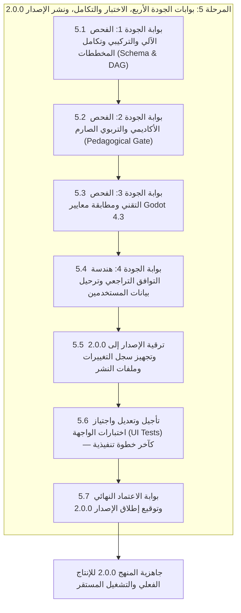

# الخطة التنفيذية للمرحلة 5: بوابات الجودة الأربع، الاختبار والتكامل، ونشر الإصدار 2.0.0

> **تاريخ الاعتماد:** 2026-10-27  
> **المرجع الأساسي:** [تحليل وتقييم المنهج التعليمي](docs/curriculum_analysis.md)  
> **الخطة الأم:** [الخطة التنفيذية لمعالجة وتطوير المنهج التعليمي](docs/curriculum_remediation_plan.md)  
> **خطط المراحل السابقة:** [المرحلة 0 (الحوكمة)](docs/phase_0_execution_plan.md) | [المرحلة 1 (الوحدات التأسيسية)](docs/phase_1_execution_plan.md) | [المرحلة 2 (خريطة المفاهيم)](docs/phase_2_execution_plan.md) | [المرحلة 3 (تعزيز التمارين)](docs/phase_3_execution_plan.md) | [المرحلة 4 (الوحدات المتقدمة)](docs/phase_4_execution_plan.md)  
> **المراجع التوثيقية الرسمية:** [سجل توثيق GDScript 4.3 الرسمي](docs/gdscript_official_registry.md) | [قواعد التحقق البرمجي للمنهج](docs/curriculum_validation_rules.md)  
> **النطاق التنفيذي:** التحقق الشامل عبر بوابات الجودة الأربع (البوابة الآلية والتركيبية، البوابة الأكاديمية والتربوية، بوابة دقة Godot 4.3، وبوابة تجربة المستخدم والتوافق التراجعي لحالة تقدم المستخدمين)، تدقيق ترقية الإصدار إلى 2.0.0، وتشغيل واجتياز كافة اختبارات المشروع مع تطبيق قاعدة تأجيل اختبارات الواجهة إلى الخطوة التنفيذية الأخيرة.  
> **قاعدة تأجيل اختبارات الواجهة الحتمية:** إذا كان هناك أي اختبارات على الواجهة الرسومية (UI Widget Tests مثل شاشات IDE والمفاهيم والشارات وإكمال الدرس)، فيجب تأجيلها وترحيلها بالكامل إلى **آخر خطوة تنفيذية** في الخطة (المرحلة الفرعية 5.6)، ويُحظر تماماً تعديلها أو تشغيلها أثناء مراحل فحص البوابات الثلاث الأولى والتحقق التراجعي، لضمان استقرار البنية الهندسية للبيانات أولاً ومنع أي فشل عارض أو تشتيت في خطوط الفحص.  
> **المخرج المستهدف:** إغلاق كافة الفجوات المرصودة في وثيقة التحليل بنسبة 100%، اجتياز بوابات الجودة الأربع، الحفاظ التام على تقدم المستخدمين دون فقدان أي بيانات، وتوقيع ونشر المنهج الإنتاجي v2.0.0 رسمياً.

---

## فهرس خطة المرحلة 5

1. [الرؤية الاستراتيجية والأهداف التشغيلية للمرحلة 5](#1-الرؤية-الاستراتيجية-والأهداف-التشغيلية-للمرحلة-5)
2. [استرجاع مصفوفة الفجوات من وثيقة التحليل (curriculum_analysis.md) وآلية إغلاقها النهائي](#2-استرجاع-مصفوفة-الفجوات-من-وثيقة-التحليل-curriculum_analysismd-وآلية-إغلاقها-النهائي)
3. [المراحل الفرعية المتسلسلة للتنفيذ](#3-المراحل-الفرعية-المتسلسلة-للتنفيذ)
   - [المرحلة الفرعية 5.1: بوابة الجودة 1 — الفحص الآلي والتركيبي وتكامل المخططات (Automated Schema & DAG Gate)](#المرحلة-الفرعية-51-بوابة-الجودة-1--الفحص-الآلي-والتركيبي-وتكامل-المخططات-automated-schema--dag-gate)
   - [المرحلة الفرعية 5.2: بوابة الجودة 2 — الفحص الأكاديمي والتربوي الصارم (Pedagogical Quality Gate)](#المرحلة-الفرعية-52-بوابة-الجودة-2--الفحص-الأكاديمي-والتربوي-الصارم-pedagogical-quality-gate)
   - [المرحلة الفرعية 5.3: بوابة الجودة 3 — الفحص التقني ومطابقة معايير Godot 4.3 (Engine & Syntax Fidelity Gate)](#المرحلة-الفرعية-53-بوابة-الجودة-3--الفحص-التقني-ومطابقة-معايير-godot-43-engine--syntax-fidelity-gate)
   - [المرحلة الفرعية 5.4: بوابة الجودة 4 — هندسة التوافق التراجعي وترحيل بيانات المستخدمين (Backward Compatibility & State Migration Gate)](#المرحلة-الفرعية-54-بوابة-الجودة-4--هندسة-التوافق-التراجعي-وترحيل-بيانات-المستخدمين-backward-compatibility--state-migration-gate)
   - [المرحلة الفرعية 5.5: ترقية الإصدار إلى 2.0.0 وتجهيز سجل التغييرات وملفات النشر (Version Bumping & Release Artifacts)](#المرحلة-الفرعية-55-ترقية-الإصدار-إلى-200-وتجهيز-سجل-التغييرات-وملفات-النشر-version-bumping--release-artifacts)
   - [المرحلة الفرعية 5.6: تأجيل وتعديل واجتياز اختبارات الواجهة الرسومية (UI Tests) والتحقق البصري — كآخر خطوة تنفيذية](#المرحلة-الفرعية-56-تأجيل-وتعديل-واجتياز-اختبارات-الواجهة-الرسومية-ui-tests-والتحقق-البصري--كآخر-خطوة-تنفيذية)
   - [المرحلة الفرعية 5.7: بوابة الاعتماد النهائي وتوقيع إطلاق الإصدار 2.0.0 (Production Sign-off & Final Release Gate)](#المرحلة-الفرعية-57-بوابة-الاعتماد-النهائي-وتوقيع-إطلاق-الإصدار-200-production-sign-off--final-release-gate)
4. [مصفوفة بوابات الجودة الأربع التفصيلية ومعايير الاجتياز الكمية](#4-مصفوفة-بوابات-الجودة-الأربع-التفصيلية-ومعايير-الاجتياز-الكمية)
5. [بروتوكول واختبارات التوافق التراجعي وترحيل بيانات التقدم (Backward Compatibility Protocol)](#5-بروتوكول-واختبارات-التوافق-التراجعي-وترحيل-بيانات-التقدم-backward-compatibility-protocol)
6. [مخطط سجل الإصدار 2.0.0 (Release Notes & Changelog Blueprint)](#6-مخطط-سجل-الإصدار-200-release-notes--changelog-blueprint)
7. [الجدول الزمني ومسار الاعتماديات للمرحلة 5 (5 أيام عمل)](#7-الجدول-الزمني-ومسار-الاعتماديات-للمرحلة-5-5-أيام-عمل)
8. [مصفوفة المسؤوليات (RACI) للمرحلة 5](#8-مصفوفة-المسؤوليات-raci-للمرحلة-5)
9. [معايير القبول وبوابة الإغلاق (Definition of Done)](#9-معايير-القبول-وبوابة-الإغلاق-definition-of-done)
10. [خطة ما بعد الإطلاق والمتابعة التشغيلية (Post-Launch Operations)](#10-خطة-ما-بعد-الإطلاق-والمتابعة-التشغيلية-post-launch-operations)

---

## 1. الرؤية الاستراتيجية والأهداف التشغيلية للمرحلة 5

تُمثل **المرحلة 5** ذروة جهود التطوير وخاتمة خطة المعالجة الشاملة للمنهج التعليمي لتطبيق "تعلّم GDScript". فبعد إنجاز حوكمة المنهج (المرحلة 0)، وإعادة كتابة وتأصيل الوحدات التأسيسية الأربع بنموذج الأركان الخمسة (المرحلة 1)، وتوسيع خريطة المفاهيم التفاعلية لـ 51 مفهوماً بنظام التكرار المتباعد SM-2 (المرحلة 2)، وترقية بنك التمارين إلى 510 تمارين مدعومة بـ 1200+ حالة اختبار و 11 تحدياً تركيبياً (المرحلة 3)، وتدقيق الوحدات المتقدمة وضبط شجرة المشاهد ومعايرة الأزمنة وتثبيت الروابط (المرحلة 4)؛ تأتي المرحلة 5 كـ **حاجز تدقيق رباعي غير قابل للمساومة** قبل السماح للمنهج بالانتقال إلى الإنتاج الفعلي كإصدار `v2.0.0`.

### الأهداف التشغيلية للمرحلة 5

1. **التحقق الشامل الصارم عبر بوابات الجودة الأربع (The 4 Quality Gates):** إخضاع كافة مكونات المنهج (51 درساً، 510 تمارين، 51 مفهوماً، 12 وحدة) للفحص الآلي والبيداغوجي والتقني وتجربة المستخدم بنسبة نجاح 100%.
2. **ضمان التوافق التراجعي لبيانات تقدم المستخدمين (Zero Progress Corruption):** التأكد من أن التحديث الجذري للمنهج لن يمس أو يصفر نقاط الخبرة (`totalXP`)، أو سلاسل التعلم اليومي (`streak`)، أو الشارات المكتسبة (`earnedBadges`)، أو حالة إكمال الدروس للمستخدمين الحاليين.
3. **ترقية الإصدار إلى 2.0.0:** رفع رقم إصدار المنهج رسمياً في [assets/curriculum/manifest.json](assets/curriculum/manifest.json) وتوثيق سجل التغييرات الشامل في [CHANGELOG.md](CHANGELOG.md).
4. **التطبيق الحتمي لمبدأ تأجيل اختبارات الواجهة (UI Test Deferral Rule):** فصل طبقة فحص البيانات والمنطق والبوابات الثلاث الأولى عن اختبارات الواجهة الرسومية؛ حيث تؤجل جميع اختبارات الواجهة ([test/ui/](test/ui/)) لتكون **آخر خطوة تنفيذية** (المرحلة الفرعية 5.6) بعد اجتياز كافة البوابات واستقرار نماذج البيانات بنسبة 100%.
5. **الاعتماد والجاهزية الإنتاجية (Production Sign-off):** الحصول على توقيع واعتماد ثلاثي (المطور، المراجع البيداغوجي، خبير محرك Godot) لإغلاق خطة المعالجة رسمياً.

> [!IMPORTANT]
> **دستور تأجيل اختبارات الواجهة إلى آخر خطوة تنفيذية (UI Testing Deferral Principle):**  
> إذا كان هناك أي اختبارات برمجية على واجهة المستخدم (مثل [test/ui/desktop_lesson_ide_screen_test.dart](test/ui/desktop_lesson_ide_screen_test.dart) أو [test/ui/concept_map_screen_test.dart](test/ui/concept_map_screen_test.dart) أو [test/ui/badges_screen_test.dart](test/ui/badges_screen_test.dart))، فإن الخطة تُلزم صراحة بتأجيل أي تعديل أو تشغيل لها إلى **آخر خطوة تنفيذية** في الخطة (المرحلة الفرعية 5.6).  
> **التعليل الهندسي:** اختبارات الواجهة تختبر تكامل دورة حياة الـ Widgets وعرض مكونات المنهج ككل متكامل؛ وتشغيلها أثناء فحص بوابات البيانات الأولى سيؤدي إلى فشل كاذب وتعطيل تدفق فحص البوابات الأساسية. لا يُسمح بفتح طبقة الواجهة إلا بعد اجتياز البوابات 1 و 2 و 3 و 4 وترقية الإصدار.

---

## 2. استرجاع مصفوفة الفجوات من وثيقة التحليل (curriculum_analysis.md) وآلية إغلاقها النهائي

بناءً على نتائج التحليل الهيكلي الشامل في [docs/curriculum_analysis.md](docs/curriculum_analysis.md)، تُثبت المرحلة 5 الإغلاق التام والنهائي لكافة نقاط الضعف والمخاطر المرصودة:

| رمز الفجوة / الضعف | الوصف المرصود في وثيقة التحليل | مستوى الخطورة السابق | بوابة الجودة المسؤولة عن التحقق النهائي | معيار الإغلاق النهائي في المرحلة 5 |
| :---: | --- | :---: | :---: | --- |
| **GAP-01 / ضعف 1** | **النمطية والقوالب في محتوى وتمارين الوحدات 1–4:** إيجاز مفرط، نسخ مكررة من التوثيق، وتمارين متطابقة. | 🔴 **حرجة** | **البوابة 2 (Pedagogical Quality Gate)** | - التحقق من تطبيق نموذج الأركان الخمسة في الـ 17 درساً الأولى.<br>- صفر أسئلة أو تلميحات قالبية متكررة (Zero Template Clones). |
| **GAP-02 / ضعف 2** | **نقص خريطة المفاهيم (14 فقط من 51 درساً):** غياب الوحدات 6–12 عن شبكة المفاهيم والـ DAG. | 🟡 **متوسطة** | **البوابة 1 (Schema & DAG) والبوابة 4 (UX)** | - التحقق من وجود 51 عقدة مفهوم في `manifest.json`.<br>- اجتياز فحص خلو الرسم البياني من الحلقات المغلقة (`Acyclic`).<br>- ربط 100% من المفاهيم ببطاقات التكرار SM-2. |
| **GAP-03 / ضعف 3** | **حالات اختبار غير كافية واقتصارها على حالة وحيدة:** فحص سطحي يقبل الحلول العارضة دون تمحيص. | 🟡 **متوسطة** | **البوابة 1 (Automated) والبوابة 3 (Godot Fidelity)** | - فحص وجود 2–3 حالات اختبار لكل تمرين كتابة كود.<br>- تغطية الحالات الحدية (Boundary Cases) كالأعداد السالبة والمصفوفات الفارغة. |
| **GAP-04 / ضعف 4** | **انعدام التمرين التراكمي في ختام كل وحدة:** غياب التحديات التركيبية التي تدمج مفاهيم الوحدة معاً. | 🟡 **متوسطة** | **البوابة 2 (Pedagogical) والبوابة 3 (Godot Fidelity)** | - التحقق من وجود 11 تحدياً تركيبياً (`order: 9`) يدمج مفاهيم كل وحدة.<br>- توفير حل نموذجي معتمد لكل تحدٍ تركيبي. |
| **GAP-05 / ضعف 5** | **تقديرات زمنية غير واقعية (`estimatedMinutes`):** تخصيص 7–10 دقائق لجميع الدروس دون تمييز. | 🟢 **منخفضة** | **البوابة 1 (Automated) والبوابة 4 (UX)** | - مطابقة أزمنة الـ 51 درساً لجدول المعايرة الموضوعي (10–25 دقيقة).<br>- إجمالي مدة المنهج تبلغ 12 ساعة و 51 دقيقة وفق جدول المعايرة المعتمد في المرحلة 4. |
| **GAP-06 / ضعف 6** | **روابط التوثيق غير المثبتة (`/stable/`):** خطر كسر الروابط واختلاف الإصدارات عند ترقية المحرك. | 🟢 **منخفضة** | **البوابة 3 (Godot Fidelity Gate)** | - تثبيت 100% من الروابط على النطاق الرسمي: `docs.godotengine.org/en/4.3/`.<br>- صفر روابط معطوبة (Zero Dead / 404 Links). |

---

## 3. المراحل الفرعية المتسلسلة للتنفيذ



---

### المرحلة الفرعية 5.1: بوابة الجودة 1 — الفحص الآلي والتركيبي وتكامل المخططات (Automated Schema & DAG Gate)

**الهدف:** إخضاع قاعدة بيانات المنهج بالكامل (ملفات JSON ومخطط المفاهيم والروابط) للفحص البرمجي الآلي الصارم دون أي تدخل يدوي، والتأكد من مطابقتها التامة لنماذج Dart.

> [!CAUTION]
> **قاعدة الحظر الصارم — حظر تشغيل أو تعديل اختبارات الواجهة في هذه المرحلة:**  
> يُحظر تماماً خلال المرحلة 5.1 فتح أو تشغيل ملفات اختبارات الواجهة الرسومية في مجلد `test/ui/` أو `test/widget_test.dart`.  
> **التركيز محصور حصراً في:** أدوات الفحص عبر سطر الأوامر (CLI) واختبارات النماذج والمنطق البرمجي (Unit & Logic Tests).

#### 1. تشغيل حزمة الفحص الآلي الشامل للحوكمة (CLI Verification Commands)

```bash
# 1. الفحص الهيكلي الشامل لكافة ملفات الدروس والوحدات، بما فيها DAG والتمارين
dart run tool/validate_curriculum.dart --strict

# 2. فحص صلاحية واستقرار وتثبيت كافة الروابط الرسمية (Godot 4.3)
dart run tool/validate_curriculum.dart --check-links

```

> يشغّل المدقق جميع فحوصات المخطط وDAG والتمارين في التشغيل الافتراضي؛ لا يدعم
> خيارات منفصلة باسم `--full-audit` أو `--check-dag` أو `--check-exercises`.

#### 2. فحص نماذج Dart ومنطق البيانات (Data Layer & Models Unit Tests)

- تشغيل واجتياز اختبارات سلامة النماذج البرمجية:
  - `dart test test/models_test.dart`
  - `dart test test/data_layer_test.dart`
  - `dart test test/repository_test.dart`
  - `dart test test/content_validation_test.dart`
  - `dart test test/curriculum_exercises_quality_test.dart`
  - `dart test test/curriculum_template_test.dart`
- التأكد من خلو عملية التحويل من JSON إلى Dart (`fromJson`) من أي `FormatException` أو حقول غير معرّفة أو مفاتيح مفقودة في الـ 51 درساً.

---

### المرحلة الفرعية 5.2: بوابة الجودة 2 — الفحص الأكاديمي والتربوي الصارم (Pedagogical Quality Gate)

**الهدف:** التحقق النوعي من أن المحتوى التعليمي يُلبي أعلى معايير التصميم التعليمي الحديث ويقضي نهائياً على الإيجاز المخل والنمطية القالبية.

#### معايير الفحص الأكاديمي الصارم

1. **تحقق نموذج الأركان الخمسة (The 5 Pillars Verification):**
   - التأكد من أن كل درس من الدروس الـ 51 يحتوي على الأقسام الخمسة كاملة دون استثناء:
     1. **المفهوم النظري والسياق البرمجي:** مدخل مشوق يوضح أهمية المفهوم في تطوير الألعاب.
     2. **القاعدة النحوية والشكل القياسي (Syntax):** كتلة كود تبرز البنية اللغوية الدقيقة.
     3. **مثال عملي تطبيقي مشروح:** كود متكامل مرتبط بسياق ألعاب (لاعب، أعداء، حركة، إشارات).
     4. **الأخطاء الشائعة وفخاخ المبتدئين (Common Pitfalls):** كتل تنبيه صريحة (`[!WARNING]` و `[!NOTE]`).
     5. **الملخص المدمج والتوصيات:** تلخيص مكثف مع توصيات Godot الرسمية (`[!TIP]`).
2. **استئصال النمطية والتكرار القالبي (Zero-Template Clone Enforcement):**
   - التحقق من عدم وجود أي تكرار نصوص بين أسئلة الاختيار من متعدد في مختلف الدروس.
   - التحقق من أن حقل `documentation` في كل درس هو شرح تقني فريد ومركّز يختلف جوهرياً عن `contentMarkdown` ولا يكرر جملاً شكلية.
   - التحقق من أن كل تلميح في كل تمرين يرتبط مباشرة بالمفهوم الدقيق للتمرين ويقود إلى الحل دون إعطائه جاهزاً.
3. **تدرج صعوبة التمارين العشرة (10 Exercises Progression):**
   - التحقق من تدرج التمارين من المستوى المعرفي البسيط إلى التطبيقي:
     - التمارين 1–3: ترسيخ المفاهيم والاختيار من متعدد وتوقع المخرجات.
     - التمارين 4–6: إكمال الفراغات وتصحيح الأخطاء النحوية (Fill-in & Debug).
     - التمارين 7–8: كتابة دوال وخوارزميات مصغرة (Write Code).
     - التمرين 9: التحدي التراكمي الختامي المركّب للوحدة (Synthesis Capstone).
     - التمرين 10: تقييم المفاهيم وتثبيت الفهم النهائي.

---

### المرحلة الفرعية 5.3: بوابة الجودة 3 — الفحص التقني ومطابقة معايير Godot 4.3 (Engine & Syntax Fidelity Gate)

**الهدف:** التحقق من دقة ومطابقة كافة الأكواد والشروح لأحدث مواصفات محرك Godot 4.3 الرسمية وخلوها من أي ممارسات قديمة عائدة لـ Godot 3.x.

#### قائمة التدقيق التقني لـ Godot 4.3

1. **نظام الأنواع الساكنة الصارمة (Static Typing & Typed Arrays):**
   - التأكد من استخدام الأنواع الصريحة (`var health: int = 100`) والأنواع المعادة من الدوال (`func get_speed() -> float:`).
   - استخدام المصفوفات المحددة النوع `Array[String]` و `Array[Node]` بدلاً من المصفوفات العامة غير محددة النوع حيثما تطلب السياق.
2. **الكلمات المفتاحية والخصائص المعمارية الحديثة:**
   - استخدام `@export` و `@onready` بالبنية الحديثة ذات الرمز `@`.
   - استخدام `class_name` وتسجيل الأصناف واستدعاء دوال البناء بـ `super()` بدلاً من الأنماط القديمة.
   - استخدام `Callable` واستدعاء `call()` و `bind()` الحديثة في التعامل مع الدوال كمواطنين من الدرجة الأولى.
3. **معمارية التواصل بالأحداث ("Signal Up, Call Down"):**
   - التأكد من أن أمثلة ربط الإشارات برمجياً تستخدم البنية الحديثة:
     `button.pressed.connect(_on_button_pressed)` بدلاً من `button.connect("pressed", self, "_on_button_pressed")`.
   - استخدام `signal.emit()` الحديث بدلاً من `emit_signal()`.
4. **العمليات اللاتزامنية والمؤقتات:**
   - استخدام `await` الحديث مع الإشارات والمؤقتات بدلاً من `yield` القديم الملغى في Godot 4.
   - فحص وجود شرط الأمان `is_instance_valid()` بعد كل استئناف لـ `await` لتجنب الانهيار البرمجي في حال حذف العقدة.
5. **وضوح شجرة المشهد المفترضة:**
   - التحقق من وجود مخطط شجرة المشهد (`Assumed Scene Hierarchy`) وموضع ارتباط السكربت في 100% من دروس الوحدات 7 إلى 12.

---

### المرحلة الفرعية 5.4: بوابة الجودة 4 — هندسة التوافق التراجعي وترحيل بيانات المستخدمين (Backward Compatibility & State Migration Gate)

**الهدف:** ضمان الانتقال السلس للمستخدمين الحاليين من الإصدار 1.0.0 إلى 2.0.0 دون تصفير نقاط الخبرة، أو فقدان الشارات، أو تشويه سجل إكمال الدروس.

#### محاور التحقق التراجعي

1. **استقرار المعرفات الثابتة (Canonical IDs Invariance):**
   - تثبيت كافة معرفات الدروس الـ 51 (`lessonId`) والوحدات الـ 12 (`unitId`) على أسمائها القياسية السابقة دون تغيير حرف واحد (مثل `lesson_01_hello` وصولاً إلى `lesson_51_final_integration`).
   - النتيجة: مفاتيح خريطة تقدم الدروس `UserProgress.lessonsProgress` تظل مطابقة 100% ولن تفقد أي سجل مكتمل.
2. **مرونة نماذج قراءة التقدم في Dart:**
   - فحص كود [lib/data/models/progress_models.dart](lib/data/models/progress_models.dart):
     - التأكد من أن دالة `LessonProgress.fromJson` تتعامل بمرونة مع الحقول المضافة أو المعدلة دون رمي استثناءات.
     - التأكد من الحفاظ على كود الحلول المحفوظة للمستخدم (`savedCode`) ومحاولات التمارين والتلميحات المستهلكة.
3. **أمان سجل المعاملات المالية للخبرة (XP Transactions):**
   - التأكد من عدم إعادة احتساب نقاط الـ XP السابقة أو سحبها؛ يظل رصيد `totalXP` ثابتاً للمستخدم ويُضاف إليه فقط عند إنجاز التمارين الجديدة أو الإضافية.
4. **اختبار الترحيل التجريبي (Migration Test Suite):**
   - إنشاء واختبار سيناريو ترحيل برمجي في `test/data/progress_migration_test.dart` يحاكي ملف JSON لمستخدم من الإصدار 1.0.0 يمتلك 1500 XP ومكتمل لـ 10 دروس، والتأكد من تحميله بنجاح تام داخل الإصدار 2.0.0.

---

### المرحلة الفرعية 5.5: ترقية الإصدار إلى 2.0.0 وتجهيز سجل التغييرات وملفات النشر (Version Bumping & Release Artifacts)

**الهدف:** التوثيق الرسمي للإصدار 2.0.0 وترقية حقول الإصدار في ملفات المشروع قبل الشروع في فحص الواجهة النهائي.

#### الإجراءات التنفيذية

1. **ترقية حقل الإصدار في ملف المنهج الرئيسي:**
   - تعديل [assets/curriculum/manifest.json](assets/curriculum/manifest.json) لرفع قيمة الحقل:

     ```json
     "version": "2.0.0"
     ```

2. **صياغة وتحديث سجل التغييرات الرسمي ([CHANGELOG.md](CHANGELOG.md)):**
   - توثيق تفاصيل الإصدار 2.0.0 تحت عنوان: `## [2.0.0] - 2026-10-27` مع تصنيف التغييرات إلى:
     - `Added`: إضافة نموذج الأركان الخمسة، 11 تحدياً تركيبياً، 37 مفهوماً جديداً في الخريطة، 1200+ حالة اختبار.
     - `Changed`: معايرة المدد التقديرية لكافة الدروس (12h 51m وفق جدول المرحلة 4)، تثبيت روابط Godot 4.3 الرسمية.
     - `Fixed`: إزالة النمطية والتكرار في الأسئلة والتلميحات، إزالة غموض شجرة المشهد في الأمثلة المتقدمة.
     - `Security & Governance`: أداة الحوكمة والتحقق البرمجي التلقائي.
3. **تحديث وثائق المشروع في مجلد `docs/`:**
   - إغلاق ومواءمة كافة وثائق المراحل التنفيذية (0، 1، 2، 3، 4، 5) والتأكد من تكامل مراجعها وروابطها.

---

### المرحلة الفرعية 5.6: تأجيل وتعديل واجتياز اختبارات الواجهة الرسومية (UI Tests) والتحقق البصري — كآخر خطوة تنفيذية

**الهدف:** مواءمة وتعديل واجتياز كافة اختبارات الواجهة الرسومية (UI Widget Tests) وتشغيلها بنجاح 100% **كآخر خطوة تنفيذية**، والتحقق البصري الميداني من تناسق واجهات التطبيق المكتبي وخلوها التام من أي مشاكل في التصميم أو تجاوز المساحة.

> [!IMPORTANT]
> **المبدأ التنفيذي الحاكم — التنفيذ الحصري في الخطوة الأخيرة:**  
> تنفيذاً لشرطك الإلزامي بتأجيل اختبارات الواجهة إلى آخر خطوة، تُعد هذه المرحلة الفرعية (5.6) المحطة الوحيدة والمخولة بفتح وتشغيل وفحص طبقة واجهة المستخدم. هنا فقط، وبعد استقرار واجتياز البوابات الأربع وترقية الإصدار إلى 2.0.0 بنسبة 100%، يتم تشغيل كامل ترسانة اختبارات الـ UI.

#### 1. مواءمة وتشغيل واجتياز حزمة اختبارات الواجهة (UI Widget Tests Suite)

```bash
# تشغيل كامل اختبارات واجهة المستخدم المجمعة
flutter test test/ui/
flutter test test/widget_test.dart
```

وتشمل قائمة الاختبارات التي يتم اجتيازها بنسبة 100%:

- **[test/ui/desktop_lesson_ide_screen_test.dart](test/ui/desktop_lesson_ide_screen_test.dart):**
  - التحقق من استعراض شاشة محرر الدرس المكتبي وعرض المدد التقديرية المحدثة من الـ Provider.
  - التحقق من تفاعل شريط الأدوات وعرض بطاقة التوثيق المحدثة وقائمة المراجع الرسمية وروابط Godot 4.3.
  - التحقق من خلو الواجهة من أي استثناءات تصميمية (`expect(tester.takeException(), isNull)`).
- **[test/ui/concept_map_screen_test.dart](test/ui/concept_map_screen_test.dart):**
  - التحقق من عرض شبكة المفاهيم الموسعة الـ 51 كاملة دون تداخل أو بطء في الرندر.
  - فحص استجابة النقر على المفاهيم وعرض تفاصيل المفهوم وبطاقات التكرار المتباعد SM-2.
- **[test/ui/syntax_reference_screen_test.dart](test/ui/syntax_reference_screen_test.dart):**
  - فحص استعراض شاشة المرجع النحوي ومطابقة الروابط التوثيقية المحدثة وتصنيفاتها.
- **[test/ui/badges_screen_test.dart](test/ui/badges_screen_test.dart) & [test/ui/gamification_widgets_test.dart](test/ui/gamification_widgets_test.dart):**
  - فحص عرض شاشة الشارات ولوحة التحفيز وتطابق رصيد الـ XP وشريط التقدم للوحدات المحدثة.
- **[test/ui/lesson_complete_screen_test.dart](test/ui/lesson_complete_screen_test.dart):**
  - التحقق من شاشة إكمال الدرس وعرض الإحصائيات الزمنية الدقيقة ونقاط الخبرة المكتسبة.
- **[test/ui/workspace_screen_test.dart](test/ui/workspace_screen_test.dart) & [test/widget_test.dart](test/widget_test.dart):**
  - التحقق من التدفق الكامل للمستخدم عبر الشاشات وتكامل الواجهة المكتبية.

#### 2. الفحص البصري وتجربة المستخدم الميدانية (Visual UX Verification)

1. **انسيابية الخطوط والقراءة:** التحقق من وضوح الخطوط العربية والإنجليزية وتنسيق كتل الأكواد أحادية المسافة (Monospace) مع التمييز اللوني النحوي السليم.
2. **التجاوب واستقرار الأبعاد (Responsiveness & Zero Overflows):** التحقق من سلامة الواجهة عند تغيير أبعاد نافذة التطبيق المكتبي أو تجربة شاشات العرض المتفاوتة (Full HD و 4K وشاشات الحواسيب المحمولة الصغيرة)، والتأكد الصارم من عدم ظهور خطأ تجاوز المساحة المشهور (`RenderFlex overflowed`).

---

### المرحلة الفرعية 5.7: بوابة الاعتماد النهائي وتوقيع إطلاق الإصدار 2.0.0 (Production Sign-off & Final Release Gate)

**الهدف:** إعلان نجاح خطة المعالجة وإغلاق كافة مراحلها رسمياً بعد اجتياز اختبارات الواجهة، وإصدار وثيقة الاعتماد والجاهزية الإنتاجية.

#### بروتوكول الاعتماد النهائي

1. **فحص نظافة بيئة المستودع (Clean Repository Audit):**
   - تشغيل `git status` والتأكد من خلو المشروع من أي ملفات مؤقتة أو غير متعقبة غير مرغوب بها.
   - التحقق من أن جميع ملفات المنهج وخطة المعالجة في مجلد `docs/` مفهرسة ومحدثة.
2. **التوقيع الثلاثي للاعتماد (Triple Sign-off):**
   - توقيع مهندس جودة البرمجيات (Flutter & Data Integrity).
   - توقيع المراجع التربوي والبيداغوجي (Pedagogical Architect).
   - توقيع خبير لغة GDScript ومحرك Godot (Godot 4 Engine Specialist).
3. **إعلان اعتماد الإصدار 2.0.0 رسمياً:**
   - إصدار إشعار إطلاق الإصدار الإنتاجي 2.0.0 لتطبيق "تعلّم GDScript" كمنهج مكتمل ومتطور وخالٍ من الفجوات.

---

## 4. مصفوفة بوابات الجودة الأربع التفصيلية ومعايير الاجتياز الكمية

| بوابة الجودة | المعيار التفصيلي | الأداة المستخدمة في الفحص | معيار القبول الكمي (Target) | الإجراء الفوري عند عدم المطابقة |
| :--- | :--- | :--- | :---: | :--- |
| **بوابة 1: الفحص الآلي والتركيبي (Automated Gate)** | - سلامة ملفات JSON ومطابقة النماذج<br>- خلو الـ DAG من الحلقات الدائرية<br>- اجتياز اختبارات النماذج والمنطق | - `validate_curriculum.dart`<br>- `dart test test/models_test.dart`<br>- `dart test test/data_layer_test.dart` | **100% نجاح**<br>(صفر تحذيرات / صفر أخطاء) | رفض النشر فورياً وإعادة فحص حقول الـ JSON المعطوبة وإصلاحها. |
| **بوابة 2: الفحص الأكاديمي والتربوي (Pedagogical Gate)** | - اكتمال الأركان الخمسة في الـ 51 درساً<br>- خلو التمارين والتلميحات من النمطية<br>- سلامة الـ 11 تحدياً تركيبياً | - الفحص الآلي بالـ CLI<br>- التدقيق البيداغوجي العيني<br>- `curriculum_exercises_quality_test.dart` | **100% تغطية**<br>(صفر أسئلة أو تلميحات قالبية متكررة) | إعادة كتابة المحتوى والتمارين غير المستوفية وفق دليل المعايير. |
| **بوابة 3: فحص معايير Godot 4.3 (Engine Gate)** | - دقة أكواد GDScript 4.3 الحديثة<br>- سلامة وتثبيت الروابط الرسمية الـ 75+<br>- توثيق شجرة المشهد في دروس المحرك | - `validate_curriculum.dart --check-links`<br>- تدقيق الأمثلة على محرك Godot 4.3<br>- فحص سجل `gdscript_official_registry.md` | **100% دقة**<br>(صفر روابط ميتة / صفر دوال ملغاة من Godot 3) | تعديل الشيفرات لتطابق Godot 4.3 وتثبيت الروابط على المسار المعتمد. |
| **بوابة 4: تجربة المستخدم والتوافق التراجعي (UX & Migration Gate)** | - سلامة ترحيل بيانات تقدم المستخدمين<br>- الحفاظ على رصيد الـ XP والشارات<br>- اجتياز اختبارات الواجهة **(كآخر خطوة)** | - `test/data/progress_migration_test.dart`<br>- `flutter test test/ui/` **(في الخطوة 5.6)**<br>- الفحص البصري لشاشات سطح المكتب | **صفر فقدان بيانات**<br>+ **100% اجتياز لاختبارات الواجهة** | تصحيح دوال ترحيل البيانات وتعديل مواءمة شاشات العرض المكتبي. |

---

## 5. بروتوكول واختبارات التوافق التراجعي وترحيل بيانات التقدم (Backward Compatibility Protocol)

لحماية تجربة المستخدمين الحاليين للتطبيق من أي أثر جانبي، يُطبق البروتوكول الهندسي التالي:

### 1. مصفوفة سلامة كائنات التقدم التراجعية

```text
UserProgress (v1.0.0 Saved State) ───────────────► UserProgress (v2.0.0 Runtime)
├── visitorId (نفس المعرف دون تغيير) ─────────────► visitorId (مطابق)
├── totalXP (رصيد نقاط الخبرة المحفوظ) ────────────► totalXP (محفوظ بالكامل دون أي خصم)
├── currentStreak & longestStreak (أيام التعلم) ──► streaks (محفوظة ومتصلة)
├── earnedBadges (الشارات المحققة مسبقاً) ──────────► earnedBadges (محتفظ بها 100%)
└── lessonsProgress (سجل الدروس المكتملة) ────────► lessonsProgress (مطابق عبر 51 معرف ثابت)
```

### 2. سيناريوهات الاختبار التراجعي الثلاثة (Regression Test Matrix)

1. **سيناريو المستخدم الجديد (Fresh Installation):**
   - تثبيت التطبيق لأول مرة؛ يتم توليد ملف تقدم جديد `UserProgress` يحتوي على 0 XP ويبدأ من `unit_01` و `lesson_01_hello` بسلاسة تامة.
2. **سيناريو المستخدم في منتصف المسار (Midway Active User):**
   - محاكاة مستخدم أكمل الوحدات 1 و 2 و 3 في الإصدار 1.0.0 ويمتلك 850 XP؛ عند ترقية التطبيق إلى 2.0.0، تظل هذه الوحدات مكتملة، ويظهر المحتوى الجديد والتمارين المحدثة متاحة له دون إجباره على إعادة ما تم إنجازه، مع إمكانية تجربة التحديات التركيبية الجديدة لاكتساب XP إضافي.
3. **سيناريو المستخدم المكتمل للمنهج القديم (Curriculum Veteran User):**
   - مستخدم أكمل الدروس الـ 51 السابقة؛ تظل حالته "مكتمل للمنهج"، وتُفتح له بطاقات المراجعة المتباعدة SM-2 في خريطة المفاهيم الجديدة، ويتمكن من حل التحديات التراكمية الـ 11 لرفع رصيده الإجمالي.

---

## 6. مخطط سجل الإصدار 2.0.0 (Release Notes & Changelog Blueprint)

يُعتمد النص التالي لإدراجه في ملف [CHANGELOG.md](CHANGELOG.md) عند الوصول للمرحلة الفرعية 5.5:

```markdown
## [2.0.0] - 2026-10-27

### 🚀 إصدار المنهج الشامل والمطوّر (Major Curriculum Overhaul)

يمثل الإصدار 2.0.0 نقلة نوعية جذرية في تطبيق "تعلّم GDScript"، حيث تم إخضاع المنهج بالكامل لمعالجة بيداغوجية وهندسية شاملة وفق معايير محرك Godot 4.3 الرسمية.

#### ✨ الميزات والتحسينات الجديدة (Added):
- **نموذج الأركان الخمسة للتعليم البرمجي:** إعادة كتابة الدروس التأسيسية لتشمل (المفهوم، القاعدة، المثال المشروح، فخاخ الأخطاء الشائعة، والملخص المدمج).
- **11 تحدياً تركيبياً تراكمياً (Synthesis Capstones):** إضافة مشروع مصغر ختامي لكل وحدة تعليمية يدمج مفاهيمها برمجياً.
- **خريطة مفاهيم تفاعلية متكاملة (DAG):** توسيع شبكة المفاهيم لتغطي 51 مفهوماً تفاعلياً مدعومة بنظام التكرار المتباعد (SuperMemo-2).
- **ترسانة اختبارات برمجية معززة:** 1,315 حالة اختبار للتمارين تغطي الحالات الحدية والخاصة.
- **إعدادات المشاهد المفترضة:** إدراج مخطط شجري بصري لشجرة العقد وموضع ارتباط السكربت لدروس محرك Godot.

#### 🔧 التعديلات والمعايرة (Changed):
- **معايرة واقعية لأزمنة الدروس:** تعديل حقل `estimatedMinutes` ليتراوح بين 10 و 25 دقيقة بناءً على كثافة التمارين، ليصبح إجمالي زمن دراسة المنهج 12 ساعة و 51 دقيقة وفق جدول المرحلة 4.
- **تثبيت روابط التوثيق الرسمي:** حصر وتثبيت 75+ رابطاً مرجعياً على المسار المستقر لـ Godot 4.3 الرسمي (`/en/4.3/`).

#### 🐛 الإصلاحات ومعالجة الفجوات (Fixed):
- القضاء التام على الأسئلة والتلميحات القالبية المتكررة عبر كافة الدروس.
- إزالة الغموض البرمجي في استدعاء العقد ومسارات الإشارات.
- ضمان التوافق التراجعي التام وعدم المساس بتقدم ونقاط خبرة المستخدمين الحاليين.
```

---

## 7. الجدول الزمني ومسار الاعتماديات للمرحلة 5 (5 أيام عمل)

تُنفذ المرحلة 5 على مدار **5 أيام عمل متسلسلة** مع حجز اليوم الأخير حصرياً لاختبارات الواجهة والاعتماد:

| اليوم | المرحلة الفرعية | المهام المنجزة خلال اليوم | المخرج اليومي المعتمد (Milestone) |
| :---: | --- | --- | --- |
| **اليوم 1** | المرحلة 5.1 | تشغيل حزمة الفحص الآلي للحوكمة (`validate_curriculum.dart`) واختبارات النماذج البرمجية | اجتياز البوابة 1 (الآلية والتركيبية) بصفر أخطاء |
| **اليوم 2** | المرحلة 5.2 | الفحص الأكاديمي والتربوي للأركان الخمسة واستئصال القوالب والتحقق من التحديات التركيبية | اجتياز البوابة 2 (الأكاديمية والتربوية) |
| **اليوم 3** | المرحلة 5.3 | الفحص التقني ومطابقة كود Godot 4.3 وصلاحية الروابط الـ 75+ وشجرة المشاهد | اجتياز البوابة 3 (دقة محرك Godot 4.3) |
| **اليوم 4** | المرحلة 5.4 + 5.5 | التحقق من التوافق التراجعي، ترقية الإصدار إلى 2.0.0 في `manifest.json`، وتجهيز `CHANGELOG.md` | اجتياز البوابة 4 وترقية وثائق الإصدار 2.0.0 |
| **اليوم 5** | المرحلة 5.6 + 5.7 | **آخر خطوة تنفيذية:** تشغيل واجتياز اختبارات الواجهة (UI Tests)، الفحص البصري، وتوقيع الاعتماد النهائي | **اجتياز كامل اختبارات الواجهة 100% وإعلان إطلاق v2.0.0** |

---

## 8. مصفوفة المسؤوليات (RACI) للمرحلة 5

| المهمة التنفيذية | مهندس Flutter والجودة | المراجع التربوي والبيداغوجي | مراجع Godot 4.3 التقني |
| --- | :---: | :---: | :---: |
| تشغيل وفحص البوابة 1 (الفحص الآلي للحوكمة والـ DAG) | **A / R** | I | C |
| تدقيق واجتياز البوابة 2 (الأركان الخمسة وخلو القوالب) | I | **A / R** | C |
| تدقيق واجتياز البوابة 3 (معايير Godot 4.3 والروابط) | I | C | **A / R** |
| اختبار بروتوكول التوافق التراجعي وترحيل التقدم (البوابة 4) | **A / R** | C | I |
| ترقية الإصدار إلى 2.0.0 وتحديث سجل التغييرات | **R** | C | C |
| **تعديل واجتياز اختبارات الواجهة كآخر خطوة تنفيذية (`test/ui/`)** | **A / R** | I | I |
| الفحص البصري وتجربة المستخدم لشاشات التطبيق المكتبي | **R** | **R** | **R** |
| توقيع الاعتماد النهائي وإطلاق الإصدار 2.0.0 رسمياً | **A** | **A** | **A** |

---

## 9. معايير القبول وبوابة الإغلاق (Definition of Done)

تُعتبر المرحلة 5 منتهية رسمياً وناجحة، ويُعلن المنهج جاهزاً للإنتاج، فقط عند تحقق الشروط الـ 7 التالية:

1. **اجتياز البوابة الآلية والتركيبية بنسبة 100% (Automated Gate Pass):** نجاح أوامر فحص الحوكمة الأربعة بالكامل دون أي خطأ أو تحذير برمجي.
2. **استيفاء البوابة الأكاديمية بنسبة 100% (Pedagogical Gate Pass):** اكتمال الأركان الخمسة في الـ 51 درساً، ووجود الـ 11 تحدياً تركيبياً، وتطهير تام لكافة الأسئلة والتلميحات من النمطية القالبية.
3. **استيفاء بوابة دقة Godot 4.3 بنسبة 100% (Engine Gate Pass):** مطابقة كافة الأمثلة لمواصفات Godot 4.3، وتثبيت كافة الروابط الـ 75+ على المسار الرسمي وخلوها من أي رابط ميت أو غير مستقر.
4. **أمان التوافق التراجعي (Zero Data Loss Migration):** اجتياز اختبارات ترحيل بيانات المستخدمين والتأكد من الحفاظ التام على نقاط الخبرة والشارات وسجلات الدروس.
5. **ترقية الإصدار رسمياً (Version 2.0.0 Bumped):** تعيين `"version": "2.0.0"` في `manifest.json` وتحديث [CHANGELOG.md](CHANGELOG.md).
6. **تأجيل وتعديل واجتياز كامل اختبارات الواجهة كآخر خطوة تنفيذية (Deferred UI Tests Passing):** تشغيل واجتياز حزمة اختبارات الواجهة في `test/ui/` و `test/widget_test.dart` بنسبة 100% دون أي استثناء أو تجاوز أبعاد (`RenderFlex overflowed`).
7. **التوقيع الثلاثي للاعتماد (Triple Sign-off):** توقيع مهندس الجودة والمراجع التربوي وخبير Godot معلنين الإطلاق الرسمي للإصدار 2.0.0.

---

## 10. خطة ما بعد الإطلاق والمتابعة التشغيلية (Post-Launch Operations)

عقب إطلاق الإصدار 2.0.0 في بيئة الإنتاج، يتم تفعيل المهام التشغيلية التالية لضمان استدامة الجودة:

1. **المراقبة الدورية للروابط الرسمية (Automated Link Health Check):** جدولة تشغيل سكريبت `validate_curriculum.dart --check-links` شهرياً لضمان عدم حدوث أي تغييرات مفاجئة في موقع توثيق Godot الرسمي.
2. **رصد التغذية الراجعة من المتعلمين (Learner Feedback Loop):** متابعة مؤشرات تجربة المستخدم ومعدلات إكمال التحديات التراكمية في لوحة التحليلات لتحديد أي تمارين قد تحتاج إلى إيضاحات إضافية.
3. **مواكبة تحديثات Godot 4.x الفرعية:** دراسة التحديثات الطفيفة (مثل 4.4 مستقبلاً) لضمان بقاء أمثلة وتمارين المنهج في طليعة الممارسات المعيارية الموصى بها لمطوري الألعاب.
