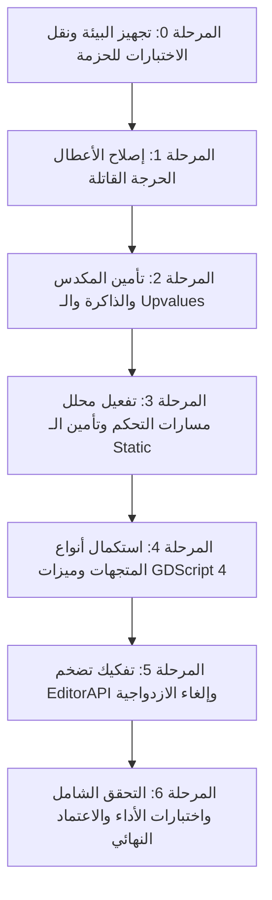

# الخطة التنفيذية الشاملة لإصلاح وتطوير محرك GDScript

## (Comprehensive Execution & Remediation Plan for GDScript Engine)

**تاريخ الخطة:** 20 أكتوبر 2026  
**المشروع المستهدف:** `packages/gdscript_engine`  
**المرجع:** تقرير الفحص الفني [docs/gdscript_engine_analysis.md](file:///home/osm/flutter_projects/learn_gdscript/packages/gdscript_engine/docs/gdscript_engine_analysis.md)

---

## نظرة عامة على منهجية العمل (Methodology)

تهدف هذه الخطة إلى نقل مكتبة `gdscript_engine` من الحالة الحالية (نواة تعاني من بعض الانهيارات الحرجة والنواقص) إلى **محرك GDScript 4 متين ومكتمل، موثوق، قابل للصيانة ومغطى بالكامل باختبارات مؤتمتة**.

تم تقسيم الخطة إلى **7 مراحل متسلسلة** وفق قاعدة التدرج من **"استقرار البنية وتثبيت الاختبارات"** مروراً بـ **"إصلاح الأعطال القاتلة وتأمين المكدس"** وصولاً إلى **"استكمال ميزات اللغة وإعادة الهيكلة المعمارية"**.



---

## المرحلة 0: تجهيز بيئة الحزمة وتوطين الاختبارات (Package Infrastructure & Test Harness)

**الهدف:** إتاحة تشغيل الاختبارات وفحص النتائج محلياً ومستقلاً داخل الحزمة بدون الاعتماد على مشاريع خارجية.

### 0.1. تحديث `pubspec.yaml` الخاص بـ `gdscript_engine`

* **المسار:** [pubspec.yaml](file:///home/osm/flutter_projects/learn_gdscript/packages/gdscript_engine/pubspec.yaml)
* **الإجراء:**
  * إضافة قسم `dev_dependencies` متضمناً `test: ^1.25.0` و `lints: ^5.0.0`.
  * تشغيل `dart pub get` داخل الحزمة.

### 0.2. نقل وتوطين الاختبارات داخل الحزمة

* **الإجراء:**
  * نسخ مجلد الاختبارات الكامل من `/home/osm/flutter_projects/gdscript_editor/test/gdscript_engine` إلى `/home/osm/flutter_projects/learn_gdscript/packages/gdscript_engine/test`.
  * ضبط استيرادات الملفات في الاختبارات لتشير إلى `package:gdscript_engine/gdscript_engine.dart` بدلاً من `package:gdscript_editor/...`.
  * استبدال `flutter_test` بـ `package:test` النقي لضمان استقلالية المحرك كحزمة Dart نقية (Pure Dart Package).

### 0.3. تشغيل خط الأساس (Baseline Test Run)

* تشغيل `dart test` والتأكد من تحديد الاختبارات الثلاثة الفاشلة بدقة كخط بداية للتحقق المستمر.

---

## المرحلة 1: إصلاح الأعطال الحرجة العاجلة (Immediate Critical Bug Fixes)

**الهدف:** حل الأعطال القاتلة التي تمنع تنفيذ السكريبتات الأساسية وتصحح الاختبارات الفاشلة فوراً.

### 1.1. إصلاح انهيار تقييم المتغيرات العامة الديناميكية في المصرف

* **الملف:** [lib/src/compiler/compiler.dart](compiler/compiler.dart)
* **المشكلة:** دالة `_evalStaticLiteral` تحاول تقييم العمليات الحسابية لمعاملات غير ثابتة (مثل `var c = a + b`)، فتعود بـ `null` وتحاول جمعه مسببة `Cannot add "Nil" and "Nil"`.
* **الإجراء:**
  * إضافة فحص استباقي `_isConstLiteral(Expr? expr)` للتحقق مما إذا كان التعبير ثابتاً حقيقياً بحتاً (أرقام، نصوص، بوليان) أو ثابت معلن بـ `const`.
  * إذا كان التعبير ديناميكياً أو يعتمد على معرفات متغيرات أخرى، يُسجل الحقل بقيمة مبدئية `GDNull.instance`، ويُترك التقييم الفعلي لكتلة البايتكود التنفيذية (`mainChunk`) وقت التشغيل.
  * تأمين دالة `_evalStaticLiteral` بحيث إذا كان أي من طرفي العملية الحسابية `null` أو `GDNull`، تعود بـ `GDNull.instance` دون محاولة استدعاء مشغلات الجمع/الضرب.

### 1.2. تفعيل تلوين التعليقات في `EditorAPI`

* **الملف:** [lib/src/api/editor_api.dart](api/editor_api.dart#L249)
* **الإجراء:**
  * تعديل إنشاء كائن `Lexer` في دالة `getSyntaxHighlights` ليمرر `includeComments: true`:

    ```dart
    final lexer = Lexer(source: source, reporter: reporter, includeComments: true);
    ```

### 1.3. إصلاح تسريب عناصر المكدس في جمل `match` (Stack Leak)

* **الملف:** [lib/src/compiler/compiler.dart](compiler/compiler.dart#L943-L955)
* **المشكلة:** قفزات `endJumps` التابعة للفروع المطابقة تقفز متجاوزة أمر `opPop` الخاص بحذف موضوع المقارنة.
* **الإجراء:**
  * تعديل تدفق التجميع لجملة `match`: قبل إصدار قفزة `endJumps` عند نهاية كل فرع متطابق، يتم إصدار أمر `_emitOp(OpCode.opPop, line)` لحذف موضوع المقارنة الخاص بالـ match، أو إعادة توجيه القفزة إلى موضع حذف الموضوع مباشرة.

### 1.4. التحقق والتوثيق

* تشغيل اختبارات:
  * `Scenario 1: Basics (Variables, Type inference, Arithmetic)`
  * `executes basic arithmetic and returns success result`
  * `getSyntaxHighlights classifies tokens accurately`
* التأكد من نجاح كافة الاختبارات المذكورة 100%.

---

## المرحلة 2: تأمين المكدس والذاكرة وإدارة النطاقات (VM Hardening & Memory Safety)

**الهدف:** منع التسريبات الخفية للأوعية والمتغيرات وضمان استقرار الآلة الافتراضية تحت كافة سيناريوهات الحلقات والتكرار.

### 2.1. إغلاق المتغيرات الحبيسة (Upvalues) مع `break` و `continue`

* **الملف:** [lib/src/compiler/compiler.dart](compiler/compiler.dart#L970-L1005)
* **الإجراء:**
  * في دالتي `visitBreakStmt` و `visitContinueStmt`، فحص كل متغير محلي سيتم حذفه من النطاق:

    ```dart
    if (_fn.locals[i].isCaptured) {
      _emitOp(OpCode.opCloseUpvalue, line);
    } else {
      _emitOp(OpCode.opPop, line);
    }
    ```

### 2.2. حماية حدود المتغيرات المحلية (Local Variables & Upvalues Bounds)

* **الملف:** [lib/src/compiler/compiler.dart](compiler/compiler.dart) و [lib/src/runtime/vm.dart](runtime/vm.dart)
* **الإجراء:**
  * إضافة فحص تصريفي صريح عند إضافة المتغيرات المحلية: إذا تجاوز العدد 255، إصدار خطأ تشخيصي واضح أو توسيع البايتكود لدعم `opGetLocalLong` / `opSetLocalLong` (16-bit).
  * فحص عدد الـ Upvalues والتحقق من عدم تجاوز حد الـ 8-bit.

### 2.3. منع الانهيار بالتكرار اللانهائي للأوعية الدائرية (Cyclic References)

* **الملف:** [lib/src/runtime/value.dart](runtime/value.dart)
* **الإجراء:**
  * إضافة وسيط اختياري `Set<Object> visited` في توقيعات التحويل النصي `toGDString([Set<Object>? visited])`.
  * حماية دوال المقارنة `==` ودوال التجزئة `hashCode` في `GDArray` و `GDDictionary` بحيث تكتشف المراجع الحلقية المتبادلة وتتجنب `StackOverflowError`.

### 2.4. إصلاح مساواة الدوال المقيدة (`boundArguments` في `GDCallable`)

* **الملف:** [lib/src/objects/gd_callable.dart](objects/gd_callable.dart)
* **الإجراء:**
  * تحديث `operator ==` و `hashCode` في `GDUserFunctionCallable` و `GDNativeCallable` لتأخذ مصفوفة `boundArguments` في الحسبان باستخدام `Object.hash` و `listEquals`.
  * تصحيح دالة `unbind(count)` بحيث تتعامل بشكل سليم مع الحالات التي يكون فيها عدد الوسائط أقل من المطلوب.

### 2.5. إصلاح خطوة التنفيذ الفردية في المصحح (`stepInto`)

* **الملف:** [lib/src/runtime/vm.dart](runtime/vm.dart#L1185-L1250)
* **الإجراء:**
  * إعادة كتابة `stepInto()` لتعتمد على تنفيذ تعليمة بايتكود واحدة دائماً عبر حلقة التوزيع الرئيسية بدلاً من إعادة استدعاء `_run()` الكامل في الفرع الافتراضي.

---

## المرحلة 3: ربط وتفعيل خطوط التحليل الدلالي (Semantic Pipeline & Analyzer Enforcement)

**الهدف:** ضمان تشغيل كافة خطوات التحليل والتأكد من أمان الكود ونظافته قبل الدخول في مرحلة التجميع.

### 3.1. تفعيل `ControlFlowAnalyzer` داخل دورة المحرك

* **الملف:** [lib/src/api/engine.dart](api/engine.dart)
* **الإجراء:**
  * تعديل دالة `executeSync` لاستخدام `SemanticAnalyzer` الموحد:

    ```dart
    final semanticAnalyzer = SemanticAnalyzer(reporter: reporter);
    final analysisResult = semanticAnalyzer.analyze(script);
    ```

  * التأكد من التقاط أخطاء فقدان الـ return (`GD3101`) وأخطاء الكود الميت وتمريرها ضمن تقرير التشخيص.

### 3.2. حظر وصول الدوال الساكنة لأعضاء الكائن (Static Function Safety)

* **الملف:** [lib/src/analyzer/resolver.dart](analyzer/resolver.dart)
* **الإجراء:**
  * داخل `visitIdentifierExpr`، التحقق مما إذا كان `_isInsideStaticFunction == true`: إذا تم حل المعرف كحقل كائن أو خاصية غير ساكنة (`!sym.isStatic && sym.isMember`)، إصدار خطأ تشخيصي فوري يمنع الوصول لحقول الكائن دون سياق مثيل.

---

## المرحلة 4: استكمال أنواع المتجهات وميزات GDScript 4 الجوهرية (GDScript 4 Core Features)

**الهدف:** دعم بيئة GDScript 4 حقيقية تدعم العمليات الرياضية وأنواع الألعاب الأساسية.

### 4.1. إضافة فئات المتجهات والرياضيات الأساسية

* **الملفات المستهدفة:**
  * إنشاء `lib/src/runtime/native/math_types/`
  * إضافة `gd_vector2.dart`, `gd_vector3.dart`, `gd_color.dart`, `gd_rect2.dart`.
* **الإجراء:**
  * بناء أصناف ترث من `GDValue` (`GDVector2`, `GDVector3`, `GDColor`) وتدعم:
    * العمليات الحسابية: `+`, `-`, `*` (مع أعداد أو متجهات أخرى).
    * الخصائص الرياضية: `x`, `y`, `z`, `r`, `g`, `b`, `a`, `length()`, `normalized()`, `dot()`.
  * تسجيل دوال الإنشاء العالمية في `GlobalScope.registerAll()`:
    * `Vector2(x, y)`
    * `Vector3(x, y, z)`
    * `Color(r, g, b, [a])`
    * `Rect2(x, y, w, h)`

### 4.2. دعم مشغل تشكيل النصوص (`%`) في `GDString`

* **الملف:** [lib/src/runtime/value.dart](runtime/value.dart) و [lib/src/objects/gd_string_helpers.dart](objects/gd_string_helpers.dart)
* **الإجراء:**
  * تطبيق `GDString operator %(GDValue other)` لدعم صياغة `%s`, `%d`, `%f` عبر استدعاء دالة تشكيل نصوص تدعم المعامل المفرد أو مصفوفة من المعاملات.

### 4.3. إضافة دعم معدلات الخصائص (Property Getters & Setters)

* **الملفات:**
  * [lib/src/parser/parser.dart](parser/parser.dart)
  * [lib/src/parser/ast/declarations.dart](parser/ast/declarations.dart)
  * [lib/src/compiler/compiler.dart](compiler/compiler.dart)
  * [lib/src/objects/gd_instance.dart](objects/gd_instance.dart)
* **الإجراء:**
  * توسيع فئة `VarStmt` لتدعم `FuncDecl? getter` و `FuncDecl? setter`.
  * تعديل المحلل النحوي لدعم بناء الجملة:

    ```gdscript
    var property: int:
        get:
            return _property
        set(value):
            _property = value
    ```

  * تعديل `GDInstance.get()` و `GDInstance.set()` لتنفيذ دوال الـ getter والـ setter تلقائياً عند القراءة والكتابة بدلاً من الوصول المباشر للحقل.

---

## المرحلة 5: تفكيك تضخم EditorAPI وإلغاء الازدواجية المعمارية (Refactoring & Modularization)

**الهدف:** خفض حجم الملفات المتضخمة وضمان بنية معمارية نظيفة وسهلة الصيانة.

### 5.1. تفكيك ملف `editor_api.dart` (130KB)

* **المسار الحالي:** `lib/src/api/editor_api.dart`
* **الهيكل الجديد:**

  ```text
  lib/src/api/editor/
  ├── editor_api.dart           // الواجهة الأساسية والمنسق
  ├── highlighter.dart          // منطق التلوين النحوي والدلالي
  ├── completions.dart          // محرك التوقع والإكمال التلقائي
  ├── folding.dart              // نطاقات الطي المصدري
  ├── navigation.dart           // الانتقال للتعريف findDefinition والتطابق
  └── data/
      ├── keyword_docs.dart     // توثيقات الكلمات المفتاحية
      ├── builtin_docs.dart     // توثيقات الدوال المدمجة
      └── member_data.dart      // قواميس خصائص الفئات والمكتبة القياسية
  ```

* **الإجراء:** تفريغ الجداول الضخمة والبيانات الثابتة في ملفات بيانات مستقلة، مما يخفض حجم الواجهة ويجعل صيانة كل خدمة محررات معزولة وقابلة للفحص.

### 5.2. توحيد مصدر الحزمة وإلغاء تكرار الكود

* **الإجراء:**
  * اعتماد الحزمة `packages/gdscript_engine` كمصدر وحيد للحقيقة (Single Source of Truth).
  * ربط مشروع `gdscript_editor` بالحزمة عبر مسار `path: ../learn_gdscript/packages/gdscript_engine` في ملف `pubspec.yaml` وحذف المجلد المكرر داخل `gdscript_editor/lib/src/gdscript_engine`.

---

## المرحلة 6: التحقق الشامل واختبارات الأداء والاعتماد (Verification & QA)

**الهدف:** التأكد من جودة النظام بالكامل وعدم وجود أي انتكاسات (Regressions).

### 6.1. مصفوفة الاختبارات الشاملة (Full Test Suite Execution)

* تشغيل اختبارات:
  1. المعجم والمحلل اللفظي (`lexer_test.dart`)
  2. المحلل النحوي وشجرة الإعراب (`parser_test.dart`)
  3. المحلل الدلالي ومحلل الأنواع (`analyzer_test.dart`, `type_checker_test.dart`)
  4. المصرف والبايتكود (`compiler_test.dart`)
  5. الآلة الافتراضية والعمليات (`vm_test.dart`, `runtime_test.dart`)
  6. كائنات GDScript والـ Callables والإشارات (`objects_test.dart`)
  7. خدمات المحرر (`editor_api_test.dart`)
  8. اختبارات التكامل الشاملة سيناريوهات 1 إلى 6 (`e2e_test.dart`)
  9. اختبارات قياس الأداء والحدود القصوى (`performance_test.dart`)

### 6.2. التحليل الساكن الصارم (Static Analysis)

* تشغيل `dart analyze` داخل الحزمة والتحقق من عدم وجود أي خطأ أو تحذير (Zero Warnings / Zero Errors).

### 6.3. توثيق الاستخدام والميزات الجديدة

* تحديث [README.md](file:///home/osm/flutter_projects/learn_gdscript/packages/gdscript_engine/README.md) ليشمل التوثيق البرمجي للأنواع المضافة وطريقة استخدام الـ Engine والـ EditorAPI داخل تطبيقات Flutter.

---

## جدول تتبع وتوزيع المهام (Phase Matrix & Readiness)

| المرحلة | المهام الرئيسية | الملفات المعنية | مؤشر النجاح (Acceptance Criteria) |
| :--- | :--- | :--- | :--- |
| **المرحلة 0** | تجهيز الحزمة ونقل الاختبارات | `pubspec.yaml`, `test/` | تشغيل `dart test` داخل الحزمة بنجاح |
| **المرحلة 1** | إصلاح 3 أخطاء حرجة (تجميع المتغيرات، التعليقات، تسريب match) | `compiler.dart`, `editor_api.dart` | اجتياز 100% من الاختبارات (نجاح 234 من أصل 234) |
| **المرحلة 2** | تأمين المكدس، Upvalues مع break، حماية الدورات | `compiler.dart`, `vm.dart`, `value.dart`, `gd_callable.dart` | عدم تسريب أي upvalue، ومنع الانهيار الحلقي |
| **المرحلة 3** | تفعيل ControlFlow وتأمين الدوال الساكنة | `engine.dart`, `resolver.dart` | كشف الكود الميت ومنع الوصول لأعضاء الكائن من static |
| **المرحلة 4** | إضافة Vector2/3، Color، مشغل `%`، و Getters/Setters | `runtime/native/math_types/`, `value.dart`, `parser.dart` | تشغيل كود يحتوي على `Vector2` و `%` و `get/set` بسلاسة |
| **المرحلة 5** | تفكيك `editor_api.dart` وإلغاء تكرار الكود عبر المشاريع | `lib/src/api/editor/*`, `pubspec.yaml` | عدم وجود أي ملف يتجاوز 1000 سطر، وإلغاء الازدواجية |
| **المرحلة 6** | التحقق الشامل والأداء وتحديث التوثيق | كامل المشروع | اجتياز جميع الاختبارات + `dart analyze` نظيف تماماً |
